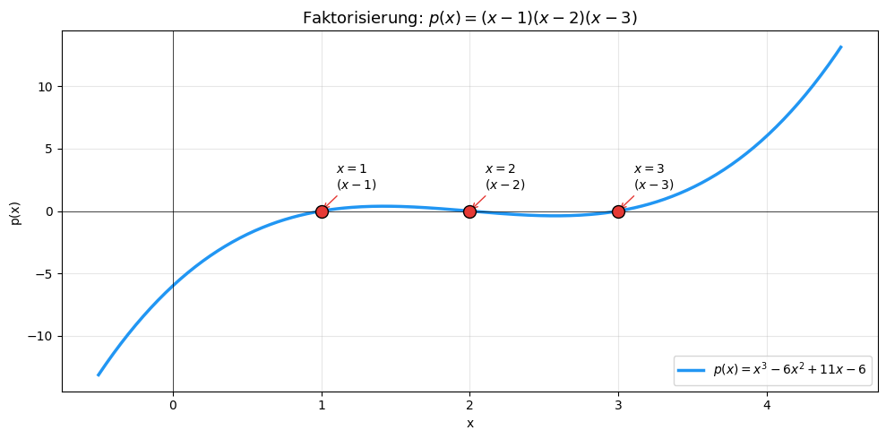

# Algebra

## 02 - Polynome & Polynomdivision

Polynome beliebigen Grades - Definition (Grad, Leitkoeffizient, Absolutglied), Addition/Subtraktion/Multiplikation, Polynomdivision, Horner-Schema, Faktorisierung und der Nullstellensatz.

> Vorausgesetzt: quadratische Gleichungen.

### Lernziele

- Du kennst die **Definition eines Polynoms** (Grad, Koeffizient, führender Term).
- Du kannst Polynome **addieren, subtrahieren und multiplizieren**.
- Du beherrschst die **Polynomdivision** (schriftliche Division).
- Du kennst das **Horner-Schema** als effiziente Methode zur Auswertung und Division.
- Du verstehst den **Nullstellensatz**: Kennt man eine Nullstelle $x_0$, so ist $(x - x_0)$ ein Faktor.
- Du kannst kubische und quartische Gleichungen durch schrittweise **Faktorisierung** lösen.

---

## 1. Definition und Grundbegriffe

Ein **Polynom** $n$-ten Grades ist ein Ausdruck der Form:

$$
p(x) = a_n x^n + a_{n-1} x^{n-1} + \cdots + a_1 x + a_0, \quad a_n \neq 0
$$

| Begriff | Bedeutung |
|---|---|
| **Grad** $n$ | Höchste Potenz mit Koeffizient $\neq 0$ |
| **Leitkoeffizient** $a_n$ | Koeffizient des höchsten Terms |
| **Absolutglied** $a_0$ | Koeffizient ohne $x$ (Wert bei $x = 0$) |
| **Monisches Polynom** | Leitkoeffizient $a_n = 1$ |

Der Grad wächst mit der höchsten vorhandenen Potenz: eine Konstante $5$ hat Grad 0, $3x - 7$ hat Grad 1, $x^2 - 4x + 4$ hat Grad 2 (Leitkoeffizient 1, also monisch), und $x^4 - 16$ hat Grad 4. Terme mit Koeffizient $0$ zählen beim Grad nicht - die Zahl $0$ selbst hat keinen definierten Grad.

> **Merke:** Bei der Angabe von Grad und Koeffizienten zählen nur Terme mit Koeffizient $\neq 0$. Die Null selbst hat keinen definierten Grad.

## 2. Polynomarithmetik

### Addition und Subtraktion

**Regel:** Gleichartige Terme (selbe Potenz) zusammenfassen.

**Beispiel:**
$$
(3x^3 - 2x^2 + x - 4) + (x^3 + 5x^2 - 3) = 4x^3 + 3x^2 + x - 7
$$

### Multiplikation

**Regel:** Jeden Term des ersten Polynoms mit jedem Term des zweiten multiplizieren (Distributivgesetz), dann sortieren.

**Beispiel:** $(x^2 + 2x - 1)(x - 3)$

$$
= x^3 - 3x^2 + 2x^2 - 6x - x + 3 = x^3 - x^2 - 7x + 3
$$

**Wichtige binomische Formeln:**

$$
(a + b)^2 = a^2 + 2ab + b^2
$$
$$
(a - b)^2 = a^2 - 2ab + b^2
$$
$$
(a + b)(a - b) = a^2 - b^2
$$

### Grad-Regeln

Beim Multiplizieren addieren sich die Grade - multipliziert man $x^3$ mit $x^2$, erhält man $x^5$, also Grad 3 + 2 = 5. Bei Addition hingegen kann sich der höchste Term wegheben, weshalb man nur eine obere Schranke angeben kann:

$$
\deg(p \cdot q) = \deg(p) + \deg(q)
$$
$$
\deg(p + q) \leq \max(\deg(p), \deg(q))
$$

## 3. Polynomdivision

Die **Polynomdivision** funktioniert wie die schriftliche Division von Zahlen. Sie teilt ein Polynom $p(x)$ durch ein Polynom $d(x)$ mit Ergebnis $q(x)$ (Quotient) und Rest $r(x)$:

$$
p(x) = q(x) \cdot d(x) + r(x), \quad \deg(r) < \deg(d)
$$

Wenn $r(x) = 0$, ist $d(x)$ ein **Teiler** von $p(x)$.

**Algorithmus (schriftlich):**

1. Führenden Term von $p(x)$ durch führenden Term von $d(x)$ dividieren → erster Term von $q(x)$.
2. Diesen Term mit $d(x)$ multiplizieren und von $p(x)$ subtrahieren.
3. Wiederholen mit dem Rest, bis $\deg(\text{Rest}) < \deg(d)$.

**Beispiel:** $(x^3 - 2x^2 - 5x + 6) \div (x - 2)$

Schritt für Schritt:

$$
\frac{x^3}{x} = x^2 \quad \Rightarrow \quad x^2 \cdot (x-2) = x^3 - 2x^2
$$
$$
\text{Rest: } (x^3 - 2x^2 - 5x + 6) - (x^3 - 2x^2) = -5x + 6
$$
$$
\frac{-5x}{x} = -5 \quad \Rightarrow \quad -5 \cdot (x-2) = -5x + 10
$$
$$
\text{Rest: } (-5x + 6) - (-5x + 10) = -4 \quad \Rightarrow \text{ Rest } \neq 0 \text{, also kein Teiler!}
$$

Probieren wir stattdessen $(x - 3)$:

$(x^3 - 2x^2 - 5x + 6) \div (x - 3)$:

$$
x^3 - 2x^2 - 5x + 6 = (x-3)(x^2 + x - 2) = (x-3)(x+2)(x-1)
$$

Nullstellen: $x_1 = 3,\ x_2 = -2,\ x_3 = 1$

> **Merke:** Ist $x_0$ eine Nullstelle, dann ist $(x - x_0)$ ein Teiler von $p(x)$ - und die Division geht **ohne Rest** auf.

## 4. Das Horner-Schema

Das **Horner-Schema** (auch: Horner-Methode) ist eine effiziente Kurzform für:

1. **Auswertung** von $p(x_0)$ (anstelle direktem Einsetzen)
2. **Division** von $p(x)$ durch $(x - x_0)$

**Idee:** Schreibe das Polynom als verschachteltes Produkt:

$$
a_n x^n + \cdots + a_1 x + a_0 = (\cdots((a_n \cdot x + a_{n-1}) \cdot x + a_{n-2}) \cdots) \cdot x + a_0
$$

**Schema:** Für $p(x) = a_n x^n + \cdots + a_0$ und Stelle $x_0$:

| | $a_n$ | $a_{n-1}$ | $a_{n-2}$ | $\cdots$ | $a_0$ |
|---|---|---|---|---|---|
| $x_0$ | $a_n$ | $b_{n-1}$ | $b_{n-2}$ | $\cdots$ | **Rest** |

Dabei: $b_k = b_{k+1} \cdot x_0 + a_k$ (mit $b_n = a_n$). Der letzte Wert ist $p(x_0)$ bzw. der Rest der Division.

**Beispiel:** $p(x) = x^3 - 2x^2 - 5x + 6$, Nullstelle $x_0 = 3$

| | $1$ | $-2$ | $-5$ | $6$ |
|---|---|---|---|---|
| $3$ | $1$ | $3 \cdot 1 + (-2) = 1$ | $3 \cdot 1 + (-5) = -2$ | $3 \cdot (-2) + 6 = 0$ |

Rest = $0$ ✓ → $x_0 = 3$ ist Nullstelle. Quotient: $q(x) = x^2 + x - 2$.

**Beispiel - Auswertung** $p(2)$:

| | $1$ | $-2$ | $-5$ | $6$ |
|---|---|---|---|---|
| $2$ | $1$ | $0$ | $-5$ | $-4$ |

$p(2) = -4$ (direkte Probe: $8 - 8 - 10 + 6 = -4$ ✓)

## 5. Nullstellensatz & Faktorisierung

Jede bekannte Nullstelle gibt dir einen **Linearfaktor** des Polynoms - und damit eine Möglichkeit, den Grad schrittweise zu reduzieren, bis nur noch lösbare Reste übrig bleiben. Das ist die Grundidee der vollständigen Faktorisierung.

**Fundamentalsatz der Algebra** (vereinfacht): Ein Polynom $n$-ten Grades hat in $\mathbb{C}$ genau $n$ Nullstellen (mit Vielfachheit). Im Reellen hat es **höchstens** $n$ reelle Nullstellen.

**Nullstellensatz:** Ist $x_0$ eine Nullstelle von $p(x)$, dann gilt:

$$
p(x) = (x - x_0) \cdot q(x)
$$

wobei $q(x)$ ein Polynom vom Grad $n - 1$ ist.

**Strategie zum vollständigen Faktorisieren:**

1. **Ganzzahlige Nullstellen** raten: Kandidaten sind Teiler des Absolutglieds $a_0$.
2. Mit Horner-Schema prüfen und abdividieren.
3. Den Quotient weiter faktorisieren (wiederholen).
4. Quadratische Reste mit abc-Formel lösen.

**Beispiel: Kubische Gleichung** $\quad x^3 - 6x^2 + 11x - 6 = 0$

Teiler von $6$: $\pm 1, \pm 2, \pm 3, \pm 6$. Teste $x_0 = 1$:

| | $1$ | $-6$ | $11$ | $-6$ |
|---|---|---|---|---|
| $1$ | $1$ | $-5$ | $6$ | $0$ |

Rest $= 0$ ✓. Quotient: $x^2 - 5x + 6 = (x-2)(x-3)$.

$$
x^3 - 6x^2 + 11x - 6 = (x-1)(x-2)(x-3) \implies x_1 = 1,\ x_2 = 2,\ x_3 = 3
$$

**Beispiel: Quartische Gleichung** $\quad x^4 - x^3 - 7x^2 + x + 6 = 0$

Teste $x_0 = 1$: Horner liefert $1 - 1 - 7 + 1 + 6 = 0$ ✓

Quotient: $x^3 - 7x - 6$. Teste $x_0 = -1$: $-1 + 7 - 6 = 0$ ✓

Quotient: $x^2 - x - 6 = (x-3)(x+2)$.

$$
\implies x_1 = 1,\ x_2 = -1,\ x_3 = 3,\ x_4 = -2
$$

    

    

    =======================================================
    Horner-Schema: Auswertung und Division
    =======================================================
    
      x³ - 2x² - 5x + 6, x₀ = 3
      Koeffizienten: [1, -2, -5, 6]
      p(3) = 0  → Nullstelle! ✓
      Quotient: [1, 1, -2]  → q(x) = x^2 + x - 2
    
      x³ - 2x² - 5x + 6, x₀ = 2 (Auswertung)
      Koeffizienten: [1, -2, -5, 6]
      p(2) = -4  → kein Teiler
    
      x³ - 6x² + 11x - 6, x₀ = 1
      Koeffizienten: [1, -6, 11, -6]
      p(1) = 0  → Nullstelle! ✓
      Quotient: [1, -5, 6]  → q(x) = x^2 - 5x + 6
    
    =======================================================
    Vollständige Faktorisierung: x³ - 6x² + 11x - 6
    =======================================================
    
      Schritt 1: x₀ = 1 → Rest = 0, Quotient = x^2 - 5x + 6
      Schritt 2: abc-Formel auf x^2 - 5x + 6 → x = [3.0, 2.0]
      Alle Nullstellen: [1, 3.0, 2.0]
    

---

## Verständnis-Check

#### Aufgabe 1: Polynomarithmetik

a) Addiere: $(2x^3 - x^2 + 4) + (x^3 + 3x^2 - x - 2)$

b) Multipliziere: $(x^2 - 3)(x + 2)$

c) Multipliziere aus und vereinfache: $(2x + 1)^2 - (x - 3)(x + 3)$

#### Aufgabe 2: Polynomdivision

Führe die Division durch und gib Quotient und Rest an:

a) $(x^3 + 2x^2 - 5x - 6) \div (x - 2)$

b) $(2x^3 - 3x^2 + x - 5) \div (x + 1)$

#### Aufgabe 3: Horner-Schema

Verwende das Horner-Schema:

a) Berechne $p(2)$ für $p(x) = x^4 - 3x^3 + 2x - 7$.

b) Zeige, dass $x_0 = -2$ eine Nullstelle von $p(x) = x^3 + x^2 - 4x - 4$ ist, und bestimme den Quotienten.

#### Aufgabe 4: Faktorisierung

Bestimme alle Nullstellen durch schrittweise Faktorisierung:

a) $x^3 - 3x^2 - 4x + 12 = 0$

b) $x^3 + 2x^2 - x - 2 = 0$

c) $x^4 - 5x^2 + 4 = 0$ (Hinweis: auch als biquadratisch lösbar)

### Lösungen

Lösung Aufgabe 1

a) $(2x^3 + x^3) + (-x^2 + 3x^2) + (-x) + (4 - 2) = 3x^3 + 2x^2 - x + 2$

b) $x^3 + 2x^2 - 3x - 6$

c) $(4x^2 + 4x + 1) - (x^2 - 9) = 3x^2 + 4x + 10$

Lösung Aufgabe 2

a) $(x^3 + 2x^2 - 5x - 6) \div (x - 2)$: Teste $x_0 = 2$: $p(2) = 8 + 8 - 10 - 6 = 0$ → Teiler.
Quotient: $x^2 + 4x + 3 = (x+1)(x+3)$. Rest: $0$.

b) $(2x^3 - 3x^2 + x - 5) \div (x + 1)$: $p(-1) = -2 - 3 - 1 - 5 = -11 \neq 0$ → Rest $-11$.
Quotient: $2x^2 - 5x + 6$, Rest: $-11$.

Lösung Aufgabe 3

a) Horner mit $x_0 = 2$ auf $[1, -3, 0, 2, -7]$:
$1 \to 2\cdot1 - 3 = -1 \to 2\cdot(-1)+0 = -2 \to 2\cdot(-2)+2 = -2 \to 2\cdot(-2)-7 = -11$
$p(2) = -11$

b) Horner mit $x_0 = -2$ auf $[1, 1, -4, -4]$:
$1 \to -2+1=-1 \to 2+(-4)=-2 \to 4+(-4)=0$ → Rest $= 0$ ✓
Quotient: $x^2 - x - 2 = (x-2)(x+1)$. Nullstellen: $-2, 2, -1$.

Lösung Aufgabe 4

a) Teste $x_0 = 2$: $8 - 12 - 8 + 12 = 0$ ✓. Quotient: $x^2 - x - 6 = (x-3)(x+2)$.
Nullstellen: $x = 2, 3, -2$.

b) Teste $x_0 = 1$: $1 + 2 - 1 - 2 = 0$ ✓. Quotient: $x^2 + 3x + 2 = (x+1)(x+2)$.
Nullstellen: $x = 1, -1, -2$.

c) Substitution $u = x^2$: $u^2 - 5u + 4 = 0 \implies u = 1$ oder $u = 4$.
Nullstellen: $x = \pm 1, \pm 2$.

---

## Zusammenfassung

| Konzept | Kernaussage |
|---------|-------------|
| Polynom | $p(x) = a_n x^n + \cdots + a_0$, Grad = höchste Potenz |
| Polynomarithmetik | Addition: gleichartige Terme; Multiplikation: Distributivgesetz |
| Polynomdivision | Schriftliche Division liefert Quotient + Rest |
| Horner-Schema | Effiziente Auswertung und Division durch $(x - x_0)$ |
| Nullstellensatz | Ist $p(x_0) = 0$, dann ist $(x - x_0)$ ein Teiler |
| Faktorisierung | Schrittweise abdividieren → alle Nullstellen finden |

---

## Glossar

| Deutsch | English |
|---------|---------|
| Polynom | Polynomial |
| Grad | Degree |
| Leitkoeffizient | Leading coefficient |
| Absolutglied | Constant term |
| Monisches Polynom | Monic polynomial |
| Polynomdivision | Polynomial long division |
| Quotient | Quotient |
| Rest | Remainder |
| Horner-Schema | Horner's method / synthetic division |
| Nullstellensatz | Factor theorem |
| Faktorisierung | Factorization |
| Vielfachheit | Multiplicity |
| Teiler | Factor / divisor |
| Abdividieren | Divide out (a factor) |

