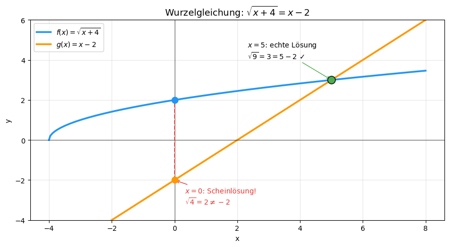

# Algebra

## 03 - Weitere Gleichungstypen

Wurzelgleichungen (quadrieren), Bruchgleichungen und Betragsgleichungen (Fallunterscheidung) per einem einheitliches Vorgehen: Definitionsmenge → lösen → Probe.

> Vorausgesetzt: lineare und quadratische Gleichungen.
### Lernziele

- Du kannst die **Definitionsmenge** bei Wurzel-, Bruch- und Betragsgleichungen bestimmen.
- Du löst **Wurzelgleichungen** durch Quadrieren und erkennst Scheinlösungen.
- Du löst **Bruchgleichungen** durch Multiplizieren mit dem Hauptnenner und schließt unzulässige Lösungen aus.
- Du löst **Betragsgleichungen** durch Fallunterscheidung.
- Du führst stets eine **Probe** durch.

---

## 1. Der rote Faden

Alle drei Gleichungstypen erfordern dasselbe strukturierte Vorgehen:

| Schritt | Was tun? | Warum? |
|---|---|---|
| **1. Definitionsmenge** | Bestimme, für welche $x$ der Ausdruck definiert ist | Nenner $\neq 0$; Radikand $\geq 0$ |
| **2. Umformung** | Eliminiere Wurzel/Bruch/Betrag durch Äquivalenzumformungen | Gleichung lösbar machen |
| **3. Lösen** | Löse die vereinfachte Gleichung (linear/quadratisch/…) | Kandidaten für Lösungen finden |
| **4. Probe** | Setze jeden Kandidaten in die **Originalgleichung** ein | Scheinlösungen ausschließen |

> **Merke:** Quadrieren und Multiplizieren mit Variablenausdrücken sind **keine** Äquivalenzumformungen - sie können Scheinlösungen erzeugen. Die Probe ist daher **Pflicht**.

## 2. Wurzelgleichungen

Eine **Wurzelgleichung** enthält die Unbekannte unter einem Wurzelzeichen.

**Definitionsmenge:** Der **Radikand** (Ausdruck unter der Wurzel) muss $\geq 0$ sein.

**Lösungsstrategie:** Isoliere die Wurzel, dann quadriere beide Seiten.

> **Warum entstehen Scheinlösungen?** $\sqrt{\cdot}$ ist per Definition **nicht-negativ**. Beim Quadrieren geht diese Information verloren - plötzlich hat auch $-5 = 5$ dieselbe Quadratsumme. Kandidaten, bei denen die Wurzelseite negativ wäre, scheiden durch die Probe aus.

**Beispiel 1:** $\quad \sqrt{2x - 3} = 5$

**DM:** $2x - 3 \geq 0 \implies x \geq \frac{3}{2}$

$$
\sqrt{2x - 3} = 5 \implies 2x - 3 = 25 \implies x = 14
$$

**Probe:** $\sqrt{2 \cdot 14 - 3} = \sqrt{25} = 5$ ✓

**Beispiel 2 (Scheinlösung):** $\quad \sqrt{x + 4} = x - 2$

**DM:** $x \geq -4$ und $x - 2 \geq 0 \implies x \geq 2$

$$
x + 4 = (x-2)^2 = x^2 - 4x + 4 \implies x^2 - 5x = 0 \implies x(x-5) = 0
$$
$$
x_1 = 0, \quad x_2 = 5
$$

**Probe:**
- $x = 0$: $\sqrt{4} = 2$ aber $0 - 2 = -2 \neq 2$ ✗ → **Scheinlösung!**
- $x = 5$: $\sqrt{9} = 3$ und $5 - 2 = 3$ ✓

**Lösung:** $x = 5$

**Beispiel 3 (zwei Wurzeln):** $\quad \sqrt{x + 3} - \sqrt{x - 1} = 1$

**DM:** $x \geq 1$

$$
\sqrt{x+3} = 1 + \sqrt{x-1} \implies x + 3 = 1 + 2\sqrt{x-1} + (x-1)
$$
$$
3 = 2\sqrt{x-1} \implies \sqrt{x-1} = \frac{3}{2} \implies x - 1 = \frac{9}{4} \implies x = \frac{13}{4}
$$

**Probe:** $\sqrt{\frac{25}{4}} - \sqrt{\frac{9}{4}} = \frac{5}{2} - \frac{3}{2} = 1$ ✓

    

    

## 3. Bruchgleichungen

Eine **Bruchgleichung** enthält die Unbekannte im Nenner eines Bruchs.

**Definitionsmenge:** Alle Nennerbedingungen müssen erfüllt sein ($\text{Nenner} \neq 0$).

**Lösungsstrategie:** Multipliziere beide Seiten mit dem **Hauptnenner** (kgV aller Nenner).

**Beispiel 1:** $\quad \dfrac{3}{x} + \dfrac{1}{x + 2} = 1$

**DM:** $x \neq 0$ und $x \neq -2$

Hauptnenner: $x(x+2)$. Multipliziere:

$$
3(x + 2) + x = x(x + 2)
$$
$$
3x + 6 + x = x^2 + 2x \implies x^2 - 2x - 6 = 0
$$
$$
x_{1,2} = 1 \pm \sqrt{7}
$$

**Probe:** Weder $1 + \sqrt{7}$ noch $1 - \sqrt{7}$ ist $0$ oder $-2$ → beide Lösungen gültig.

**Beispiel 2 (Scheinlösung):** $\quad \dfrac{x}{x-1} - \dfrac{2}{x+1} = \dfrac{2x^2 - x - 3}{x^2 - 1}$

**DM:** $x \neq 1$ und $x \neq -1$

Beachte: $x^2 - 1 = (x-1)(x+1)$. Hauptnenner: $(x-1)(x+1)$. Multipliziere:

$$
x(x+1) - 2(x-1) = 2x^2 - x - 3
$$
$$
x^2 + x - 2x + 2 = 2x^2 - x - 3 \implies x^2 - 5 = 0 \implies x = \pm\sqrt{5}
$$

Weder $+\sqrt{5}$ noch $-\sqrt{5}$ liegt bei $\pm 1$ → beide gültig.

**Beispiel 3 (alle Lösungen ausgeschlossen):** $\quad \dfrac{x+2}{x-1} = \dfrac{3}{x-1}$

**DM:** $x \neq 1$. Multipliziere mit $(x-1)$:

$$
x + 2 = 3 \implies x = 1
$$

$x = 1$ liegt außerhalb der DM → **keine Lösung!** $\mathbb{L} = \{\}$

> **Merke:** Prüfe nach dem Lösen, ob alle Kandidaten in der DM liegen. Liegen sie außerhalb, sind es Scheinlösungen.

## 4. Betragsgleichungen

Eine **Betragsgleichung** enthält die Unbekannte unter einem Absolutbetragszeichen $|\cdot|$. Sie tauchen auf, wenn man Abstände beschreibt oder Toleranzbereiche modelliert - $|x - 5| = 2$ bedeutet etwa "genau 2 Einheiten von 5 entfernt", also $x = 3$ oder $x = 7$.

**Grundprinzip:** $|A| = B$ (mit $B \geq 0$) ist äquivalent zu:

$$
A = B \quad \text{oder} \quad A = -B
$$

**Lösungsstrategie:** Fallunterscheidung anhand des Ausdrucks im Betrag.

**Beispiel 1:** $\quad |2x - 6| = 4$

$$
\text{Fall 1: } 2x - 6 = 4 \implies x = 5
$$
$$
\text{Fall 2: } 2x - 6 = -4 \implies x = 1
$$

**Probe:** $|2 \cdot 5 - 6| = |4| = 4$ ✓ und $|2 \cdot 1 - 6| = |-4| = 4$ ✓

**Beispiel 2 (zwei Beträge):** $\quad |x + 1| = |2x - 3|$

$$
\text{Fall 1: } x + 1 = 2x - 3 \implies x = 4
$$
$$
\text{Fall 2: } x + 1 = -(2x - 3) \implies x + 1 = -2x + 3 \implies 3x = 2 \implies x = \frac{2}{3}
$$

**Probe:** $|5| = |5|$ ✓ und $|\frac{5}{3}| = |\frac{-5}{3}|$ ✓

**Beispiel 3 (quadratisch nach Fallunterscheidung):** $\quad |x^2 - 4| = 5$

$$
\text{Fall 1: } x^2 - 4 = 5 \implies x^2 = 9 \implies x = \pm 3
$$
$$
\text{Fall 2: } x^2 - 4 = -5 \implies x^2 = -1 \implies \text{keine reelle Lösung}
$$

**Lösung:** $x = 3$ oder $x = -3$

**Betragsungleichungen** (kurze Erinnerung, → auch in 00_Grundlagen):

$$
|A| < r \iff -r < A < r \qquad\qquad |A| > r \iff A < -r \text{ oder } A > r
$$

    =======================================================
    Probe: Wurzel-, Bruch- und Betragsgleichungen
    =======================================================
    
      Gleichung: √(x+4) = x-2
      x = 0: außerhalb DM → Scheinlösung ✗
      x = 5: links = 3, rechts = 3  ✓
    
      Gleichung: 3/x + 1/(x+2) = 1
      x = -1.6458  (✓)
      x = 3.6458  (✓)
    
      Gleichung: |2x-6| = 4
      x = 5: links = 4, rechts = 4  ✓
      x = 1: links = 4, rechts = 4  ✓
    
      Gleichung: (x+2)/(x-1) = 3/(x-1)
      x = 1: außerhalb DM → Scheinlösung ✗

---

## Verständnis-Check

#### Aufgabe 1: Wurzelgleichungen

Bestimme die DM, löse und mache die Probe:

a) $\sqrt{3x + 1} = 4$

b) $\sqrt{x - 2} = x - 4$

c) $\sqrt{2x + 5} + 1 = x$

#### Aufgabe 2: Bruchgleichungen

Bestimme die DM, löse und prüfe auf Scheinlösungen:

a) $\dfrac{4}{x} - \dfrac{1}{x + 3} = 1$

b) $\dfrac{x}{x - 2} + \dfrac{2}{x + 2} = \dfrac{8}{x^2 - 4}$

c) $\dfrac{1}{x - 1} = \dfrac{2}{x + 1}$

#### Aufgabe 3: Betragsgleichungen

a) $|3x - 2| = 7$

b) $|x + 5| = |2x - 1|$

c) $|x^2 - 9| = 7$

### Lösungen

Lösung Aufgabe 1: Wurzelgleichungen

a) $\sqrt{3x+1} = 4$: DM: $x \geq -\frac{1}{3}$. Quadrieren: $3x + 1 = 16 \implies x = 5$.
Probe: $\sqrt{16} = 4$ ✓

b) $\sqrt{x-2} = x-4$: DM: $x \geq 2$ und $x \geq 4$, also $x \geq 4$. Quadrieren:
$x - 2 = x^2 - 8x + 16 \implies x^2 - 9x + 18 = 0 \implies x_1 = 6, x_2 = 3$.
Probe: $x = 3 < 4$ → Scheinlösung. $x = 6$: $\sqrt{4} = 2 = 6-4$ ✓. **Lösung: $x = 6$**

c) $\sqrt{2x+5} + 1 = x$: DM: $x \geq -\frac{5}{2}$ und $x \geq 1$. Isolieren: $\sqrt{2x+5} = x-1$.
Quadrieren: $2x+5 = x^2 - 2x + 1 \implies x^2 - 4x - 4 = 0 \implies x = 2 \pm 2\sqrt{2}$.
Nur $x = 2 + 2\sqrt{2} \approx 4{,}83$ ist $\geq 1$. Probe prüft ✓.

Lösung Aufgabe 2: Bruchgleichungen

a) DM: $x \neq 0, x \neq -3$. Hauptnenner $x(x+3)$:
$4(x+3) - x = x(x+3) \implies 3x + 12 = x^2 + 3x \implies x^2 = 12 \implies x = \pm 2\sqrt{3}$.
Beide liegen in DM ✓.

b) DM: $x \neq 2, x \neq -2$. Hauptnenner $(x-2)(x+2)$:
$x(x+2) + 2(x-2) = 8 \implies x^2 + 4x - 12 = 0 \implies x = 2$ oder $x = -6$.
$x = 2$ liegt nicht in DM → Scheinlösung. **Lösung: $x = -6$**

c) DM: $x \neq 1, x \neq -1$. Multiplizieren mit $(x-1)(x+1)$:
$x + 1 = 2(x-1) \implies x + 1 = 2x - 2 \implies x = 3$. In DM ✓.

Lösung Aufgabe 3: Betragsgleichungen

a) Fall 1: $3x - 2 = 7 \implies x = 3$. Fall 2: $3x - 2 = -7 \implies x = -\frac{5}{3}$.

b) Fall 1: $x + 5 = 2x - 1 \implies x = 6$. Fall 2: $x + 5 = -(2x-1) \implies 3x = -4 \implies x = -\frac{4}{3}$.

c) Fall 1: $x^2 - 9 = 7 \implies x^2 = 16 \implies x = \pm 4$. Fall 2: $x^2 - 9 = -7 \implies x^2 = 2 \implies x = \pm\sqrt{2}$.

---

## Zusammenfassung

| Konzept | Kernaussage |
|---------|-------------|
| Roter Faden | DM bestimmen → lösen → Probe (Scheinlösungen ausschließen) |
| Wurzelgleichungen | Wurzel isolieren, quadrieren; Radikand $\geq 0$ |
| Bruchgleichungen | Mit Hauptnenner multiplizieren; Nenner $\neq 0$ |
| Betragsgleichungen | Fallunterscheidung: $\|A\| = B \iff A = B$ oder $A = -B$ |
| Scheinlösungen | Entstehen durch Quadrieren / Multiplizieren - Probe ist Pflicht |

---

## Glossar

| Deutsch | English |
|---------|---------|
| Wurzelgleichung | Radical equation |
| Bruchgleichung | Rational equation |
| Betragsgleichung | Absolute value equation |
| Definitionsmenge | Domain |
| Radikand | Radicand |
| Hauptnenner | Least common denominator (LCD) |
| Scheinlösung | Extraneous solution |
| Probe | Verification / check |
| Fallunterscheidung | Case analysis |
| Unzulässige Lösung | Inadmissible solution |
| Äquivalenzumformung | Equivalent transformation |

