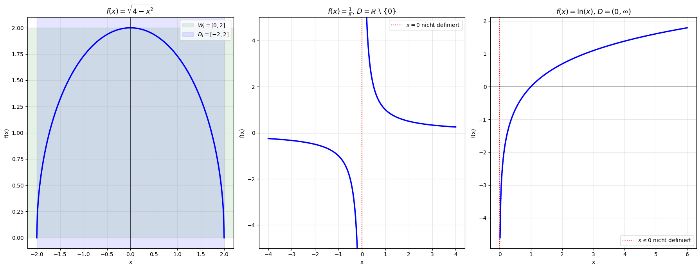
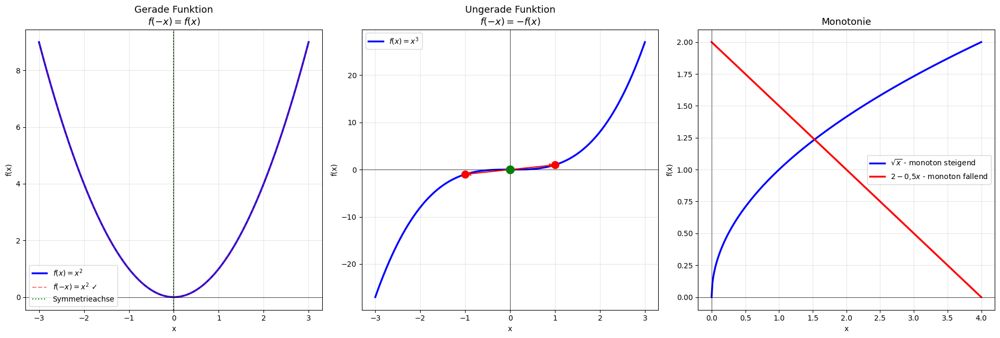
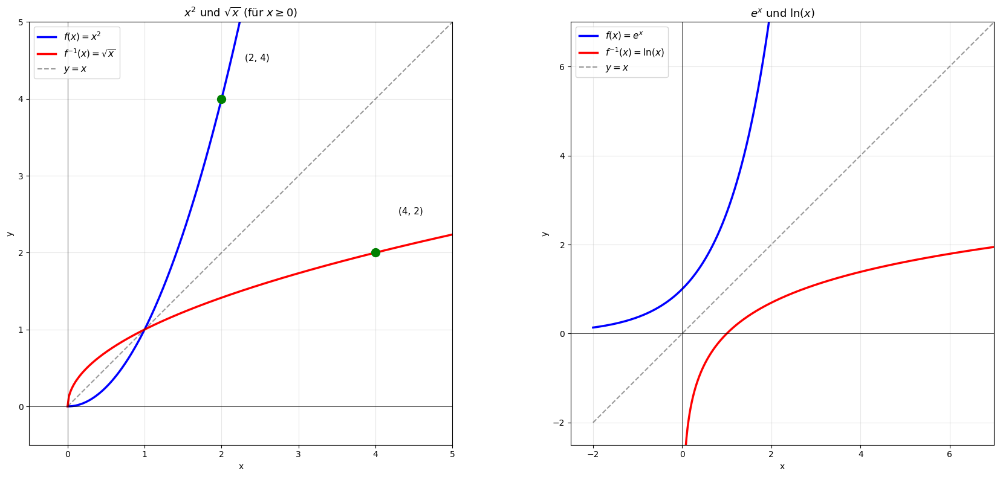

# Funktionen

## 01 - Grundlagen der Funktion

Funktionen sind eines der zentralen Konzepte in der Mathematik. Grundlegend beschreiben sie eine Beziehung zwischen zwei Mengen: Jeder Eingabe (aus dem Definitionsbereich) wird genau eine Ausgabe (im Wertebereich) zugeordnet. Das ist auf erstaunlich viele Situationen anwendbar, was in den kommenden Kapiteln deutlich wird.

Dieses Kapitel behandelt den Funktionsbegriff ($f: D \to W$, jedem $x$ genau ein $y$), Definitions- und Wertebereich, vier Darstellungsformen (Graph, Tabelle, Formel, Text), Eigenschaften (Monotonie, Symmetrie, Nullstellen) und Umkehrfunktion.

> Vorausgesetzt: grundlegende Algebra, Terme, Gleichungen.

### Lernziele

- Den **Funktionsbegriff** formal und anschaulich erklären
- **Definitionsbereich** und **Wertebereich** einer Funktion bestimmen
- Funktionen in verschiedenen **Darstellungsformen** erkennen und umwandeln
- Wichtige **Eigenschaften** von Funktionen benennen (Monotonie, Symmetrie, Nullstellen)
- Die **Umkehrfunktion** bestimmen, wenn sie existiert

---

### 1. Was ist eine Funktion?

Eine **Funktion** $f$ ist eine Zuordnung, die jedem Element $x$ aus einer Menge $D$ **genau ein** Element $y$ aus einer Menge $W$ zuordnet.

$$f: D \to W, \quad x \mapsto f(x) = y$$

| Begriff | Bedeutung |
|---------|----------|
| $x$ | Argument / unabhängige Variable |
| $f(x) = y$ | Funktionswert / abhängige Variable |
| $D = D_f$ | Definitionsbereich - alle zulässigen $x$-Werte |
| $W = W_f$ | Wertebereich - alle tatsächlich angenommenen $y$-Werte |

**Entscheidend:** Jedem $x$ wird *genau ein* $y$ zugeordnet. Umgekehrt darf aber ein $y$-Wert von mehreren $x$-Werten erreicht werden.

**Gegenbeispiel:** Die Gleichung $x^2 + y^2 = 1$ (Kreis) ist *keine* Funktion, da zu manchen $x$-Werten zwei $y$-Werte gehören.

---

### Darstellungsformen

Funktionen lassen sich auf verschiedene Arten beschreiben:

| Form | Beispiel |
|------|----------|
| **Funktionsgleichung** | $f(x) = 2x + 1$ |
| **Wertetabelle** | $x = 0 \to 1,\; x = 1 \to 3,\; x = 2 \to 5$ |
| **Graph** | Punkte $(x, f(x))$ im Koordinatensystem |
| **Verbal** | „Die Temperatur steigt pro Stunde um 2°C" |
| **Mengenschreibweise** | $f = \{(0, 1),\; (1, 3),\; (2, 5)\}$ |

### 2. Definitionsbereich und Wertebereich

Der **Definitionsbereich** $D_f$ enthält alle $x$-Werte, für die $f(x)$ definiert ist.  
Der **Wertebereich** $W_f$ enthält alle $y$-Werte, die $f$ tatsächlich annimmt.

**Typische Einschränkungen des Definitionsbereichs:**

| Situation | Bedingung | Beispiel |
|-----------|-----------|----------|
| Division durch 0 | Nenner $\ne 0$ | $f(x) = \frac{1}{x}$: $D = \mathbb{R} \setminus \{0\}$ |
| Wurzel aus negativer Zahl | Radikand $\ge 0$ | $f(x) = \sqrt{x}$: $D = [0, \infty)$ |
| Logarithmus | Argument $> 0$ | $f(x) = \ln(x)$: $D = (0, \infty)$ |
| Kombination | Beide Bedingungen | $f(x) = \frac{1}{\sqrt{x-2}}$: $D = (2, \infty)$ |

**Beispiel:** $f(x) = \sqrt{4 - x^2}$
- Bedingung: $4 - x^2 \ge 0 \Rightarrow x^2 \le 4 \Rightarrow -2 \le x \le 2$
- $D_f = [-2, 2]$, $W_f = [0, 2]$

    

    

### 3. Eigenschaften von Funktionen

Funktionen lassen sich anhand verschiedener Eigenschaften charakterisieren - das hilft dabei, ihr Verhalten schnell einzuschätzen, ohne den gesamten Graphen zu kennen.

| Eigenschaft | Definition | Beispiel |
|-------------|------------|----------|
| **Nullstellen** | $f(x) = 0$ | $f(x) = x^2 - 4$: Nullstellen bei $x = \pm 2$ |
| **Monoton steigend** | $x_1 < x_2 \Rightarrow f(x_1) \le f(x_2)$ | $f(x) = x^3$ auf $\mathbb{R}$ |
| **Monoton fallend** | $x_1 < x_2 \Rightarrow f(x_1) \ge f(x_2)$ | $f(x) = -x$ auf $\mathbb{R}$ |
| **Beschränkt** | $f(x)$ nimmt nicht beliebig große Werte an | $f(x) = \sin(x)$: $W = [-1, 1]$ |
| **Periodisch** | $f(x + p) = f(x)$ für alle $x$ | $\sin(x)$ mit Periode $p = 2\pi$ |

---

Ein Sonderfall der Eigenschaften ist die Symmetrie. Wer weiß, dass $f$ gerade ist, kennt automatisch die linke Hälfte des Graphen aus der rechten - das vereinfacht Skizzen und Berechnungen erheblich.

| Typ | Bedingung | Grafisch | Beispiel |
|-----|-----------|----------|----------|
| **Gerade** (achsensymmetrisch) | $f(-x) = f(x)$ | Spiegelung an y-Achse | $x^2, \cos(x)$ |
| **Ungerade** (punktsymmetrisch) | $f(-x) = -f(x)$ | Drehung um Ursprung ($180 \degree$) | $x^3, \sin(x)$ |
| **Ungerade** (punktsymmetrisch) | $f(-x) = -f(x)$ | Drehung um Ursprung ($180 \degree$) | $x^3, \sin(x)$ | **Weder noch** | Keine der beiden | Kein Symmetriemuster | $e^x, x^2 + x$ |
| **Weder noch** | Keine der beiden | Kein Symmetriemuster | $e^x, x^2 + x$ |

    

    

### 4. Umkehrfunktion

Die **Umkehrfunktion** $f^{-1}$ kehrt die Zuordnung um: Statt $x \mapsto y$ wird $y \mapsto x$.

$$f^{-1}(f(x)) = x \quad \text{und} \quad f(f^{-1}(y)) = y$$

**Voraussetzung:** $f$ muss **injektiv** (eineindeutig) sein - jeder $y$-Wert wird höchstens einmal angenommen. Das ist genau dann der Fall, wenn $f$ **streng monoton** ist.

**Bestimmung der Umkehrfunktion:**
1. Schreibe $y = f(x)$
2. Löse nach $x$ auf
3. Vertausche $x$ und $y$

**Beispiel:** $f(x) = 2x + 3$
1. $y = 2x + 3$
2. $x = \frac{y - 3}{2}$
3. $f^{-1}(x) = \frac{x - 3}{2}$

**Grafisch:** Der Graph von $f^{-1}$ entsteht durch Spiegelung des Graphen von $f$ an der Geraden $y = x$.

| Funktion | Umkehrfunktion |
|----------|----------------|
| $f(x) = x^2$ (für $x \ge 0$) | $f^{-1}(x) = \sqrt{x}$ |
| $f(x) = e^x$ | $f^{-1}(x) = \ln(x)$ |
| $f(x) = \sin(x)$ (für $x \in [-\frac{\pi}{2}, \frac{\pi}{2}]$) | $f^{-1}(x) = \arcsin(x)$ |

    

    

### 5. Überblick: Funktionstypen

Die folgenden Funktionstypen werden in den nächsten Abschnitten einzeln behandelt:

| Typ | Allgemeine Form | Beispiel | Abschnitt |
|-----|----------------|----------|----------|
| Linear | $f(x) = kx + d$ | $f(x) = 2x + 1$ | 03 |
| Quadratisch | $f(x) = ax^2 + bx + c$ | $f(x) = x^2 - 4$ | 03 |
| Potenzfunktion | $f(x) = x^n$ | $f(x) = x^3$ | 04 |
| Polynomfunktion | $f(x) = a_nx^n + \ldots + a_0$ | $f(x) = x^3 - 3x$ | 04 |
| Exponentialfunktion | $f(x) = a^x$ | $f(x) = e^x$ | 05 |
| Logarithmusfunktion | $f(x) = \log_a(x)$ | $f(x) = \ln(x)$ | 05 |
| Trigonometrisch | $\sin, \cos, \tan$ | $f(x) = \sin(x)$ | → 04_Trig |
| Rational | $f(x) = \frac{p(x)}{q(x)}$ | $f(x) = \frac{1}{x}$ | 04 |

---

## Verständnis-Check

*Löse die folgenden Aufgaben auf Papier.*

**Aufgabe 1:** Bestimme den Definitionsbereich von $f(x) = \dfrac{\sqrt{x+3}}{x-1}$.

**Aufgabe 2:** Ist $f(x) = x^4 - 2x^2$ eine gerade, ungerade oder weder-noch-Funktion?

**Aufgabe 3:** Bestimme die Umkehrfunktion von $f(x) = 3x - 7$.

**Aufgabe 4:** Eine Funktion $f$ hat den Definitionsbereich $D = [-2, 5]$ und den Wertebereich $W = [0, 9]$. Welchen Definitions- und Wertebereich hat $f^{-1}$?

### Lösungen

Lösung Aufgabe 1

Zwei Bedingungen:
1. Wurzel: $x + 3 \ge 0 \Rightarrow x \ge -3$
2. Nenner: $x \ne 1$

$$D_f = [-3, \infty) \setminus \{1\} = [-3, 1) \cup (1, \infty)$$

Lösung Aufgabe 2

Prüfe $f(-x)$:
$$f(-x) = (-x)^4 - 2(-x)^2 = x^4 - 2x^2 = f(x)$$

$f(-x) = f(x)$ → **gerade Funktion** (achsensymmetrisch zur y-Achse).

Lösung Aufgabe 3

1. $y = 3x - 7$
2. $x = \frac{y + 7}{3}$
3. $f^{-1}(x) = \frac{x + 7}{3}$

Probe: $f(f^{-1}(x)) = 3 \cdot \frac{x+7}{3} - 7 = x$ ✓

Lösung Aufgabe 4

Bei der Umkehrfunktion werden Definitions- und Wertebereich vertauscht:
$$D_{f^{-1}} = W_f = [0, 9] \qquad W_{f^{-1}} = D_f = [-2, 5]$$

---

## Zusammenfassung

| Konzept | Kernaussage |
|---------|-------------|
| **Funktion** | Zuordnung $x \mapsto f(x)$, jedem $x$ genau ein $y$ |
| **Definitionsbereich** | Alle zulässigen $x$-Werte |
| **Wertebereich** | Alle tatsächlich angenommenen $y$-Werte |
| **Vertikale-Linie-Test** | Graph ist Funktion ⟺ jede Vertikale schneidet höchstens einmal |
| **Monotonie** | Steigend/fallend - Verhalten des Funktionswerts |
| **Symmetrie** | Gerade: $f(-x)=f(x)$, Ungerade: $f(-x)=-f(x)$ |
| **Umkehrfunktion** | Spiegelung an $y=x$, existiert bei strenger Monotonie |

---

## Glossar

| Deutsch | Englisch |
|---------|----------|
| Funktion | Function |
| Definitionsbereich | Domain |
| Wertebereich | Range / Codomain |
| Zuordnung | Mapping |
| Nullstelle | Zero / Root |
| Monotonie | Monotonicity |
| Gerade Funktion | Even function |
| Ungerade Funktion | Odd function |
| Umkehrfunktion | Inverse function |
| Injektiv / Eineindeutig | Injective / One-to-one |
