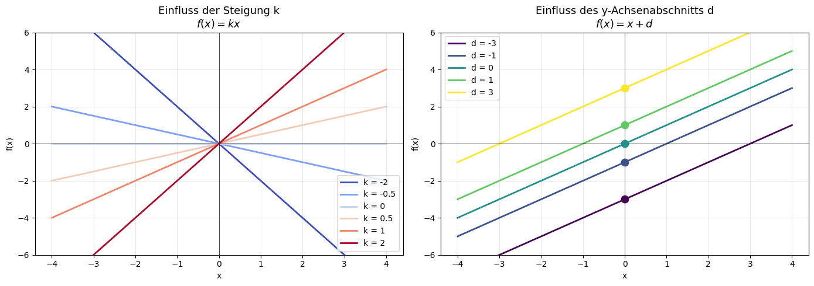
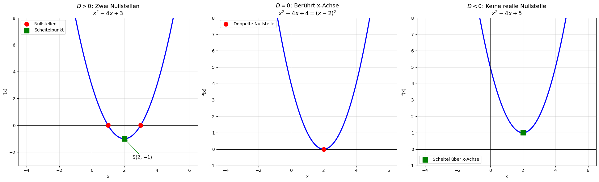
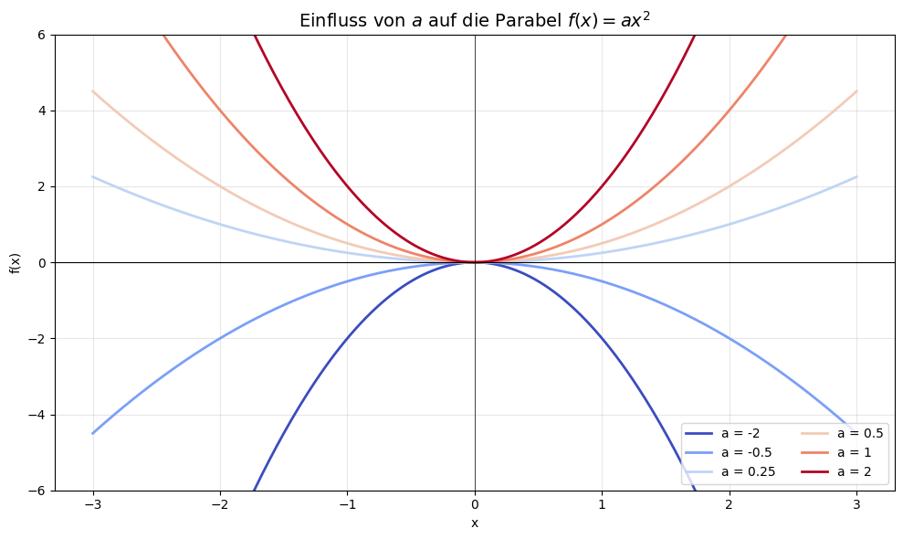
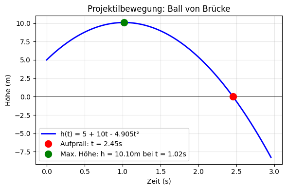
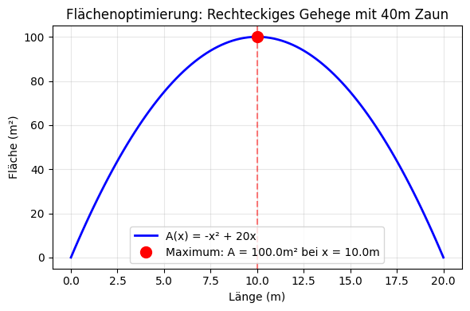

# Funktionen

## 03 - Lineare und Quadratische Funktionen

Lineare Funktionen ($f(x) = kx + d$: Steigung, y-Achsenabschnitt, Nullstelle) und quadratische Funktionen - Umwandlung zwischen Normalform, Scheitelpunktform und Produktform; Nullstellen und Scheitelpunkt.

> Vorausgesetzt: Funktionsbegriff, quadratische Gleichungen.

### Lernziele

- **Lineare Funktionen** aufstellen, zeichnen und ihre Parameter deuten
- **Quadratische Funktionen** in Normal-, Scheitel- und Produktform umwandeln
- **Nullstellen** und **Scheitelpunkt** berechnen
- Beide Funktionstypen sicher auf Papier skizzieren

---

## Teil A: Lineare Funktionen

### 1. Definition und Parameter

Eine **lineare Funktion** hat die allgemeine Form:

$$f(x) = kx + d$$

| Parameter | Bedeutung | Grafisch |
|-----------|-----------|----------|
| $k$ | **Steigung** (Änderungsrate) | Neigung der Geraden |
| $d$ | **y-Achsenabschnitt** | Schnittpunkt mit der y-Achse |

**Steigung $k$:**  
Die Steigung gibt an, um wie viele Einheiten sich $f(x)$ ändert, wenn $x$ um 1 zunimmt.

$$k = \frac{\Delta y}{\Delta x} = \frac{f(x_2) - f(x_1)}{x_2 - x_1}$$

Ist $k > 0$, steigt die Gerade von links nach rechts; ist $k < 0$, fällt sie. Für $k = 0$ ergibt sich eine horizontale Gerade. Je größer $|k|$, desto steiler der Graph.

**Nullstelle:** $f(x) = 0 \Rightarrow x = -\frac{d}{k}$ (für $k \ne 0$)

---

### Geradengleichung aufstellen

Kennt man die Steigung und einen Punkt - oder zwei Punkte - lässt sich die Geradengleichung direkt aufstellen:

| Gegeben | Methode |
|---------|---------|
| Steigung $k$ + Punkt $P(x_0, y_0)$ | $f(x) = k(x - x_0) + y_0$ |
| Zwei Punkte $P_1, P_2$ | $k = \frac{y_2 - y_1}{x_2 - x_1}$, dann einsetzen |

    

    

## Teil B: Quadratische Funktionen

### 2. Die drei Darstellungsformen

| Form | Formel | Daraus direkt ablesbar |
|------|--------|------------------------|
| **Normalform** | $f(x) = ax^2 + bx + c$ | y-Achsenabschnitt $c$ |
| **Scheitelpunktform** | $f(x) = a(x - h)^2 + k$ | Scheitelpunkt $S(h, k)$ |
| **Produktform** | $f(x) = a(x - x_1)(x - x_2)$ | Nullstellen $x_1, x_2$ |

**Parameter $a$:**

| $a$ | Wirkung |
|-----|--------|
| $a > 0$ | Parabel nach oben geöffnet (U-Form) |
| $a < 0$ | Parabel nach unten geöffnet (∩-Form) |
| $\|a\| > 1$ | Schmaler (gestreckt) |
| $\|a\| < 1$ | Breiter (gestaucht) |

---

### 3. Scheitelpunkt

Der **Scheitelpunkt** $S(h, k)$ ist der höchste oder tiefste Punkt der Parabel.

Aus der Normalform $ax^2 + bx + c$:

$$h = -\frac{b}{2a}, \qquad k = f(h) = c - \frac{b^2}{4a}$$

---

### 4. Nullstellen und Diskriminante

Wie viele Schnittpunkte hat eine Parabel mit der x-Achse? Die Antwort steckt vollständig in der **Diskriminante**.

Die Nullstellen von $ax^2 + bx + c = 0$ ergeben sich aus der **Lösungsformel**:

> Siehe Algebra/Quadratische Gleichungen für Details.

$$x_{1,2} = \frac{-b \pm \sqrt{b^2 - 4ac}}{2a}$$

Die **Diskriminante** $D = b^2 - 4ac$ bestimmt die Anzahl der Lösungen:

| $D$ | Nullstellen | Grafisch |
|-----|-------------|----------|
| $D > 0$ | Zwei verschiedene | Parabel schneidet x-Achse zweimal |

| $D = 0$ | Eine doppelte | Parabel berührt x-Achse || $D < 0$ | Keine reelle | Parabel schneidet x-Achse nicht |

    

    

    

    

## Anwendungen Quadratischer Funktionen

### 1. Physik: Projektilbewegung
Die Höhe eines geworfenen Objekts folgt einer quadratischen Funktion:
$$h(t) = h_0 + v_0 \,t - \frac{1}{2}g \,t^2$$

wobei:
- $h_0$ = Anfangshöhe
- $v_0$ = Anfangsgeschwindigkeit
- $g$ = Gravitationsbeschleunigung (=~ 9.81 m/s²)

Die Nullstellen zeigen, wann das Objekt den Boden berührt.

### 2. Geometrie: Flächenoptimierung
Bei rechteckigen Grundstücken mit begrenztem Umfang ist die Fläche eine quadratische Funktion:
$$A(x) = x(U/2 - x)$$

Der Scheitelpunkt zeigt die Abmessungen für maximale Fläche.

### 3. Optik & Akustik: Parabolische Reflektoren
Die Form von Satellitenschüsseln, Spiegeln und Mikrofonen folgt Parabeln. Der Grund ist geometrisch elegant: Alle von einer Parabel reflektierten parallelen Strahlen treffen sich exakt in ihrem **Brennpunkt** - das macht Parabeln ideal zum Bündeln von Licht, Schall oder Funksignalen. Die Gleichung $f(x) = ax^2$ bestimmt dabei, wie spitz oder flach die Parabel und damit der Fokus ist.

    PROBLEM: Projektilbwewegung
    --------------------------------------------------
    h(t) = 5 + 10t + -4.905t²
    h(t) = -4.905t² + 10t + 5
    
    Diskriminante: Δ = 198.10
    Nullstellen: t1 = 2.45, t2 = -0.42s
    
     Der Ball kommt nach 2.45 Sekunden auf dem Boden an.
    

    

    

    
    
    PROBLEM: Flächenoptimierung
    --------------------------------------------------
    Umnfang = 40m
    A(x) = x(20 . x ) = -1x² + 20x + 0
    
    Optimale Länge: x = 10.0m
    Optimale Breite: 10.0m
    Maximale Fläche: A = 100.0m²
    

    

    

---

## Verständnis-Check

**Aufgabe 1:** Bestimme die Gleichung der Geraden durch $P(1, 3)$ und $Q(4, 9)$.

**Aufgabe 2:** Wandle $f(x) = x^2 - 6x + 5$ in die Scheitelpunktform um.

**Aufgabe 3:** Berechne die Nullstellen von $f(x) = 2x^2 + 4x - 6$.

**Aufgabe 4:** Eine Parabel hat den Scheitelpunkt $S(2, -3)$ und geht durch den Punkt $P(0, 5)$. Bestimme die Funktionsgleichung.

### Lösungen

Lösung Aufgabe 1

$$k = \frac{9 - 3}{4 - 1} = \frac{6}{3} = 2$$

$$f(x) = 2(x - 1) + 3 = 2x + 1$$

Probe: $f(4) = 8 + 1 = 9$ ✓

Lösung Aufgabe 2

Quadratische Ergänzung:
$$x^2 - 6x + 5 = (x^2 - 6x + 9) - 9 + 5 = (x - 3)^2 - 4$$

Scheitelpunktform: $f(x) = (x-3)^2 - 4$, also $S(3, -4)$.

Lösung Aufgabe 3

$a=2, b=4, c=-6$:

$$D = 16 + 48 = 64$$

$$x_{1,2} = \frac{-4 \pm 8}{4} \Rightarrow x_1 = 1, \; x_2 = -3$$

Lösung Aufgabe 4

Ansatz: $f(x) = a(x-2)^2 - 3$

Einsetzen von $P(0, 5)$: $5 = a(0-2)^2 - 3 = 4a - 3 \Rightarrow a = 2$

$$f(x) = 2(x-2)^2 - 3 = 2x^2 - 8x + 5$$

---

## Zusammenfassung

| Thema | Kernformel |
|-------|------------|
| **Lineare Funktion** | $f(x) = kx + d$ - Steigung $k$, Abschnitt $d$ |
| **Geradenbestimmung** | $k = \frac{\Delta y}{\Delta x}$ aus zwei Punkten |
| **Normalform** | $f(x) = ax^2 + bx + c$ |
| **Scheitelpunktform** | $f(x) = a(x-h)^2 + k$, Scheitel $S(h,k)$ |
| **Lösungsformel** | $x_{1,2} = \frac{-b \pm \sqrt{b^2-4ac}}{2a}$, $D = b^2-4ac$  |
| **Diskriminante** | $D>0$: 2 NS, $D=0$: 1 NS, $D<0$: 0 NS |

---

## Glossar

| Deutsch | Englisch |
|---------|----------|
| Steigung | Slope |
| y-Achsenabschnitt | y-intercept |
| Scheitelpunkt | Vertex |
| Diskriminante | Discriminant |
| Nullstelle | Root / Zero |
| Parabel | Parabola |
| Normalform | Standard form |
| Quadratische Ergänzung | Completing the square |

