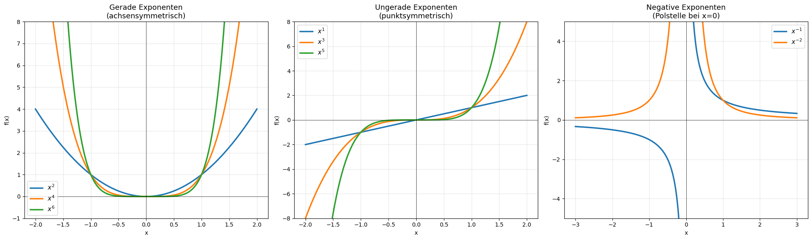
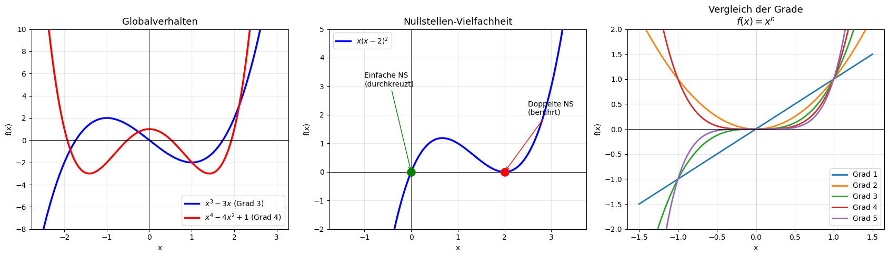
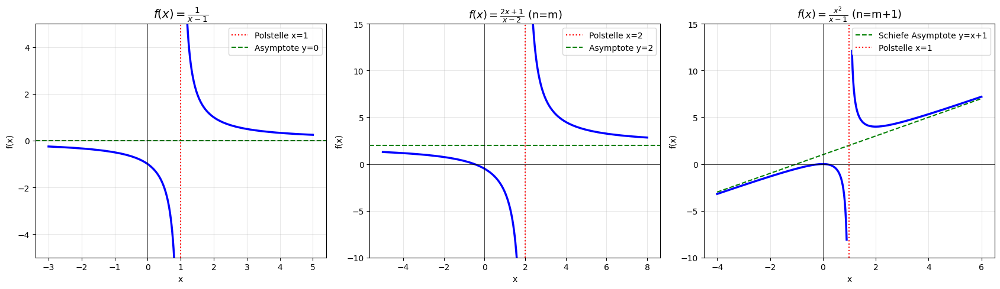

# Funktionen
## 04 - Potenz- & Polynomfunktionen

Potenzfunktionen $x^n$ (gerade/ungerade Exponenten → Symmetrie und Globalverhalten), Polynomfunktionen (Grad, Leitkoeffizient, Nullstellen) und rationale Funktionen (Definitionslücken, Polstellen, Asymptoten).

> Vorausgesetzt: Funktionsbegriff, lineare und quadratische Funktionen.

### Lernziele

- Das **Verhalten von Potenzfunktionen** $x^n$ für gerade und ungerade $n$ beschreiben
- **Polynomfunktionen** analysieren: Grad, Globalverhalten, Nullstellen
- **Rationale Funktionen** untersuchen: Definitionslücken, Asymptoten
- Graphen dieser Funktionstypen sicher skizzieren

---

### 1. Potenzfunktionen

Eine **Potenzfunktion** hat die Form $f(x) = x^n$ mit $n \in \mathbb{Z}$.

Ob der Exponent gerade oder ungerade ist, bestimmt das gesamte Verhalten des Graphen - Symmetrie, Richtung, Vorzeichen. Das ist eine der wichtigsten Faustregeln beim Skizzieren:

| Exponent | Symmetrie | Verhalten für $x \to \pm\infty$ | Beispiel |
|----------|-----------|-----------------------------------|----------|
| $n$ gerade, $n > 0$ | Achsensymmetrisch (y-Achse) | $f(x) \to +\infty$ beidseitig | $x^2, x^4$ |
| $n$ ungerade, $n > 0$ | Punktsymmetrisch (Ursprung) | $f(x) \to -\infty$ bzw. $+\infty$ | $x^3, x^5$ |
| $n$ gerade, $n < 0$ | Achsensymmetrisch | $f(x) \to 0$ beidseitig, Pol bei $x=0$ | $x^{-2}$ |
| $n$ ungerade, $n < 0$ | Punktsymmetrisch | $f(x) \to 0$ beidseitig, Pol bei $x=0$ | $x^{-1}$ |

Auch **rationale Exponenten** sind möglich: $x^{1/2} = \sqrt{x}$, $x^{1/3} = \sqrt[3]{x}$.

    

    

### 2. Polynomfunktionen

Polynomfunktionen verallgemeinern lineare und quadratische Funktionen auf beliebig hohe Grade - sie sind die einfachste Klasse von Funktionen, die man durch Addition und Multiplikation aufbauen kann.

Eine **Polynomfunktion** vom Grad $n$ ist eine Summe von Potenzfunktionen:

$$f(x) = a_n x^n + a_{n-1} x^{n-1} + \ldots + a_1 x + a_0 \quad (a_n \ne 0)$$

| Begriff | Bedeutung |
|---------|----------|
| **Grad** $n$ | Höchster vorkommender Exponent |
| **Leitkoeffizient** $a_n$ | Koeffizient des Terms mit höchstem Grad |
| **Absolutglied** $a_0$ | Konstanter Term (= y-Achsenabschnitt) |

**Spezialfälle:**
- Grad 0: Konstante ($f(x) = c$)
- Grad 1: Lineare Funktion
- Grad 2: Quadratische Funktion
- Grad 3: Kubische Funktion

---

Für $|x| \to \infty$ dominiert der Term mit dem höchsten Grad - alle anderen Terme werden im Vergleich vernachlässigbar klein. Zwei Fragen entscheiden alles: Ist der Grad gerade oder ungerade, und ist der Leitkoeffizient positiv oder negativ?

Für $|x| \to \infty$ dominiert der Term mit dem höchsten Grad. Das Verhalten hängt von Grad und Leitkoeffizient ab:

| Grad | $a_n > 0$ | $a_n < 0$ |
|------|-----------|----------|
| Gerade | $f(x) \to +\infty$ beidseitig | $f(x) \to -\infty$ beidseitig |
| Ungerade | Links $-\infty$, rechts $+\infty$ | Links $+\infty$, rechts $-\infty$ |

---

### Nullstellen

Ein Polynom vom Grad $n$ hat **höchstens $n$** reelle Nullstellen.

Eine Nullstelle $x_0$ mit **Vielfachheit $k$** bedeutet:

- $k$ ungerade: Graph **durchkreuzt** die x-Achse- $k$ gerade: Graph **berührt** die x-Achse (Wendepunktberührung)

    

    

### 3. Rationale Funktionen

Eine **rationale Funktion** ist ein Quotient zweier Polynome:

$$f(x) = \frac{p(x)}{q(x)} = \frac{a_n x^n + \ldots + a_0}{b_m x^m + \ldots + b_0}$$

Wo der Nenner null wird, ist $f$ nicht definiert. Was dort genau passiert, hängt davon ab, ob auch der Zähler null wird:

**Definitionslücken:** $f$ ist nicht definiert, wo $q(x) = 0$.

| Situation | Typ | Beispiel |
|-----------|-----|----------|
| $q(x_0) = 0$, $p(x_0) \ne 0$ | Polstelle | $\frac{1}{x}$ bei $x=0$ |
**Asymptoten** - das Fernverhalten hängt vom Verhältnis der Grade von Zähler und Nenner ab (vgl. Notebook 02_Grenzwerte):

**Asymptoten** (vgl. Notebook 02_Grenzwerte):

| Grad Zähler ($n$) vs. Nenner ($m$) | Horizontale Asymptote |
|-------------------------------------|-----------------------|
| $n < m$ | $y = 0$ |
| $n = m$ | $y = \frac{a_n}{b_m}$ |

| $n = m + 1$ | Schiefe Asymptote (Polynomdivision) || $n > m + 1$ | Keine horizontale/schiefe Asymptote |

    

    

---

## Verständnis-Check

**Aufgabe 1:** Skizziere das Globalverhalten von $f(x) = -2x^3 + x$. Ist die Funktion symmetrisch?

**Aufgabe 2:** Bestimme alle Nullstellen von $f(x) = x^3 - 4x$ und gib ihre Vielfachheit an.

**Aufgabe 3:** Untersuche $f(x) = \dfrac{x^2 - 9}{x - 3}$: Definitionslücke, Typ (Pol oder behebbar), vereinfachte Form.

**Aufgabe 4:** Bestimme alle Asymptoten von $f(x) = \dfrac{3x + 1}{x^2 - 4}$.

### Lösungen

Lösung Aufgabe 1

Grad 3 (ungerade) mit $a_3 = -2 < 0$:
- Für $x \to +\infty$: $f(x) \to -\infty$
- Für $x \to -\infty$: $f(x) \to +\infty$

Symmetrie: $f(-x) = -2(-x)^3 + (-x) = 2x^3 - x = -(-2x^3 + x) = -f(x)$

Punktsymmetrisch zum Ursprung (ungerade Funktion).

Lösung Aufgabe 2

$$x^3 - 4x = x(x^2 - 4) = x(x-2)(x+2)$$

Drei einfache Nullstellen: $x_1 = 0$, $x_2 = 2$, $x_3 = -2$ (alle Vielfachheit 1 → Graph durchkreuzt die x-Achse).

Lösung Aufgabe 3

Definitionslücke bei $x = 3$ (Nenner = 0).

$$\frac{x^2 - 9}{x - 3} = \frac{(x-3)(x+3)}{x-3} = x + 3 \quad (x \ne 3)$$

Zähler und Nenner sind bei $x=3$ beide Null → **behebbare Lücke**. Der Graph ist eine Gerade $y = x+3$ mit einem fehlenden Punkt bei $(3, 6)$.

Lösung Aufgabe 4

**Vertikale Asymptoten:** $x^2 - 4 = 0 \Rightarrow x = \pm 2$

**Horizontale Asymptote:** Grad Zähler (1) < Grad Nenner (2) → $y = 0$

Asymptoten: $x = -2$, $x = 2$ (vertikal), $y = 0$ (horizontal).

---

## Zusammenfassung

| Funktionstyp | Form | Besonderheit |
|-------------|------|-------------|
| **Potenzfunktion** | $x^n$ | Symmetrie hängt von geradem/ungeradem $n$ ab |
| **Polynomfunktion** | $a_nx^n + \ldots + a_0$ | Max. $n$ Nullstellen, Globalverhalten durch $a_n$ und $n$ |
| **Rationale Funktion** | $\frac{p(x)}{q(x)}$ | Polstellen, behebbare Lücken, Asymptoten |

| Asymptoten-Typ | Bedingung |
|----------------|-----------|
| Vertikal | Nullstelle des Nenners (nicht kürzbar) |
| Horizontal | Grad Zähler $\le$ Grad Nenner |
| Schief | Grad Zähler = Grad Nenner + 1 |

---

## Glossar

| Deutsch | Englisch |
|---------|----------|
| Potenzfunktion | Power function |
| Polynomfunktion | Polynomial function |
| Rationale Funktion | Rational function |
| Grad | Degree |
| Leitkoeffizient | Leading coefficient |
| Globalverhalten | End behavior |
| Nullstelle (Vielfachheit) | Root (multiplicity) |
| Polstelle | Pole |
| Schiefe Asymptote | Oblique / Slant asymptote |

