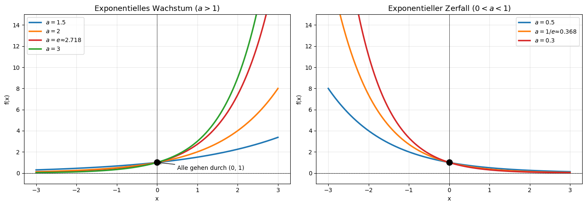
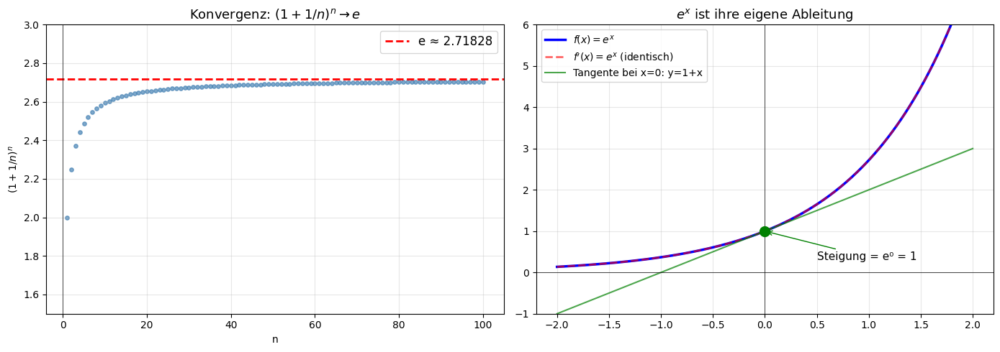
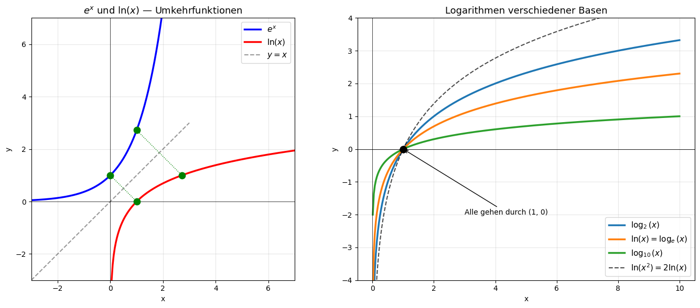

# Funktionen

## 05 - Exponential- und Logarithmusfunktionen

Exponentialfunktion $a^x$ und insbesondere $e^x$ — Graph, Monotonie ($a > 1$: Wachstum; $0 < a < 1$: Zerfall), Asymptote $y = 0$. Ebenso die Logarithmusfunktion als Umkehrung, Logarithmengesetze und Gleichungen.

> Vorausgesetzt: Funktionsbegriff (02_Funktionen/01), Exponenten und Logarithmen (00_Grundlagen/04).

### Lernziele

- Die **Exponentialfunktion** $a^x$ und insbesondere $e^x$ graphisch und algebraisch beschreiben
- Die **Eulersche Zahl** $e$ motivieren und einordnen
- Die **Logarithmusfunktion** als Umkehrung der Exponentialfunktion verstehen
- **Logarithmengesetze** sicher anwenden
- Exponential- und Logarithmusgleichungen lösen

---

### 1. Exponentialfunktionen

Eine **Exponentialfunktion** hat die Variable im Exponenten:

$$f(x) = a^x \qquad (a > 0, \; a \ne 1)$$

| Eigenschaft | Wert |
|-------------|------|
| Definitionsbereich | $D = \mathbb{R}$ |
| Wertebereich | $W = (0, \infty)$ - immer positiv |
| y-Achsenabschnitt | $f(0) = a^0 = 1$ (für alle $a$) |
| Monotonie | Steigend für $a > 1$, fallend für $0 < a < 1$ |
| Asymptote | $y = 0$ (horizontale Asymptote für $x \to -\infty$ bzw. $+\infty$) |

**Vergleich verschiedener Basen:** Je nachdem, ob die Basis größer oder kleiner als 1 ist, kippt das Verhalten von Wachstum zu Zerfall.

| Basis | Verhalten |
|-------|-----------|
| $a > 1$ | Wachstum - Graph steigt nach rechts |
| $a = 1$ | Konstant: $f(x) = 1$ (kein Exponentialverhalten) |
| $0 < a < 1$ | Zerfall - Graph fällt nach rechts |

Zwischen den Basen besteht der Zusammenhang: $a^x = \left(\frac{1}{a}\right)^{-x}$. Ein Zerfall mit Basis $a$ ist also ein Wachstum mit Basis $\frac{1}{a}$, gespiegelt an der y-Achse.

    

    

### 2. Die Eulersche Zahl $e$

Die Zahl $e \approx 2{,}71828\ldots$ ist die wichtigste Basis für Exponentialfunktionen. Sie entsteht aus der Frage:

> Welche Exponentialfunktion hat bei $x = 0$ die Steigung genau 1?

Es gilt: $\dfrac{d}{dx}\, e^x = e^x$ - die e-Funktion ist ihre eigene Ableitung.

**Definition über den Grenzwert:**

$$e = \lim_{n \to \infty} \left(1 + \frac{1}{n}\right)^n$$

**Motivation (Zinseszins):** Du legst 1 GE an mit 100% Jahreszins. Wie viel hast du nach einem Jahr, wenn $n$-mal pro Jahr verzinst wird?

| $n$ (Verzinsungen/Jahr) | $\left(1 + \frac{1}{n}\right)^n$ |
|--------------------------|----------------------------------|
| 1 (jährlich) | 2,000 |
| 12 (monatlich) | 2,613 |
| 365 (täglich) | 2,715 |
| $\to \infty$ (stetig) | $e \approx 2{,}71828$ |

---

### Umrechnung zwischen Basen

Jede Exponentialfunktion $a^x$ lässt sich mit Basis $e$ schreiben:

$$a^x = e^{x \cdot \ln(a)}$$

Das ist nützlich, weil man mit $e^x$ leichter differenzieren und integrieren kann.

    

    

### 3. Die Logarithmusfunktion

Der **Logarithmus** ist die Umkehroperation des Potenzierens:

$$\log_a(y) = x \quad \Longleftrightarrow \quad a^x = y$$

Gelesen: „Der Logarithmus von $y$ zur Basis $a$ ist $x$" - also: *Welchen Exponent braucht man bei Basis $a$, um $y$ zu erhalten?*

| Notation | Basis | Üblich in |
|----------|-------|-----------|
| $\ln(x) = \log_e(x)$ | $e$ | Mathematik, Physik |
| $\log(x) = \log_{10}(x)$ | 10 | Taschenrechner, Ingenieurwesen |
| $\log_2(x)$ | 2 | Informatik |

---

### Eigenschaften der Logarithmusfunktion

| Eigenschaft | Wert |
|-------------|------|
| Definitionsbereich | $D = (0, \infty)$ - nur positive Argumente |
| Wertebereich | $W = \mathbb{R}$ |
| Nullstelle | $\log_a(1) = 0$ |
| Fixpunkt | $\log_a(a) = 1$ |
| Monotonie | Streng steigend (für $a > 1$) |
| Asymptote | $x = 0$ (vertikale Asymptote) |

**Umkehrbeziehung:**
$$a^{\log_a(x)} = x \qquad \text{und} \qquad \log_a(a^x) = x$$

    

    

### 4. Logarithmengesetze

Die Logarithmengesetze sind direkte Konsequenzen der Potenzregeln - jede Regel spiegelt wider, was beim Potenzieren passiert. Kennt man die Potenzregeln, versteht man die Logarithmengesetze automatisch.

Diese Regeln gelten für jeden Logarithmus mit Basis $a > 0, a \ne 1$:

| Gesetz | Formel | Entspricht |
|--------|--------|------------|
| **Produktregel** | $\log(u \cdot v) = \log(u) + \log(v)$ | „Multiplikation → Addition" |
| **Quotientenregel** | $\log\left(\frac{u}{v}\right) = \log(u) - \log(v)$ | „Division → Subtraktion" |
| **Potenzregel** | $\log(u^k) = k \cdot \log(u)$ | „Exponent → Faktor" |
| **Basiswechsel** | $\log_a(x) = \frac{\ln(x)}{\ln(a)}$ | Umrechnung zwischen Basen |

**Spezielle Werte:**

$$\log_a(1) = 0 \qquad \log_a(a) = 1 \qquad \ln(e) = 1$$

---

Das Prinzip ist immer dasselbe: Exponentialgleichungen löst man durch Logarithmieren, Logarithmusgleichungen durch Potenzieren.

| Gleichungstyp | Strategie | Beispiel |
|---------------|-----------|----------|
| $a^x = b$ | Logarithmieren: $x = \frac{\ln b}{\ln a}$ | $2^x = 8 \Rightarrow x = 3$ |

| $\log_a(x) = b$ | Potenzieren: $x = a^b$ | $\log_2(x) = 5 \Rightarrow x = 32$ |
| $\log_a(x) = b$ | Potenzieren: $x = a^b$ | $\log_2(x) = 5 \Rightarrow x = 32$ |
| $e^{f(x)} = g(x)$ | $f(x) = \ln(g(x))$ | $e^{2x} = 7 \Rightarrow x = \frac{\ln 7}{2}$ |

    === Logarithmengesetze mit SymPy ===
    
    ln(2·3) = 1.79176
    ln(2) + ln(3) = 1.79176
    
    ln(2⁵) = 3.46574
    5·ln(2) = 3.46574
    === Gleichungen lösen ===
    2^x = 10  → x = 3.32193
    e^(2x) = 7 → x = 0.97296
    ln(x) = 3  → x = 20.08554
    

---

## Verständnis-Check

**Aufgabe 1:** Vereinfache: $\ln(e^3) + \ln\left(\frac{1}{e}\right)$

**Aufgabe 2:** Löse nach $x$ auf: $5^{x+1} = 125$

**Aufgabe 3:** Schreibe $3^x$ in der Form $e^{kx}$. Welchen Wert hat $k$?

**Aufgabe 4:** Vereinfache: $\log_2(8) + \log_2(4) - \log_2(16)$

**Aufgabe 5:** Bestimme den Definitions- und Wertebereich von $f(x) = \ln(x - 2) + 1$.

### Lösungen

Lösung Aufgabe 1

$$\ln(e^3) + \ln\left(\frac{1}{e}\right) = 3 + \ln(e^{-1}) = 3 + (-1) = 2$$

Lösung Aufgabe 2

$125 = 5^3$, also $5^{x+1} = 5^3 \Rightarrow x + 1 = 3 \Rightarrow x = 2$.

Lösung Aufgabe 3

$$3^x = e^{x \ln 3}$$

Also $k = \ln 3 \approx 1{,}0986$.

Lösung Aufgabe 4

$$\log_2(8) + \log_2(4) - \log_2(16) = 3 + 2 - 4 = 1$$

Alternativ per Logarithmengesetze: $\log_2\left(\frac{8 \cdot 4}{16}\right) = \log_2(2) = 1$.

Lösung Aufgabe 5

Bedingung: $x - 2 > 0 \Rightarrow x > 2$, also $D = (2, \infty)$.

Da $\ln$ alle reellen Werte annimmt und $+1$ nur verschiebt: $W = \mathbb{R}$.

---

## Zusammenfassung

| Thema | Kernaussage |
|-------|-------------|
| **Exponentialfunktion** | $a^x$: Basis $a>1$ → Wachstum, $0<a<1$ → Zerfall |
| **Eulersche Zahl** | $e \approx 2{,}718$; $e^x$ ist ihre eigene Ableitung |
| **Logarithmus** | $\log_a(x)$: Umkehrung von $a^x$ |
| **Logarithmengesetze** | Produkt→Summe, Quotient→Differenz, Potenz→Faktor |
| **Basiswechsel** | $a^x = e^{x\ln a}$, $\log_a(x) = \frac{\ln x}{\ln a}$ |
| **Gleichungen** | Logarithmieren bzw. Potenzieren zum Auflösen |

---

## Glossar

| Deutsch | Englisch |
|---------|----------|
| Exponentialfunktion | Exponential function |
| Eulersche Zahl | Euler's number |
| Logarithmus | Logarithm |
| Natürlicher Logarithmus | Natural logarithm |
| Basiswechsel | Change of base |
| Umkehrfunktion | Inverse function |
| Asymptote | Asymptote |
