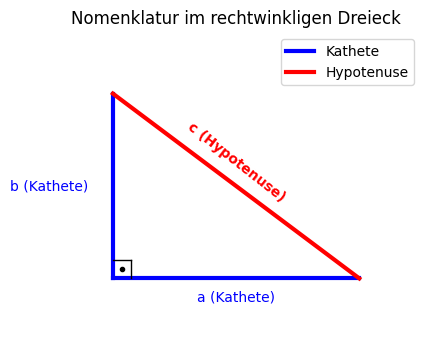
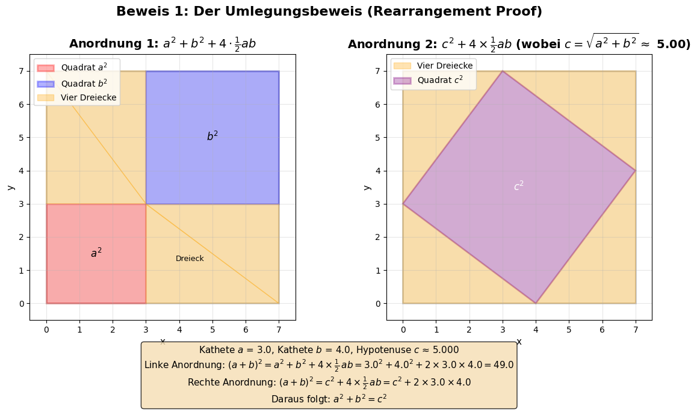

# Geometrie und Trigonometrie

## 05 - Das rechtwinklige Dreieck und der Satz des Pythagoras

Satz des Pythagoras ($a^2 + b^2 = c^2$) — Katheten (schließen den rechten Winkel ein) und Hypotenuse (liegt ihm gegenüber); geometrischer Beweis durch Flächenvergleich; Umkehrung ($a^2 + b^2 = c^2 \implies$ Dreieck ist rechtwinklig).

> Vorausgesetzt: Winkelgrundlagen (03_Geometrie/01), Flächenberechnung.

### Lernziele

- Du lernst die Begriffe **Kathete** und **Hypotenuse** sicher zu verwenden.
- Du verstehst den **geometrischen Beweis** des Satzes (Flächenvergleich).
- Du kannst fehlende Seitenlängen in rechtwinkligen Dreiecken berechnen.
- Du lernst die **Umkehrung** des Satzes kennen (Wie prüfe ich, ob ein Winkel $90°$ ist?).

---

## 1. Das rechtwinklige Dreieck

Bevor wir rechnen, müssen wir die Bauteile benennen. Der Satz des Pythagoras gilt **nur** in rechtwinkligen Dreiecken.

- **Der rechte Winkel ($90°$):** Er ist das markanteste Merkmal. Meist wird er mit einem Punkt in einem Viertelkreis markiert.
- **Die Hypotenuse:** Die längste Seite des Dreiecks. Sie liegt dem rechten Winkel immer **gegenüber**.
- **Die Katheten:** Die beiden kürzeren Seiten, die den rechten Winkel **einschließen** (sie "berühren" den rechten Winkel).

*Eselsbrücke:* Die **H**ypotenuse ist die **H**auptseite (die größte).

    

    

## 2. Der Satz des Pythagoras

Der Satz des Pythagoras ist eines der fundamentellen Theoreme der euklidischen Geometrie. Er besagt:

**In einem rechtwinkligen Dreieck ist die Fläche des Quadrats über der Hypotenuse (der längsten Seite, die dem rechten Winkel gegenüberliegt) gleich der Summe der Flächen der Quadrate über den beiden Katheten (den Seiten, die den rechten Winkel bilden).**

Mathematisch ausgedrückt:
$$
a^2 + b^2 = c^2
$$

Wobei:
- $a$ und $b$ die **Katheten** (Ankathete und Gegenkathete) sind
- $c$ die **Hypotenuse** ist
- Der Winkel zwischen $a$ und $b$ genau $90°$ ($\pi / 2 \text{Radiant}$) beträgt.

### Interpretation

Das Theorem kann geometrisch interpretiert werden als:
- Die Summer der Flächeninhalte zweiere Quadrate (über den Katheten) entspricht dem Flächeninhalt eines dritten Quadrates (über der Hypotenuse)

## 3. Ein Beweis (Umlegungsbeweis)

Der Umlegungsbeweis (auch "Beweis durch Neuanordnung" genannt) basiert auf der folgender Idee:

1. Man konstruiert ein großes Quadrat mit der Seitenlänge $(a + b)$
2. Dieses große Quadrat wird auf zwei verschiedene Arten in kleinere geometrische Formen zerlegt
3. **Erste Zerlegung**: Das große Quadrat wird in zwei Quadrate (mit Seitenlängen $a$ und $b$) plus vier kongruente rechtwinklige Dreiecke unterteilt.
4. **Zweite Zerlegung**: Das gleiche große Quadrat wird in ein Quadrat (mit Seitenlänge $c$, der Hypotenuse) plus vier kongruente rechtwinklige Dreiecke unterteilt.
5. Da beide Zerlegungen denselben großen Quadratflächeninhalt ergeben und die vier Dreiecke in beiden Fällen identisch sind, müssen die verbleibenden Quadratflächen gleich sein: $a^2 + b^2 = c^2$

### Mathematische Formalisierung

- Großes Quadrat: Seitenlänge = $a + b$, Fläche = $(a + b)^2 = a^2 + 2ab + b^2$
- Jedes rechtwinklige Dreieck: Fläche = $\frac{1}{2}ab$
- Vier Dreiecke: Gesamtfläche = $4 \cdot \frac{1}{2}ab = 2ab$

**Erste Anordnung**:
$$A_{\text{groß}} = a^2 + b^2 + 2ab$$

**Zweite Anordnung**:
$$A_{\text{groß}} = c^2 + 2ab$$

**Daher**:
$$a^2 + b^2 + 2ab = c^2 + 2ab$$
$$a^2 + b^2 = c^2$$

### Visualisierung
Schauen wir uns an wie das ganze aussieht. Der untenstehende Python Code visualisiert diesen Bweis:

    

    

## 4. Rechnen mit Pythagoras

Der Satz $a^2 + b^2 = c^2$ ist eine Gleichung. Wenn wir zwei Seiten kennen, können wir die dritte immer ausrechnen.

**Fall A: Hypotenuse gesucht**
Gegeben: Katheten $a=3, b=4$. Gesucht: $c$.
$$c^2 = 3^2 + 4^2 = 9 + 16 = 25$$
$$c = \sqrt{25} = 5$$

**Fall B: Kathete gesucht**
Gegeben: Hypotenuse $c=10$, Kathete $a=8$. Gesucht: $b$.
Wir stellen die Formel um: $b^2 = c^2 - a^2$.
$$b^2 = 10^2 - 8^2 = 100 - 64 = 36$$
$$b = \sqrt{36} = 6$$

## 5. Pythagoreische Tripel

Im Beispiel oben (3, 4, 5) kommen glatte ganze Zahlen heraus, das ist selten! Meistens ergeben Wurzeln "krumme" Kommazahlen (Irrationale Zahlen).
Ganzzahlige Lösungen nennt man **Pythagoreische Tripel**.
Die wichtigsten zum Auswendiglernen:
- $(3, 4, 5)$
- $(5, 12, 13)$
- $(8, 15, 17)$

## 6. Die Umkehrung des Satzes

Der Satz gilt auch rückwärts:
**"Wenn in einem Dreieck die Summe der Quadrate zweier Seiten gleich dem Quadrat der dritten Seite ist, dann ist das Dreieck rechtwinklig."**

Das ist extrem nützlich für Handwerker (z.B. die "Zimmerer-Methode" oder "3-4-5-Methode" um rechte Winkel auf Baustellen abzustecken).

---

## Verständnis-Check

**Aufgabe 1: Die Leiter**
Eine 5 Meter lange Leiter lehnt an einer Hauswand. Der Fuß der Leiter steht 3 Meter von der Wand entfernt.
Wie hoch reicht die Leiter? (Skizziere ein Dreieck: Leiter = Hypotenuse).

**Aufgabe 2: Der Bildschirm**
Ein Fernseher wird als "50 Zoll" verkauft. Das ist die Länge der Diagonalen. Der Bildschirm ist 40 Zoll breit.
Wie hoch ist der Bildschirm?

**Aufgabe 3: Rechtwinklig oder nicht?**
Ein Dreieck hat die Seitenlängen 6 cm, 7 cm und 9 cm. Ist es rechtwinklig?

### Lösungen

Lösung Aufgabe 1

Gegeben: $c=5$ (Leiter), $a=3$ (Abstand). Gesucht: $b$ (Höhe).
$$b^2 = c^2 - a^2 = 5^2 - 3^2 = 25 - 9 = 16$$
$$b = \sqrt{16} = 4$$
Die Leiter reicht **4 Meter** hoch.

Lösung Aufgabe 2

Gegeben: $c=50$ (Diagonale), $a=40$ (Breite). Gesucht: $b$ (Höhe).
$$b^2 = 50^2 - 40^2 = 2500 - 1600 = 900$$
$$b = \sqrt{900} = 30$$
Der Bildschirm ist **30 Zoll** hoch. (Dies ist ein 3:4:5 Tripel, multipliziert mit 10).

Lösung Aufgabe 3

Wir prüfen, ob $a^2 + b^2 = c^2$ gilt. Die längste Seite (9) muss $c$ sein.
$$6^2 + 7^2 = 36 + 49 = 85$$
$$c^2 = 9^2 = 81$$
Da $85 \neq 81$, ist das Dreieck **nicht rechtwinklig**.

## Zusammenfassung

| Thema | Kernaussage |
|-------|-------------|
| Rechtwinkliges Dreieck | Katheten schließen den rechten Winkel ein; Hypotenuse liegt gegenüber |
| Satz des Pythagoras | $a^2 + b^2 = c^2$ (nur im rechtwinkligen Dreieck) |
| Beweis | Umlegungsbeweis: Zwei Zerlegungen eines $(a+b)$-Quadrats |
| Pythagoreische Tripel | Ganzzahlige Lösungen, z.B. $(3,4,5)$, $(5,12,13)$ |
| Umkehrung | Gilt $a^2+b^2=c^2$, ist das Dreieck rechtwinklig |

---

## Glossar

| Deutsch | Englisch |
|---------|----------|
| Rechtwinkliges Dreieck | Right-angled triangle |
| Kathete | Cathetus / Leg |
| Hypotenuse | Hypotenuse |
| Satz des Pythagoras | Pythagorean theorem |
| Wurzel | Square root |
| Quadrat | Square |
| Fläche | Area |
| Umkehrung | Converse |
