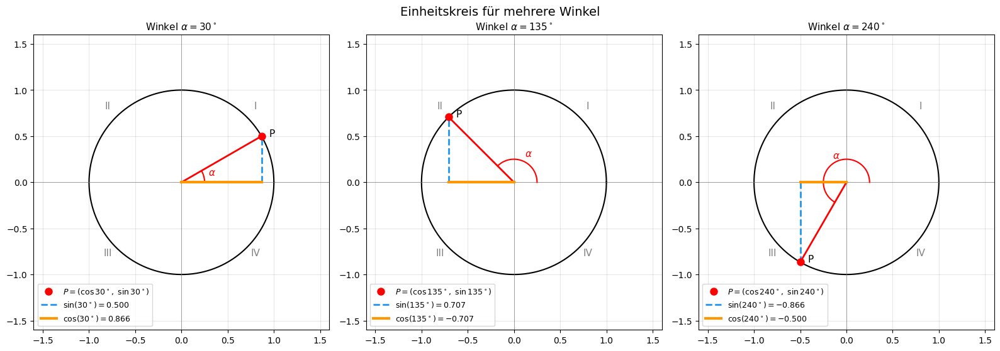
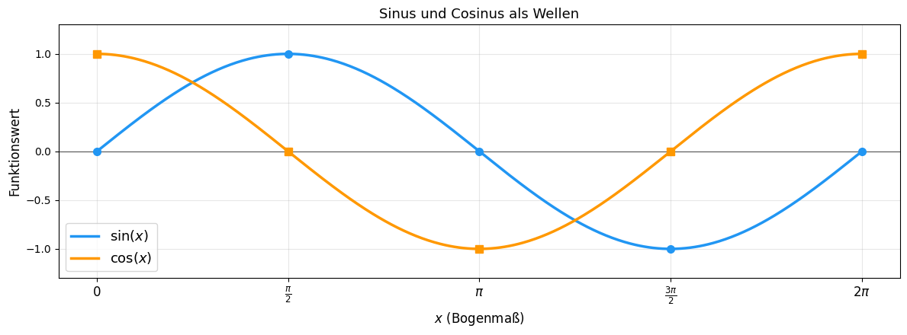
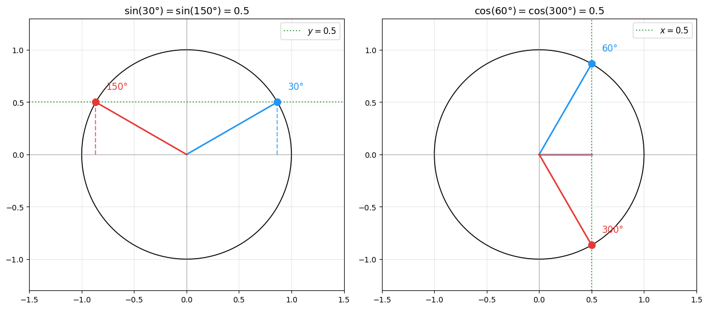

# Geometrie und Trigonometrie

## 02 - Trigonometrie 2: Einheitskreis und Funktionen

Der Einheitskreis ($P = (\cos\alpha, \sin\alpha)$ auf dem Kreis mit $r = 1$) erweitert Sinus und Cosinus auf alle Winkel — periodische Funktionen mit Periode $2\pi$ und Amplitude $1$, Bogenmaß ($\text{rad} = \text{deg} \cdot \pi/180$), Quadrantenvorzeichen, fundamentale Identität $\sin^2\alpha + \cos^2\alpha = 1$ und Lösen trigonometrischer Gleichungen.

> Vorausgesetzt: Sinus/Cosinus im rechtwinkligen Dreieck (04_Trigonometrie/01).

### Lernziele

- Du verstehst den **Einheitskreis** als Erweiterung des Dreiecks.
- Du lernst die **Graphen** von Sinus und Cosinus kennen (Wellenform).
- Du verstehst **Symmetrien** (warum es oft zwei Lösungen für einen Winkel gibt).
- Du lernst Strategien zum **Lösen trigonometrischer Gleichungen** (Substitution).

---

## 1. Der Einheitskreis (The Unit Circle)

Statt eines beliebigen Dreiecks betrachten wir einen Kreis mit Radius $r=1$ im Koordinatensystem.
Der Mittelpunkt liegt bei $(0|0)$.

Jeder Winkel $\alpha$ (gemessen von der positiven x-Achse gegen den Uhrzeigersinn) definiert einen Punkt $P$ auf dem Kreis:

$$P = (\cos\alpha,\ \sin\alpha)$$

- Die **x-Koordinate** dieses Punktes ist der **Cosinus**.
- Die **y-Koordinate** dieses Punktes ist der **Sinus**.

Damit können wir plötzlich auch den Sinus von $120°$ oder $-30°$ bestimmen - das Dreieck ist nicht mehr nötig.

### Wertetabelle (wichtige Winkel)

| $\alpha$ | $0°$ | $30°$ | $45°$ | $60°$ | $90°$ | $180°$ | $270°$ | $360°$ |
|---|---|---|---|---|---|---|---|---|
| $\sin\alpha$ | $0$ | $\frac{1}{2}$ | $\frac{\sqrt2}{2}$ | $\frac{\sqrt3}{2}$ | $1$ | $0$ | $-1$ | $0$ |
| $\cos\alpha$ | $1$ | $\frac{\sqrt3}{2}$ | $\frac{\sqrt2}{2}$ | $\frac{1}{2}$ | $0$ | $-1$ | $0$ | $1$ |
| $\tan\alpha$ | $0$ | $\frac{\sqrt3}{3}$ | $1$ | $\sqrt3$ | - | $0$ | - | $0$ |

### Bogenmaß (Radians)

Neben der Gradangabe gibt es das **Bogenmaß**: Die Bogenlänge auf dem Einheitskreis.

$$\text{rad} = \text{deg} \cdot \frac{\pi}{180}$$

| Grad | $0°$ | $30°$ | $45°$ | $60°$ | $90°$ | $180°$ | $360°$ |
|---|---|---|---|---|---|---|---|
| Bogenmaß | $0$ | $\frac{\pi}{6}$ | $\frac{\pi}{4}$ | $\frac{\pi}{3}$ | $\frac{\pi}{2}$ | $\pi$ | $2\pi$ |

> **Merke:** In der Mathematik und Physik wird fast immer das Bogenmaß verwendet. Python-Funktionen wie `math.sin()` erwarten ebenfalls Bogenmaß.

    

    

## 2. Die Funktionsgraphen (Wellen)

Wenn wir den Winkel $\alpha$ (oder $x$) auf der horizontalen Achse abtragen und den Sinuswert auf der vertikalen, entsteht die typische Wellenform.

Wichtige Eigenschaften:
- **Periode:** $360^\circ$ oder $2\pi$. Danach wiederholt sich alles.
- **Amplitude:** Pendelt zwischen $+1$ und $-1$.
- **Nullstellen:** Wo schneidet die Kurve die Achse?

    

    

## 3. Symmetrie und Vorzeichen

Der Taschenrechner gibt bei `asin(0.5)` oft nur einen Wert zurück ($30°$). Aber im Kreis gibt es oft einen zweiten Winkel, der den gleichen Sinuswert hat.

### Vorzeichen in den Quadranten

| Quadrant | Winkelbereich | $\sin$ | $\cos$ | $\tan$ |
|---|---|---|---|---|
| I   | $0°$-$90°$     | $+$ | $+$ | $+$ |
| II  | $90°$-$180°$   | $+$ | $-$ | $-$ |
| III | $180°$-$270°$  | $-$ | $-$ | $+$ |
| IV  | $270°$-$360°$  | $-$ | $+$ | $-$ |

### Wichtige Symmetrien
- **Sinus:** $\sin(180° - \alpha) = \sin(\alpha)$ - Spiegelung an der y-Achse im Kreis
- **Cosinus:** $\cos(360° - \alpha) = \cos(\alpha)$ - Spiegelung an der x-Achse im Kreis
- **Tangens:** $\tan(\alpha + 180°) = \tan(\alpha)$ - Periode $180°$

### Fundamentale Identität

Direkt aus dem Einheitskreis (Satz des Pythagoras auf das Dreieck mit Hypotenuse $r=1$):

$$\sin^2(\alpha) + \cos^2(\alpha) = 1$$

Daraus abgeleitet:
- $\sin^2(\alpha) = 1 - \cos^2(\alpha)$
- $\cos^2(\alpha) = 1 - \sin^2(\alpha)$

    

    

## 4. Lösen trigonometrischer Gleichungen

Hier wird es algebraisch. Wir suchen alle $x$ in einem Intervall $[0, 2\pi]$ (bzw. $[0°, 360°]$).

### A. Einfache Gleichungen

**Beispiel:** $\sin(x) = 0{,}5$ im Intervall $[0, 2\pi]$

1. Taschenrechner / Tabelle: $x_1 = \arcsin(0{,}5) = \frac{\pi}{6}$ (= $30°$)
2. Symmetrie beachten: $x_2 = \pi - x_1 = \pi - \frac{\pi}{6} = \frac{5\pi}{6}$ (= $150°$)

**Lösung:** $x \in \left\{\frac{\pi}{6},\ \frac{5\pi}{6}\right\}$

### B. Substitution (komplexe Argumente)

**Beispiel:** $\sin(2x) = 0{,}5$ im Intervall $[0, 2\pi]$

1. **Substituiere** $u = 2x$. Neues Intervall: $u \in [0, 4\pi]$
2. Löse $\sin(u) = 0{,}5$: $u_1 = \frac{\pi}{6},\ u_2 = \frac{5\pi}{6}$
3. Periodenwiederholungen im erweiterten Intervall: $u_3 = \frac{\pi}{6} + 2\pi = \frac{13\pi}{6},\ u_4 = \frac{5\pi}{6} + 2\pi = \frac{17\pi}{6}$
4. **Rücksubstitution** $x = \frac{u}{2}$: $x \in \left\{\frac{\pi}{12},\ \frac{5\pi}{12},\ \frac{13\pi}{12},\ \frac{17\pi}{12}\right\}$

### C. Quadratische Form

**Beispiel:** $2\sin^2(x) - 1 = 0$

1. Umstellen: $\sin^2(x) = \frac{1}{2} \Rightarrow \sin(x) = \pm\frac{\sqrt{2}}{2}$
2. Alle Winkel mit $\sin(x) = \frac{\sqrt{2}}{2}$: $x = \frac{\pi}{4},\ \frac{3\pi}{4}$
3. Alle Winkel mit $\sin(x) = -\frac{\sqrt{2}}{2}$: $x = \frac{5\pi}{4},\ \frac{7\pi}{4}$

**Lösung:** $x \in \left\{\frac{\pi}{4},\ \frac{3\pi}{4},\ \frac{5\pi}{4},\ \frac{7\pi}{4}\right\}$

    sin(x) = 0.5 in [0, 2π]:
      x = 0.523599 rad = 30.0°  →  sin(x) = 0.500000
      x = 2.617994 rad = 150.0°  →  sin(x) = 0.500000
    
    sin(2x) = 0.5 in [0, 2π]  (substituiere u = 2x):
      x = 0.261799 rad = 15.0°  →  sin(2x) = 0.500000
      x = 1.308997 rad = 75.0°  →  sin(2x) = 0.500000
      x = 3.403392 rad = 195.0°  →  sin(2x) = 0.500000
      x = 4.450590 rad = 255.0°  →  sin(2x) = 0.500000
    
    Fundamentale Identität: sin²(α) + cos²(α) = 1
      α =   0°:  1.000000000000000
      α =  30°:  1.000000000000000
      α =  45°:  1.000000000000000
      α =  60°:  1.000000000000000
      α =  90°:  1.000000000000000
      α = 135°:  1.000000000000000
      α = 210°:  1.000000000000000
      α = 300°:  1.000000000000000
    

---

## Verständnis-Check

**Aufgabe 1: Einheitskreis ablesen**

Bestimme ohne Taschenrechner (aus der Wertetabelle / dem Einheitskreis):

a) $\sin(90°)$ und $\cos(90°)$

b) $\sin(180°)$ und $\cos(180°)$

c) $\sin(330°)$ (Hinweis: $330° = 360° - 30°$)

d) $\cos(150°)$ (Hinweis: $150° = 180° - 30°$)

**Aufgabe 2: Bogenmaß**

Rechne um:

a) $120°$ in Bogenmaß

b) $\frac{5\pi}{4}$ in Grad

c) $315°$ in Bogenmaß

**Aufgabe 3: Gleichungen lösen**

Finde alle Lösungen im Intervall $[0°, 360°]$:

a) $\cos(x) = -\frac{1}{2}$

b) $\sin(x) = -\frac{\sqrt{2}}{2}$

c) $2\cos^2(x) - 1 = 0$ (Hinweis: quadratische Form)

**Aufgabe 4: Substitution**

Finde alle Lösungen im Intervall $[0°, 360°]$:

$\cos(2x) = 0$

### Lösungen

Lösung Aufgabe 1

a) $\sin(90°) = 1$, $\cos(90°) = 0$

b) $\sin(180°) = 0$, $\cos(180°) = -1$

c) $\sin(330°) = -\sin(30°) = -\frac{1}{2}$

d) $\cos(150°) = -\cos(30°) = -\frac{\sqrt{3}}{2}$

Lösung Aufgabe 2

a) $120° = 120 \cdot \frac{\pi}{180} = \frac{2\pi}{3}$

b) $\frac{5\pi}{4} = \frac{5 \cdot 180°}{4} = 225°$

c) $315° = 315 \cdot \frac{\pi}{180} = \frac{7\pi}{4}$

Lösung Aufgabe 3

a) $\cos(x) = -\frac{1}{2}$: $x \in \{120°, 240°\}$

b) $\sin(x) = -\frac{\sqrt{2}}{2}$: $x \in \{225°, 315°\}$

c) $2\cos^2(x) - 1 = 0 \Rightarrow \cos(x) = \pm\frac{\sqrt{2}}{2}$: $x \in \{45°, 135°, 225°, 315°\}$

Lösung Aufgabe 4

$\cos(2x) = 0$. Substituiere $u = 2x$, Intervall $u \in [0°, 720°]$.
$\cos(u) = 0 \Rightarrow u \in \{90°, 270°, 450°, 630°\}$
Rücksubstitution $x = u/2$: $x \in \{45°, 135°, 225°, 315°\}$

## Zusammenfassung

| Thema | Kernaussage |
|-------|-------------|
| Einheitskreis | $P = (\cos\alpha, \sin\alpha)$ auf dem Kreis mit $r=1$ |
| Bogenmaß | $\text{rad} = \text{deg} \cdot \frac{\pi}{180}$; Vollkreis = $2\pi$ |
| Graphen | Sinus und Cosinus sind periodische Wellen (Periode $2\pi$, Amplitude $1$) |
| Quadrantenregel | Vorzeichen von $\sin$/$\cos$ hängt vom Quadranten ab |
| Fundamentale Identität | $\sin^2(\alpha) + \cos^2(\alpha) = 1$ |
| Gleichungen lösen | Symmetrie beachten → oft 2 Lösungen; Substitution bei $\sin(nx)$ |

---

## Glossar

| Deutsch | Englisch |
|---------|----------|
| Einheitskreis | Unit circle |
| Bogenmaß | Radians |
| Gradmaß | Degrees |
| Periode | Period |
| Amplitude | Amplitude |
| Nullstelle | Zero / root |
| Symmetrie | Symmetry |
| Quadrant | Quadrant |
| Trigonometrische Gleichung | Trigonometric equation |
| Substitution | Substitution |
| Rücksubstitution | Back-substitution |
| Funktionsgraph | Function graph |
| Wertetabelle | Value table |
| Fundamentale Identität | Fundamental identity |
