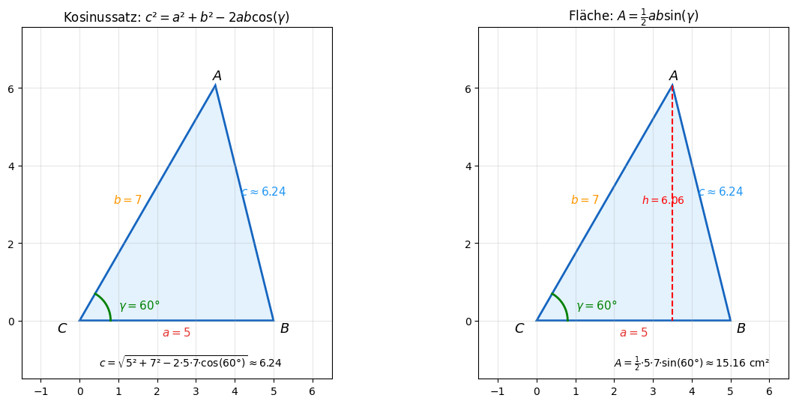

# Geometrie und Trigonometrie

## 03 - Das allgemeine Dreieck: Sinussatz, Kosinussatz

Sinussatz ($\frac{a}{\sin\alpha} = \frac{b}{\sin\beta} = \frac{c}{\sin\gamma}$) für WSW und SSW, Kosinussatz ($c^2 = a^2 + b^2 - 2ab\cos\gamma$) für SSS und SWS — Flächenformel $A = \frac{1}{2}ab\sin\gamma$ für beliebige Dreiecke.

> Vorausgesetzt: Sinus/Cosinus (04_Trigonometrie/01-02).

### Lernziele

- Du kennst den **Sinussatz** und weißt, wann du ihn einsetzt.
- Du kennst den **Kosinussatz** und weißt, wann du ihn einsetzt.
- Du kannst die **Fläche** eines beliebigen Dreiecks mit Trigonometrie berechnen.
- Du weißt, welche Formel du bei welcher Angabe-Kombination (SSS, SWS, WSW, SSW) verwendest.

### Bezeichnungen

In einem Dreieck $ABC$ gilt die Konvention:
- Seite $a$ liegt **gegenüber** dem Winkel $\alpha$ (bei Eckpunkt $A$)
- Seite $b$ liegt **gegenüber** dem Winkel $\beta$ (bei Eckpunkt $B$)
- Seite $c$ liegt **gegenüber** dem Winkel $\gamma$ (bei Eckpunkt $C$)
- Winkelsumme: $\alpha + \beta + \gamma = 180°$

## 1. Der Sinussatz (Law of Sines)

$$\frac{a}{\sin(\alpha)} = \frac{b}{\sin(\beta)} = \frac{c}{\sin(\gamma)}$$

Das Verhältnis von Seite zu Sinus des Gegenwinkels ist für alle drei Seiten gleich.

### Wann verwenden?

- **WSW** (Winkel-Seite-Winkel): Zwei Winkel und eine Seite bekannt → fehlende Seiten berechnen.
- **SSW** (Seite-Seite-Winkel): Zwei Seiten und ein **gegenüberliegender** Winkel bekannt.

> **Achtung (Mehrdeutigkeit):** Bei SSW, wenn der gegebene Winkel einer kürzeren Seite gegenüberliegt, kann es **zwei** gültige Dreiecke geben (da $\sin(\beta) = \sin(180° - \beta)$).

### Beispiel

Gegeben: $a = 8\text{ cm},\ \alpha = 40°,\ \beta = 75°$

1. Dritter Winkel: $\gamma = 180° - 40° - 75° = 65°$
2. Seite $b$: $\frac{b}{\sin(75°)} = \frac{8}{\sin(40°)} \Rightarrow b = \frac{8 \cdot \sin(75°)}{\sin(40°)}$
3. Seite $c$: $\frac{c}{\sin(65°)} = \frac{8}{\sin(40°)} \Rightarrow c = \frac{8 \cdot \sin(65°)}{\sin(40°)}$

## 2. Der Kosinussatz (Law of Cosines)

$$c^2 = a^2 + b^2 - 2ab\cos(\gamma)$$

Analog für die anderen Seiten:
$$a^2 = b^2 + c^2 - 2bc\cos(\alpha)$$
$$b^2 = a^2 + c^2 - 2ac\cos(\beta)$$

> **Beachte:** Für $\gamma = 90°$ gilt $\cos(90°) = 0$ → der Kosinussatz wird zum Satz des Pythagoras: $c^2 = a^2 + b^2$.

### Wann verwenden?

- **SWS** (Seite-Winkel-Seite): Zwei Seiten und der **eingeschlossene** Winkel bekannt → fehlende Seite berechnen.
- **SSS** (Seite-Seite-Seite): Alle drei Seiten bekannt → Winkel berechnen (umgestellt).

### Umgestellt nach dem Winkel

$$\cos(\gamma) = \frac{a^2 + b^2 - c^2}{2ab}$$

### Beispiel (SWS)

Gegeben: $a = 5\text{ cm},\ b = 7\text{ cm},\ \gamma = 60°$

$$c^2 = 25 + 49 - 2 \cdot 5 \cdot 7 \cdot \cos(60°) = 74 - 70 \cdot 0{,}5 = 39$$
$$c = \sqrt{39} \approx 6{,}24\text{ cm}$$

## 3. Flächenformel mit Trigonometrie

Für die Fläche eines beliebigen Dreiecks, wenn zwei Seiten und der eingeschlossene Winkel bekannt sind:

$$A = \frac{1}{2} \cdot a \cdot b \cdot \sin(\gamma)$$

Analog: $A = \frac{1}{2} \cdot b \cdot c \cdot \sin(\alpha) = \frac{1}{2} \cdot a \cdot c \cdot \sin(\beta)$

### Beispiel

$a = 5\text{ cm},\ b = 7\text{ cm},\ \gamma = 60°$

$$A = \frac{1}{2} \cdot 5 \cdot 7 \cdot \sin(60°) = \frac{35}{2} \cdot \frac{\sqrt3}{2} = \frac{35\sqrt3}{4} \approx 15{,}16\text{ cm}^2$$

---

## 4. Entscheidungsbaum: Welche Formel?

| Gegeben | Gesucht | Formel |
|---------|---------|--------|
| **SSS** (3 Seiten) | Winkel | Kosinussatz (umgestellt) |
| **SWS** (2 Seiten + eingeschlossener Winkel) | 3. Seite | Kosinussatz |
| **WSW** (2 Winkel + 1 Seite) | fehlende Seiten | Sinussatz |
| **SSW** (2 Seiten + gegenüberliegender Winkel) | fehlender Winkel | Sinussatz (Achtung: evtl. 2 Lösungen!) |
| 2 Seiten + eingeschlossener Winkel | Fläche | $A = \frac{1}{2}ab\sin\gamma$ |

    

    

---

## Verständnis-Check

**Aufgabe 1: Kosinussatz (SWS)**

Gegeben: $a = 6\text{ cm},\ b = 8\text{ cm},\ \gamma = 50°$

Berechne die Seite $c$.

**Aufgabe 2: Kosinussatz (SSS → Winkel)**

Gegeben: $a = 5,\ b = 6,\ c = 7$

Berechne den Winkel $\gamma$ (gegenüber der Seite $c$).

**Aufgabe 3: Sinussatz (WSW)**

Gegeben: $\alpha = 45°,\ \beta = 70°,\ c = 10\text{ cm}$

a) Bestimme den Winkel $\gamma$

b) Berechne die Seiten $a$ und $b$

**Aufgabe 4: Fläche**

Gegeben: $a = 9\text{ cm},\ b = 12\text{ cm},\ \gamma = 35°$

Berechne die Fläche des Dreiecks.

### Lösungen

Lösung Aufgabe 1

$$c^2 = a^2 + b^2 - 2ab\cos(\gamma) = 36 + 64 - 2 \cdot 6 \cdot 8 \cdot \cos(50°)$$
$$c^2 = 100 - 96 \cdot 0{,}6428 \approx 100 - 61{,}71 = 38{,}29$$
$$c = \sqrt{38{,}29} \approx 6{,}19\text{ cm}$$

Lösung Aufgabe 2

$$\cos(\gamma) = \frac{a^2 + b^2 - c^2}{2ab} = \frac{25 + 36 - 49}{2 \cdot 5 \cdot 6} = \frac{12}{60} = 0{,}2$$
$$\gamma = \arccos(0{,}2) \approx 78{,}46°$$

Lösung Aufgabe 3

a) $\gamma = 180° - 45° - 70° = 65°$

b) Sinussatz: $\frac{a}{\sin(\alpha)} = \frac{c}{\sin(\gamma)}$

$$a = \frac{c \cdot \sin(\alpha)}{\sin(\gamma)} = \frac{10 \cdot \sin(45°)}{\sin(65°)} \approx \frac{10 \cdot 0{,}7071}{0{,}9063} \approx 7{,}80\text{ cm}$$

$$b = \frac{c \cdot \sin(\beta)}{\sin(\gamma)} = \frac{10 \cdot \sin(70°)}{\sin(65°)} \approx \frac{10 \cdot 0{,}9397}{0{,}9063} \approx 10{,}37\text{ cm}$$

Lösung Aufgabe 4

$$A = \frac{1}{2} \cdot a \cdot b \cdot \sin(\gamma) = \frac{1}{2} \cdot 9 \cdot 12 \cdot \sin(35°)$$
$$A = 54 \cdot 0{,}5736 \approx 30{,}97\text{ cm}^2$$

## Zusammenfassung

| Thema | Kernaussage |
|:------|:------------|
| **Sinussatz** | $\frac{a}{\sin(\alpha)} = \frac{b}{\sin(\beta)} = \frac{c}{\sin(\gamma)}$ — wenn mindestens ein Winkel-Seiten-Paar bekannt ist |
| **Kosinussatz** | $c^2 = a^2 + b^2 - 2ab\cos(\gamma)$ — verallgemeinerter Satz des Pythagoras |
| **Flächenformel** | $A = \frac{1}{2}ab\sin(\gamma)$ — Fläche aus zwei Seiten und eingeschlossenem Winkel |
| **Entscheidungsbaum** | SSS / SWS → Kosinussatz; WSW / SSW → Sinussatz |

---

## Glossar

| Deutsch | English |
|---------|---------|
| Sinussatz | Law of Sines |
| Kosinussatz | Law of Cosines |
| Allgemeines Dreieck | General (oblique) triangle |
| Seite | Side |
| Winkel | Angle |
| Winkelsumme | Angle sum |
| Eingeschlossener Winkel | Included angle |
| Gegenüberliegende Seite | Opposite side |
| Fläche | Area |
| Mehrdeutigkeit | Ambiguity |
| Satz des Pythagoras | Pythagorean theorem |
