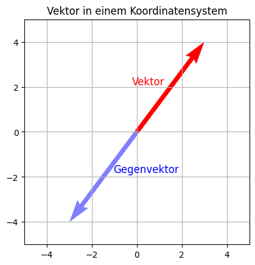
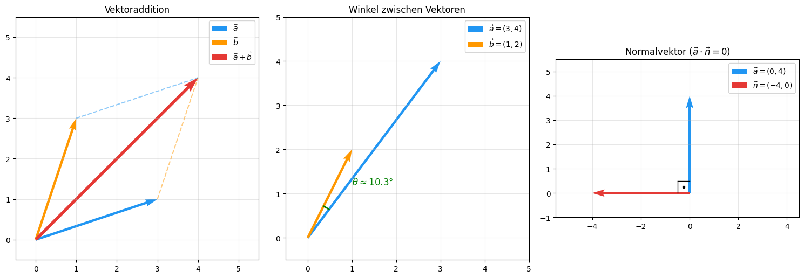

# Vektoren

## 01 - Grundlagen der Vektoren

Viele physikalische Größen lassen sich nicht allein durch ihren Betrag beschreiben — sie brauchen eine Richtung. Vektoren sind das Werkzeug dafür: Notation ($\vec a = \begin{pmatrix}a_x\\a_y\end{pmatrix}$), Addition/Subtraktion/Skalarmultiplikation, Betrag $\|\vec a\| = \sqrt{a_x^2 + a_y^2}$, Skalarprodukt $\vec a \cdot \vec b = a_x b_x + a_y b_y$ und Winkelberechnung ($\cos\theta = \frac{\vec a \cdot \vec b}{\|\vec a\|\|\vec b\|}$).

> Vorausgesetzt: Satz des Pythagoras (03_Geometrie/05), Trigonometrie (04_Trigonometrie).

### Lernziele

- Du verstehst, was ein Vektor ist und wie man ihn notiert.
- Du kannst Vektoren addieren, subtrahieren und skalieren.
- Du kannst den **Betrag** (Länge) eines Vektors berechnen.
- Du verstehst das **Skalarprodukt** und kannst damit **Winkel** berechnen.
- Du kennst den **Normalvektor** und seine Konstruktion.

---

## Definition

Ein **Vektor** beschreibt eine gerichtete Größe: **Länge** und **Richtung**.

Geometrisch kann man ihn als **Menge aller gleich langen, gleich gerichteten und gleich orientierten Pfeile** auffassen, die im Raum existieren können.

Ein einzelner Pfeil dieser Menge ist ein **Repräsentant** (Stellvertreter) des entsprechenden Vektors.

### Notation
- Vektoren: $\vec a,\ \vec b$ (oder fett: $\mathbf a,\ \mathbf b$)
- Komponenten: $\vec a = \begin{pmatrix} a_x \\ a_y \end{pmatrix}$ (2D) oder $\begin{pmatrix} a_x \\ a_y \\ a_z \end{pmatrix}$ (3D)

### Betrag (Norm)

Der **Betrag** (die Länge) eines Vektors berechnet sich nach dem Satz des Pythagoras:

$$\|\vec a\| = \sqrt{a_x^2 + a_y^2}$$

**Beispiel:** $\vec a = \begin{pmatrix}3\\4\end{pmatrix} \Rightarrow \|\vec a\| = \sqrt{9+16} = \sqrt{25} = 5$

### Nullvektor
Der **Nullvektor** ist der Vektor mit Betrag $0$:
$$
\vec 0 = \begin{pmatrix}0\\0\end{pmatrix}\quad (\text{bzw. } \begin{pmatrix}0\\0\\0\end{pmatrix})
$$
Er hat **keine Richtung** (bzw. Richtung ist nicht sinnvoll definiert).

### Einheitsvektor
Ein **Einheitsvektor** hat Betrag $1$ und zeigt in eine bestimmte Richtung.

Der Einheitsvektor in Richtung eines Vektors $\vec a \neq \vec 0$ ist:
$$
\hat a = \frac{\vec a}{\|\vec a\|}
$$

---

    

    

## Regeln für Vektoren

- Der Vektor $\vec{BA} = -\vec{AB}$ heißt **Gegenvektor** des Vektors $\vec{AB}$.
- Der Gegenvektor $-\vec a$ hat **gleichen Betrag**, **gleiche Richtung**, aber **entgegengesetzte Orientierung**.

### Addition und Subtraktion 

- Vektoren werden komponentenweise **addiert** bzw. **subtrahiert**.
$$
\vec{a} \pm \vec{b} 
= 
\begin{pmatrix} a_x \\ a_y \end{pmatrix} 
\pm 
\begin{pmatrix} b_x \\ b_y \end{pmatrix}
= 
\begin{pmatrix} a_x \pm b_x \\ a_y \pm b_y \end{pmatrix}
$$

**Grafisch:** Bei $\vec a + \vec b$ wird der **Schaft** von $\vec b$ an die **Spitze** von $\vec a$ gesetzt.  
Die Summe ist der Pfeil **vom Schaft von $\vec a$ zur Spitze von $\vec b$** und wird als Vektorsumme bezeichnet.

### Skalarmultiplikation (komponentenweise)
Für einen Skalar $c \in \mathbb{R}$ gilt:
$$
c \cdot \vec a
=
c \cdot \begin{pmatrix} a_x \\ a_y \end{pmatrix}
=
\begin{pmatrix} c\,a_x \\ c\,a_y \end{pmatrix}.
$$

- $c>0$: Richtung bleibt gleich, Länge skaliert.
- $c<0$: Orientierung kehrt sich um, Länge skaliert mit $|c|$.

### Verbindungsvektor (Spitze − Schaft)

Um den Vektor **von Punkt $A$ nach Punkt $B$** zu berechnen, subtrahiert man den **Schaft** (Startpunkt) von der **Spitze** (Endpunkt):

$$\vec{AB} = B - A = \begin{pmatrix}b_x - a_x \\ b_y - a_y\end{pmatrix}$$

**Beispiel:** $A = (1, 2),\ B = (4, 6)$

$$\vec{AB} = \begin{pmatrix}4-1\\6-2\end{pmatrix} = \begin{pmatrix}3\\4\end{pmatrix}$$

> **Merke:** Spitze minus Schaft — immer "Ziel minus Start".

### Kräfteparallelogramm

Vektoren werden häufig verwendet, um physikalische **Kräfte** zu beschreiben.

Wirken zwei Kräfte $\vec F_1$ und $\vec F_2$ am selben Punkt, ergibt ihre **Vektorsumme** die resultierende Kraft:

$$\vec F_{\text{res}} = \vec F_1 + \vec F_2$$

Grafisch bilden $\vec F_1$ und $\vec F_2$ zwei Seiten eines **Parallelogramms**. Die Diagonale vom gemeinsamen Anfangspunkt zum gegenüberliegenden Eck ist der resultierende Vektor.

## Skalarprodukt (Dot Product)

Das Skalarprodukt zweier Vektoren ergibt eine **Zahl** (Skalar), keinen Vektor.

### Berechnung (komponentenweise)

$$\vec a \cdot \vec b = a_x \cdot b_x + a_y \cdot b_y$$

### Geometrische Interpretation

$$\vec a \cdot \vec b = \|\vec a\| \cdot \|\vec b\| \cdot \cos(\theta)$$

wobei $\theta$ der Winkel zwischen den beiden Vektoren ist.

**Beispiel:** $\vec a = \begin{pmatrix}3\\4\end{pmatrix},\ \vec b = \begin{pmatrix}1\\2\end{pmatrix}$

$$\vec a \cdot \vec b = 3 \cdot 1 + 4 \cdot 2 = 11$$

### Wichtige Sonderfälle
- $\vec a \cdot \vec b = 0$ → die Vektoren stehen **senkrecht** aufeinander ($\theta = 90°$)
- $\vec a \cdot \vec b > 0$ → spitzer Winkel ($\theta < 90°$)
- $\vec a \cdot \vec b < 0$ → stumpfer Winkel ($\theta > 90°$)

---

## Winkel zwischen Vektoren

Aus der geometrischen Formel umgestellt:

$$\cos(\theta) = \frac{\vec a \cdot \vec b}{\|\vec a\| \cdot \|\vec b\|}$$

$$\theta = \arccos\left(\frac{\vec a \cdot \vec b}{\|\vec a\| \cdot \|\vec b\|}\right)$$

**Beispiel:** $\vec a = \begin{pmatrix}3\\4\end{pmatrix},\ \vec b = \begin{pmatrix}1\\2\end{pmatrix}$

$$\cos(\theta) = \frac{11}{5 \cdot \sqrt{5}} = \frac{11}{5\sqrt{5}} \approx 0{,}9839$$

$$\theta = \arccos(0{,}9839) \approx 10{,}3°$$

## Normalvektoren

Ein **Normalvektor** steht **senkrecht** (orthogonal) auf einem gegebenen Vektor.

### Konstruktion in 2D

Für $\vec a = \begin{pmatrix}a_x\\a_y\end{pmatrix}$ gibt es zwei Normalvektoren:

$$\vec n_1 = \begin{pmatrix}-a_y\\a_x\end{pmatrix}, \qquad \vec n_2 = \begin{pmatrix}a_y\\-a_x\end{pmatrix}$$

Man vertauscht die Komponenten und ändert bei einer das Vorzeichen.

**Probe:** $\vec a \cdot \vec n_1 = a_x \cdot (-a_y) + a_y \cdot a_x = 0$ ✓

**Beispiel:** $\vec a = \begin{pmatrix}3\\4\end{pmatrix} \Rightarrow \vec n_1 = \begin{pmatrix}-4\\3\end{pmatrix},\ \vec n_2 = \begin{pmatrix}4\\-3\end{pmatrix}$

    

    

---

## Verständnis-Check

*Löse die folgenden Aufgaben auf Papier.*

#### Aufgabe 1: Grundoperationen

Gegeben: $\vec a = \begin{pmatrix}2\\5\end{pmatrix},\ \vec b = \begin{pmatrix}-1\\3\end{pmatrix}$

a) Berechne $\vec a + \vec b$

b) Berechne $\vec a - \vec b$

c) Berechne $3 \cdot \vec a$

d) Berechne $\|\vec a\|$ und $\|\vec b\|$

#### Aufgabe 2: Verbindungsvektor

Gegeben die Punkte $A = (1, 3)$ und $B = (7, -1)$.

a) Berechne $\vec{AB}$

b) Berechne $\|\vec{AB}\|$ (Abstand der Punkte)

c) Bestimme den Mittelpunkt $M$ der Strecke $\overline{AB}$

#### Aufgabe 3: Skalarprodukt und Winkel

Gegeben: $\vec u = \begin{pmatrix}4\\3\end{pmatrix},\ \vec v = \begin{pmatrix}-3\\4\end{pmatrix}$

a) Berechne $\vec u \cdot \vec v$

b) Was sagt dir das Ergebnis über den Winkel?

c) Berechne den Winkel zwischen $\vec a = \begin{pmatrix}1\\0\end{pmatrix}$ und $\vec b = \begin{pmatrix}1\\1\end{pmatrix}$

#### Aufgabe 4: Normalvektor

Gegeben: $\vec a = \begin{pmatrix}5\\-2\end{pmatrix}$

a) Bestimme beide Normalvektoren

b) Überprüfe mit dem Skalarprodukt, dass sie wirklich senkrecht stehen

### Lösungen

Lösung Aufgabe 1

a) $\vec a + \vec b = \begin{pmatrix}2+(-1)\\5+3\end{pmatrix} = \begin{pmatrix}1\\8\end{pmatrix}$

b) $\vec a - \vec b = \begin{pmatrix}2-(-1)\\5-3\end{pmatrix} = \begin{pmatrix}3\\2\end{pmatrix}$

c) $3 \cdot \vec a = \begin{pmatrix}6\\15\end{pmatrix}$

d) $\|\vec a\| = \sqrt{4+25} = \sqrt{29} \approx 5{,}385$, $\quad \|\vec b\| = \sqrt{1+9} = \sqrt{10} \approx 3{,}162$

Lösung Aufgabe 2

a) $\vec{AB} = B - A = \begin{pmatrix}7-1\\-1-3\end{pmatrix} = \begin{pmatrix}6\\-4\end{pmatrix}$

b) $\|\vec{AB}\| = \sqrt{36+16} = \sqrt{52} = 2\sqrt{13} \approx 7{,}211$

c) $M = \frac{A + B}{2} = \frac{1}{2}\begin{pmatrix}8\\2\end{pmatrix} = \begin{pmatrix}4\\1\end{pmatrix}$

Lösung Aufgabe 3

a) $\vec u \cdot \vec v = 4 \cdot (-3) + 3 \cdot 4 = -12 + 12 = 0$

b) $\vec u \cdot \vec v = 0$ → die Vektoren stehen **senkrecht** ($\theta = 90°$)

c) $\cos\theta = \frac{\vec a \cdot \vec b}{\|\vec a\|\,\|\vec b\|} = \frac{1 \cdot 1 + 0 \cdot 1}{1 \cdot \sqrt{2}} = \frac{1}{\sqrt{2}}$ → $\theta = 45°$

Lösung Aufgabe 4

a) Normalvektoren von $\begin{pmatrix}5\\-2\end{pmatrix}$: $\vec n_1 = \begin{pmatrix}2\\5\end{pmatrix}$, $\vec n_2 = \begin{pmatrix}-2\\-5\end{pmatrix}$

b) $\vec a \cdot \vec n_1 = 5 \cdot 2 + (-2) \cdot 5 = 10 - 10 = 0$ ✓

$\vec a \cdot \vec n_2 = 5 \cdot (-2) + (-2) \cdot (-5) = -10 + 10 = 0$ ✓

## Zusammenfassung

| Konzept | Kernaussage |
|---------|-------------|
| **Vektor** | Gerichtete Größe mit Betrag und Richtung: $\vec a = \begin{pmatrix}a_1\\a_2\end{pmatrix}$ |
| **Addition / Subtraktion** | Komponentenweise: $\vec a \pm \vec b = \begin{pmatrix}a_1 \pm b_1\\a_2 \pm b_2\end{pmatrix}$ |
| **Skalarmultiplikation** | $k \cdot \vec a = \begin{pmatrix}k\,a_1\\k\,a_2\end{pmatrix}$ — streckt oder staucht |
| **Betrag (Norm)** | $\|\vec a\| = \sqrt{a_1^2 + a_2^2}$ |
| **Einheitsvektor** | $\hat a = \frac{\vec a}{\|\vec a\|}$, Länge 1 |
| **Skalarprodukt** | $\vec a \cdot \vec b = a_1 b_1 + a_2 b_2 = \|\vec a\|\,\|\vec b\|\cos\theta$ |
| **Orthogonalität** | $\vec a \cdot \vec b = 0 \Leftrightarrow \vec a \perp \vec b$ |
| **Normalvektor** | $\vec n = \begin{pmatrix}-a_2\\a_1\end{pmatrix}$ steht senkrecht auf $\vec a$ |

---

## Glossar

| Deutsch | Englisch |
|---------|----------|
| Vektor | Vector |
| Betrag / Norm | Magnitude / Norm |
| Einheitsvektor | Unit vector |
| Nullvektor | Zero vector |
| Gegenvektor | Opposite vector |
| Skalarmultiplikation | Scalar multiplication |
| Verbindungsvektor | Displacement vector |
| Skalarprodukt | Dot product / Scalar product |
| Normalvektor | Normal vector |
| senkrecht / orthogonal | Perpendicular / Orthogonal |
| Kräfteparallelogramm | Parallelogram of forces |
| Repräsentant | Representative |
