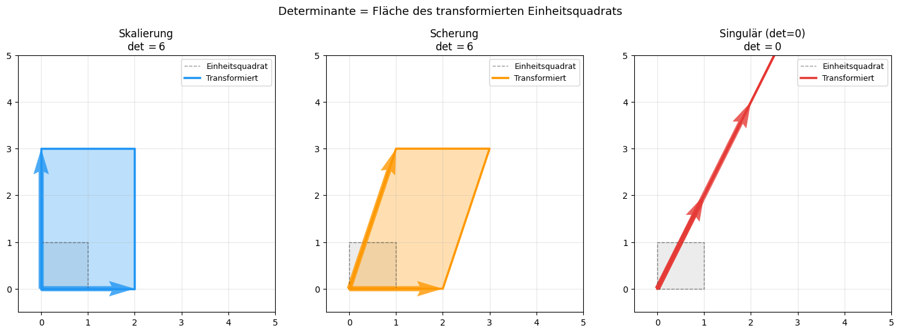
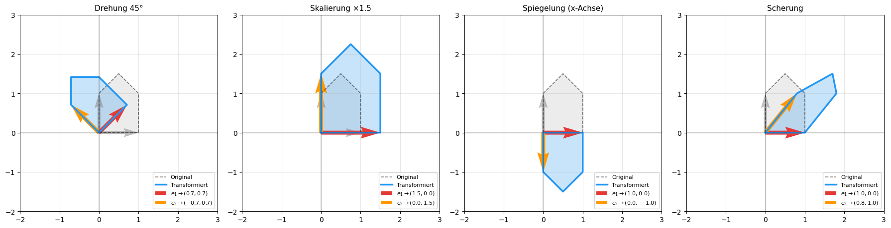

# Matrizen

## 02 - Grundlagen der Matrizen

Matrizen ($m \times n$) — Addition und Skalarmultiplikation (elementweise), Matrizenmultiplikation ($A \cdot B$: Zeile $\times$ Spalte), Determinante ($\det A = ad - bc$ für 2×2), inverse Matrix ($A^{-1}$) und lineare Gleichungssysteme als Matrixgleichung $A\vec x = \vec b$.

> Vorausgesetzt: Vektoren (05_Vektoren_Matrizen/01), lineare Gleichungssysteme (00_Grundlagen/03).

### Lernziele

- Du weißt, was eine Matrix ist und wie man sie notiert.
- Du kannst Matrizen **addieren**, **skalieren** und **multiplizieren**.
- Du kennst die **Determinante** (2×2 und 3×3) und weißt, was sie aussagt.
- Du kannst die **inverse Matrix** (2×2) berechnen.
- Du kannst ein **lineares Gleichungssystem** als Matrixgleichung $A\vec x = \vec b$ formulieren und lösen.

---

## 1. Definition und Notation

Eine **Matrix** ist ein rechteckiges Zahlenschema mit $m$ Zeilen und $n$ Spalten.

$$A = \begin{pmatrix} a_{11} & a_{12} & \cdots & a_{1n} \\ a_{21} & a_{22} & \cdots & a_{2n} \\ \vdots & \vdots & \ddots & \vdots \\ a_{m1} & a_{m2} & \cdots & a_{mn} \end{pmatrix} \in \mathbb{R}^{m \times n}$$

- $a_{ij}$ = Eintrag in Zeile $i$, Spalte $j$
- **Dimension:** $m \times n$ ("$m$ kreuz $n$", Zeilen × Spalten)

### Spezielle Matrizen

| Name | Eigenschaft | Beispiel (2×2) |
|---|---|---|
| **Quadratische Matrix** | $m = n$ | $\begin{pmatrix}1 & 2\\3 & 4\end{pmatrix}$ |
| **Einheitsmatrix** $I$ | Einsen auf der Diagonale, sonst 0 | $\begin{pmatrix}1 & 0\\0 & 1\end{pmatrix}$ |
| **Nullmatrix** $O$ | Alle Einträge 0 | $\begin{pmatrix}0 & 0\\0 & 0\end{pmatrix}$ |
| **Diagonalmatrix** | Nur Diagonale ≠ 0 | $\begin{pmatrix}3 & 0\\0 & 7\end{pmatrix}$ |
| **Transponierte** $A^T$ | Zeilen ↔ Spalten getauscht | $A = \begin{pmatrix}1 & 2\\3 & 4\end{pmatrix} \Rightarrow A^T = \begin{pmatrix}1 & 3\\2 & 4\end{pmatrix}$ |

> **Zusammenhang mit Vektoren:** Ein Spaltenvektor $\vec a = \begin{pmatrix}a_1\\a_2\end{pmatrix}$ ist eine Matrix der Dimension $2 \times 1$.

## 2. Addition und Skalarmultiplikation

Matrizen **gleicher Dimension** können elementweise addiert/subtrahiert werden:

$$A \pm B = \begin{pmatrix}a_{11} \pm b_{11} & a_{12} \pm b_{12}\\a_{21} \pm b_{21} & a_{22} \pm b_{22}\end{pmatrix}$$

**Skalarmultiplikation** — jeder Eintrag wird mit dem Skalar multipliziert:

$$c \cdot A = \begin{pmatrix}c \cdot a_{11} & c \cdot a_{12}\\c \cdot a_{21} & c \cdot a_{22}\end{pmatrix}$$

**Beispiel:**

$$\begin{pmatrix}1 & 3\\2 & 0\end{pmatrix} + \begin{pmatrix}4 & -1\\0 & 5\end{pmatrix} = \begin{pmatrix}5 & 2\\2 & 5\end{pmatrix}, \qquad 3 \cdot \begin{pmatrix}1 & 3\\2 & 0\end{pmatrix} = \begin{pmatrix}3 & 9\\6 & 0\end{pmatrix}$$

## 3. Matrixmultiplikation

Die Multiplikation $C = A \cdot B$ ist **nicht** elementweise! Der Eintrag $c_{ij}$ ist das **Skalarprodukt** der $i$-ten Zeile von $A$ mit der $j$-ten Spalte von $B$.

$$c_{ij} = \sum_{k=1}^{n} a_{ik} \cdot b_{kj}$$

### Dimensionsregel

$$A \in \mathbb{R}^{m \times \mathbf{n}}, \quad B \in \mathbb{R}^{\mathbf{n} \times p} \quad \Rightarrow \quad C = A \cdot B \in \mathbb{R}^{m \times p}$$

Die **inneren Dimensionen** ($n$) müssen übereinstimmen. Das Ergebnis hat die **äußeren Dimensionen** ($m \times p$).

### Beispiel (2×2)

$$\begin{pmatrix}1 & 2\\3 & 4\end{pmatrix} \cdot \begin{pmatrix}5 & 6\\7 & 8\end{pmatrix} = \begin{pmatrix}1{\cdot}5 + 2{\cdot}7 & 1{\cdot}6 + 2{\cdot}8\\3{\cdot}5 + 4{\cdot}7 & 3{\cdot}6 + 4{\cdot}8\end{pmatrix} = \begin{pmatrix}19 & 22\\43 & 50\end{pmatrix}$$

### Wichtige Eigenschaften

- **Nicht kommutativ:** $A \cdot B \neq B \cdot A$ (im Allgemeinen!)
- **Assoziativ:** $(A \cdot B) \cdot C = A \cdot (B \cdot C)$
- **Neutrales Element:** $A \cdot I = I \cdot A = A$
- **Matrix × Vektor:** $A \cdot \vec x$ ergibt einen neuen Vektor (→ lineare Abbildung)

    A =
    [[1 2]
     [3 4]]
    
    B =
    [[5 6]
     [7 8]]
    
    --- Addition ---
    A + B =
    [[ 6  8]
     [10 12]]
    
    --- Skalarmultiplikation ---
    3·A =
    [[ 3  6]
     [ 9 12]]
    
    --- Matrixmultiplikation ---
    A · B =
    [[19 22]
     [43 50]]
    B · A =
    [[23 34]
     [31 46]]
    
    A·B ≠ B·A?  True  (nicht kommutativ!)
    
    --- Einheitsmatrix ---
    A · I =
    [[1. 2.]
     [3. 4.]]
    
    --- Transponierte ---
    A^T =
    [[1 3]
     [2 4]]

## 4. Determinante

Die **Determinante** ist eine Zahl, die nur für **quadratische** Matrizen definiert ist. Sie sagt aus, ob ein Gleichungssystem eindeutig lösbar ist.

### 2×2-Determinante

$$\det(A) = \begin{vmatrix}a & b\\c & d\end{vmatrix} = a \cdot d - b \cdot c$$

**Beispiel:**

$$\det\begin{pmatrix}3 & 1\\2 & 5\end{pmatrix} = 3 \cdot 5 - 1 \cdot 2 = 13$$

### 3×3-Determinante (Regel von Sarrus)

Für $A = \begin{pmatrix}a_1 & a_2 & a_3\\b_1 & b_2 & b_3\\c_1 & c_2 & c_3\end{pmatrix}$:

$$\det(A) = a_1 b_2 c_3 + a_2 b_3 c_1 + a_3 b_1 c_2 - a_3 b_2 c_1 - a_1 b_3 c_2 - a_2 b_1 c_3$$

**Merkhilfe (Sarrus):** Man schreibt die ersten zwei Spalten nochmal rechts daneben und bildet die Produkte entlang der Diagonalen: ↘ positiv, ↗ negativ.

### Was sagt die Determinante aus?

| $\det(A)$ | Bedeutung |
|---|---|
| $\neq 0$ | Matrix ist **invertierbar**, LGS hat **genau eine** Lösung |
| $= 0$ | Matrix ist **singulär**, LGS hat **keine oder unendlich viele** Lösungen |
| $> 0$ | Orientierung bleibt erhalten |
| $< 0$ | Orientierung wird umgekehrt (Spiegelung) |

> **Geometrisch:** $|\det(A)|$ ist der **Flächeninhalt** des Parallelogramms, das die Spaltenvektoren aufspannen (2D), bzw. das **Volumen** des Parallelepipeds (3D).

    

    

## 5. Inverse Matrix

Die **Inverse** $A^{-1}$ ist die Matrix, für die gilt:

$$A \cdot A^{-1} = A^{-1} \cdot A = I$$

Sie existiert **nur**, wenn $\det(A) \neq 0$.

### Formel für 2×2

$$A = \begin{pmatrix}a & b\\c & d\end{pmatrix} \quad \Rightarrow \quad A^{-1} = \frac{1}{\det(A)} \begin{pmatrix}d & -b\\-c & a\end{pmatrix}$$

**Beispiel:**

$$A = \begin{pmatrix}3 & 1\\2 & 5\end{pmatrix}, \quad \det(A) = 13$$

$$A^{-1} = \frac{1}{13}\begin{pmatrix}5 & -1\\-2 & 3\end{pmatrix} = \begin{pmatrix}\frac{5}{13} & -\frac{1}{13}\\-\frac{2}{13} & \frac{3}{13}\end{pmatrix}$$

> Für größere Matrizen berechnet man die Inverse über den **Gauß-Jordan-Algorithmus** oder per Computer.

## 6. Lineare Gleichungssysteme als Matrixgleichung

Jedes LGS lässt sich kompakt als **Matrixgleichung** schreiben:

$$A \cdot \vec x = \vec b$$

### Beispiel

$$\begin{cases}2x + 3y = 7\\x - y = 1\end{cases} \quad \Longleftrightarrow \quad \underbrace{\begin{pmatrix}2 & 3\\1 & -1\end{pmatrix}}_{A} \cdot \underbrace{\begin{pmatrix}x\\y\end{pmatrix}}_{\vec x} = \underbrace{\begin{pmatrix}7\\1\end{pmatrix}}_{\vec b}$$

### Lösung über die Inverse

Wenn $\det(A) \neq 0$, dann ist die eindeutige Lösung:

$$\vec x = A^{-1} \cdot \vec b$$

### Lösung mit Gauß-Elimination

Man schreibt die **erweiterte Koeffizientenmatrix** $(A \mid \vec b)$ und formt mit erlaubten Zeilenoperationen um:

1. Zeile mit Skalar multiplizieren
2. Vielfaches einer Zeile zu einer anderen addieren
3. Zeilen vertauschen

**Ziel:** Stufenform (obere Dreiecksmatrix) → Rückwärtseinsetzen.

### Ausführliches Beispiel

$$\left(\begin{array}{cc|c}2 & 3 & 7\\1 & -1 & 1\end{array}\right)$$

**Schritt 1:** $Z_2 \leftarrow Z_2 - \frac{1}{2} Z_1$

$$\left(\begin{array}{cc|c}2 & 3 & 7\\0 & -\frac{5}{2} & -\frac{5}{2}\end{array}\right)$$

**Schritt 2:** Aus Zeile 2: $-\frac{5}{2}y = -\frac{5}{2} \Rightarrow y = 1$

**Schritt 3:** Einsetzen in Zeile 1: $2x + 3(1) = 7 \Rightarrow x = 2$

**Lösung:** $x = 2,\ y = 1$

    =======================================================
    Determinante, Inverse und LGS
    =======================================================
    
    A =
    [[3 1]
     [2 5]]
    det(A) = 13
    
    A⁻¹ =
    [[ 0.38461538 -0.07692308]
     [-0.15384615  0.23076923]]
    A · A⁻¹ =
    [[ 1.  0.]
     [-0.  1.]]  (= I ✓)
    
    =======================================================
    LGS: 2x + 3y = 7,  x - y = 1
    =======================================================
    
    Lösung via A⁻¹·b:  x = 2,  y = 1
    Lösung via solve:   x = 2,  y = 1
    
    Probe: A · x = [7. 1.]  (soll: [7 1]) ✓
    
    =======================================================
    3×3 Determinante (Sarrus)
    =======================================================
    
    M =
    [[1 2 3]
     [4 5 6]
     [7 8 0]]
    det(M) = 27
    Handrechnung: 0 + 84 + 96 - 105 - 48 - 0 = 27 ✓

## 7. Geometrische Interpretation: Lineare Abbildungen

Eine $2 \times 2$-Matrix kann als **geometrische Transformation** der Ebene verstanden werden.

| Matrix | Transformation |
|---|---|
| $\begin{pmatrix}\cos\theta & -\sin\theta\\\sin\theta & \cos\theta\end{pmatrix}$ | **Drehung** um Winkel $\theta$ |
| $\begin{pmatrix}k & 0\\0 & k\end{pmatrix}$ | **Skalierung** um Faktor $k$ |
| $\begin{pmatrix}1 & 0\\0 & -1\end{pmatrix}$ | **Spiegelung** an der x-Achse |
| $\begin{pmatrix}1 & k\\0 & 1\end{pmatrix}$ | **Scherung** in x-Richtung |

Die Spalten der Matrix zeigen, wohin die **Einheitsvektoren** $\vec e_1 = \begin{pmatrix}1\\0\end{pmatrix}$ und $\vec e_2 = \begin{pmatrix}0\\1\end{pmatrix}$ abgebildet werden.

    

    

---

## Verständnis-Check

*Löse die folgenden Aufgaben auf Papier.*

#### Aufgabe 1: Grundoperationen

Gegeben: $A = \begin{pmatrix}2 & -1\\0 & 3\end{pmatrix},\ B = \begin{pmatrix}1 & 4\\-2 & 5\end{pmatrix}$

a) Berechne $A + B$

b) Berechne $2A - B$

c) Berechne $A \cdot B$

d) Berechne $B \cdot A$. Ist $A \cdot B = B \cdot A$?

#### Aufgabe 2: Determinante

a) Berechne $\det\begin{pmatrix}4 & 3\\2 & 1\end{pmatrix}$

b) Berechne $\det\begin{pmatrix}1 & 2 & 0\\3 & 1 & -1\\2 & 0 & 4\end{pmatrix}$ mit der Regel von Sarrus.

c) Für welches $k$ ist $\begin{pmatrix}k & 2\\3 & k\end{pmatrix}$ singulär?

#### Aufgabe 3: Inverse Matrix

Berechne die Inverse von $A = \begin{pmatrix}5 & 2\\3 & 1\end{pmatrix}$ und überprüfe mit $A \cdot A^{-1} = I$.

#### Aufgabe 4: LGS als Matrixgleichung

Löse das folgende System mit der Inversen:

$$\begin{cases}3x + 2y = 12\\x + 4y = 10\end{cases}$$

### Lösungen

Lösung Aufgabe 1

a) $A + B = \begin{pmatrix}3 & 3\\-2 & 8\end{pmatrix}$

b) $2A - B = \begin{pmatrix}4-1 & -2-4\\0-(-2) & 6-5\end{pmatrix} = \begin{pmatrix}3 & -6\\2 & 1\end{pmatrix}$

c) $A \cdot B = \begin{pmatrix}2 \cdot 1 + (-1)(-2) & 2 \cdot 4 + (-1) \cdot 5\\0 \cdot 1 + 3 \cdot (-2) & 0 \cdot 4 + 3 \cdot 5\end{pmatrix} = \begin{pmatrix}4 & 3\\-6 & 15\end{pmatrix}$

d) $B \cdot A = \begin{pmatrix}1 \cdot 2 + 4 \cdot 0 & 1 \cdot (-1) + 4 \cdot 3\\(-2) \cdot 2 + 5 \cdot 0 & (-2)(-1) + 5 \cdot 3\end{pmatrix} = \begin{pmatrix}2 & 11\\-4 & 17\end{pmatrix}$

$A \cdot B \neq B \cdot A$ → **Matrixmultiplikation ist nicht kommutativ!**

Lösung Aufgabe 2

a) $\det = 4 \cdot 1 - 3 \cdot 2 = 4 - 6 = -2$

b) Sarrus: $1 \cdot 1 \cdot 4 + 2 \cdot (-1) \cdot 2 + 0 \cdot 3 \cdot 0 - 0 \cdot 1 \cdot 2 - 1 \cdot (-1) \cdot 0 - 2 \cdot 3 \cdot 4$
$= 4 - 4 + 0 - 0 - 0 - 24 = -24$

c) $\det = k^2 - 6 = 0 \Rightarrow k = \pm\sqrt{6} \approx \pm 2{,}449$

Lösung Aufgabe 3

$\det(A) = 5 \cdot 1 - 2 \cdot 3 = -1$

$$A^{-1} = \frac{1}{-1}\begin{pmatrix}1 & -2\\-3 & 5\end{pmatrix} = \begin{pmatrix}-1 & 2\\3 & -5\end{pmatrix}$$

Probe: $A \cdot A^{-1} = \begin{pmatrix}5 \cdot (-1) + 2 \cdot 3 & 5 \cdot 2 + 2 \cdot (-5)\\3 \cdot (-1) + 1 \cdot 3 & 3 \cdot 2 + 1 \cdot (-5)\end{pmatrix} = \begin{pmatrix}1 & 0\\0 & 1\end{pmatrix}$ ✓

Lösung Aufgabe 4

$A = \begin{pmatrix}3 & 2\\1 & 4\end{pmatrix},\quad \vec b = \begin{pmatrix}12\\10\end{pmatrix}$

$\det(A) = 12 - 2 = 10$

$$A^{-1} = \frac{1}{10}\begin{pmatrix}4 & -2\\-1 & 3\end{pmatrix}$$

$$\vec x = A^{-1}\vec b = \frac{1}{10}\begin{pmatrix}4 \cdot 12 + (-2) \cdot 10\\(-1) \cdot 12 + 3 \cdot 10\end{pmatrix} = \frac{1}{10}\begin{pmatrix}28\\18\end{pmatrix} = \begin{pmatrix}2{,}8\\1{,}8\end{pmatrix}$$

Probe: $3 \cdot 2{,}8 + 2 \cdot 1{,}8 = 8{,}4 + 3{,}6 = 12$ ✓, $\quad 1 \cdot 2{,}8 + 4 \cdot 1{,}8 = 2{,}8 + 7{,}2 = 10$ ✓

## Zusammenfassung

| Konzept | Kernaussage |
|---------|-------------|
| **Matrix** | Rechteckige Zahlentabelle $A \in \mathbb{R}^{m \times n}$ |
| **Addition / Skalierung** | Komponentenweise; gleiche Dimension nötig |
| **Multiplikation** | Zeile × Spalte; $A_{m \times n} \cdot B_{n \times p} = C_{m \times p}$; **nicht kommutativ** |
| **Determinante (2×2)** | $\det(A) = ad - bc$ |
| **Determinante (3×3)** | Regel von Sarrus |
| **Inverse (2×2)** | $A^{-1} = \frac{1}{\det(A)}\begin{pmatrix}d & -b\\-c & a\end{pmatrix}$; existiert nur wenn $\det \neq 0$ |
| **LGS als Matrix** | $A\vec x = \vec b \Rightarrow \vec x = A^{-1}\vec b$ |
| **Geometrische Transformation** | Matrizen beschreiben Drehungen, Spiegelungen, Skalierungen |

---

## Glossar

| Deutsch | Englisch |
|---------|----------|
| Matrix / Matrizen | Matrix / Matrices |
| Dimension | Dimension |
| Zeile | Row |
| Spalte | Column |
| Quadratische Matrix | Square matrix |
| Einheitsmatrix | Identity matrix |
| Transponierte | Transpose |
| Matrixmultiplikation | Matrix multiplication |
| Determinante | Determinant |
| Inverse Matrix | Inverse matrix |
| Singulär | Singular |
| Koeffizientenmatrix | Coefficient matrix |
| Erweiterte Matrix | Augmented matrix |
| Gauß-Elimination | Gaussian elimination |
| Lineare Abbildung | Linear transformation |
