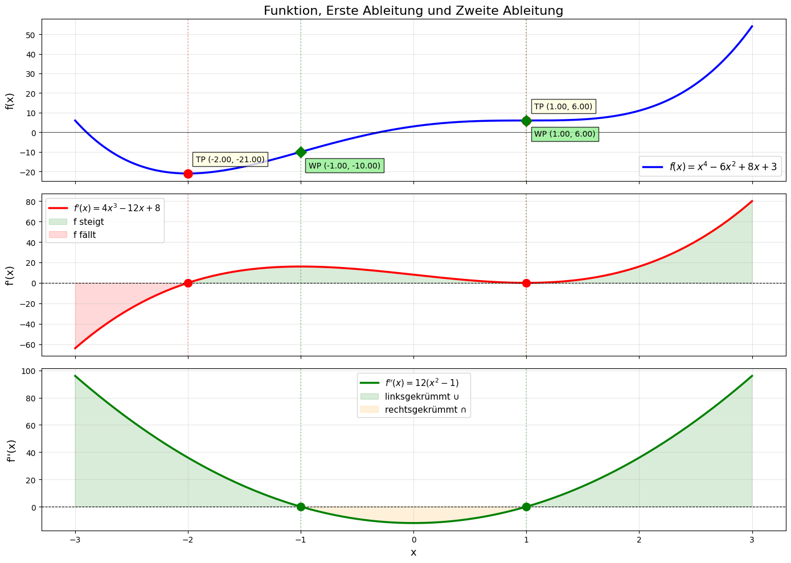
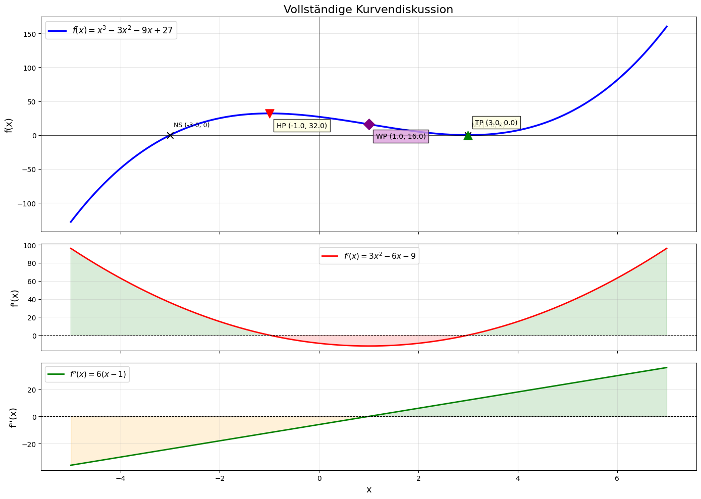

# Analysis
## 04 - Höhere Ableitungen und Kurvendiskussion

Zweite und höhere Ableitungen:
- $f'$ bestimmt die Monotonie ($f' > 0 \implies$ steigend)
- $f''$ die Krümmung ($f'' > 0 \implies$ linksgekrümmt/konvex)
- Extremstellen ($f' = 0$ und $f'' \neq 0$) und 
- Wendepunkte ($f'' = 0$ mit Vorzeichenwechsel)
- vollständige Kurvendiskussion.

> Vorausgesetzt: Ableitungsregeln.

### Lernziele

- **Höhere Ableitungen** ($f'', f''', \ldots$) zu berechnen und zu interpretieren
- **Den Zusammenhang zwischen $f$, $f'$ und $f''$** visuell zu verstehen
- **Monotonieverhalten** (Steigen/Fallen) aus $f'$ abzulesen
- **Extremstellen** (Hoch- und Tiefpunkte) zu bestimmen
- **Krümmungsverhalten** und **Wendepunkte** mit $f''$ zu finden
- Eine vollständige **Kurvendiskussion** durchzuführen

---

### 1. Höhere Ableitungen

Wenn wir eine Funktion $f(x)$ ableiten, erhalten wir $f'(x)$ - die **erste Ableitung**. Aber $f'(x)$ ist selbst wieder eine Funktion, die wir ableiten können!

| Notation | Name | Bedeutung |
|----------|------|-----------|
| $f'(x)$ oder $\frac{df}{dx}$ | Erste Ableitung | Steigung (Änderungsrate) |
| $f''(x)$ oder $\frac{d^2f}{dx^2}$ | Zweite Ableitung | Änderung der Steigung (Krümmung) |
| $f'''(x)$ oder $\frac{d^3f}{dx^3}$ | Dritte Ableitung | Änderung der Krümmung |

**Beispiel:** $f(x) = x^4 - 6x^2 + 8x + 3$
- $f'(x) = 4x^3 - 12x + 8$ (Potenz- und Summenregel)
- $f''(x) = 12x^2 - 12$ (nochmal ableiten)
- $f'''(x) = 24x$ (nochmal ableiten)

#### Was sagen uns diese Ableitungen?

| Ableitung | Aussage |
|-----------|---------|
| $f'(x) > 0$ | Funktion **steigt** (monoton wachsend) |
| $f'(x) < 0$ | Funktion **fällt** (monoton fallend) |
| $f'(x) = 0$ | Mögliche **Extremstelle** (Hoch-/Tiefpunkt) oder Sattelpunkt |
| $f''(x) > 0$ | Kurve ist **linksgekrümmt** (konkav ∪) |
| $f''(x) < 0$ | Kurve ist **rechtsgekrümmt** (konvex ∩) |
| $f''(x) = 0$ | Möglicher **Wendepunkt** (Krümmungswechsel) |

    f(x)   = x**4 - 6*x**2 + 8*x + 3
    f'(x)  = 4*x**3 - 12*x + 8
    f''(x) = 12*(x**2 - 1)
    f'''(x)= 24*x

### 2. Das Zusammenspiel von $f$, $f'$ und $f''$

Die folgende Grafik zeigt die Funktion, ihre erste und zweite Ableitung **untereinander**. Beobachte:
- Wo $f'(x) = 0$ kreuzt (rote Linie die x-Achse), hat $f$ eine Extremstelle
- Wo $f'(x) > 0$, steigt $f$ - wo $f'(x) < 0$, fällt $f$
- Wo $f''(x) = 0$ kreuzt (grüne Linie die x-Achse), hat $f$ einen Wendepunkt
- Wo $f''(x) > 0$, ist $f$ linksgekrümmt - wo $f''(x) < 0$, rechtsgekrümmt

    

    

### 3. Extremstellen bestimmen

Um Hoch- und Tiefpunkte systematisch zu finden, gehst Du in zwei Schritten vor:

**Schritt 1: Notwendige Bedingung** - Setze $f'(x) = 0$ und löse nach $x$.
Die Lösungen sind die **Kandidaten** für Extremstellen.

**Schritt 2: Hinreichende Bedingung** - Prüfe mit der zweiten Ableitung, ob es sich um ein Maximum oder Minimum handelt:
- $f''(x_0) < 0 \Rightarrow$ **Hochpunkt** (Maximum) - die Kurve ist rechtsgekrümmt ∩
- $f''(x_0) > 0 \Rightarrow$ **Tiefpunkt** (Minimum) - die Kurve ist linksgekrümmt ∪
- $f''(x_0) = 0 \Rightarrow$ Keine Aussage! Könnte ein **Sattelpunkt** sein (→ höhere Ableitungen prüfen)

#### Was ist ein Sattelpunkt?
Ein **Sattelpunkt** (auch Terrassenpunkt) ist eine Stelle, an der $f'(x_0) = 0$ und $f''(x_0) = 0$ gilt, aber **kein Extremum** vorliegt. Die Funktion hat dort einen horizontalen Wendepunkt - sie „ruht" kurz und setzt dann in derselben Richtung fort.

**Beispiel:** $f(x) = x^3$ bei $x = 0$:
- $f'(x) = 3x^2 \Rightarrow f'(0) = 0$ ✓
- $f''(x) = 6x \Rightarrow f''(0) = 0$ - keine Aussage!
- $f'''(x) = 6 \Rightarrow f'''(0) = 6 \neq 0$ → Wendepunkt (Sattelpunkt)

    f(x)   = x**4 - 6*x**2 + 8*x + 3
    f'(x)  = 4*x**3 - 12*x + 8
    f''(x) = 12*(x**2 - 1)
    
    Kritische Stellen (f'(x)=0): [-2, 1]
    
    x₀ = -2.0000: f(x₀) = -21.0000, f''(x₀) = 36.0000 → TIEFPUNKT (Minimum)
    x₀ = 1.0000: f(x₀) = 6.0000, f''(x₀) = 0.0000 → KEINE AUSSAGE (evtl. Sattelpunkt)
    
    --- Sattelpunkt-Beispiel: f(x) = x³ ---
    f'(0)  = 0
    f''(0) = 0 → keine Aussage!
    f'''(0)= 6 ≠ 0 → Sattelpunkt

### 4. Wendepunkte bestimmen

Ein **Wendepunkt** ist eine Stelle, an der die Krümmung der Kurve wechselt (von linksgekrümmt zu rechtsgekrümmt oder umgekehrt).

**Schritt 1: Notwendige Bedingung** - Setze $f''(x) = 0$ und löse nach $x$.

**Schritt 2: Hinreichende Bedingung** - Prüfe, ob die Krümmung tatsächlich wechselt:
- $f'''(x_0) \neq 0 \Rightarrow$ **Wendepunkt bestätigt**
- $f'''(x_0) = 0 \Rightarrow$ Keine Aussage (noch höhere Ableitung prüfen)

*Alternativ kannst Du auch einen Vorzeichenwechsel von $f''$ links und rechts der Stelle prüfen.*

---

### 5. Vollständige Kurvendiskussion - Schritt für Schritt

Eine **Kurvendiskussion** ist die systematische Analyse einer Funktion. Der Ablauf ist wie folgt:

| Schritt | Was? | Wie? |
|---------|------|------|
| 1 | **Definitionsbereich** | Wo ist $f(x)$ definiert? |
| 2 | **Symmetrie** | Achsensymmetrie ($f(-x)=f(x)$)? Punktsymmetrie ($f(-x)=-f(x)$)? |
| 3 | **Nullstellen** | Löse $f(x) = 0$ |
| 4 | **Extremstellen** | $f'(x) = 0$ lösen, $f''$ prüfen |
| 5 | **Wendepunkte** | $f''(x) = 0$ lösen, $f'''$ prüfen |
| 6 | **Monotonieverhalten** | Wo ist $f'(x) > 0$ (steigend) bzw. $< 0$ (fallend)? |
| 7 | **Krümmungsverhalten** | Wo ist $f''(x) > 0$ (linksgekr.) bzw. $< 0$ (rechtsgekr.)? |
| 8 | **Verhalten im Unendlichen** | $\lim_{x \to \pm\infty} f(x)$ |
| 9 | **Graph zeichnen** | Alles zusammenführen |

Komplett durchgeführt liefert die Kurvendiskussion ein umfassendes Bild der Funktion - wo sie steigt/fällt, wo sie Extremstellen und Wendepunkte hat, wie sie sich im Unendlichen verhält und wie ihr Graph aussieht.

In Python (für Notebook-Leser, PDF-Leser sehen nur die Ausgabe):

    ============================================================
    KURVENDISKUSSION: f(x) = x³ - 3x² - 9x + 27
    ============================================================
    
    1. DEFINITIONSBEREICH
       D = ℝ (Polynom → überall definiert)
    
    2. SYMMETRIE
       Keine Symmetrie
    
    3. NULLSTELLEN
       x = -3
       x = 3
    
    4. EXTREMSTELLEN
       f'(x)  = 3*x**2 - 6*x - 9
       x₀ = -1: f(x₀) = 32, f''(x₀) = -12 → Hochpunkt (-1, 32)
       x₀ = 3: f(x₀) = 0, f''(x₀) = 12 → Tiefpunkt (3, 0)
    
    5. WENDEPUNKTE
       f''(x) = 6*(x - 1)
       x₀ = 1: f(x₀) = 16, f'''(x₀) = 6 ≠ 0 → Wendepunkt (1, 16)
    
    6. MONOTONIEVERHALTEN
       f'(x) = 3*x**2 - 6*x - 9 = 3*(x - 3)*(x + 1)
       Steigend: (-∞, -1.0) und (3.0, +∞)
       Fallend:  (-1.0, 3.0)
    
    7. KRÜMMUNGSVERHALTEN
       Rechtsgekrümmt (∩): (-∞, 1.0)
       Linksgekrümmt  (∪): (1.0, +∞)
    
    8. VERHALTEN FÜR x → ±∞
       lim(x→+∞) = oo
       lim(x→-∞) = -oo
    
    9. GRAPH → siehe Plot unten

    

    

---

## Verständnis-Check
*Führe eine vollständige Kurvendiskussion auf Papier durch!*

**Aufgabe 1:** $f(x) = -x^3 + 3x + 2$

Bestimme:
- a) Ableitungen $f'(x)$ und $f''(x)$
- b) Extremstellen (Art und Koordinaten)
- c) Wendepunkte
- d) Monotonie- und Krümmungsintervalle

**Aufgabe 2:** $f(x) = x^4 - 8x^2$

Bestimme:
- a) Nullstellen
- b) Symmetrie
- c) Extremstellen
- d) Wendepunkte
- e) Skizziere den Graphen mit allen gefundenen Punkten

**Aufgabe 3:** Erkläre den Unterschied zwischen einem **Wendepunkt** und einem **Sattelpunkt**. Gib jeweils ein Beispiel einer Funktion an.

**Aufgabe 4:** Bei welcher Funktion gilt $f'(x) = 0$ und $f''(x) = 0$ bei $x=0$, aber es liegt *kein* Extremum und *kein* Wendepunkt vor?
*(Tipp: Denke an $f(x) = x^4$ - prüfe genau!)*

### Lösungen

Lösung Aufgabe 1

- a) $f'(x) = -3x^2 + 3$, $f''(x) = -6x$
- b) $f'(x) = 0 \Rightarrow -3x^2 + 3 = 0 \Rightarrow x^2 = 1 \Rightarrow x = \pm 1$
  - $f''(-1) = 6 > 0 \Rightarrow$ Tiefpunkt $(-1, 0)$
  - $f''(1) = -6 < 0 \Rightarrow$ Hochpunkt $(1, 4)$
- c) $f''(x) = 0 \Rightarrow x = 0$, $f'''(x) = -6 \neq 0 \Rightarrow$ Wendepunkt $(0, 2)$
- d) Steigend: $(-1, 1)$, Fallend: $(-\infty, -1)$ und $(1, \infty)$.
  Linksgekrümmt: $(-\infty, 0)$, Rechtsgekrümmt: $(0, \infty)$

Lösung Aufgabe 2

- a) $x^4 - 8x^2 = x^2(x^2 - 8) = 0 \Rightarrow x = 0, x = \pm 2\sqrt{2}$
- b) $f(-x) = (-x)^4 - 8(-x)^2 = x^4 - 8x^2 = f(x) \Rightarrow$ achsensymmetrisch
- c) $f'(x) = 4x^3 - 16x = 4x(x^2 - 4) = 0 \Rightarrow x = 0, \pm 2$
  - $f''(x) = 12x^2 - 16$; $f''(0) = -16 < 0 \Rightarrow$ HP $(0, 0)$
  - $f''(2) = 32 > 0 \Rightarrow$ TP $(2, -16)$; $f''(-2) = 32 > 0 \Rightarrow$ TP $(-2, -16)$
- d) $f''(x) = 0 \Rightarrow 12x^2 = 16 \Rightarrow x = \pm\frac{2\sqrt{3}}{3}$, WP bei $(\pm 1{,}15; -7{,}11)$

Lösung Aufgabe 3

- **Wendepunkt:** Stelle, an der die Krümmung wechselt ($f'' = 0$ mit VZW). Bsp: $f(x) = x^3$ bei $x=0$.
- **Sattelpunkt:** Spezialfall eines Wendepunkts, bei dem *zusätzlich* $f' = 0$ gilt (horizontale Tangente). Bsp: $f(x) = x^3$ bei $x=0$.
- Jeder Sattelpunkt ist ein Wendepunkt, aber nicht umgekehrt!

Lösung Aufgabe 4

$f(x) = x^4$: $f'(0) = 0$, $f''(0) = 0$, aber $f''''(0) = 24 > 0$. Es liegt ein Tiefpunkt vor (kein Wendepunkt). Die hinreichende Bedingung $f''=0$ liefert keine Aussage - man muss höhere Ableitungen prüfen!

    
    ============================================================
      Aufgabe 1: -x³ + 3x + 2
    ============================================================
    f(x)   = -x**3 + 3*x + 2
    f'(x)  = 3 - 3*x**2
    f''(x) = -6*x
    
    Nullstellen: [-1, 2]
    
    Kritische Stellen: [-1, 1]
      x=-1: f=0, f''=6 → TP
      x=1: f=4, f''=-6 → HP
    
    Wendepunkt-Kandidaten: [0]
      x=0: f=2, f'''=-6 → WP
    
    ============================================================
      Aufgabe 2: x⁴ - 8x²
    ============================================================
    f(x)   = x**4 - 8*x**2
    f'(x)  = 4*x**3 - 16*x
    f''(x) = 4*(3*x**2 - 4)
    
    Nullstellen: [0, -2*sqrt(2), 2*sqrt(2)]
    
    Kritische Stellen: [-2, 0, 2]
      x=-2: f=-16, f''=32 → TP
      x=0: f=0, f''=-16 → HP
      x=2: f=-16, f''=32 → TP
    
    Wendepunkt-Kandidaten: [-2*sqrt(3)/3, 2*sqrt(3)/3]
      x=-2*sqrt(3)/3: f=-80/9, f'''=-16*sqrt(3) → WP
      x=2*sqrt(3)/3: f=-80/9, f'''=16*sqrt(3) → WP

---

## Zusammenfassung

| Konzept | Kernaussage |
|---------|-------------|
| **Höhere Ableitungen** | $f'', f''', \ldots$ geben Auskunft über Krümmung und deren Änderung |
| **$f'$** | Steigungsverhalten: positiv = steigend, negativ = fallend |
| **$f''$** | Krümmungsverhalten: positiv = linksgekrümmt (∪), negativ = rechtsgekrümmt (∩) |
| **Extremstellen** | $f'(x_0) = 0$ (notwendig), $f''(x_0) \neq 0$ (hinreichend) |
| **Wendepunkte** | $f''(x_0) = 0$ (notwendig), $f'''(x_0) \neq 0$ (hinreichend) |
| **Sattelpunkt** | Wendepunkt mit horizontaler Tangente ($f' = 0$ und $f'' = 0$) |
| **Kurvendiskussion** | Systematisches Werkzeug zur vollständigen Funktionsanalyse |

---

## Glossar

| Deutsch | Englisch |
|---------|----------|
| Höhere Ableitung | Higher-order derivative |
| Erste / Zweite / Dritte Ableitung | First / Second / Third derivative |
| Extremstelle | Extremum (critical point) |
| Hochpunkt (Maximum) | Maximum (peak) |
| Tiefpunkt (Minimum) | Minimum (valley) |
| Sattelpunkt / Terrassenpunkt | Saddle point / Inflection with zero slope |
| Wendepunkt | Inflection point |
| Monotonieverhalten | Monotonicity |
| Krümmungsverhalten | Concavity |
| Linksgekrümmt (konkav) | Concave up |
| Rechtsgekrümmt (konvex) | Concave down |
| Kurvendiskussion | Curve sketching / Curve analysis |
| Notwendige Bedingung | Necessary condition |
| Hinreichende Bedingung | Sufficient condition |
