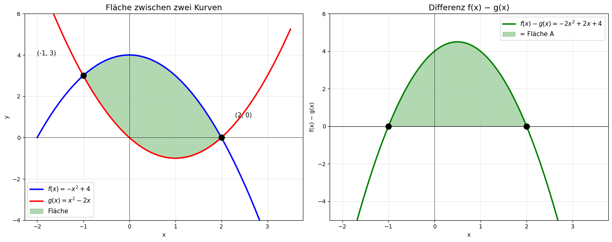
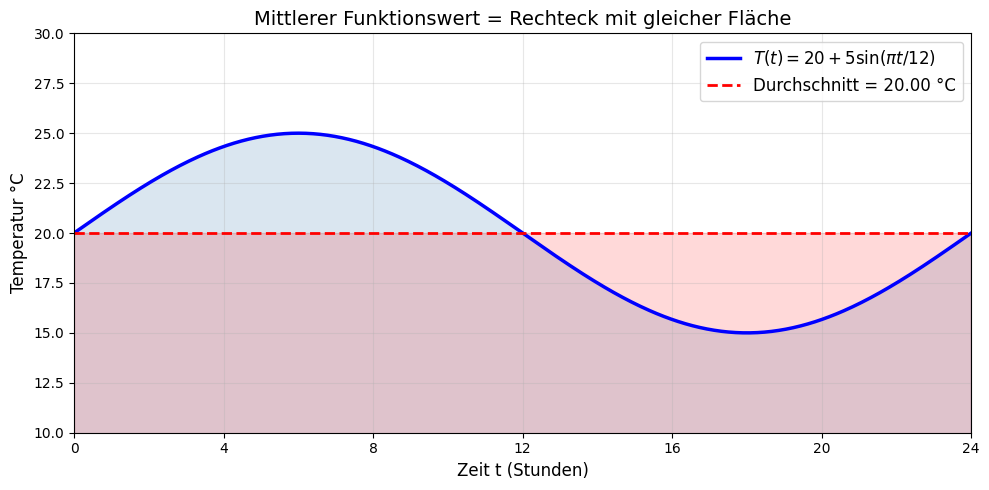

# Analysis
## 06 - Integrationsregeln und Anwendungen

- Integration durch Substitution ($\int f(g(x)) \cdot g'(x)dx = \int f(u)du$, Gegenstück zur Kettenregel) und 
- partielle Integration ($\int u\,dv = uv - \int v\,du$, Gegenstück zur Produktregel)
- Flächen zwischen zwei Kurven als $\int_a^b (f_{\text{oben}} - f_{\text{unten}})dx$.

> Vorausgesetzt: Integralrechnung Grundlagen, Ableitungsregeln.

### Lernziele

- **Substitution** anwenden, um verkettete Funktionen zu integrieren
- **Partielle Integration** für Produkte einsetzen
- **Flächen zwischen zwei Kurven** berechnen
- Typische Integrale der Matura sicher lösen

---

### 1. Integration durch Substitution

Die Substitution ist das Gegenstück zur **Kettenregel** beim Ableiten.

> **Idee:** Ersetze einen komplizierten Ausdruck durch eine neue Variable $u$, integriere einfacher, und setze zurück.

**Formel:**

$$\int f(g(x)) \cdot g'(x)\, dx = \int f(u)\, du \quad \text{mit } u = g(x)$$

**Schritt-für-Schritt:**
1. Wähle $u = g(x)$ (der „innere Teil")
2. Berechne $\frac{du}{dx} = g'(x)$ und forme um zu $du = g'(x)\, dx$
3. Ersetze im Integral: $\int f(g(x)) \cdot g'(x)\, dx = \int f(u)\, du$
4. Integriere nach $u$
5. Rücksubstitution: Setze $u = g(x)$ wieder ein

---

**Beispiel 1:** $\displaystyle\int 2x \cdot e^{x^2}\, dx$

1. Setze $u = x^2$
2. $\frac{du}{dx} = 2x \Rightarrow du = 2x\, dx$
3. Das Integral wird: $\int e^u\, du$
4. Integrieren: $e^u + C$
5. Rücksubstitution: $e^{x^2} + C$ ✓

**Beispiel 2:** $\displaystyle\int \cos(3x)\, dx$

1. Setze $u = 3x$
2. $\frac{du}{dx} = 3 \Rightarrow dx = \frac{du}{3}$
3. Das Integral wird: $\int \cos(u) \cdot \frac{1}{3}\, du = \frac{1}{3}\int \cos(u)\, du$
4. Integrieren: $\frac{1}{3}\sin(u) + C$
5. Rücksubstitution: $\frac{1}{3}\sin(3x) + C$ ✓

---

### Substitution bei bestimmten Integralen

Bei bestimmten Integralen **müssen auch die Grenzen angepasst** werden!

**Beispiel:** $\displaystyle\int_0^2 x(x^2+1)^3\, dx$

1. Setze $u = x^2 + 1$
2. $du = 2x\, dx \Rightarrow x\, dx = \frac{du}{2}$
3. **Grenzen anpassen:**
   - $x = 0 \Rightarrow u = 0^2 + 1 = 1$
   - $x = 2 \Rightarrow u = 2^2 + 1 = 5$
4. Integral: $\displaystyle\int_1^5 u^3 \cdot \frac{1}{2}\, du = \frac{1}{2}\left[\frac{u^4}{4}\right]_1^5 = \frac{1}{8}(625 - 1) = 78$

    === Substitution mit SymPy verifizieren ===
    
    ∫ 2x·e^(x²) dx  = exp(x**2)  + C
    ∫ cos(3x) dx    = sin(3*x)/3  + C
    ∫ (2x+1)⁵ dx   = 16*x**6/3 + 16*x**5 + 20*x**4 + 40*x**3/3 + 5*x**2 + x  + C
    ∫ x·√(x²+1) dx = x**2*sqrt(x**2 + 1)/3 + sqrt(x**2 + 1)/3  + C
    ∫ 1/(x·ln(x)) dx = log(log(x))  + C
    
    === Bestimmtes Integral mit Substitution ===
    ∫₀² x(x²+1)³ dx = 78 = 78.0
    
    === Probe (Ableitung der Stammfunktion) ===
    d/dx [e^(x²)] = 2*x*exp(x**2)  ✓

### 2. Partielle Integration

Die partielle Integration ist das Gegenstück zur **Produktregel** beim Ableiten.

> **Formel:**
> $$\int u(x) \cdot v'(x)\, dx = u(x) \cdot v(x) - \int u'(x) \cdot v(x)\, dx$$

Kurz: $\int u\, dv = uv - \int v\, du$

**Wann anwenden?** Diese Regel ist angebracht, wenn ein Produkt zweier Funktionen unterschiedlichen Typs integriert werden soll, und weder Substitution noch andere Vereinfachungen möglich sind.

**Strategie - LIATE-Regel** (wähle $u$ nach dieser Priorität):

| Priorität | Typ | Beispiel |
|-----------|-----|----------|
| 1 | **L**ogarithmus | $\ln x$ |
| 2 | **I**nverse Trig | $\arctan x$ |
| 3 | **A**lgebraisch | $x^2, x, 3x+1$ |
| 4 | **T**rigonometrisch | $\sin x, \cos x$ |
| 5 | **E**xponentiell | $e^x$ |

---

**Beispiel:** $\displaystyle\int x \cdot e^x\, dx$

| Wahl | |
|------|---|
| $u = x$ | $u' = 1$ |
| $v' = e^x$ | $v = e^x$ |

$$\int x \cdot e^x\, dx = x \cdot e^x - \int 1 \cdot e^x\, dx = x e^x - e^x + C = e^x(x-1) + C$$

---

**Beispiel:** $\displaystyle\int \ln x\, dx$

| Wahl | |
|------|---|
| $u = \ln x$ | $u' = \frac{1}{x}$ |
| $v' = 1$ | $v = x$ |

$$\int \ln x\, dx = x \ln x - \int x \cdot \frac{1}{x}\, dx = x \ln x - x + C$$

    === Partielle Integration mit SymPy ===
    
    ∫ x·eˣ dx   = (x - 1)*exp(x)  + C
    ∫ ln(x) dx  = x*log(x) - x  + C
    ∫ x·sin(x) dx = -x*cos(x) + sin(x)  + C
    ∫ x²·eˣ dx  = (x**2 - 2*x + 2)*exp(x)  + C  (2x partielle Int.)
    
    === Probe ===
    d/dx [eˣ(x-1)] = x*exp(x)  ✓

### 3. Überblick: Welche Methode wann?

| Integraltyp | Methode | Beispiel |
|-------------|---------|----------|
| Grundintegral | Tabelle | $\int x^3\, dx$ |
| Lineares Argument | Schnelle Substitution | $\int e^{2x}\, dx = \frac{1}{2}e^{2x}$ |
| Verkettung mit $g'(x)$ sichtbar | Substitution | $\int 2x \cdot e^{x^2}\, dx$ |
| Produkt (verschiedene Typen) | Partielle Integration | $\int x \cdot e^x\, dx$ |
| Bruch mit Polynomen | Polynomdivision + Partialbrüche | $\int \frac{x^2}{x-1}\, dx$ |
| $\frac{0}{0}$-Form (Bruch, vereinfachbar) | Kürzen, dann integrieren | $\int \frac{x^2-1}{x-1}\, dx$ |

> *Hinweis:* In der Matura sind meist Substitution und partielle Integration die wichtigsten Techniken.

### 4. Fläche zwischen zwei Kurven

Die Fläche zwischen $f(x)$ (oben) und $g(x)$ (unten) auf $[a, b]$:

$$A = \int_a^b [f(x) - g(x)]\, dx$$

**Schritt-für-Schritt:**
1. Schnittpunkte finden: $f(x) = g(x)$
2. Bestimme, welche Funktion oben/unten liegt
3. Integriere die Differenz

**Beispiel:** Fläche zwischen $f(x) = -x^2 + 4$ und $g(x) = x^2 - 2x$

Schnittpunkte: $-x^2 + 4 = x^2 - 2x \Rightarrow 2x^2 - 2x - 4 = 0 \Rightarrow x = -1$ oder $x = 2$

    Schnittpunkte: x = [-1, 2]
    Fläche = ∫₋₁² [f(x)-g(x)] dx = 9 = 9.0000

    

    

### 5. Anwendungen der Integralrechnung

| Anwendung | Formel |
|-----------|--------|
| **Fläche unter Kurve** | $A = \int_a^b f(x)\, dx$ |
| **Fläche zwischen Kurven** | $A = \int_a^b [f(x) - g(x)]\, dx$ |
| **Mittlerer Funktionswert** | $\bar{f} = \frac{1}{b-a} \int_a^b f(x)\, dx$ |
| **Weg aus Geschwindigkeit** | $s(t) = \int_0^t v(\tau)\, d\tau$ |
| **Gesamtmenge aus Rate** | $\text{Menge} = \int_0^T \text{Rate}(t)\, dt$ |

---

**Beispiel: Mittlerer Funktionswert**

Die Durchschnittstemperatur von $T(t) = 20 + 5\sin\left(\frac{\pi t}{12}\right)$ über 24 Stunden:

$$\bar{T} = \frac{1}{24}\int_0^{24} \left[20 + 5\sin\left(\frac{\pi t}{12}\right)\right] dt$$

    

    

    Integral: ∫₀²⁴ T(t) dt = 480.00
    Mittlerer Wert: 480.00 / 24 = 20.00 °C

---

## Verständnis-Check

*Löse die folgenden Aufgaben eigenständig, bevor du die Lösungen konsultierst.*

**Aufgabe 1 (Substitution):** Berechne $\displaystyle\int (2x+3)^4\, dx$

**Aufgabe 2 (Substitution):** Berechne $\displaystyle\int_0^1 x \cdot e^{x^2}\, dx$

**Aufgabe 3 (Partielle Integration):** Berechne $\displaystyle\int x \cdot \cos x\, dx$

**Aufgabe 4 (Fläche):** Berechne die Fläche, die von $f(x) = x^2$ und $g(x) = x$ eingeschlossen wird.

**Aufgabe 5 (Anwendung):** Ein Auto fährt mit der Geschwindigkeit $v(t) = 3t^2$ (m/s). Wie weit fährt es in den ersten 4 Sekunden?

### Lösungen

Lösung Aufgabe 1

Substitution: $u = 2x+3, \quad du = 2\, dx \Rightarrow dx = \frac{du}{2}$

$$\int (2x+3)^4\, dx = \frac{1}{2}\int u^4\, du = \frac{1}{2} \cdot \frac{u^5}{5} + C = \frac{(2x+3)^5}{10} + C$$

Lösung Aufgabe 2

Substitution: $u = x^2, \quad du = 2x\, dx \Rightarrow x\, dx = \frac{du}{2}$

Grenzen: $x=0 \Rightarrow u=0$, $x=1 \Rightarrow u=1$

$$\int_0^1 x \cdot e^{x^2}\, dx = \frac{1}{2}\int_0^1 e^u\, du = \frac{1}{2}[e^u]_0^1 = \frac{1}{2}(e - 1) \approx 0.859$$

Lösung Aufgabe 3

Partielle Integration: $u = x, v' = \cos x$

$$\int x \cos x\, dx = x \sin x - \int \sin x\, dx = x \sin x + \cos x + C$$

Lösung Aufgabe 4

Schnittpunkte: $x^2 = x \Rightarrow x(x-1) = 0 \Rightarrow x = 0, x = 1$

Auf $[0,1]$ gilt $g(x) = x \geq x^2 = f(x)$, also:

$$A = \int_0^1 (x - x^2)\, dx = \left[\frac{x^2}{2} - \frac{x^3}{3}\right]_0^1 = \frac{1}{2} - \frac{1}{3} = \frac{1}{6}$$

Lösung Aufgabe 5

$$s = \int_0^4 3t^2\, dt = \left[t^3\right]_0^4 = 64 - 0 = 64 \text{ m}$$

Das Auto legt in 4 Sekunden 64 Meter zurück.

---

## Zusammenfassung

| Methode | Wann? | Formel |
|---------|-------|--------|
| **Substitution** | Verkettung $f(g(x)) \cdot g'(x)$ | $u = g(x)$, integriere nach $u$ |
| **Lineare Sub.** | Argument $ax+b$ | $\frac{1}{a}F(ax+b) + C$ |
| **Partielle Int.** | Produkt verschiedener Typen | $\int u\, dv = uv - \int v\, du$ |
| **Fläche zw. Kurven** | Eingeschlossene Fläche | $\int_a^b [f(x)-g(x)]\, dx$ |
| **Mittelwert** | Durchschnittswert von $f$ | $\frac{1}{b-a}\int_a^b f(x)\, dx$ |

> **Die Kern-Analysis-Reihe ist nun abgeschlossen!** Du beherrschst die Kernthemen: Grenzwerte → Ableitungen → Ableitungsregeln → Kurvendiskussion → Integration → Integrationsregeln → Anwendungen. Bei Interesse, gehen die nächsten Kapitel weiter mit **Partiellen Ableitungen** (für Funktionen mehrerer Variablen), **multivariatie Kettenregel** und **Gradienten**.

---

## Glossar

| Deutsch | Englisch |
|---------|----------|
| Substitution | Substitution / u-substitution |
| Partielle Integration | Integration by parts |
| Verkettung | Composition |
| Rücksubstitution | Back-substitution |
| Fläche zwischen Kurven | Area between curves |
| Mittlerer Funktionswert | Average value of a function |
| Partialbruchzerlegung | Partial fraction decomposition |

