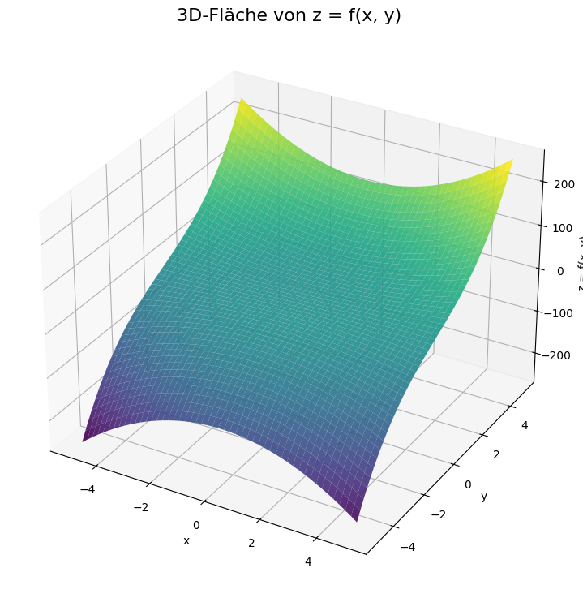
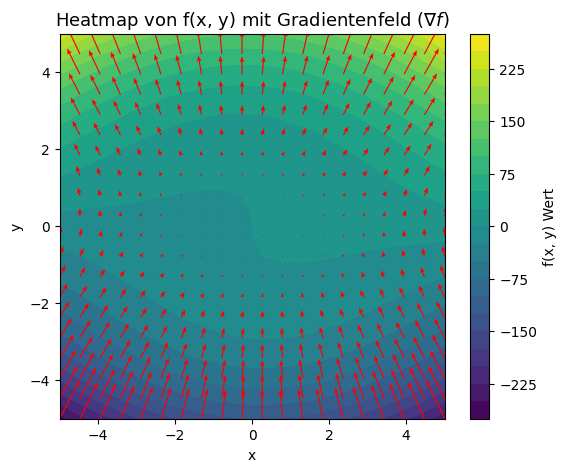

# Analysis
## 07 - Partielle Ableitungen: Steigungen in höheren Dimensionen

Partielle Ableitungen $\frac{\partial f}{\partial x}, \frac{\partial f}{\partial y}$ für Funktionen $f(x, y)$ und der Gradient $\nabla f = \begin{pmatrix}\frac{\partial f}{\partial x}\\\frac{\partial f}{\partial y}\end{pmatrix}$ als Vektor der steilsten Steigung und Grundlage des Gradientenabstiegs.

> Vorausgesetzt: Ableitungsregeln.

### Lernziele

- **Partielle Ableitungen** numerisch und symbolisch berechnen
- **Den Gradienten** $\nabla f$ als Vektor der steilsten Steigung
- **3D-Flächen** und **Gradientenfelder** visuell interpretieren
- Zusammenhänge zum Gradientenabstieg (Gradient Descent) erkennen

---

### 1. Definition und numerische Berechnung

Die Definition ist sehr ähnlich zur gewöhnlichen Ableitung. Für die partielle Ableitung nach $x$ ändert sich nur $x$, während $y$ festgehalten wird:
$$
\frac{\partial f}{\partial x}(x, y) = \lim_{h \to 0} \frac{f(x+h, y) - f(x, y)}{h}
$$

Und für $y$:
$$
\frac{\partial f}{\partial y}(x, y) = \lim_{h \to 0} \frac{f(x, y+h) - f(x, y)}{h}
$$

**Praktische Berechnung:** Alle *anderen* Variablen werden wie Konstanten behandelt, und es wird nach den üblichen Ableitungsregeln vorgegangen.

**Beispiel:** $f(x, y) = x^2 y + 2x + y^3$
- $\frac{\partial f}{\partial x} = 2xy + 2$ ($y$ und $y^3$ werden wie Konstanten behandelt)
- $\frac{\partial f}{\partial y} = x^2 + 3y^2$ ($x^2$ und $2x$ werden wie Konstanten behandelt)

Wir können unsere `numerische_ableitung`-Funktion wiederverwenden, indem wir mit Pythons `lambda` temporäre Ein-Variablen-Funktionen erstellen:

    Partielle Ableitung ∂f/∂x bei (3, 4): 26.00000045
    Exakt: 2xy + 2 = 26
    
    Partielle Ableitung ∂f/∂y bei (3, 4): 57.00000131
    Exakt: x² + 3y² = 57

### 2. Der Gradient: Die Richtung des steilsten Anstiegs

Wir haben die Steigung in x-Richtung ($\frac{\partial f}{\partial x}$) und die Steigung in y-Richtung ($\frac{\partial f}{\partial y}$) berechnet. Was passiert, wenn wir diese beiden Werte zu einem **Vektor** zusammenfassen?

Diesen Vektor nennt man den **Gradienten**, geschrieben als $\nabla f$ (gesprochen: „Nabla f"):

$$
\nabla f(x, y) = \begin{pmatrix} \frac{\partial f}{\partial x} \\ \frac{\partial f}{\partial y} \end{pmatrix}
$$

Der Gradient hat zwei wichtige Eigenschaften:
1. **Richtung:** Der Gradientvektor zeigt immer in die Richtung des **steilsten Anstiegs**. Wenn Du auf einem Berg stehst und so schnell wie möglich nach oben willst, gehst Du in Richtung des Gradienten.
2. **Betrag:** Die Länge (der Betrag) des Gradientvektors gibt an, **wie steil** dieser Anstieg ist. Längerer Vektor = steilerer Anstieg.

Der **negative Gradient** ($-\nabla f$) zeigt in die Richtung des **steilsten Abstiegs** - das ist die Kernidee hinter dem **Gradientenabstieg** (Gradient Descent), einem der wichtigsten Algorithmen im maschinellen Lernen.

---

### 3. 3D-Visualisierung: Die Funktionslandschaft

Zuerst visualisieren wir die Funktion $f(x, y)$ als 3D-Fläche. Das zeigt die tatsächliche „Landschaft" der Funktion:

    

    

### 4. 2D-Darstellung: Gradientenfeld als Heatmap

Jetzt visualisieren wir das Ganze von oben: Eine 2D-Heatmap zeigt den Wert von $f(x,y)$ durch Farbe, und darüber legen wir **Pfeile** (ein „Quiver-Plot"), die die Gradientvektoren an verschiedenen Stellen darstellen.

- Pfeile zeigen **bergauf** - von dunklen (niedrigen) zu hellen (hohen) Regionen
- Gelbe Bereiche = hohe Gipfel, violette Bereiche = tiefe Täler
- Längere Pfeile = steilere Steigung

    

    

    
    Für f(x, y) = x²y + 2x + y³:
    --------------------------------------------------
    Punkt (-1, -2):
      f(x,y)  = -12
      ∇f      = (6, 13)
      |∇f|    = 14.32 (Steilheit)
    
    Punkt (-3, 4):
      f(x,y)  = 94
      ∇f      = (-22, 57)
      |∇f|    = 61.10 (Steilheit)
    
    Punkt (3, 1):
      f(x,y)  = 16
      ∇f      = (8, 12)
      |∇f|    = 14.42 (Steilheit)
    

---

## Verständnis-Check
*Löse die folgenden Aufgaben eigenständig, bevor du die Lösungen konsultierst.*

**Aufgabe 1:** Berechne die partiellen Ableitungen:
- a) $f(x, y) = 3x^2y - 4xy^2 + y$ → $\frac{\partial f}{\partial x}$ und $\frac{\partial f}{\partial y}$
- b) $f(x, y) = x \cdot e^{xy}$ → $\frac{\partial f}{\partial x}$ und $\frac{\partial f}{\partial y}$

**Aufgabe 2:** Berechne den Gradienten $\nabla f$ für $f(x,y) = x^2 + y^2$ an der Stelle $(3, 4)$.
- In welche Richtung zeigt der Gradient?
- Wie groß ist der Betrag $|\nabla f|$?

**Aufgabe 3:** Für $f(x, y) = x^2 + y^2$ zeigt der Gradient immer vom Ursprung weg. Warum ist das so? *(Tipp: Was für eine Fläche ist das?)*

**Aufgabe 4:** In welche Richtung würde ein Gradientenabstiegs-Algorithmus laufen, wenn er bei $(3, 4)$ auf der Fläche $f(x,y) = x^2 + y^2$ startet?

### Lösungen

Lösung Aufgabe 1

a)
- $\frac{\partial f}{\partial x} = 6xy - 4y^2$ ($y$ festhalten, nach $x$ ableiten)
- $\frac{\partial f}{\partial y} = 3x^2 - 8xy + 1$ ($x$ festhalten, nach $y$ ableiten)

b) Hier braucht man die Produktregel!
- $\frac{\partial f}{\partial x} = e^{xy} + x \cdot ye^{xy} = e^{xy}(1 + xy)$ (Produktregel: $u=x, v=e^{xy}$)
- $\frac{\partial f}{\partial y} = x \cdot xe^{xy} = x^2 e^{xy}$ (Kettenregel: innere Abl. von $xy$ nach $y$ ist $x$)

Lösung Aufgabe 2

$f(x,y) = x^2 + y^2$

- $\frac{\partial f}{\partial x} = 2x$, $\frac{\partial f}{\partial y} = 2y$
- $\nabla f(3, 4) = (6, 8)$
- $|\nabla f| = \sqrt{6^2 + 8^2} = \sqrt{100} = 10$
- Der Gradient zeigt in Richtung $(6, 8)$, also nach rechts-oben.

Lösung Aufgabe 3

$f(x,y) = x^2 + y^2$ beschreibt ein **Paraboloid** (eine „Schüssel") mit Minimum im Ursprung. Der Gradient $\nabla f = (2x, 2y)$ zeigt immer radial nach außen, weil die steilste Steigung immer *weg* vom Tiefpunkt führt.

Lösung Aufgabe 4

Der Gradientenabstieg folgt $-\nabla f = -(6, 8) = (-6, -8)$, also in Richtung des Ursprungs - genau zum Minimum der Funktion!

---

## Zusammenfassung

| Konzept | Kernaussage |
|---------|-------------|
| **Partielle Ableitung** | Steigung in *einer* Richtung, andere Variablen festhalten |
| **Berechnung** | Andere Variablen wie Konstanten behandeln und normal ableiten |
| **Gradient** | $\nabla f$ fasst alle partiellen Ableitungen zu einem Vektor zusammen |
| **Richtung** | $\nabla f$ zeigt zum **steilsten Anstieg**, $-\nabla f$ bergab |
| **3D-Visualisierung** | Funktion als Fläche, Gradient als Pfeilfeld |

---

## Glossar

| Deutsch | Englisch |
|---------|----------|
| Partielle Ableitung | Partial derivative |
| Gradient | Gradient |
| Gradientenfeld | Gradient field |
| Steilster Anstieg | Steepest ascent |
| Steilster Abstieg | Steepest descent |
| Gradientenabstieg | Gradient descent |
| Heatmap | Heatmap |
| Höhenlinie / Konturlinie | Contour line |
| Betrag (eines Vektors) | Magnitude (of a vector) |
| Mehrere Variablen | Multiple variables |

