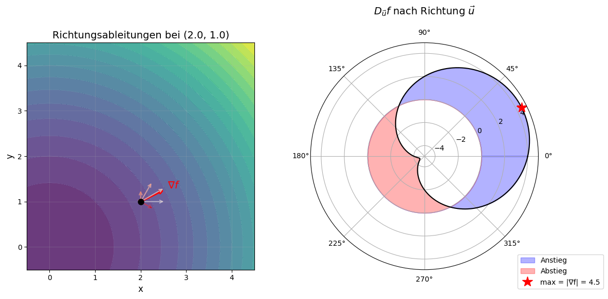
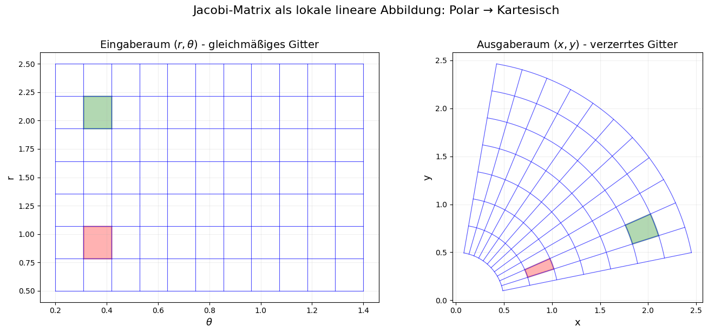
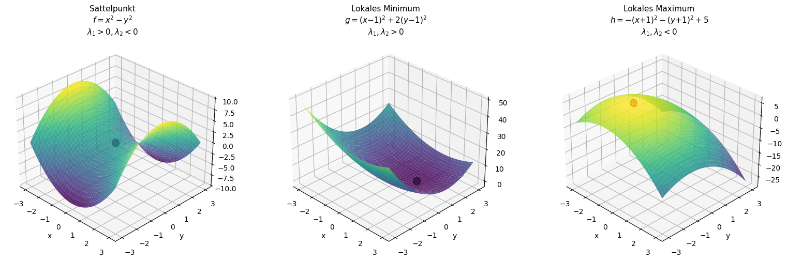

# Analysis
## 08 - Multivariate Kettenregel, Jacobi- und Hesse-Matrix

Totale Ableitung $\frac{df}{dt} = \frac{\partial f}{\partial x}\frac{dx}{dt} + \frac{\partial f}{\partial y}\frac{dy}{dt}$ (Summe der Beiträge jedes Abhängigkeitspfades), multivariate Kettenregel, Richtungsableitung, Jacobi-Matrix (lineare Approximation vektorwertiger Funktionen) und Hesse-Matrix (Krümmung, Klassifikation kritischer Punkte).

> Vorausgesetzt: Partielle Ableitungen, Kettenregel.

### Lernziele

- **Totale Ableitung** vs. partielle Ableitung — warum die Unterscheidung wichtig ist
- **Multivariate Kettenregel** — Ableitungen entlang mehrerer Abhängigkeitspfade berechnen
- **Richtungsableitung** — Steigung in eine *beliebige* Richtung, nicht nur entlang der Achsen
- **Jacobi-Matrix** — die „Ableitung" einer vektorwertigen Funktion als lineare Approximation
- **Hesse-Matrix** — Krümmung in mehreren Dimensionen, Klassifikation kritischer Punkte

---

### 1. Die totale Ableitung

Erinnern wir uns: Die partielle Ableitung $\frac{\partial f}{\partial x}$ misst, wie sich $f$ ändert, wenn **nur $x$** variiert und alles andere festgehalten wird. Aber was, wenn $x$ und $y$ sich **gleichzeitig** ändern - etwa weil beide von einer gemeinsamen Variable $t$ abhängen?

**Konkretes Bild:** Du wanderst auf einem Berghang. Die Höhe über dem Meeresspiegel ist $h(x, y)$, wobei $(x, y)$ Deine Position ist. Während Du wanderst, ändert sich sowohl $x(t)$ als auch $y(t)$ mit der Zeit $t$. Die Frage „Wie schnell steige oder falle ich?" fragt nach $\frac{dh}{dt}$ - und das ist weder $\frac{\partial h}{\partial x}$ noch $\frac{\partial h}{\partial y}$ allein.

#### Die Idee: Jeder Pfad trägt bei

Betrachten wir $z = f(x, y)$, wobei $x = x(t)$ und $y = y(t)$. Eine kleine Änderung $dt$ bewirkt:
- $x$ ändert sich um $dx = \frac{dx}{dt} \cdot dt$
- $y$ ändert sich um $dy = \frac{dy}{dt} \cdot dt$

Beide Änderungen beeinflussen $z$. Wie groß ist die Gesamtänderung? Wir nutzen die **lineare Approximation** (das **totale Differential**):

$$dz = \frac{\partial f}{\partial x} \cdot dx + \frac{\partial f}{\partial y} \cdot dy$$

Das ist die zentrale Einsicht: Die Gesamtänderung von $z$ ist die **Summe der Beiträge** entlang jedes Abhängigkeitspfades. Jeder Pfad bringt zwei Faktoren mit:
1. **Wie empfindlich** $z$ auf diese Variable reagiert (partielle Ableitung)
2. **Wie stark** sich diese Variable selbst ändert (Ableitung nach $t$)

Teilen wir beide Seiten durch $dt$, erhalten wir die **totale Ableitung**:

$$\boxed{\frac{dz}{dt} = \frac{\partial f}{\partial x} \cdot \frac{dx}{dt} + \frac{\partial f}{\partial y} \cdot \frac{dy}{dt}}$$

#### Baumdiagramm der Abhängigkeiten

Man kann die Abhängigkeitsstruktur als Baum darstellen. Jeder Pfad von $z$ hinunter zu $t$ ergibt einen Summand:

```
        z = f(x, y)
       /           \
      x(t)         y(t)
       \           /
         \       /
           \   /
             t
```

- Linker Pfad: $z \to x \to t$ ergibt $\frac{\partial f}{\partial x} \cdot \frac{dx}{dt}$
- Rechter Pfad: $z \to y \to t$ ergibt $\frac{\partial f}{\partial y} \cdot \frac{dy}{dt}$
- **Addiere alle Pfade** → totale Ableitung

Das Prinzip funktioniert für beliebig viele Zwischenvariablen: Für $z = f(x_1, x_2, \ldots, x_n)$ mit jedem $x_i = x_i(t)$ wird:

$$\frac{dz}{dt} = \sum_{i=1}^{n} \frac{\partial f}{\partial x_i} \cdot \frac{dx_i}{dt}$$

> **Merke:** Die Leibniz-Notation macht die Multiplikation entlang eines Pfades besonders anschaulich - die $\partial x$-Terme „kürzen" sich gewissermaßen, obwohl das formal natürlich nur eine Eselsbrücke ist.

**Ergebnis:** Für $f(x, y) = x^2 y + 2x + y^3$ mit Pfaden $x(t) = \cos(t)$, $y(t) = t^2$:

| Schritt | Formel |
|---|---|
| Partielle Ableitungen | $\frac{\partial f}{\partial x} = 2xy + 2$, $\quad \frac{\partial f}{\partial y} = x^2 + 3y^2$ |
| Pfad-Ableitungen | $\frac{dx}{dt} = -\sin(t)$, $\quad \frac{dy}{dt} = 2t$ |
| **Totale Ableitung** | $\frac{dz}{dt} = \frac{\partial f}{\partial x} \cdot \frac{dx}{dt} + \frac{\partial f}{\partial y} \cdot \frac{dy}{dt}$ |

Beide Wege - Kettenregel und direktes Einsetzen - liefern dasselbe vereinfachte Ergebnis. Das ist die zentrale Probe: die multivariate Kettenregel ist konsistent mit der gewöhnlichen Ableitung.

### 2. Die multivariate Kettenregel - mehrere Abhängigkeitspfade

Im vorigen Abschnitt hing alles von **einer** Variable $t$ ab. Was passiert, wenn die Zwischenvariablen von **mehreren** Variablen abhängen?

#### Die allgemeine Situation

Betrachten wir $z = f(x, y)$, aber diesmal hängen $x$ und $y$ jeweils von **zwei** Variablen $s$ und $t$ ab:
$$x = x(s, t), \qquad y = y(s, t)$$

Jetzt ist $z$ selbst eine Funktion von $s$ und $t$. Um $\frac{\partial z}{\partial s}$ zu berechnen, müssen wir **alle Pfade** von $z$ nach $s$ aufsummieren:

$$\frac{\partial z}{\partial s} = \frac{\partial f}{\partial x} \cdot \frac{\partial x}{\partial s} + \frac{\partial f}{\partial y} \cdot \frac{\partial y}{\partial s}$$

Und analog für $t$:

$$\frac{\partial z}{\partial t} = \frac{\partial f}{\partial x} \cdot \frac{\partial x}{\partial t} + \frac{\partial f}{\partial y} \cdot \frac{\partial y}{\partial t}$$

Das Baumdiagramm hat jetzt mehr Äste:

```
          z = f(x, y)
         /           \
       x(s,t)       y(s,t)
       /    \       /    \
      s      t     s      t
```

Für $\frac{\partial z}{\partial s}$ folge man allen Pfaden, die bei $s$ enden:
- $z \to x \to s$: ergibt $\frac{\partial f}{\partial x} \cdot \frac{\partial x}{\partial s}$
- $z \to y \to s$: ergibt $\frac{\partial f}{\partial y} \cdot \frac{\partial y}{\partial s}$

> **Muster:** Multipliziere entlang jedes Pfades, addiere über alle Pfade. Das ist die gesamte multivariate Kettenregel in einem Satz.

#### Anwendung: Polarkoordinaten

Eine natürliche Anwendung sind **Koordinatentransformationen**. Die Polarkoordinaten $(r, \theta)$ hängen mit kartesischen $(x, y)$ so zusammen:

$$x = r \cos\theta, \qquad y = r \sin\theta$$

Wenn $f(x, y)$ eine Funktion in kartesischen Koordinaten ist, können wir sie in Polarkoordinaten ausdrücken. Die partiellen Ableitungen transformieren sich nach der Kettenregel:

$$\frac{\partial f}{\partial r} = \frac{\partial f}{\partial x} \cdot \cos\theta + \frac{\partial f}{\partial y} \cdot \sin\theta$$

$$\frac{\partial f}{\partial \theta} = \frac{\partial f}{\partial x} \cdot (-r\sin\theta) + \frac{\partial f}{\partial y} \cdot (r\cos\theta)$$

| Situation | Ergebnis | Formel |
|-----------|----------|--------|
| Ein Pfadparameter $t$ | Totale Ableitung $\frac{dz}{dt}$ | $\sum_i \frac{\partial f}{\partial x_i} \cdot \frac{dx_i}{dt}$ |
| Mehrere Pfadparameter $s, t, \ldots$ | Partielle Ableitungen $\frac{\partial z}{\partial s}$ etc. | $\sum_i \frac{\partial f}{\partial x_i} \cdot \frac{\partial x_i}{\partial s}$ |

**Ergebnis:** Für $f(x,y) = x^2 + y^2$ mit $x = r\cos\theta$, $y = r\sin\theta$:

| | Kettenregel | Kontrolle (direkt) |
|---|---|---|
| $\frac{\partial f}{\partial r}$ | $2r$ | $2r$ |
| $\frac{\partial f}{\partial \theta}$ | $0$ | $0$ |

In Polarkoordinaten vereinfacht sich $f = r^2$ - die Funktion hängt gar nicht von $\theta$ ab. Das Paraboloid $x^2 + y^2$ ist **rotationssymmetrisch**, und die Kettenregel macht das sichtbar.

### 3. Richtungsableitung - Steigung in beliebiger Richtung

Partielle Ableitungen messen die Steigung entlang der **Koordinatenachsen**: $\frac{\partial f}{\partial x}$ entlang der $x$-Achse, $\frac{\partial f}{\partial y}$ entlang der $y$-Achse. Aber was, wenn Du Dich **schräg** über die Landschaft bewegst - zum Beispiel in Richtung Nordost?

#### Herleitung aus der Definition

Sei $\vec u = \begin{pmatrix}u_1\\u_2\end{pmatrix}$ ein **Einheitsvektor** ($\|\vec u\| = 1$), der die Richtung angibt. Wir wollen die Steigung von $f$ am Punkt $(a, b)$ in Richtung $\vec u$ messen. Dafür bewegen wir uns ein winziges Stück $h$ in Richtung $\vec u$ und messen die Änderung:

$$D_{\vec u} f(a, b) = \lim_{h \to 0} \frac{f(a + h u_1,\; b + h u_2) - f(a, b)}{h}$$

Das ist eine ganz gewöhnliche Ableitung - aber entlang eines Strahls durch $(a, b)$ in Richtung $\vec u$.

Jetzt kommt der Trick: Definiere $g(h) = f(a + h u_1,\; b + h u_2)$. Dann ist die Richtungsableitung einfach $g'(0)$. Mit der (einvariablen!) Kettenregel:

$$g'(h) = \frac{\partial f}{\partial x} \cdot u_1 + \frac{\partial f}{\partial y} \cdot u_2$$

Das ist nichts anderes als das **Skalarprodukt** von $\nabla f$ und $\vec u$:

$$\boxed{D_{\vec u} f = \nabla f \cdot \vec u = \|\nabla f\| \cdot \cos\theta}$$

wobei $\theta$ der Winkel zwischen Gradient und Richtung ist.

#### Was uns das verrät

Die Formel $D_{\vec u} f = \|\nabla f\| \cdot \cos\theta$ ist aufschlussreich:

| Winkel $\theta$ | $\cos\theta$ | Richtungsableitung | Bedeutung |
|---|---|---|---|
| $0°$ (mit dem Gradienten) | $1$ | $\|\nabla f\|$ (maximal) | **Steilster Anstieg** |
| $90°$ (senkrecht) | $0$ | $0$ | **Höhenlinie** (kein Anstieg) |
| $180°$ (gegen den Gradienten) | $-1$ | $-\|\nabla f\|$ (minimal) | **Steilster Abstieg** |

Das erklärt mathematisch, **warum** der Gradient in die Richtung des steilsten Anstiegs zeigt (was wir in Abschnitt 07 behauptet hatten): Unter allen Richtungen $\vec u$ ist das Skalarprodukt $\nabla f \cdot \vec u$ genau dann maximal, wenn $\vec u$ parallel zu $\nabla f$ ist - denn dann ist $\cos\theta = 1$.

> **Merke:** Der Gradient gibt sowohl die Richtung als auch die Stärke der maximalen Steigung an. Die Richtungsableitung in *jeder anderen* Richtung ist nur die „Projektion" davon.


    

    


**Zur Grafik:** Am Punkt $(2, 1)$ ist $\nabla f = (4, 2)$ mit $|\nabla f| \approx 4{,}47$.

- **Maximale Steigung** $= |\nabla f|$: in Richtung des Gradienten (roter Pfeil)
- **Minimale Steigung** $= -|\nabla f|$: entgegen dem Gradienten
- **Steigung $= 0$**: senkrecht zum Gradienten - das ist genau die Richtung entlang der **Höhenlinie**

Im Polarplot rechts sieht man das als Cosinuskurve: $D_{\vec u} f = \nabla f \cdot \vec u = |\nabla f| \cos\alpha$, wobei $\alpha$ der Winkel zwischen $\vec u$ und $\nabla f$ ist.

### 4. Die Jacobi-Matrix - Ableitung einer vektorwertigen Funktion

Bisher haben wir Funktionen betrachtet, die **mehrere Eingaben** haben, aber **eine Ausgabe** liefern: $f: \mathbb{R}^n \to \mathbb{R}$ (z.B. Temperatur, Kostenfunktion). Der Gradient $\nabla f$ war ein Vektor - das passt.

Aber was, wenn auch die **Ausgabe** mehrdimensional ist? Zum Beispiel:
- Eine **Koordinatentransformation** $(r, \theta) \mapsto (x, y)$ hat 2 Eingaben und 2 Ausgaben
- Ein **neuronales Netz** bildet einen Eingabevektor auf einen Ausgabevektor ab
- Eine **Strömung** ordnet jedem Punkt $(x, y)$ einen Geschwindigkeitsvektor $(v_x, v_y)$ zu

Für solche Funktionen $\vec F: \mathbb{R}^n \to \mathbb{R}^m$ brauchen wir eine **Matrix** als Ableitung. Das ist die **Jacobi-Matrix**.

#### Die Idee: Lineare Approximation verallgemeinern

Erinnern wir uns an die eindimensionale Analysis. Dort war die Ableitung $f'(a)$ die Steigung der **bestmöglichen linearen Approximation**:

$$f(a + h) \approx f(a) + f'(a) \cdot h$$

Das sagt: In der Nähe von $a$ verhält sich $f$ wie eine lineare Funktion. Die Zahl $f'(a)$ beschreibt, wie stark eine kleine Eingabeänderung $h$ das Ergebnis verändert.

Für eine vektorwertige Funktion $\vec F: \mathbb{R}^n \to \mathbb{R}^m$ suchen wir genau die gleiche Idee: Was ist die **bestmögliche lineare Approximation**?

$$\vec F(\vec a + \vec h) \approx \vec F(\vec a) + \underbrace{J}_{\text{Jacobi-Matrix}} \cdot \vec h$$

Die „Ableitung" ist jetzt keine einzelne Zahl mehr, sondern eine **Matrix** $J \in \mathbb{R}^{m \times n}$, die einen kleinen Eingabevektor $\vec h \in \mathbb{R}^n$ auf die resultierende Ausgabeänderung $\in \mathbb{R}^m$ abbildet. Das ist eine **lineare Abbildung** - genau wie in [02_Matrizen](../05_Vektoren_Matrizen/02_Matrizen.ipynb) gelernt.

#### Definition

Für $\vec F = \begin{pmatrix} F_1(x_1, \ldots, x_n) \\ \vdots \\ F_m(x_1, \ldots, x_n) \end{pmatrix}$ ist die Jacobi-Matrix:

$$J = \begin{pmatrix}
\frac{\partial F_1}{\partial x_1} & \frac{\partial F_1}{\partial x_2} & \cdots & \frac{\partial F_1}{\partial x_n} \\[6pt]
\frac{\partial F_2}{\partial x_1} & \frac{\partial F_2}{\partial x_2} & \cdots & \frac{\partial F_2}{\partial x_n} \\[6pt]
\vdots & \vdots & \ddots & \vdots \\[6pt]
\frac{\partial F_m}{\partial x_1} & \frac{\partial F_m}{\partial x_2} & \cdots & \frac{\partial F_m}{\partial x_n}
\end{pmatrix}$$

Jede **Zeile** enthält den Gradienten einer Komponentenfunktion $F_i$. Jede **Spalte** zeigt, wie sich alle Ausgaben ändern, wenn man **eine** Eingabe variiert.

#### Zusammenhang mit dem Gradienten

Für eine skalare Funktion $f: \mathbb{R}^n \to \mathbb{R}$ (also $m = 1$) hat die Jacobi-Matrix nur **eine Zeile** - das ist gerade der Gradient als Zeilenvektor:

$$J_f = \begin{pmatrix} \frac{\partial f}{\partial x_1} & \cdots & \frac{\partial f}{\partial x_n} \end{pmatrix} = (\nabla f)^T$$

| Funktion | Eingabe → Ausgabe | „Ableitung" | Dimension |
|---|---|---|---|
| $f: \mathbb{R} \to \mathbb{R}$ | Zahl → Zahl | $f'(x)$ (Zahl) | $1 \times 1$ |
| $f: \mathbb{R}^n \to \mathbb{R}$ | Vektor → Zahl | $\nabla f$ (Vektor) | $1 \times n$ |
| $\vec F: \mathbb{R}^n \to \mathbb{R}^m$ | Vektor → Vektor | $J$ (Matrix) | $m \times n$ |

#### Determinante der Jacobi-Matrix

Bei einer quadratischen Jacobi-Matrix ($m = n$) hat die **Determinante** eine anschauliche Bedeutung, die direkt an das anknüpft, was wir in [02_Matrizen](../05_Vektoren_Matrizen/02_Matrizen.ipynb) über Determinanten gelernt haben:

$$|\det(J)| = \text{lokaler Flächenskalierungsfaktor}$$

Das heißt: Wenn die Abbildung $\vec F$ ein kleines Flächenstück (oder Volumenelement) transformiert, wird dessen Fläche (Volumen) um den Faktor $|\det(J)|$ gestreckt oder gestaucht. Bei Polarkoordinaten zum Beispiel: $|\det(J)| = r$ - Flächenelemente weiter vom Ursprung entfernt werden stärker gestreckt.


    

    


**Ergebnis:** Für die Koordinatentransformation $(r, \theta) \to (x, y)$ mit $x = r\cos\theta$, $y = r\sin\theta$:

$$
J = \begin{pmatrix} \cos\theta & -r\sin\theta \\ \sin\theta & r\cos\theta \end{pmatrix}, \qquad \det(J) = r
$$

**Zur Grafik:** Gleichgroße Zellen im $(r, \theta)$-Raum (links) werden zu unterschiedlich großen Flächen im $(x, y)$-Raum (rechts). Die **grüne Zelle** (großes $r$) ist stärker gestreckt als die **rote** (kleines $r$) - genau um den Faktor $|\det(J)| = r$. Das ist der Grund, warum bei Polarintegration $dx\,dy = r\,dr\,d\theta$ gilt.

### 5. Die Hesse-Matrix - Krümmung in mehreren Dimensionen

In der eindimensionalen Analysis haben wir gelernt (in [04 - Höhere Ableitungen](../07_Analysis/04_Hoehere_Ableitungen_und_Kurvendiskussion.ipynb)): Die **zweite Ableitung** $f''(x)$ beschreibt die **Krümmung** einer Funktion:

- $f''(x) > 0$: Die Steigung nimmt zu → die Kurve krümmt sich **nach oben** (konvex / „Schüsselform")
- $f''(x) < 0$: Die Steigung nimmt ab → die Kurve krümmt sich **nach unten** (konkav / „Hügelform")
- $f''(x) = 0$: Möglicher **Wendepunkt**

Was passiert mit der Krümmung im Mehrdimensionalen? Bei $f(x, y)$ gibt es nicht mehr *eine* Krümmung, sondern die Krümmung **hängt von der Richtung ab**: Die Funktion kann in $x$-Richtung nach oben gekrümmt sein, aber in $y$-Richtung nach unten - das ergibt einen **Sattelpunkt**.

Um diese richtungsabhängige Krümmung vollständig zu beschreiben, brauchen wir eine **Matrix** aller zweiten partiellen Ableitungen: die **Hesse-Matrix**.

#### Definition

Für $f: \mathbb{R}^n \to \mathbb{R}$ ist die Hesse-Matrix die Matrix aller zweiten partiellen Ableitungen:

$$H_f = \begin{pmatrix}
\frac{\partial^2 f}{\partial x_1^2} & \frac{\partial^2 f}{\partial x_1 \partial x_2} & \cdots & \frac{\partial^2 f}{\partial x_1 \partial x_n} \\[6pt]
\frac{\partial^2 f}{\partial x_2 \partial x_1} & \frac{\partial^2 f}{\partial x_2^2} & \cdots & \frac{\partial^2 f}{\partial x_2 \partial x_n} \\[6pt]
\vdots & \vdots & \ddots & \vdots \\[6pt]
\frac{\partial^2 f}{\partial x_n \partial x_1} & \frac{\partial^2 f}{\partial x_n \partial x_2} & \cdots & \frac{\partial^2 f}{\partial x_n^2}
\end{pmatrix}$$

Für $f(x, y)$ konkret:

$$H_f = \begin{pmatrix}
f_{xx} & f_{xy} \\
f_{yx} & f_{yy}
\end{pmatrix}$$

#### Der Satz von Schwarz: Die Matrix ist symmetrisch

Eine wichtige Eigenschaft: Unter den üblichen Bedingungen (stetige zweite Ableitungen) gilt:

$$\frac{\partial^2 f}{\partial x \partial y} = \frac{\partial^2 f}{\partial y \partial x}$$

Die **Reihenfolge** des Ableitens spielt keine Rolle. Das bedeutet: Die Hesse-Matrix ist **symmetrisch** ($H = H^T$). Das ist nicht nur eine formale Eigenschaft - symmetrische Matrizen haben besonders „gutartige" Eigenwerte (alle reell), was für die Anwendung entscheidend ist.

#### Was die Einträge bedeuten

- **Diagonale** $f_{xx}$, $f_{yy}$: Krümmung entlang der Koordinatenachsen (wie $f''$ im 1D-Fall)
- **Nebendiagonale** $f_{xy}$: Misst, wie sich die Steigung in $x$-Richtung ändert, wenn man sich in $y$-Richtung bewegt - eine Art „Verdrehung" der Fläche

#### Klassifikation kritischer Punkte

An einem **kritischen Punkt** ($\nabla f = \vec 0$) bestimmt die Hesse-Matrix, ob es sich um ein Minimum, Maximum oder einen Sattel handelt. Die Schlüsselinformation steckt in den **Eigenwerten** $\lambda_1, \lambda_2$ der Hesse-Matrix:

| Eigenwerte | Geometrie | Typ |
|---|---|---|
| $\lambda_1 > 0,\ \lambda_2 > 0$ | Aufwärts gekrümmt in alle Richtungen | **Lokales Minimum** |
| $\lambda_1 < 0,\ \lambda_2 < 0$ | Abwärts gekrümmt in alle Richtungen | **Lokales Maximum** |
| $\lambda_1 > 0,\ \lambda_2 < 0$ | Aufwärts in einer, abwärts in anderer Richtung | **Sattelpunkt** |
| $\lambda_1 = 0$ oder $\lambda_2 = 0$ | Flach in mindestens einer Richtung | **Unbestimmt** (höhere Ableitungen nötig) |

> **Warum Eigenwerte?** Die Eigenwerte einer symmetrischen Matrix geben die Krümmung in den **Hauptkrümmungsrichtungen** an - den Richtungen, entlang denen die Krümmung am stärksten bzw. schwächsten ist. Die Eigenvektoren zeigen, *wo* diese Richtungen liegen. (Eigenwerte werden in `09_Lineare_Algebra` ausführlich behandelt - hier genügt die Idee.)

Für 2×2 kann man statt der Eigenwerte auch die **Determinante** und die **Spur** (Summe der Diagonalelemente) verwenden:

$$\det(H) = f_{xx} f_{yy} - f_{xy}^2, \qquad \text{Spur}(H) = f_{xx} + f_{yy}$$

- $\det(H) > 0$ und $f_{xx} > 0$ → Minimum
- $\det(H) > 0$ und $f_{xx} < 0$ → Maximum
- $\det(H) < 0$ → Sattelpunkt
- $\det(H) = 0$ → keine Aussage


    

    


**Klassifikation der drei Beispiele:**

| Funktion | Punkt | Hesse-Matrix $H$ | Eigenwerte | $\det(H)$ | Typ |
|---|---|---|---|---|---|
| $f = x^2 - y^2$ | $(0, 0)$ | $\begin{pmatrix} 2 & 0 \\ 0 & -2 \end{pmatrix}$ | $+2, -2$ | $-4 < 0$ | **Sattelpunkt** |
| $g = (x{-}1)^2 + 2(y{-}1)^2$ | $(1, 1)$ | $\begin{pmatrix} 2 & 0 \\ 0 & 4 \end{pmatrix}$ | $+2, +4$ | $8 > 0$ | **Minimum** |
| $h = -(x{+}1)^2 - (y{+}1)^2 + 5$ | $(-1, -1)$ | $\begin{pmatrix} -2 & 0 \\ 0 & -2 \end{pmatrix}$ | $-2, -2$ | $4 > 0$ | **Maximum** |

Die Eigenwerte der Hesse-Matrix entscheiden: alle positiv → Minimum (Schüssel), alle negativ → Maximum (Hügel), gemischte Vorzeichen → Sattelpunkt (Pringles-Chip). Genau dafür brauchen wir Eigenwerte - Thema im nächsten Kapitel.

### 6. Gradient, Jacobi, Hesse - das Gesamtbild

Wir haben jetzt drei „Ableitungsobjekte" kennengelernt, die aufeinander aufbauen:

| Objekt | Funktion | Was es beschreibt | Form | Dimension |
|---|---|---|---|---|
| **Gradient** $\nabla f$ | $f: \mathbb{R}^n \to \mathbb{R}$ | Richtung und Stärke des steilsten Anstiegs | Vektor | $n$ |
| **Jacobi-Matrix** $J$ | $\vec F: \mathbb{R}^n \to \mathbb{R}^m$ | Beste lineare Approximation der Abbildung | Matrix | $m \times n$ |
| **Hesse-Matrix** $H$ | $f: \mathbb{R}^n \to \mathbb{R}$ | Krümmung / zweite Ordnung am Punkt | Symmetrische Matrix | $n \times n$ |

#### Zusammenhänge

1. Der **Gradient** ist ein Spezialfall der Jacobi-Matrix (eine Zeile, $m = 1$)
2. Die **Hesse-Matrix** ist die Jacobi-Matrix des Gradienten: $H_f = J_{\nabla f}$

> **Ausblick:** Diese drei Werkzeuge sind die Grundlage für Optimierungsverfahren wie Gradient Descent und Newtons Methode - Thema in `ml/01_Optimierung`.

---

## Verständnis-Check
*Löse die folgenden Aufgaben eigenständig, bevor du die Lösungen konsultierst.*

**Aufgabe 1 (Totale Ableitung):**
Gegeben: $f(x, y) = xy^2$, wobei $x(t) = e^t$ und $y(t) = \sin(t)$.

- a) Zeichne das Baumdiagramm der Abhängigkeiten.
- b) Berechne $\frac{dz}{dt}$ mit der multivariaten Kettenregel.
- c) Kontrolliere, indem Du $x(t)$ und $y(t)$ direkt einsetzt und nach $t$ ableitest.

**Aufgabe 2 (Richtungsableitung):**
Gegeben: $f(x, y) = x^2 + xy + y^2$ am Punkt $(1, 2)$.

- a) Berechne den Gradienten $\nabla f(1, 2)$.
- b) Berechne die Richtungsableitung in Richtung $\vec v = \begin{pmatrix}3\\4\end{pmatrix}$.
*(Tipp: Vergiss nicht, $\vec v$ zuerst zum Einheitsvektor zu normieren!)*
- c) In welcher Richtung ist die Richtungsableitung gleich null?

**Aufgabe 3 (Jacobi-Matrix):**
Gegeben die Abbildung $\vec F(u, v) = \begin{pmatrix} u^2 - v \\ u + v^2 \end{pmatrix}$.

- a) Bestimme die Jacobi-Matrix $J$.
- b) Berechne $J$ am Punkt $(1, 2)$ und $\det(J)$.
- c) Was sagt $|\det(J)|$ über die lokale Flächenskalierung an diesem Punkt?

**Aufgabe 4 (Hesse-Matrix):**
Gegeben: $f(x, y) = x^3 - 3xy + y^3$

- a) Finde alle kritischen Punkte (setze $\nabla f = \vec 0$).
- b) Berechne die Hesse-Matrix $H$.
- c) Klassifiziere jeden kritischen Punkt (Minimum, Maximum oder Sattel).

### Lösungen

<details open>
<summary>Lösung Aufgabe 1</summary>

a) Baumdiagramm:
```
        z = f(x, y) = xy²
       /             \
     x(t) = eᵗ      y(t) = sin(t)
       \             /
            t
```

b) Kettenregel:
- $\frac{\partial f}{\partial x} = y^2$, $\frac{\partial f}{\partial y} = 2xy$
- $\frac{dx}{dt} = e^t$, $\frac{dy}{dt} = \cos(t)$
- $\frac{dz}{dt} = y^2 \cdot e^t + 2xy \cdot \cos(t) = \sin^2(t) \cdot e^t + 2e^t \sin(t) \cos(t)$
- Vereinfacht: $\frac{dz}{dt} = e^t \sin(t)[\sin(t) + 2\cos(t)]$

c) Direkt: $z(t) = e^t \cdot \sin^2(t)$
- $\frac{dz}{dt} = e^t \sin^2(t) + e^t \cdot 2\sin(t)\cos(t) = e^t[\sin^2(t) + 2\sin(t)\cos(t)]$ ✓

</details>

<details open>
<summary>Lösung Aufgabe 2</summary>

a) $f(x,y) = x^2 + xy + y^2$
- $\frac{\partial f}{\partial x} = 2x + y$, $\frac{\partial f}{\partial y} = x + 2y$
- $\nabla f(1, 2) = (2 \cdot 1 + 2,\; 1 + 2 \cdot 2) = (4, 5)$

b) Einheitsvektor: $\vec u = \frac{1}{\sqrt{9+16}}\begin{pmatrix}3\\4\end{pmatrix} = \frac{1}{5}\begin{pmatrix}3\\4\end{pmatrix}$
- $D_{\vec u} f = \nabla f \cdot \vec u = 4 \cdot \frac{3}{5} + 5 \cdot \frac{4}{5} = \frac{12}{5} + \frac{20}{5} = \frac{32}{5} = 6{,}4$

c) $D_{\vec u} f = 0$ wenn $\vec u \perp \nabla f$, also $\vec u$ senkrecht auf $(4, 5)$.
Normalvektor: $\vec n = \frac{1}{\sqrt{41}}\begin{pmatrix}-5\\4\end{pmatrix}$ (oder umgekehrt). Das entspricht der **Höhenlinie** durch den Punkt.

</details>

<details open>
<summary>Lösung Aufgabe 3</summary>

a) $J = \begin{pmatrix} \frac{\partial F_1}{\partial u} & \frac{\partial F_1}{\partial v} \\ \frac{\partial F_2}{\partial u} & \frac{\partial F_2}{\partial v} \end{pmatrix} = \begin{pmatrix} 2u & -1 \\ 1 & 2v \end{pmatrix}$

b) Bei $(1, 2)$: $J = \begin{pmatrix} 2 & -1 \\ 1 & 4 \end{pmatrix}$
- $\det(J) = 2 \cdot 4 - (-1) \cdot 1 = 8 + 1 = 9$

c) $|\det(J)| = 9$: Ein infinitesimales Flächenstück wird bei der Transformation am Punkt $(1, 2)$ um den Faktor 9 vergrößert.

</details>

<details open>
<summary>Lösung Aufgabe 4</summary>

a) $\nabla f = (3x^2 - 3y,\; -3x + 3y^2) = \vec 0$
- Aus Gleichung 1: $y = x^2$
- In Gleichung 2: $-3x + 3x^4 = 0 \Rightarrow 3x(x^3 - 1) = 0$
- $x = 0 \Rightarrow y = 0$, oder $x = 1 \Rightarrow y = 1$
- Kritische Punkte: $(0, 0)$ und $(1, 1)$

b) $H = \begin{pmatrix} 6x & -3 \\ -3 & 6y \end{pmatrix}$

c) Bei $(0, 0)$: $H = \begin{pmatrix} 0 & -3 \\ -3 & 0 \end{pmatrix}$, $\det(H) = 0 - 9 = -9 < 0$ → **Sattelpunkt**

Bei $(1, 1)$: $H = \begin{pmatrix} 6 & -3 \\ -3 & 6 \end{pmatrix}$, $\det(H) = 36 - 9 = 27 > 0$ und $f_{xx} = 6 > 0$ → **Lokales Minimum**

</details>

---

## Zusammenfassung

| Konzept | Kernaussage |
|---------|-------------|
| **Totale Ableitung** | $\frac{dz}{dt} = \sum_i \frac{\partial f}{\partial x_i} \cdot \frac{dx_i}{dt}$ - summiere Beiträge aller Abhängigkeitspfade |
| **Multivariate Kettenregel** | Multipliziere entlang jedem Pfad im Baumdiagramm, addiere über alle Pfade |
| **Richtungsableitung** | $D_{\vec u} f = \nabla f \cdot \vec u$ - Steigung in beliebiger Richtung; der Gradient ist die maximale |
| **Jacobi-Matrix** | Die „Ableitung" einer vektorwertigen Funktion: $\vec F(\vec a + \vec h) \approx \vec F(\vec a) + J \vec h$ |
| **$\|\det(J)\|$** | Lokaler Flächen-/Volumenskalierungsfaktor der Abbildung |
| **Hesse-Matrix** | Matrix aller zweiten partiellen Ableitungen; beschreibt Krümmung am Punkt |
| **Kritische Punkte (2D)** | $\det(H) > 0 \wedge f_{xx} > 0$ → Min; $\det(H) > 0 \wedge f_{xx} < 0$ → Max; $\det(H) < 0$ → Sattel |


---

## Glossar

| Deutsch | Englisch |
|---------|----------|
| Totale Ableitung | Total derivative |
| Totales Differential | Total differential |
| Multivariate Kettenregel | Multivariable chain rule |
| Baumdiagramm (Abhängigkeiten) | Dependency tree diagram |
| Richtungsableitung | Directional derivative |
| Jacobi-Matrix | Jacobian matrix |
| Determinante der Jacobi-Matrix | Jacobian determinant |
| Hesse-Matrix | Hessian matrix |
| Satz von Schwarz | Symmetry of second derivatives / Clairaut's theorem |
| Sattelpunkt | Saddle point |
| Krümmung | Curvature |
| Eigenwert | Eigenvalue |
| Lokales Minimum / Maximum | Local minimum / maximum |
