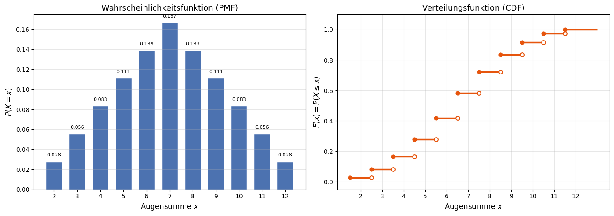
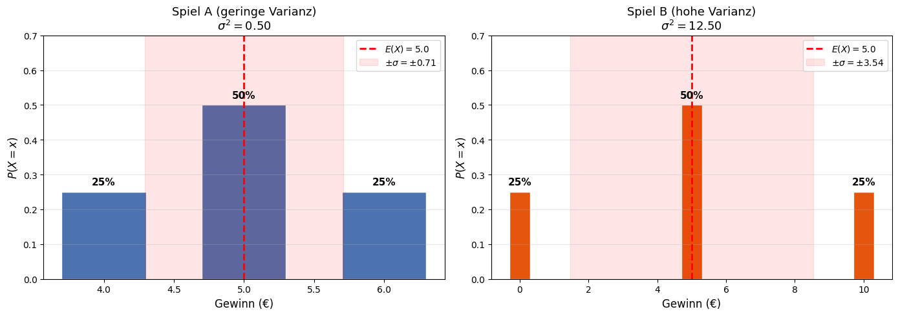
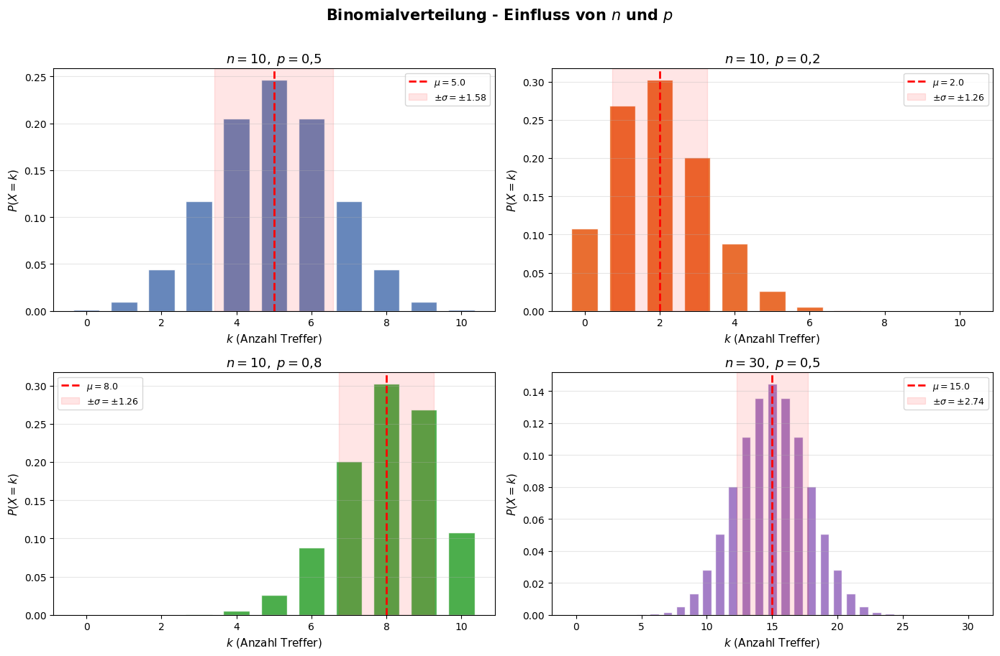
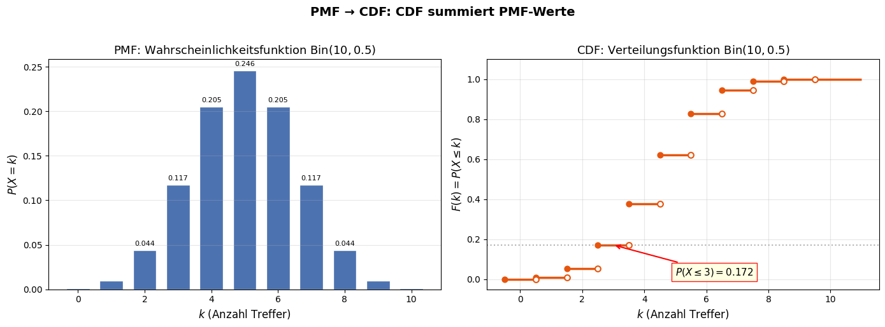
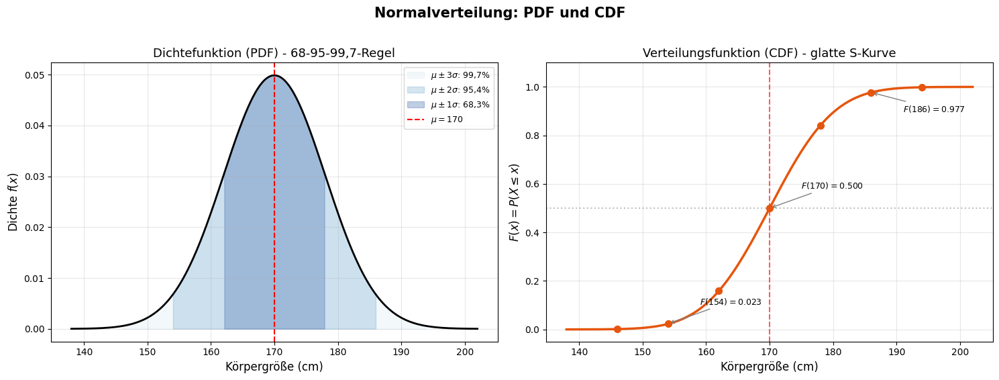
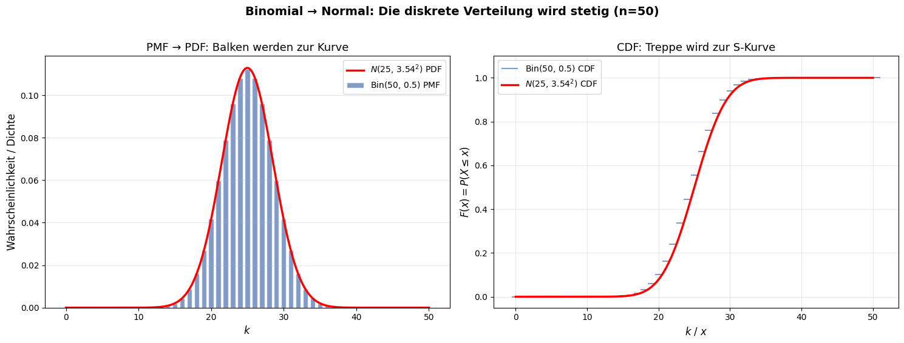
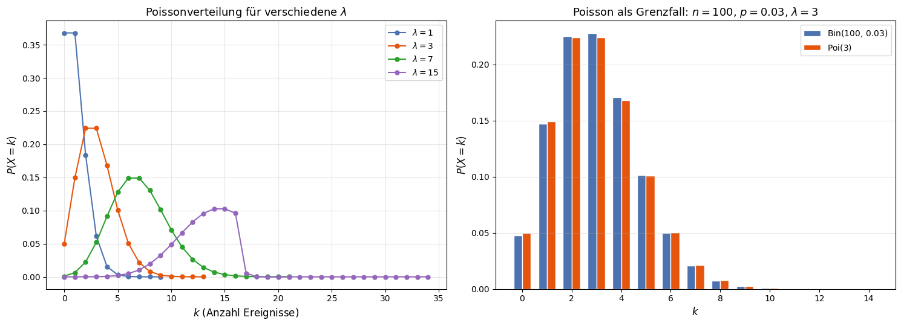
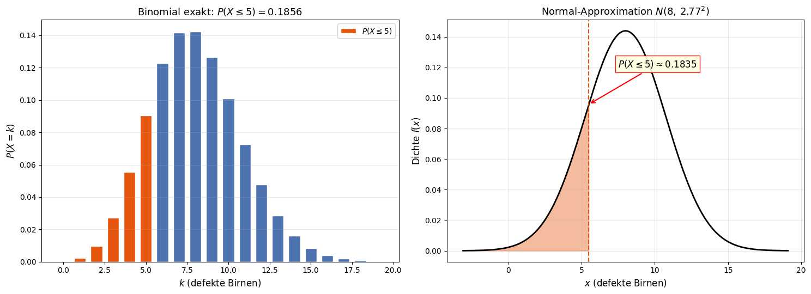

# Statistik und Wahrscheinlichkeit
## 04 - Verteilungen

Zufallsvariablen (diskret mit Wahrscheinlichkeitsfunktion vs. stetig mit Dichtefunktion), Erwartungswert $E[X]$ und Varianz $\text{Var}(X)$; Binomialverteilung ($B(n, p)$: $n$ Versuche, Trefferwahrscheinlichkeit $p$), Normalverteilung ($\mathcal{N}(\mu, \sigma^2)$: Glockenkurve) und Poissonverteilung (seltene Ereignisse); z-Standardisierung ($z = \frac{x-\mu}{\sigma}$).

> Vorausgesetzt: Wahrscheinlichkeitsrechnung (08_Statistik/03).

### Lernziele

- **Was eine Zufallsvariable ist** und den Unterschied zwischen diskret und stetig
- **Erwartungswert und Varianz** — die zwei Kennzahlen jeder Verteilung
- **Die Binomialverteilung** — das Modell für „Treffer bei $n$ Versuchen"
- **Die Normalverteilung** — die allgegenwärtige Glockenkurve
- **Die Poissonverteilung** — das Modell für seltene Ereignisse
- **Anwendungen** — z-Standardisierung, Sachaufgaben, Taschenrechner-Tipps

---

### 1. Zufallsvariablen

Eine **Zufallsvariable** $X$ ordnet jedem Ergebnis eines Zufallsexperiments eine reelle Zahl zu. Formal ist sie eine Funktion $X: \Omega \to \mathbb{R}$.

**Beispiel:** Beim Wurf zweier Würfel ist die Augensumme $X = \text{Würfel}_1 + \text{Würfel}_2$ eine Zufallsvariable mit Werten von 2 bis 12.

#### Diskret vs. Stetig

| Typ | Wertemenge | Beschreibung | Beispiel |
|-----|-----------|--------------|----------|
| **Diskret** | Endlich oder abzählbar | Einzelne Werte „mit Lücken" | Augenzahl, Trefferanzahl |
| **Stetig** | Überabzählbar (Intervall) | Jeder Wert in einem Bereich möglich | Körpergröße, Temperatur |

#### Wahrscheinlichkeitsfunktion (diskret)

Die **Wahrscheinlichkeitsfunktion** (PMF - Probability Mass Function) gibt an, mit welcher Wahrscheinlichkeit $X$ einen bestimmten Wert annimmt:

$$P(X = x_i) = p_i \qquad \text{mit} \quad \sum_i p_i = 1$$

#### Dichtefunktion (stetig)

Bei stetigen Zufallsvariablen spricht man statt von Einzelwahrscheinlichkeiten von der **Dichtefunktion** $f(x)$ (PDF - Probability Density Function). Die Wahrscheinlichkeit, dass $X$ in einem Intervall liegt, berechnet sich als Fläche unter der Kurve:

$$P(a \leq X \leq b) = \int_a^b f(x)\, dx$$

**Wichtig:** Bei stetigen Variablen gilt $P(X = x) = 0$ für jeden einzelnen Punkt - die Wahrscheinlichkeit steckt immer in der *Fläche*, nie in einem Punkt.

#### Verteilungsfunktion (CDF)

Die **kumulative Verteilungsfunktion** $F(x) = P(X \leq x)$ beschreibt, wie viel Wahrscheinlichkeit sich bis zum Wert $x$ angesammelt hat. Sie steigt monoton von 0 auf 1 - bei diskreten Variablen als Treppenfunktion, bei stetigen als glatte Kurve.

    

    

### 2. Erwartungswert und Varianz

Jede Verteilung lässt sich durch zwei zentrale Kennzahlen zusammenfassen: den **Erwartungswert** (wo liegt das „Zentrum"?) und die **Varianz** (wie breit streuen die Werte?).

#### Erwartungswert

Der **Erwartungswert** $E(X)$ ist der gewichtete Durchschnitt aller möglichen Werte, gewichtet mit ihren Wahrscheinlichkeiten:

$$E(X) = \mu = \sum_{i} x_i \cdot P(X = x_i) \qquad \text{(diskret)}$$

$$E(X) = \mu = \int_{-\infty}^{\infty} x \cdot f(x)\, dx \qquad \text{(stetig)}$$

Der Erwartungswert beantwortet die Frage: „Welchen Wert erhalte ich *im Mittel*, wenn ich das Experiment sehr oft wiederhole?"

#### Varianz und Standardabweichung

Die **Varianz** misst die mittlere quadratische Abweichung vom Erwartungswert:

$$\text{Var}(X) = \sigma^2 = E\bigl[(X - \mu)^2\bigr] = E(X^2) - [E(X)]^2$$

Die **Standardabweichung** $\sigma = \sqrt{\text{Var}(X)}$ hat dieselbe Einheit wie $X$ und ist daher leichter zu interpretieren.

#### Rechenregeln

Für Konstanten $a, b$ und unabhängige Zufallsvariablen $X, Y$:

| Regel | Erwartungswert | Varianz |
|-------|---------------|---------|
| Verschiebung | $E(X + b) = E(X) + b$ | $\text{Var}(X + b) = \text{Var}(X)$ |
| Skalierung | $E(aX) = a \cdot E(X)$ | $\text{Var}(aX) = a^2 \cdot \text{Var}(X)$ |
| Summe | $E(X + Y) = E(X) + E(Y)$ | $\text{Var}(X + Y) = \text{Var}(X) + \text{Var}(Y)$* |

*nur bei **Unabhängigkeit** von $X$ und $Y$.

    

    

### 3. Binomialverteilung

Die **Binomialverteilung** ist *das* Standardmodell für die Frage: „Wie oft tritt ein Ereignis bei $n$ unabhängigen Versuchen ein?"

#### Voraussetzungen (Bernoulli-Kette)

1. Es gibt genau zwei Ausgänge: „Treffer" (W'keit $p$) und „Niete" (W'keit $1-p$)
2. Die Versuche sind **unabhängig**
3. Die Erfolgswahrscheinlichkeit $p$ bleibt **konstant**
4. Die Anzahl der Versuche $n$ ist **fest**

#### Wahrscheinlichkeitsfunktion (PMF)

Die Binomialverteilung ist *diskret* - ihre PMF gibt die Wahrscheinlichkeit für genau $k$ Treffer an:

$$ P(X = k) = \binom{n}{k} \cdot p^k \cdot (1-p)^{n-k}, \qquad k = 0, 1, \ldots, n $$

Der Binomialkoeffizient $\binom{n}{k}$ zählt dabei, auf wie viele Arten man $k$ Treffer unter $n$ Versuchen anordnen kann - genau wie in der Kombinatorik gelernt.

#### Verteilungsfunktion (CDF)

Die **kumulative Verteilungsfunktion** beantwortet die Frage „höchstens $k$ Treffer":

$$ F(k) = P(X \leq k) = \sum_{i=0}^{k} \binom{n}{i} \cdot p^i \cdot (1-p)^{n-i} $$

In der Praxis braucht man die CDF sogar häufiger als die PMF, denn typische Fragestellungen lauten:
- *Höchstens* $k$ Treffer: $P(X \leq k) = F(k)$
- *Mindestens* $k$ Treffer: $P(X \geq k) = 1 - F(k-1)$
- *Zwischen* $a$ und $b$ Treffer: $P(a \leq X \leq b) = F(b) - F(a-1)$

#### Kennzahlen

$$ E(X) = n \cdot p \qquad \text{Var}(X) = n \cdot p \cdot (1-p) \qquad \sigma = \sqrt{n \cdot p \cdot (1-p)} $$

Intuitiv: Bei 100 Münzwürfen ($p = 0{,}5$) erwartet man im Mittel 50 Köpfe, mit einer Standardabweichung von $\sigma = \sqrt{100 \cdot 0{,}5 \cdot 0{,}5} = 5$.

#### Anwendungen

- **Qualitätskontrolle:** Wie wahrscheinlich sind höchstens 3 defekte Teile in einer Stichprobe von 100?
- **Medizin:** Wie viele Patienten reagieren auf ein Medikament?
- **Sport:** Wahrscheinlichkeit, mindestens 7 von 10 Freiwürfen zu treffen

    

    

    

    

### 4. Normalverteilung

Die **Normalverteilung** (auch Gauß-Verteilung) ist die wichtigste stetige Verteilung überhaupt. Messwerte wie Körpergröße, Prüfungsergebnisse oder Messfehler folgen ihr oft erstaunlich gut - und der **zentrale Grenzwertsatz** erklärt, warum: Die Summe vieler unabhängiger Einflüsse ist annähernd normalverteilt, egal wie die einzelnen Einflüsse verteilt sind.

#### Dichtefunktion (PDF)

Anders als bei der diskreten Binomialverteilung hat die Normalverteilung eine **Dichtefunktion** - eine glatte Kurve statt einzelner Balken:

$$ f(x) = \frac{1}{\sigma\sqrt{2\pi}} \cdot e^{-\frac{1}{2}\left(\frac{x-\mu}{\sigma}\right)^2} $$

Die Kurve ist vollständig durch zwei Parameter bestimmt:
- $\mu$ - der **Erwartungswert** (Zentrum der Glocke)
- $\sigma$ - die **Standardabweichung** (Breite der Glocke)

**Wichtig:** Die Dichte $f(x)$ ist *nicht* die Wahrscheinlichkeit! Bei stetigen Variablen ergibt sich die Wahrscheinlichkeit erst als **Fläche** unter der Kurve (Integral). Ein einzelner Punkt hat die Wahrscheinlichkeit 0.

#### Verteilungsfunktion (CDF)

Die **kumulative Verteilungsfunktion** $F(x) = P(X \leq x)$ ist das Integral der Dichtefunktion:

$$ F(x) = P(X \leq x) = \int_{-\infty}^{x} f(t)\, dt $$

Für die Normalverteilung hat dieses Integral keine geschlossene Formel - deshalb benutzt man Tabellen, den Taschenrechner oder z-Standardisierung. Im Gegensatz zur Treppenfunktion der Binomial-CDF ist die Normal-CDF eine **glatte S-Kurve**, die von 0 auf 1 steigt.

Wahrscheinlichkeiten in Intervallen berechnet man über die CDF:

$$ P(a \leq X \leq b) = F(b) - F(a) $$

#### 68-95-99,7-Regel

Die Fläche unter der Glockenkurve in den $\sigma$-Intervallen um $\mu$:

| Intervall | Fläche | Bedeutung |
|-----------|--------|-----------|
| $\mu \pm 1\sigma$ | $\approx 68{,}3\%$ | Etwa zwei Drittel aller Werte |
| $\mu \pm 2\sigma$ | $\approx 95{,}4\%$ | Fast alle Werte |
| $\mu \pm 3\sigma$ | $\approx 99{,}7\%$ | Praktisch alle Werte |

Das bedeutet: Fast alle Werte ($99{,}7\%$) liegen innerhalb von drei Standardabweichungen um den Mittelwert. Werte jenseits von $3\sigma$ sind extrem selten.

#### z-Standardisierung

Jede Normalverteilung lässt sich auf die **Standardnormalverteilung** $N(0, 1)$ zurückführen:

$$ z = \frac{x - \mu}{\sigma} $$

Der $z$-Wert gibt an, wie viele Standardabweichungen ein Wert vom Mittelwert entfernt ist. Damit wird aus jeder Normal-Frage eine Standardfrage:

$$ P(X \leq x) = P\!\left(Z \leq \frac{x - \mu}{\sigma}\right) = \Phi(z) $$

Hierbei ist $\Phi(z)$ die CDF der Standardnormalverteilung - genau das, was eine z-Tabelle oder `normCdf` liefert.

#### Zusammenhang mit der Binomialverteilung

Für großes $n$ nähert sich die Binomialverteilung einer Normalverteilung an (**Faustregel**: $n \cdot p \cdot (1-p) > 9$):

$$ \text{Bin}(n, p) \approx N\bigl(np,\; np(1-p)\bigr) $$

Das ist praktisch, weil man statt vieler Binomialkoeffizienten nur noch die Normalverteilung berechnen muss. Dabei wandelt sich die diskrete Treppenfunktion (Binomial-CDF) in die glatte S-Kurve (Normal-CDF).

    

    

    

    

### 5. Poissonverteilung

Die **Poissonverteilung** modelliert die Anzahl von Ereignissen in einem festen Intervall (Zeit, Fläche, Volumen, …), wenn die Ereignisse **selten** und **unabhängig** voneinander auftreten.

#### Voraussetzungen

1. Events treten **einzeln** auf (nicht in Gruppen)
2. Die Rate $\lambda$ (erwartete Anzahl pro Intervall) ist **konstant**
3. Events in verschiedenen Intervallen sind **unabhängig**

#### Formel

$$P(X = k) = \frac{\lambda^k \cdot e^{-\lambda}}{k!}, \qquad k = 0, 1, 2, \ldots$$

Der Parameter $\lambda$ ist gleichzeitig Erwartungswert *und* Varianz:

$$E(X) = \lambda \qquad \text{Var}(X) = \lambda$$

Das ist eine besondere Eigenschaft: Je mehr Ereignisse man im Mittel erwartet, desto breiter streuen sie auch.

#### Zusammenhang mit der Binomialverteilung

Die Poissonverteilung ist der Grenzfall der Binomialverteilung für **viele Versuche** mit **kleiner Erfolgswahrscheinlichkeit**:

$$\text{Bin}(n, p) \to \text{Poi}(\lambda) \qquad \text{für } n \to \infty, \; p \to 0, \; np = \lambda \text{ konstant}$$

**Faustregel:** Die Poisson-Approximation funktioniert gut, wenn $n \geq 30$ und $p \leq 0{,}05$.

#### Anwendungen

- Anzahl Kundenanrufe pro Stunde
- Druckfehler pro Seite
- Unfälle pro Tag auf einer Autobahn
- Serveranfragen pro Sekunde

    

    

### 6. Anwendungen

#### Sachaufgabe: Qualitätskontrolle

*Ein Hersteller weiß, dass 4% seiner Glühbirnen defekt sind. In einer Stichprobe von 200 Glühbirnen: Wie wahrscheinlich ist es, dass höchstens 5 defekt sind?*

**Vorgehen:**
1. Modell: $X \sim \text{Bin}(200,\; 0{,}04)$ - Anzahl defekter Birnen
2. Gesucht: $P(X \leq 5)$
3. Kennzahlen: $\mu = 200 \cdot 0{,}04 = 8$, $\sigma = \sqrt{200 \cdot 0{,}04 \cdot 0{,}96} \approx 2{,}77$
4. Normal-Approximation: $z = \frac{5{,}5 - 8}{2{,}77} \approx -0{,}90$ (mit Stetigkeitskorrektur)
5. Ablesen: $P(Z \leq -0{,}90) \approx 0{,}184$

Alternativ exakt mit Poisson ($\lambda = 8$) oder direkt mit dem Taschenrechner.

#### TI-Nspire CX II Hinweise

Alle Befehele für Verteilungen lassen sich am TI-Nspire CX II unter **Menü → 5:Wahrscheinlichkeit → 5:Verteilungen**. 

| Aufgabe | Befehl |
|---------|--------|
| $P(X = k)$ Binomial | `binomPdf(n, p, k)` |
| $P(X \leq k)$ Binomial | `binomCdf(n, p, 0, k)` |
| $P(X \leq x)$ Normal | `normCdf(-∞, x, μ, σ)` |
| $x$ zu gegebener Fläche | `invNorm(fläche, μ, σ)` |
| $P(X = k)$ Poisson | `poissPdf(λ, k)` |
| $P(X \leq k)$ Poisson | `poissCdf(λ, 0, k)` |

    

    

---

## Verständnis-Check

*Löse die folgenden Aufgaben auf Papier, bevor du die Lösungen aufdeckst.*

**Aufgabe 1:** Ein fairer Würfel wird einmal geworfen. $X$ = Augenzahl. Berechne $E(X)$ und $\text{Var}(X)$.

**Aufgabe 2:** Ein Multiple-Choice-Test hat 20 Fragen mit je 4 Antworten (genau eine richtig). Ein Schüler rät bei jeder Frage zufällig. Wie viele richtige Antworten erwartet man? Wie groß ist $P(X \geq 8)$?

**Aufgabe 3:** Die Körpergröße von Männern sei normalverteilt mit $\mu = 178$ cm und $\sigma = 7$ cm. Wie groß ist der Anteil der Männer, die zwischen 164 cm und 192 cm groß sind?

**Aufgabe 4:** Im Mittel treffen 2 Notrufe pro Stunde ein. Wie wahrscheinlich ist es, dass in einer Stunde *kein* Notruf eingeht? Und dass mehr als 4 eingehen?

**Aufgabe 5:** Erkläre den Unterschied zwischen PMF und PDF. Warum gilt $P(X = 5) = 0$ für eine normalverteilte Variable?

### Lösungen

Lösung Aufgabe 1

$$E(X) = \sum_{k=1}^{6} k \cdot \frac{1}{6} = \frac{1+2+3+4+5+6}{6} = \frac{21}{6} = 3{,}5$$

$$E(X^2) = \frac{1+4+9+16+25+36}{6} = \frac{91}{6} \approx 15{,}167$$

$$\text{Var}(X) = E(X^2) - [E(X)]^2 = \frac{91}{6} - \frac{49}{4} = \frac{35}{12} \approx 2{,}917$$

Lösung Aufgabe 2

$X \sim \text{Bin}(20,\; 0{,}25)$

$$E(X) = 20 \cdot 0{,}25 = 5 \text{ richtige Antworten}$$

$$P(X \geq 8) = 1 - P(X \leq 7) = 1 - \sum_{k=0}^{7} \binom{20}{k} \cdot 0{,}25^k \cdot 0{,}75^{20-k}$$

Mit dem TR: `1 - binomCdf(20, 0.25, 0, 7)` $\approx 0{,}102$ - also etwa 10%.

Lösung Aufgabe 3

Gesucht: $P(164 \leq X \leq 192)$ mit $X \sim N(178, 7^2)$

$$z_1 = \frac{164 - 178}{7} = -2 \qquad z_2 = \frac{192 - 178}{7} = +2$$

$$P(-2 \leq Z \leq 2) \approx 95{,}4\%$$

Das folgt direkt aus der 68-95-99,7-Regel ($\pm 2\sigma$).

Lösung Aufgabe 4

$X \sim \text{Poi}(2)$

$$P(X = 0) = \frac{2^0 \cdot e^{-2}}{0!} = e^{-2} \approx 0{,}1353$$

$$P(X > 4) = 1 - P(X \leq 4) = 1 - \sum_{k=0}^{4} \frac{2^k \cdot e^{-2}}{k!} \approx 1 - 0{,}9473 = 0{,}0527$$

Lösung Aufgabe 5

Die **PMF** (Probability Mass Function) gibt für *diskrete* Variablen die Wahrscheinlichkeit $P(X = k)$ für jeden einzelnen Wert an - die Summe aller PMF-Werte ergibt 1.

Die **PDF** (Probability Density Function) beschreibt *stetige* Variablen. Hier gibt $f(x)$ die Dichte an, nicht die Wahrscheinlichkeit selbst. Wahrscheinlichkeiten ergeben sich erst als **Fläche** unter der Kurve: $P(a \leq X \leq b) = \int_a^b f(x)\, dx$.

Da $P(X = 5) = \int_5^5 f(x)\, dx = 0$, hat ein einzelner Punkt bei stetigen Variablen stets die Wahrscheinlichkeit 0.

---

## Zusammenfassung

Eine **Zufallsvariable** ordnet jedem Ausgang eines Experiments eine Zahl zu. Damit lässt sich Zufall quantitativ beschreiben und mit Erwartungswert, Varianz und Wahrscheinlichkeiten über Intervalle arbeiten.

**PMF, PDF und CDF** sind die zentralen Beschreibungsmittel. Die PMF (bei diskreten Variablen) und die Dichtefunktion (bei stetigen) zeigen, wie die Wahrscheinlichkeit auf die möglichen Werte verteilt ist. Die CDF $F(x) = P(X \leq x)$ akkumuliert diese Wahrscheinlichkeit von unten. In der Praxis ist die CDF das häufiger verwendete Werkzeug, weil die meisten typischen Aufgaben auf eine Abfrage der Form $P(X \leq k)$ hinauslaufen.

**Erwartungswert** $E(X)$ und **Standardabweichung** $\sigma$ fassen eine Verteilung in zwei Kennzahlen zusammen. $E(X)$ beschreibt das langfristige Mittel. $\sigma$ beschreibt die typische Abweichung in denselben Einheiten wie die Variable. Zwei Verteilungen mit gleichem $E(X)$ können sich bei unterschiedlichem $\sigma$ sehr verschieden verhalten.

Die drei Kernverteilungen ergänzen sich gegenseitig. Die **Binomialverteilung** zählt diskrete Treffer bei $n$ Versuchen mit fester Erfolgswahrscheinlichkeit $p$. Die **Poissonverteilung** ist der Grenzfall für viele Versuche mit sehr kleinem $p$ bei festem $\lambda = np$; sie eignet sich für seltene Ereignisse in einem Intervall. Die **Normalverteilung** nähert die Binomialverteilung für großes $n$ an (zentraler Grenzwertsatz) und ist die Grundlage der z-Standardisierung.

| Verteilung | Typ | Parameter | $E(X)$ | $\text{Var}(X)$ | Typische Anwendung |
|-----------|-----|-----------|--------|-----------------|-------------------|
| **Binomial** | diskret | $n, p$ | $np$ | $np(1-p)$ | Treffer bei $n$ Versuchen |
| **Poisson** | diskret | $\lambda$ | $\lambda$ | $\lambda$ | Seltene Ereignisse in Intervall |
| **Normal** | stetig | $\mu, \sigma$ | $\mu$ | $\sigma^2$ | Messwerte, Summen, Approximation |

---

## Glossar

| Deutsch | Englisch |
|---------|----------|
| Zufallsvariable | Random variable |
| Erwartungswert | Expected value / Expectation |
| Varianz | Variance |
| Standardabweichung | Standard deviation |
| Wahrscheinlichkeitsfunktion | Probability mass function (PMF) |
| Dichtefunktion | Probability density function (PDF) |
| Verteilungsfunktion | Cumulative distribution function (CDF) |
| Binomialverteilung | Binomial distribution |
| Normalverteilung | Normal / Gaussian distribution |
| Poissonverteilung | Poisson distribution |
| Bernoulli-Kette | Bernoulli trial |
| Glockenkurve | Bell curve |
| z-Standardisierung | z-score / Standardization |
| Stetigkeitskorrektur | Continuity correction |
| Zentraler Grenzwertsatz | Central limit theorem |

