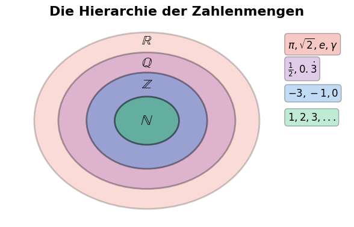
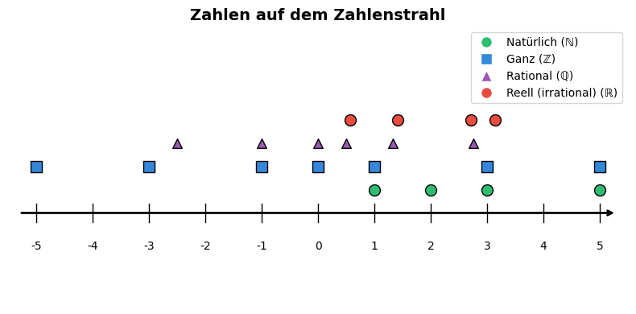

# Grundlagen
## 01 - Zahlenmengen und Grundrechenarten

Die hierarchischen Zahlenmengen $\mathbb{N} \subset \mathbb{Z} \subset \mathbb{Q} \subset \mathbb{R}$ ($\subset$ = "ist Teilmenge von", kommt gleich) und die Grundrechenarten bilden die Grundlage für alle weiteren mathematischen Konzepte.

### Lernziele
- Du verstehst die wichtigsten **Zahlenmengen** ($\mathbb{N}$, $\mathbb{Z}$, $\mathbb{Q}$, $\mathbb{R}$).
- Du verstehst die **Grundrechenarten** und ihre Eigenschaften (kommutativ, assoziativ, distributiv).
- Du kannst **Rechengesetze** sicher anwenden und erkennst typische Fehlerquellen.
- Du verstehst den Unterschied zwischen **exakter** und **numerischer** Darstellung.

---

## 1. Die Zahlenmengen

Die Mathematik organisiert Zahlen in hierarchischen Mengen, die aufeinander aufbauen:

### $\mathbb{N}$ - Natürliche Zahlen
Die "Zählzahlen" beginnen bei 1 und gehen unendlich weiter:
$$\mathbb{N} = \{1, 2, 3, 4, \ldots\}$$

Je nach Konvention gehört die $0$ dazu ($\mathbb{N}_0$) oder nicht. Wir verwenden $\mathbb{N}_0 = \{0, 1, 2, 3, 4, \ldots\}$.

**Eigenschaften:** 
- Addition und Multiplikation bleiben immer in $\mathbb{N}$. 
- Subtraktion und Division hingegen nicht - $3 - 5 = -2$ liegt außerhalb von $\mathbb{N}$, und $1 \div 3$ ist kein ganzzahliges Ergebnis. 

### $\mathbb{Z}$ - Ganze Zahlen
Natürliche Zahlen erweitern wir um negative Zahlen und die Null:
$$\mathbb{Z} = \{\ldots, -3, -2, -1, 0, 1, 2, 3, \ldots\}$$

**Eigenschaften:**
- Subtraktion immer möglich: $3 - 5 = -2 \in \mathbb{Z}$.
- Abgeschlossen unter Addition, Subtraktion und Multiplikation. **Nicht** abgeschlossen unter Division.

### $\mathbb{Q}$ - Rationale Zahlen
Alle Zahlen, die sich als **Bruch** zweier ganzer Zahlen darstellen lassen:
$$\mathbb{Q} = \left\{ \frac{p}{q} \mid p \in \mathbb{Z}, q \in \mathbb{Z}, q \neq 0 \right\}$$

**Beispiele:** 
- $\frac{1}{2}, \frac{-3}{4}, \frac{7}{1} = 7$ 
- $\quad 0.333\ldots = \frac{1}{3}$

**Eigenschaften:**
- Division wird vollständig möglich (bis auf Division durch Null).
- Dezimaldarstellung ist entweder endlich oder periodisch (wiederkehrendes Muster).

Aber: $\sqrt{2} \notin \mathbb{Q}$ - es gibt keine ganzen Zahlen $p, q$ mit $\frac{p}{q} = \sqrt{2}$.

### $\mathbb{R}$ - Reelle Zahlen
Alle Punkte auf dem Zahlenstrahl, inklusive irrationaler Zahlen:
$$\mathbb{R} = \mathbb{Q} \cup \{\text{irrationale Zahlen}\}$$

**Irrationale Zahlen:** $\sqrt{2}, \pi, e, \sqrt{3}, \ldots$ (unendlich, nicht periodisch)

### Die Hierarchie der Zahlenmengen
$$\mathbb{N} \subset \mathbb{Z} \subset \mathbb{Q} \subset \mathbb{R}$$

*Jede natürliche Zahl ist auch eine ganze Zahl, jede ganze Zahl ist eine rationale Zahl und jede rationale Zahl ist eine reelle Zahl.*

    

    

    

    

### Exakte vs. numerische Darstellung

| Art | Bedeutung | Beispiel |
|-----|-----------|----------|
| **Exakt** | Wert als Symbol oder Bruch - kein Runden | $\frac{1}{3}, \quad \sqrt{2}, \quad \pi$ |
| **Numerisch** | Dezimalzahl mit endlich vielen Stellen - immer eine Näherung | $0{,}333, \quad 1{,}4142, \quad 3{,}14159$ |

In der Mathematik ist $\sqrt{2}$ exakt - $1{,}4142$ ist bereits eine Näherung. Taschenrechner und Computer arbeiten fast immer numerisch, was zu Rundungsfehlern führen kann. Faustregel: Solange du rechnen kannst, bleib exakt. Erst am Ende runden.

## 2. Die Grundrechenarten und ihre Gesetze

Die vier Grundrechenarten sind: 
- Addition (+), 
- Subtraktion (-), 
- Multiplikation (·), 
- Division (÷). 

Drei strukturelle Gesetze beschreiben, wie Terme umgeformt werden können und zu wissen, für welche Operationen sie *nicht* gelten, schützt vor den häufigsten Fehlern.

#### A. Kommutativgesetz (Vertauschungsgesetz)
Die **Reihenfolge der Operanden** ändert das Ergebnis bei Addition und Multiplikation **nicht**:
$$a + b = b + a \quad \text{und} \quad a \cdot b = b \cdot a$$

**! Gilt NICHT für Subtraktion und Division:**
$$5 - 3 \neq 3 - 5 \quad \text{und} \quad 6 \div 2 \neq 2 \div 6$$

#### B. Assoziativgesetz (Verbindungsgesetz)
Klammern dürfen **verschoben** werden:
$$(a + b) + c = a + (b + c) \quad \text{und} \quad (a \cdot b) \cdot c = a \cdot (b \cdot c)$$

**! Gilt NICHT für Subtraktion und Division:**
$$(8 - 4) - 2 = 2 \quad \text{aber} \quad 8 - (4 - 2) = 6$$

#### C. Distributivgesetz (Verteilungsgesetz)
Multiplikation wird über Addition/Subtraktion **"verteilt"**:
$$a \cdot (b + c) = a \cdot b + a \cdot c$$

**Beispiel:** $3 \cdot (4 + 5) = 3 \cdot 4 + 3 \cdot 5 = 12 + 15 = 27$

Das Distributivgesetz ist die Grundlage für das Ausmultiplizieren von Klammern.

#### D. Rechenreihenfolge (PEMDAS / Punkt vor Strich)
1. **P**arentheses (Klammern)
2. **E**xponents (Potenzen)
3. **M**ultiplication & **D**ivision (von links nach rechts)
4. **A**ddition & **S**ubtraction (von links nach rechts)

**Beispiel:** $2 + 3 \cdot 4^2 = 2 + 3 \cdot 16 = 2 + 48 = 50$

---

## Zusammenfassung

| Konzept | Kernaussage |
|---------|-------------|
| Zahlenmengen | $\mathbb{N} \subset \mathbb{Z} \subset \mathbb{Q} \subset \mathbb{R}$ - jede Menge erweitert die vorherige |
| Natürliche Zahlen $\mathbb{N}$ | Zählzahlen ab 1 (bzw. 0 bei $\mathbb{N}_0$) |
| Ganze Zahlen $\mathbb{Z}$ | $\mathbb{N}$ erweitert um negative Zahlen und Null |
| Rationale Zahlen $\mathbb{Q}$ | Alle Brüche $\frac{p}{q}$, endliche oder periodische Dezimalzahlen |
| Reelle Zahlen $\mathbb{R}$ | $\mathbb{Q}$ plus irrationale Zahlen ($\sqrt{2}, \pi, e$) |
| Rechengesetze | Kommutativ, Assoziativ, Distributiv - gelten nur für bestimmte Operationen |
| Rechenreihenfolge | Klammern → Potenzen → Punkt → Strich (PEMDAS) |

---

## Glossar

| Deutsch | English |
|---------|---------|
| Zahlenmenge | Number set |
| Natürliche Zahlen | Natural numbers |
| Ganze Zahlen | Integers |
| Rationale Zahlen | Rational numbers |
| Reelle Zahlen | Real numbers |
| Irrationale Zahlen | Irrational numbers |
| Grundrechenarten | Basic arithmetic operations |
| Kommutativgesetz | Commutative law |
| Assoziativgesetz | Associative law |
| Distributivgesetz | Distributive law |
| Rechenreihenfolge | Order of operations |
| Bruch | Fraction |
| Nenner | Denominator |
| Zähler | Numerator |

