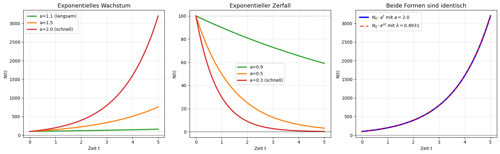
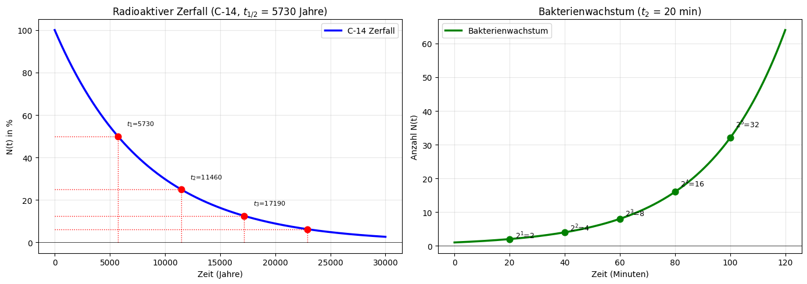
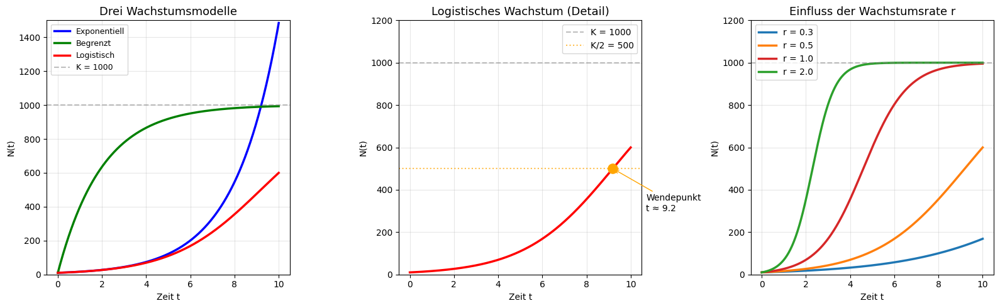

# Funktionen

## 06 - Wachstum und Zerfall

Exponentielles Wachstum und Zerfall: 
- Basis-Form $N(t) = N_0 \cdot a^t$ vs. e-Form $N(t) = N_0 \cdot e^{\lambda t}$ mit Umrechnung $a = e^\lambda$ 
- Verdopplungszeit ($T_2 = \ln 2 / \lambda$), Halbwertszeit ($T_{1/2} = \ln 2 / |\lambda|$)
- begrenztes und logistisches Wachstum.

> Vorausgesetzt: Exponential- und Logarithmusfunktionen.

### Lernziele

- **Exponentielles Wachstum** und **exponentiellen Zerfall** modellieren
- Zwischen der **Basis-Form** $N(t) = N_0 \cdot a^t$ und der **e-Form** $N(t) = N_0 \cdot e^{\lambda t}$ umrechnen
- **Verdopplungszeit** und **Halbwertszeit** bestimmen
- **Begrenztes Wachstum** und **logistisches Wachstum** einordnen
- Wachstumsmodelle auf realistische Probleme anwenden

---

### 1. Exponentielles Wachstum und Zerfall

Ein Prozess heisst **exponentiell**, wenn die Änderungsrate proportional zum aktuellen Bestand ist.

**Basis-Form (Wachstumsfaktor):**

$$N(t) = N_0 \cdot a^t$$

| Symbol | Bedeutung |
|--------|-----------|
| $N_0$ | Anfangswert zum Zeitpunkt $t = 0$ |
| $a$ | Wachstumsfaktor pro Zeiteinheit |
| $t$ | Zeit |

Ist $a > 1$, wächst der Bestand - der Prozess beschleunigt sich mit der Zeit. Ist $0 < a < 1$, nimmt er ab. Beides ist dasselbe Modell, nur mit verschiedenen Vorzeichen in $\lambda$.

**e-Form (Wachstumsrate):**

$$N(t) = N_0 \cdot e^{\lambda t}$$

| Symbol | Bedeutung |
|--------|-----------|
| $\lambda > 0$ | Wachstumsrate → Zunahme |
| $\lambda < 0$ | Zerfallsrate → Abnahme |

**Umrechnung** zwischen den Formen:

$$a = e^{\lambda} \quad \Longleftrightarrow \quad \lambda = \ln(a)$$

Die e-Form ist in der Mathematik und Physik üblicher, weil sich $e^{\lambda t}$ leichter differenzieren lässt: $\frac{d}{dt} N_0 \, e^{\lambda t} = \lambda \, N_0 \, e^{\lambda t}$.

    

    

### 2. Verdopplungszeit und Halbwertszeit

Zwei zentrale Kenngrößen für exponentielle Prozesse:

**Verdopplungszeit** $t_2$ (bei Wachstum, $\lambda > 0$):

$$N(t_2) = 2 \, N_0 \quad \Rightarrow \quad e^{\lambda t_2} = 2 \quad \Rightarrow \quad t_2 = \frac{\ln 2}{\lambda}$$

**Halbwertszeit** $t_{1/2}$ (bei Zerfall, $\lambda < 0$):

$$N(t_{1/2}) = \frac{N_0}{2} \quad \Rightarrow \quad e^{\lambda \, t_{1/2}} = \frac{1}{2} \quad \Rightarrow \quad t_{1/2} = \frac{\ln 2}{|\lambda|}$$

In der Basis-Form:

$$t_2 = \frac{\ln 2}{\ln a} \qquad \text{bzw.} \qquad t_{1/2} = \frac{\ln 2}{\ln(1/a)} = \frac{-\ln 2}{\ln a}$$

| Kenngrößen | Formel (e-Form) | Formel (Basis-Form) |
|------------|-----------------|---------------------|
| Verdopplungszeit | $t_2 = \frac{\ln 2}{\lambda}$ | $t_2 = \frac{\ln 2}{\ln a}$ |
| Halbwertszeit | $t_{1/2} = \frac{\ln 2}{\lvert\lambda\rvert}$ | $t_{1/2} = \frac{\ln 2}{\ln(1/a)}$ |
| Prozentuale Änderung/ZE | $p = e^{\lambda} - 1$ | $p = a - 1$ |

    

    

### 3. Weitere Wachstumsmodelle

Exponentielles Wachstum ist unbegrenzt - in der Realität gibt es oft eine **Kapazitätsgrenze**.

---

#### Begrenztes Wachstum (Sättigungsmodell)

$$N(t) = S - (S - N_0) \cdot e^{-k t} \qquad (k > 0)$$

Der Bestand nähert sich der **Schranke** $S$ an, ohne sie zu überschreiten. Die Änderungsrate wird kleiner, je näher $N$ an $S$ liegt.

*Beispiele:* Aufwärmen eines Körpers, Ladevorgang eines Kondensators, Lernen einer Fertigkeit.

---

#### Logistisches Wachstum

$$N(t) = \frac{K}{1 + \left(\frac{K - N_0}{N_0}\right) \cdot e^{-r t}}$$

| Symbol | Bedeutung |
|--------|-----------|
| $K$ | Kapazitätsgrenze (Carrying Capacity) |
| $r$ | Wachstumsrate |
| $N_0$ | Anfangswert |

Der Graph hat eine typische **S-Form** (Sigmoidkurve):
1. Anfangs nahezu exponentielles Wachstum
2. Wendepunkt bei $N = K/2$ - maximale Wachstumsgeschwindigkeit
3. Sättigung: $N(t) \to K$ für $t \to \infty$

*Beispiele:* Populationsdynamik, Verbreitung von Epidemien, Marktdurchdringung.

    

    

### 4. Anwendungsbeispiele

Das folgende Überblick zeigt, wie die verschiedenen Modelle auf reale Phänomene passen. Wichtig dabei: Die Wahl des Modells - unbeschränkt, begrenzt oder logistisch - hängt davon ab, ob es eine physikalische Obergrenze gibt.

| Anwendung | Modell | Typische Parameter |
|-----------|--------|--------------------|
| Radioaktiver Zerfall | $N(t) = N_0 \cdot e^{-\lambda t}$ | C-14: $t_{1/2} = 5730$ Jahre |
| Bakterienwachstum | $N(t) = N_0 \cdot 2^{t/t_2}$ | E. coli: $t_2 \approx 20$ min |
| Zinseszins | $K(t) = K_0 \cdot (1 + p/100)^t$ | Jahreszins $p$ in % |
| Stetige Verzinsung | $K(t) = K_0 \cdot e^{rt}$ | $r = \ln(1 + p/100)$ |
| Abkühlung (Newton) | $T(t) = T_U + (T_0 - T_U) \cdot e^{-kt}$ | Begrenztes Modell |
| Bevölkerung | Logistisch | Kapazitätsgrenze $K$ |

**Modellwahl:**  
- **Unbeschränktes** exponentielles Modell: geeignet für kurze Zeiträume  

- **Begrenztes** Modell: wenn ein Sättigungswert bekannt ist  - **Logistisches** Modell: wenn zunächst exponentielles Wachstum vorliegt, das sich dann verlangsamt

---

## Zusammenfassung

| Thema | Kernaussage |
|-------|-------------|
| **Exp. Wachstum** | $N(t) = N_0 \cdot a^t$ mit $a > 1$, oder $N_0 \cdot e^{\lambda t}$ mit $\lambda > 0$ |
| **Exp. Zerfall** | $a < 1$ bzw. $\lambda < 0$ |
| **Umrechnung** | $a = e^{\lambda}$, $\lambda = \ln(a)$ |
| **Verdopplungszeit** | $t_2 = \frac{\ln 2}{\lambda}$ |
| **Halbwertszeit** | $t_{1/2} = \frac{\ln 2}{\lvert\lambda\rvert}$ |
| **Begrenztes Wachstum** | $N(t) = S - (S-N_0) \, e^{-kt}$ - nähert sich Schranke $S$ |
| **Logistisches Wachstum** | S-Kurve mit Kapazitätsgrenze $K$, Wendepunkt bei $K/2$ |

---

## Glossar

| Deutsch | Englisch |
|---------|----------|
| Exponentielles Wachstum | Exponential growth |
| Exponentieller Zerfall | Exponential decay |
| Halbwertszeit | Half-life |
| Verdopplungszeit | Doubling time |
| Wachstumsfaktor | Growth factor |
| Wachstumsrate | Growth rate |
| Begrenztes Wachstum | Limited/bounded growth |
| Logistisches Wachstum | Logistic growth |
| Kapazitätsgrenze | Carrying capacity |
| Wendepunkt | Inflection point |
