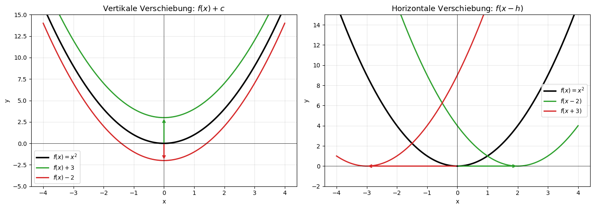
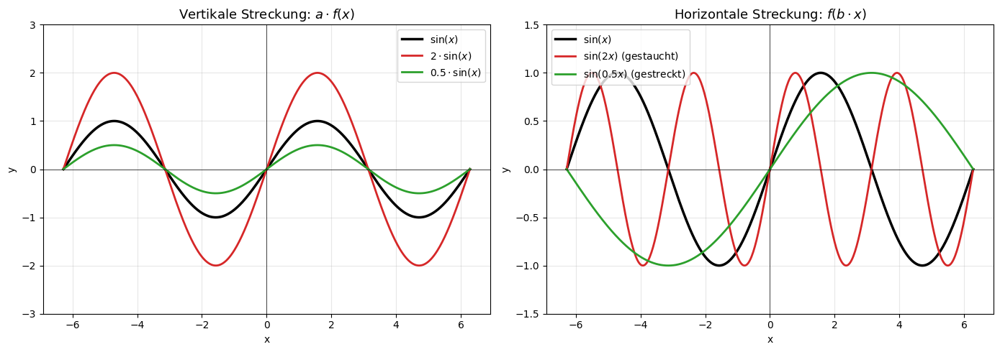
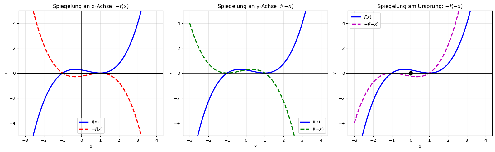
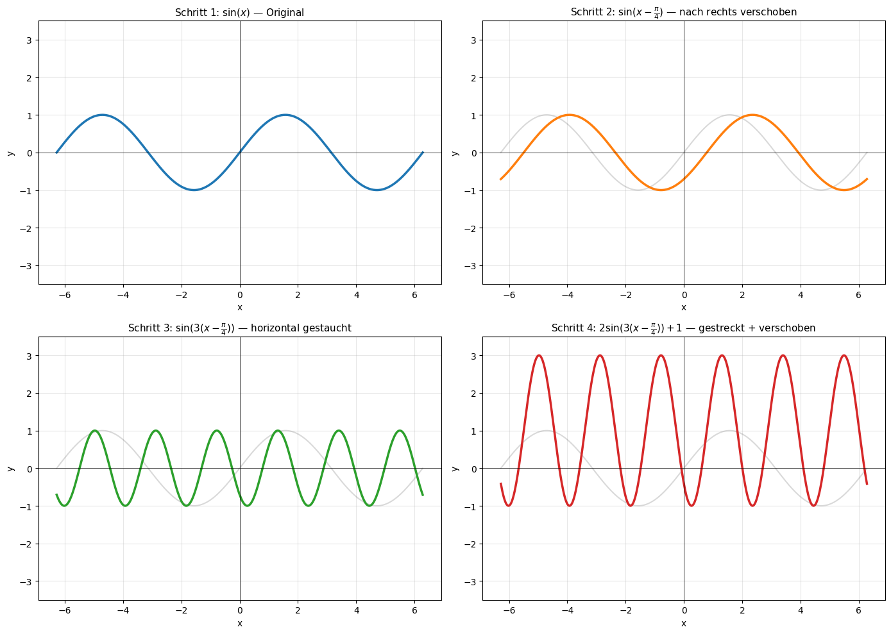
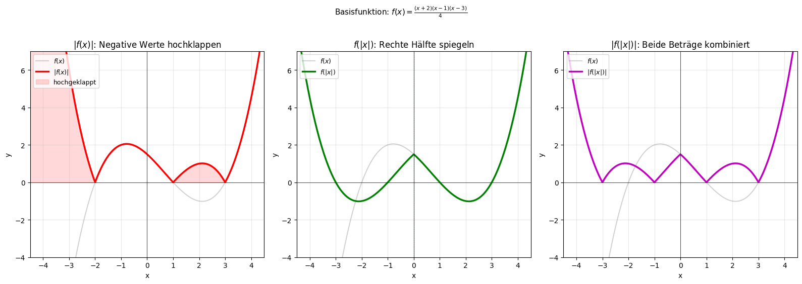

# Funktionen

## 07 - Funktionsmanipulationen

Transformationen von Funktionsgraphen:
- verschieben ($f(x) + c$, $f(x - h)$), 
- vertikal und horizontal strecken/stauchen ($a \cdot f(x)$, $f(b \cdot x)$)
- spiegeln an x- und y-Achse ($-f(x)$, $f(-x)$)
- zusammengesetzte Transformationen in korrekter Reihenfolge.

> Vorausgesetzt: Funktionsbegriff, lineare und quadratische Funktionen.

### Lernziele

- Funktionen **verschieben** (horizontal und vertikal)
- Funktionen **strecken und stauchen** (vertikal und horizontal)
- Funktionen **spiegeln** (an der x-Achse und der y-Achse)
- **Zusammengesetzte Transformationen** in der richtigen Reihenfolge anwenden
- Den Effekt jeder Manipulation am Graphen ablesen

---

### 1. Übersicht: Transformationen

Ausgehend von einer bekannten Funktion $f(x)$ lassen sich neue Funktionen erzeugen, indem man am **Argument** (innerhalb von $f$) oder am **Funktionswert** (außerhalb von $f$) Änderungen vornimmt.

| Transformation | Formel | Wirkung |
|----------------|--------|---------|
| Verschiebung nach oben | $f(x) + c$ | Graph wandert $c$ Einheiten nach oben |
| Verschiebung nach unten | $f(x) - c$ | Graph wandert $c$ Einheiten nach unten |
| Verschiebung nach rechts | $f(x - h)$ | Graph wandert $h$ Einheiten nach rechts |
| Verschiebung nach links | $f(x + h)$ | Graph wandert $h$ Einheiten nach links |
| Vertikale Streckung | $a \cdot f(x)$, $a > 1$ | Graph wird vertikal gestreckt |
| Vertikale Stauchung | $a \cdot f(x)$, $0 < a < 1$ | Graph wird vertikal gestaucht |
| Horizontale Stauchung | $f(b \cdot x)$, $b > 1$ | Graph wird horizontal gestaucht |
| Horizontale Streckung | $f(b \cdot x)$, $0 < b < 1$ | Graph wird horizontal gestreckt |
| Spiegelung an x-Achse | $-f(x)$ | Vorzeichen der y-Werte wird umgekehrt |
| Spiegelung an y-Achse | $f(-x)$ | Vorzeichen der x-Werte wird umgekehrt |

**Faustregel:**
- Änderungen **außen** (an $f$) wirken **vertikal** und **wie erwartet** (+ → nach oben)
- Änderungen **innen** (am Argument $x$) wirken **horizontal** und **gegenläufig** ($x - h$ → nach rechts)

    

    

### 2. Streckung und Stauchung

#### Vertikale Streckung/Stauchung: $a \cdot f(x)$

Der Faktor $a$ multipliziert jeden **y-Wert**:
- $|a| > 1$: Der Graph wird in y-Richtung **gestreckt** (steiler)
- $0 < |a| < 1$: Der Graph wird in y-Richtung **gestaucht** (flacher)
- Nullstellen bleiben unverändert (denn $a \cdot 0 = 0$)

#### Horizontale Streckung/Stauchung: $f(b \cdot x)$

Der Faktor $b$ ändert das **Argument** - die Wirkung ist gegenläufig:
- $|b| > 1$: Der Graph wird horizontal **gestaucht** (zusammengedrückt)
- $0 < |b| < 1$: Der Graph wird horizontal **gestreckt** (auseinandergezogen)

Bei periodischen Funktionen wie $\sin(x)$ beeinflusst $b$ die **Periode**: $T = \frac{2\pi}{|b|}$.

    

    

### 3. Spiegelungen

Spiegelungen sind Sonderfälle der Skalierung: das Vorzeichen eines Faktors entscheidet, ob der Graph gespiegelt wird. Wer die Symmetrieeigenschaften einer Funktion kennt, weiß schon im Voraus, welche Spiegelung nichts verändert.

| Spiegelung | Formel | Wirkung |
|------------|--------|---------|
| An der **x-Achse** | $-f(x)$ | Alle y-Werte ändern das Vorzeichen |
| An der **y-Achse** | $f(-x)$ | Der Graph wird links-rechts vertauscht |
| Am **Ursprung** | $-f(-x)$ | Beide Spiegelungen kombiniert |

**Zusammenhang mit Symmetrie:**

- $f(-x) = f(x)$: Die Funktion ist **gerade** (symmetrisch zur y-Achse) → Spiegelung an y-Achse ändert nichts- $f(-x) = -f(x)$: Die Funktion ist **ungerade** (punktsymmetrisch zum Ursprung) → Spiegelung am Ursprung ändert nichts

    

    

### 4. Zusammengesetzte Transformationen

Die allgemeine Form einer transformierten Funktion:

$$g(x) = a \cdot f\bigl(b(x - h)\bigr) + c$$

| Parameter | Wirkung |
|-----------|--------- |
| $h$ | Horizontale Verschiebung (nach rechts für $h > 0$) |
| $b$ | Horizontale Skalierung (Stauchung für $\|b\| > 1$) |
| $a$ | Vertikale Skalierung (Streckung für $\|a\| > 1$) |
| $c$ | Vertikale Verschiebung (nach oben für $c > 0$) |

**Reihenfolge der Anwendung** (von innen nach außen):

Die Reihenfolge ist entscheidend - genau wie beim Auswerten von Termen: Zuerst wird das Argument aufgebaut (horizontale Transformationen), dann erst der Funktionswert verändert (vertikale Transformationen).

1. Horizontale Verschiebung: $x \to x - h$
2. Horizontale Skalierung: $x \to b \cdot x$
3. Anwendung von $f$
4. Vertikale Skalierung: $y \to a \cdot y$
5. Vertikale Verschiebung: $y \to y + c$

**Beispiel:** $g(x) = 2\sin\bigl(3(x - \frac{\pi}{4})\bigr) + 1$

| Schritt | Transformation | Numerisch |
|---------|---------------|-------- |
| 1 | Verschiebung nach rechts | um $\frac{\pi}{4}$ |
| 2 | Horizontale Stauchung | Faktor 3 → Periode $\frac{2\pi}{3}$ |

| 3 | Vertikale Streckung | Faktor 2 → Amplitude 2 || 4 | Verschiebung nach oben | um 1 |

    

    

### 5. Betrag und Verkettung

Zwei weitere häufige Manipulationen:

| Transformation | Formel | Wirkung |
|----------------|--------|---------|
| Betrag von $f$ | $\|f(x)\|$ | Negative y-Werte werden nach oben geklappt |
| Betrag von $x$ | $f(\|x\|)$ | Der Graph für $x \ge 0$ wird an der y-Achse gespiegelt |

**Verkettung** $g(f(x))$ bedeutet: zuerst wird $f$ angewendet - der Output von $f$ wird zum Input von $g$. Die Reihenfolge ist dabei nicht vertauschbar: $g(f(x)) \ne f(g(x))$ im Allgemeinen.

Beispiel: $|\sin(x)|$ klappt alle negativen Sinuswerte nach oben - das Ergebnis hat dieselbe Frequenz wie $\sin(x)$, aber nur positive Werte.

    

    

---

## Zusammenfassung

| Transformation | Formel | Richtung |
|----------------|--------|----------|
| **Verschiebung vertikal** | $f(x) + c$ | $c > 0$: nach oben |
| **Verschiebung horizontal** | $f(x - h)$ | $h > 0$: nach rechts |
| **Streckung vertikal** | $a \cdot f(x)$ | $\|a\| > 1$: steiler |
| **Streckung horizontal** | $f(b \cdot x)$ | $\|b\| > 1$: gestaucht |
| **Spiegelung x-Achse** | $-f(x)$ | y-Werte negiert |
| **Spiegelung y-Achse** | $f(-x)$ | Links/rechts vertauscht |
| **Allgemeine Form** | $a \cdot f(b(x-h)) + c$ | Kombination aller Effekte |

---

## Glossar

| Deutsch | Englisch |
|---------|----------|
| Verschiebung | Translation / Shift |
| Streckung | Stretch |
| Stauchung | Compression |
| Spiegelung | Reflection |
| Amplitude | Amplitude |
| Periode | Period |
| Phasenverschiebung | Phase shift |
| Betrag | Absolute value |
| Verkettung | Composition |
