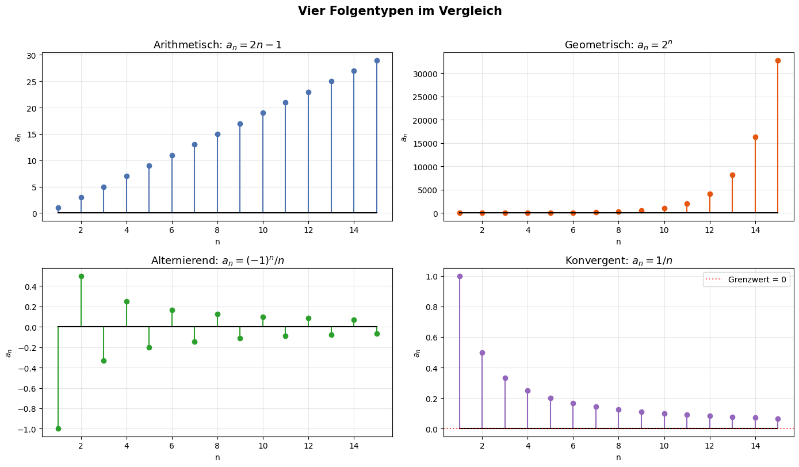
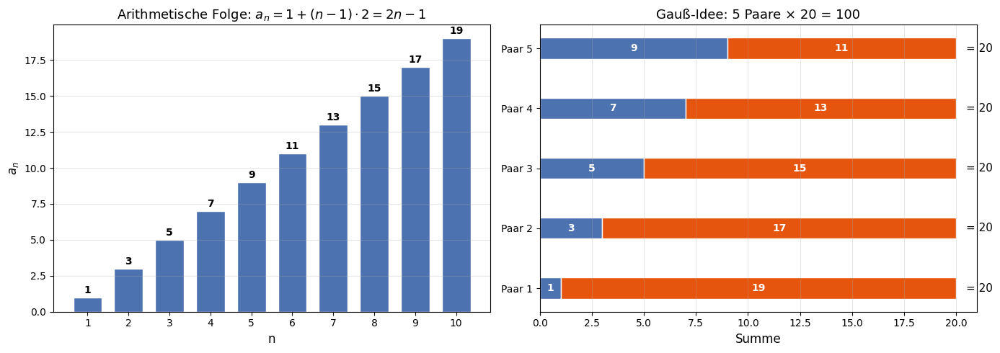
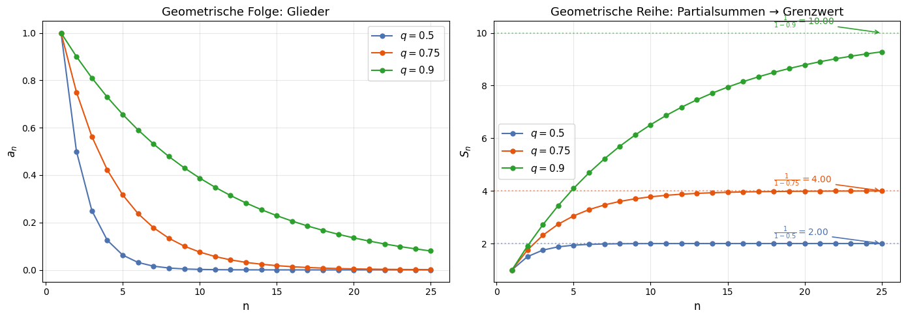
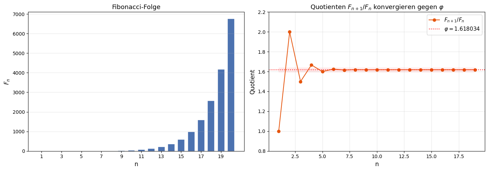
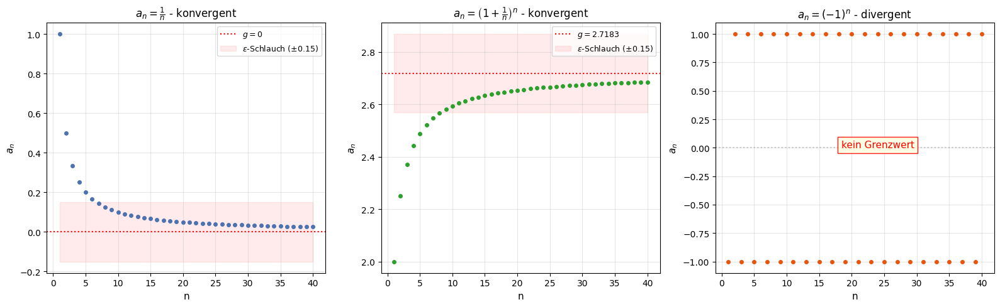

# Folgen und Reihen

## 01 - Folgen und Reihen

Folgen und Reihen verbinden Algebra mit Analysis: Zahlenfolgen $(a_n)$ — explizite Darstellung ($a_n = f(n)$) und rekursive Darstellung ($a_{n+1}$ aus $a_n$); Reihen als Partialsummen $S_n = \sum_{k=1}^n a_k$; arithmetische Folgen ($a_n = a_1 + (n-1)d$), geometrische Folgen ($a_n = a_1 \cdot q^{n-1}$), Gaußsche Summenformel, Konvergenz und Divergenz.

> Vorausgesetzt: grundlegende Algebra (00_Grundlagen), Grenzwerte (02_Funktionen/02).

### Lernziele

- **Was eine Folge ist** und wie man sie formal beschreibt (explizit und rekursiv)
- **Was eine Reihe ist** und wie Partialsummen funktionieren
- **Arithmetische** Folgen und Reihen — konstante Differenz, Gaußsche Summenformel
- **Geometrische** Folgen und Reihen — konstanter Quotient, endliche und unendliche Summe
- **Bildungsgesetze erkennen** — eine Folge analysieren und ihr Gesetz formulieren
- **Konvergenz und Divergenz** — wann nähert sich eine Folge einem Grenzwert?

---

### 1. Was ist eine Folge?

Eine **Zahlenfolge** (kurz **Folge**) ist eine Funktion, die jeder natürlichen Zahl $n \geq 1$ genau eine reelle Zahl zuordnet. Man schreibt $(a_n)_{n \geq 1}$ oder kurz $(a_n)$ und nennt $a_n$ das **$n$-te Folgenglied**.

**Beispiel:** Die Folge der Quadratzahlen: $(a_n) = 1, 4, 9, 16, 25, \ldots$ mit $a_n = n^2$.

Es gibt zwei grundlegende Wege, eine Folge zu beschreiben:

#### Explizite Darstellung
Man gibt eine Formel an, die $a_n$ direkt aus $n$ berechnet - ohne vorherige Glieder zu kennen.

$$a_n = f(n) \qquad \text{z.\,B. } a_n = 2n - 1 \;\;\Rightarrow\;\; 1, 3, 5, 7, 9, \ldots$$

#### Rekursive Darstellung
Man gibt einen **Startwert** (oder mehrere) und eine **Rechenvorschrift** an, die das nächste Glied aus den vorherigen berechnet.

$$a_1 = 1, \quad a_{n+1} = a_n + 2 \qquad \Rightarrow\quad 1, 3, 5, 7, 9, \ldots$$

Beide Darstellungen beschreiben hier dieselbe Folge - die ungeraden Zahlen. Die explizite Form ist praktischer zum Berechnen eines bestimmten Glieds (z.\,B. $a_{100} = 199$), die rekursive Form zeigt dagegen die innere Struktur: „Jedes Glied entsteht, indem man 2 zum vorherigen addiert."

### 2. Was ist eine Reihe?

Addiert man die Glieder einer Folge auf, entsteht eine **Reihe**. Die Summe der *ersten $n$ Glieder* heißt **$n$-te Partialsumme**:

$$S_n = \sum_{k=1}^{n} a_k = a_1 + a_2 + \cdots + a_n$$

Die Folge der Partialsummen $(S_1, S_2, S_3, \ldots)$ ist selbst wieder eine Folge. Wenn diese Folge einen Grenzwert besitzt, spricht man von einer **konvergenten Reihe**:

$$\sum_{k=1}^{\infty} a_k = \lim_{n \to \infty} S_n$$

**Beispiel:** Für $a_k = \frac{1}{2^k}$ gilt $S_n = 1 - \frac{1}{2^n}$ und $\lim_{n \to \infty} S_n = 1$.

---

    

    

### 3. Arithmetische Folgen und Reihen

Eine Folge heißt **arithmetisch**, wenn die **Differenz** $d$ zwischen aufeinanderfolgenden Gliedern konstant ist:

$$a_{n+1} - a_n = d \quad \text{für alle } n$$

Die Folge wächst (oder fällt) also gleichmäßig - wie eine Treppe mit immer gleicher Stufenhöhe.

#### Explizite Formel

$$a_n = a_1 + (n-1) \cdot d$$

**Beispiel:** $a_1 = 3$, $d = 5$ ergibt die Folge $3, 8, 13, 18, 23, \ldots$ und das 20. Glied ist $a_{20} = 3 + 19 \cdot 5 = 98$.

#### Gaußsche Summenformel

Die Summe der ersten $n$ Glieder einer arithmetischen Folge lautet:

$$S_n = \frac{n}{2} \cdot (a_1 + a_n) = \frac{n}{2} \cdot \bigl(2a_1 + (n-1)d\bigr)$$

Die Idee dahinter lässt sich an $1 + 2 + 3 + \cdots + 100$ veranschaulichen: Paart man das erste und letzte Glied ($1 + 100 = 101$), das zweite und vorletzte ($2 + 99 = 101$) usw., erhält man 50 Paare mit Summe 101. Also $S_{100} = 50 \cdot 101 = 5050$. Genau das formalisiert die Formel.

**Wichtig:** Arithmetische Reihen *divergieren* immer (außer für $d = 0$ und $a_1 = 0$) - die Partialsummen wachsen unbegrenzt.

    

    

### 4. Geometrische Folgen und Reihen

Eine Folge heißt **geometrisch**, wenn der **Quotient** $q$ zwischen aufeinanderfolgenden Gliedern konstant ist:

$$\frac{a_{n+1}}{a_n} = q \quad \text{für alle } n$$

Statt einer gleichmäßigen Treppe (wie bei arithmetischen Folgen) wächst oder schrumpft hier jedes Glied um denselben *Faktor*. Das führt zu exponentiellem Verhalten - schnell steigend für $|q| > 1$, schnell fallend für $|q| < 1$.

#### Explizite Formel

$$a_n = a_1 \cdot q^{n-1}$$

**Beispiel:** $a_1 = 3$, $q = 2$ ergibt $3, 6, 12, 24, 48, \ldots$ und $a_{10} = 3 \cdot 2^9 = 1536$.

#### Endliche geometrische Reihe

Die Summe der ersten $n$ Glieder:

$$S_n = a_1 \cdot \frac{q^n - 1}{q - 1} \qquad (q \neq 1)$$

Für $q = 1$ ist die Summe einfach $S_n = n \cdot a_1$.

#### Unendliche geometrische Reihe

Nur wenn $|q| < 1$ konvergiert die Reihe. Die Partialsummen nähern sich dann einem festen Wert:

$$\sum_{k=0}^{\infty} a_1 \cdot q^k = \frac{a_1}{1 - q} \qquad (|q| < 1)$$

Das liegt daran, dass die Glieder für $|q| < 1$ immer kleiner werden und „fast nichts" mehr zur Summe beitragen. Für $|q| \geq 1$ dagegen wachsen die Glieder (oder bleiben gleich groß), und die Summe explodiert.

**Anwendung:** Zinseszins. Legt man ein Kapital $K_0$ zu einem Zinssatz $p$ (als Dezimalzahl) an, wächst es geometrisch mit $q = 1 + p$:

$$K_n = K_0 \cdot (1 + p)^n$$

    

    

### 5. Bildungsgesetze erkennen

In der Praxis bekommt man oft die ersten Glieder einer Folge und muss das Gesetz dahinter entdecken. Hier ein systematischer Ansatz:

#### Strategie

1. **Differenzen bilden:** Berechne $a_{n+1} - a_n$. Sind sie konstant → **arithmetisch** (Differenz $d$).
2. **Quotienten bilden:** Berechne $a_{n+1} / a_n$. Sind sie konstant → **geometrisch** (Quotient $q$).
3. **Muster suchen:** Quadratzahlen, Potenzen, alternierende Vorzeichen ($(-1)^n$), Brüche mit wachsendem Nenner, …
4. **Rekursion prüfen:** Hängt jedes Glied von den *vorherigen* ab? (z.\,B. Fibonacci)

#### Beispiel: Fibonacci-Folge

Die berühmte Fibonacci-Folge ist weder arithmetisch noch geometrisch, sondern rein **rekursiv** definiert:

$$F_1 = 1, \quad F_2 = 1, \quad F_{n+2} = F_n + F_{n+1}$$

Das ergibt $1, 1, 2, 3, 5, 8, 13, 21, 34, 55, \ldots$ - jedes Glied ist die Summe der beiden vorherigen. Für diese Folge gibt es zwar eine explizite Formel (die Binet-Formel mit dem goldenen Schnitt $\varphi$), aber die rekursive Definition ist weitaus natürlicher und einfacher.

**Tipp:** Oft hilft es, die Folge in eine Tabelle zu schreiben und systematisch Differenzen und Quotienten zu berechnen, bevor man rät.

    

    

### 6. Konvergenz und Divergenz

Wann nähert sich eine Folge einem festen Wert? Die zentrale Frage dieses Abschnitts.

#### Konvergenz

Eine Folge $(a_n)$ **konvergiert** gegen den **Grenzwert** $g$, wenn die Glieder für wachsendes $n$ beliebig nahe an $g$ herankommen:

$$\lim_{n \to \infty} a_n = g$$

Formal: Für jedes noch so kleine $\varepsilon > 0$ gibt es ein $N$, sodass $|a_n - g| < \varepsilon$ für alle $n > N$. Anschaulich bedeutet das: Ab einem bestimmten Index liegen *alle* Glieder im „$\varepsilon$-Schlauch" um $g$.

#### Divergenz

Besitzt eine Folge keinen Grenzwert, heißt sie **divergent**. Es gibt zwei Arten:

- **Bestimmte Divergenz:** $a_n \to +\infty$ oder $a_n \to -\infty$ (die Glieder wachsen unbegrenzt)
- **Unbestimmte Divergenz:** Die Glieder springen hin und her, ohne sich einem Wert zu nähern (z.\,B. $a_n = (-1)^n$)

#### Hinreichende Bedingung: Monoton und beschränkt

Eine Folge, die **monoton wachsend** (oder fallend) und **beschränkt** ist, konvergiert garantiert. Das ist eines der nützlichsten Kriterien - man muss den Grenzwert nicht kennen, um Konvergenz zu beweisen.

#### Wichtige Grenzwerte

| Folge | Grenzwert | Bemerkung |
|-------|-----------|-----------|
| $a_n = \frac{1}{n}$ | $0$ | Harmonische Nullfolge |
| $a_n = \left(1 + \frac{1}{n}\right)^n$ | $e \approx 2{,}718$ | Definition der Eulerschen Zahl |
| $a_n = q^n$ mit $\|q\| < 1$ | $0$ | Geometrische Nullfolge |
| $a_n = \frac{n^k}{c^n}$ ($c > 1$) | $0$ | Exponentielles schlägt polynomiales Wachstum |

> **Verweis:** Eine ausführliche Behandlung von Grenzwerten findest Du im Notebook → **02_Funktionen/02_Grenzwerte**

---

    

    

---

## Zusammenfassung

| Konzept | Formel / Kernaussage |
|---------|---------------------|
| **Folge** | Funktion $n \mapsto a_n$, explizit oder rekursiv |
| **Reihe** | Summe der Folgenglieder: $S_n = \sum_{k=1}^{n} a_k$ |
| **Arithmetisch** | $a_n = a_1 + (n-1)d$, Summe: $S_n = \frac{n}{2}(a_1 + a_n)$ |
| **Geometrisch** | $a_n = a_1 \cdot q^{n-1}$, Summe: $S_n = a_1 \cdot \frac{q^n - 1}{q - 1}$ |
| **Geom. Reihe** ($\|q\|<1$) | $\sum_{k=0}^{\infty} a_1 q^k = \frac{a_1}{1-q}$ |
| **Konvergenz** | $\lim_{n\to\infty} a_n = g$ - Glieder nähern sich $g$ |
| **Divergenz** | Kein Grenzwert (bestimmt ↔ unbestimmt) |
| **Monoton + beschränkt** | ⇒ konvergent |

---

## Glossar

| Deutsch | Englisch |
|---------|----------|
| Folge | Sequence |
| Reihe | Series |
| Folgenglied | Term (of a sequence) |
| Partialsumme | Partial sum |
| Bildungsgesetz | Formation rule / Closed form |
| Arithmetische Folge | Arithmetic sequence |
| Geometrische Folge | Geometric sequence |
| Differenz (d) | Common difference |
| Quotient (q) | Common ratio |
| Konvergenz | Convergence |
| Divergenz | Divergence |
| Grenzwert | Limit |
| Monoton | Monotonic |
| Beschränkt | Bounded |
| Rekursiv | Recursive |
| Explizit | Explicit |
| Gaußsche Summenformel | Gauss summation formula |
| Fibonacci-Folge | Fibonacci sequence |
| Goldener Schnitt ($\varphi$) | Golden ratio |

