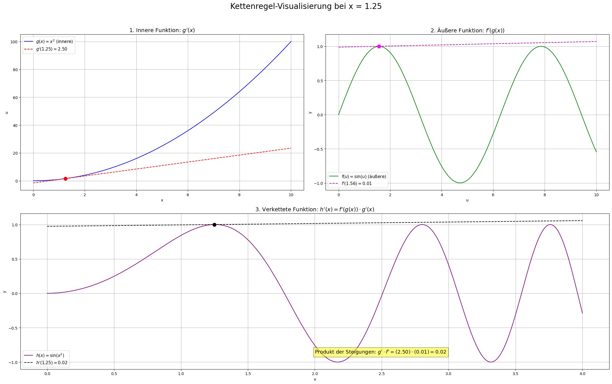

# Analysis
## 03 - Ableitungsregeln

Effizientes Ableiten ohne Grenzwert:
- Potenzregel ($(x^n)' = nx^{n-1}$)
- Konstanten-/Faktor-/Summenregel, Produktregel ($(uv)' = u'v + uv'$)
- Quotientenregel und Kettenregel ($(f(g(x)))' = f'(g(x)) \cdot g'(x)$) für zusammengesetzte Funktionen.

> Vorausgesetzt: Ableitungsbegriff.

### Lernziele

- **Die Potenzregel** — die wichtigste Grundregel
- **Konstanten- und Faktorregel** — Ableitungen von Konstanten und Vielfachen
- **Summen- und Differenzregel** — Term für Term ableiten
- **Die Produktregel** — Ableitung von Produkten zweier Funktionen
- **Die Quotientenregel** — Ableitung von Brüchen
- **Die Kettenregel** — Ableitung verschachtelter (zusammengesetzter) Funktionen

---

### 1. Die Potenzregel

Die **Potenzregel** ist die am häufigsten verwendete Ableitungsregel. Sie gilt für Funktionen der Form $f(x) = x^n$:

$$\boxed{f(x) = x^n \quad \Rightarrow \quad f'(x) = n \cdot x^{n-1}}$$

In Worten: **Der Exponent wird als Faktor vorangestellt und anschließend um eins vermindert.**

Beispiele:
- $f(x) = x^2 \Rightarrow f'(x) = 2x^1 = 2x$
- $f(x) = x^3 \Rightarrow f'(x) = 3x^2$
- $f(x) = x^1 = x \Rightarrow f'(x) = 1 \cdot x^0 = 1$ (Steigung der Geraden $y=x$ ist immer 1)
- $f(x) = x^{-1} = \frac{1}{x} \Rightarrow f'(x) = -1 \cdot x^{-2} = -\frac{1}{x^2}$
- $f(x) = \sqrt{x} = x^{1/2} \Rightarrow f'(x) = \frac{1}{2} x^{-1/2} = \frac{1}{2\sqrt{x}}$

### 2. Konstanten- und Faktorregel

**Ableitung einer Konstanten:** Wenn $f(x) = c$ (eine horizontale Linie), dann ist die Steigung überall null:
$$\boxed{f(x) = c \quad \Rightarrow \quad f'(x) = 0}$$

**Konstanter Faktor:** Ein konstanter Faktor bleibt beim Ableiten erhalten:
$$\boxed{f(x) = c \cdot g(x) \quad \Rightarrow \quad f'(x) = c \cdot g'(x)}$$

Beispiele:
- $f(x) = 5 \Rightarrow f'(x) = 0$
- $f(x) = 7x^2 \Rightarrow f'(x) = 7 \cdot 2x = 14x$
- $f(x) = -3x^4 \Rightarrow f'(x) = -3 \cdot 4x^3 = -12x^3$

### 3. Summen- und Differenzregel

Man kann **Term für Term** ableiten:
$$\boxed{[f(x) \pm g(x)]' = f'(x) \pm g'(x)}$$

Damit kannst Du jedes Polynom ableiten!

**Beispiel:** $h(x) = x^3 + 2x - 5$
- Ableitung von $x^3$ ist $3x^2$
- Ableitung von $2x$ ist $2$
- Ableitung von $-5$ ist $0$
- Also: $h'(x) = 3x^2 + 2$

### 4. Die Produktregel

Wenn $f(x) = u(x) \cdot v(x)$, also ein Produkt zweier Funktionen, dann gilt:

$$\boxed{[u(x) \cdot v(x)]' = u'(x) \cdot v(x) + u(x) \cdot v'(x)}$$

*Merkhilfe: „Erste abgeleitet mal Zweite plus Erste mal Zweite abgeleitet."*

**Beispiel:** $f(x) = x^2 \cdot \sin(x)$
- $u(x) = x^2 \quad \Rightarrow \quad u'(x) = 2x$
- $v(x) = \sin(x) \quad \Rightarrow \quad v'(x) = \cos(x)$
- $f'(x) = 2x \cdot \sin(x) + x^2 \cdot \cos(x)$

---

### 5. Die Quotientenregel

Wenn $f(x) = \frac{u(x)}{v(x)}$, ein Bruch zweier Funktionen, dann gilt:

$$\boxed{\left[\frac{u(x)}{v(x)}\right]' = \frac{u'(x) \cdot v(x) - u(x) \cdot v'(x)}{[v(x)]^2}}$$

*Merkhilfe: „Zähler abgeleitet mal Nenner minus Zähler mal Nenner abgeleitet - alles durch Nenner zum Quadrat."* (NAZ - NZA durch N²)

**Beispiel:** $f(x) = \frac{x^2 + 1}{x - 3}$
- $u(x) = x^2 + 1 \quad \Rightarrow \quad u'(x) = 2x$
- $v(x) = x - 3 \quad \Rightarrow \quad v'(x) = 1$
- $f'(x) = \frac{2x(x-3) - (x^2+1) \cdot 1}{(x-3)^2} = \frac{2x^2 - 6x - x^2 - 1}{(x-3)^2} = \frac{x^2 - 6x - 1}{(x-3)^2}$

### 6. Die Kettenregel

Die Kettenregel brauchst Du, wenn eine Funktion **verschachtelt** (zusammengesetzt) ist, z.B. $f(x) = (x^2 + 1)^3$ oder $h(x) = \sin(x^2)$.

Sei $y = f(g(x))$ mit:
- $f$ = **äußere Funktion**
- $g$ = **innere Funktion**

Dann gilt die Kettenregel:

$$\boxed{[f(g(x))]' = f'(g(x)) \cdot g'(x)}$$

In Worten: **„Äußere Funktion ableiten (innere stehen lassen), dann mal die Ableitung der inneren Funktion."**

In Leibniz-Notation besonders anschaulich:
$$\frac{dy}{dx} = \frac{dy}{du} \cdot \frac{du}{dx}$$

#### Beispiel 1: $y = (x^2 + 1)^3$
1. **Funktionen identifizieren:**
   - Äußere Funktion: $f(u) = u^3$ (wobei $u$ der „innere Teil" ist)
   - Innere Funktion: $g(x) = x^2 + 1$
2. **Ableitungen bilden:**
   - $f'(u) = 3u^2$ (Potenzregel)
   - $g'(x) = 2x$ (Potenzregel)
3. **Kettenregel anwenden:** $f'(g(x)) \cdot g'(x)$
   - $f'(g(x)) = 3(x^2+1)^2$ (innere Funktion für $u$ einsetzen)
   - Mal $g'(x) = 2x$
4. **Ergebnis:**
   - $y' = 3(x^2+1)^2 \cdot 2x = 6x(x^2+1)^2$

#### Beispiel 2: $h(x) = \sin(x^2)$
- Äußere: $\sin(u) \Rightarrow \cos(u)$
- Innere: $x^2 \Rightarrow 2x$
- Ergebnis: $h'(x) = \cos(x^2) \cdot 2x = 2x\cos(x^2)$

    

    

### 7. Übersicht: Alle Regeln auf einen Blick

| Regel | Formel | Beispiel |
|-------|--------|----------|
| **Potenzregel** | $(x^n)' = n \cdot x^{n-1}$ | $(x^5)' = 5x^4$ |
| **Konstantenregel** | $(c)' = 0$ | $(7)' = 0$ |
| **Faktorregel** | $(c \cdot f)' = c \cdot f'$ | $(3x^2)' = 6x$ |
| **Summenregel** | $(f \pm g)' = f' \pm g'$ | $(x^3 + x)' = 3x^2 + 1$ |
| **Produktregel** | $(u \cdot v)' = u'v + uv'$ | $(x^2 \sin x)' = 2x\sin x + x^2\cos x$ |
| **Quotientenregel** | $\left(\frac{u}{v}\right)' = \frac{u'v - uv'}{v^2}$ | $\left(\frac{x}{x+1}\right)' = \frac{1}{(x+1)^2}$ |
| **Kettenregel** | $[f(g(x))]' = f'(g(x)) \cdot g'(x)$ | $[\sin(x^2)]' = 2x\cos(x^2)$ |

#### Wichtige Standardableitungen

Einige Ableitungen solltest Du auswendig kennen:

| Funktion $f(x)$ | Ableitung $f'(x)$ |
|---|---|
| $x^n$ | $nx^{n-1}$ |
| $e^x$ | $e^x$ |
| $\ln(x)$ | $\frac{1}{x}$ |
| $\sin(x)$ | $\cos(x)$ |
| $\cos(x)$ | $-\sin(x)$ |
| $\tan(x)$ | $\frac{1}{\cos^2(x)}$ |
| $a^x$ | $a^x \cdot \ln(a)$ |

---

---

## Zusammenfassung

| Regel | Formel |
|-------|--------|
| **Potenzregel** | $(x^n)' = nx^{n-1}$ |
| **Faktorregel** | $(c \cdot f)' = c \cdot f'$ |
| **Summenregel** | $(f \pm g)' = f' \pm g'$ |
| **Produktregel** | $(u \cdot v)' = u'v + uv'$ |
| **Quotientenregel** | $\left(\frac{u}{v}\right)' = \frac{u'v - uv'}{v^2}$ |
| **Kettenregel** | $(f(g(x)))' = f'(g(x)) \cdot g'(x)$ |

---

## Glossar

| Deutsch | Englisch |
|---------|----------|
| Potenzregel | Power Rule |
| Faktorregel | Constant Multiple Rule |
| Summenregel | Sum Rule |
| Produktregel | Product Rule |
| Quotientenregel | Quotient Rule |
| Kettenregel | Chain Rule |
| Äußere Funktion | Outer function |
| Innere Funktion | Inner function |
| Verschachtelte Funktion | Composite function |
| Ableiten | To differentiate |
