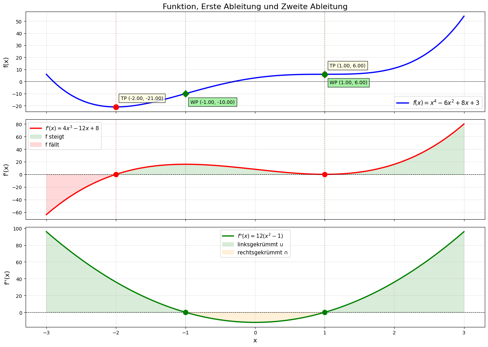
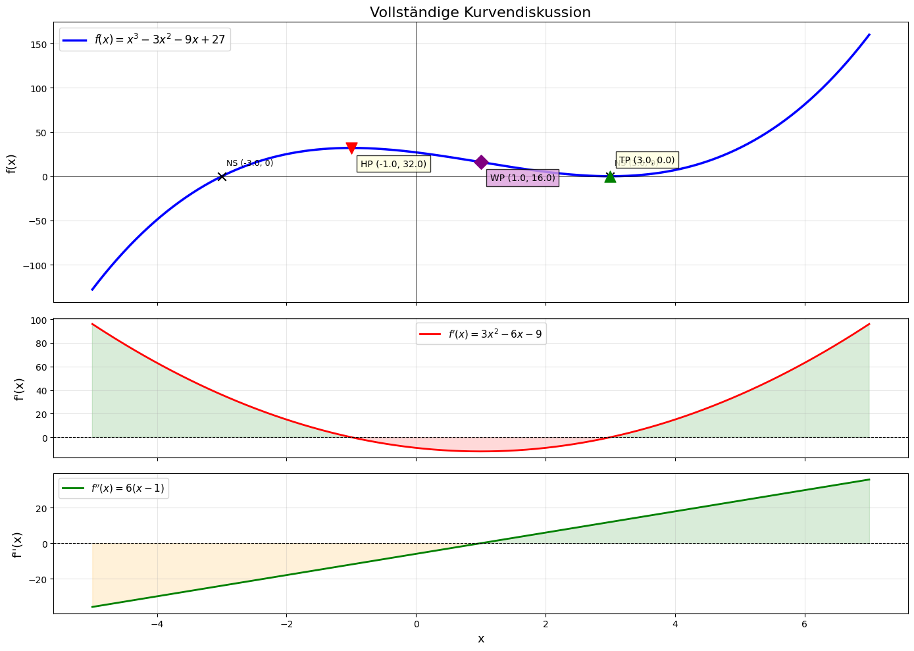

# Analysis
## 04 - Höhere Ableitungen und Kurvendiskussion

Zweite und höhere Ableitungen:
- $f'$ bestimmt die Monotonie ($f' > 0 \implies$ steigend)
- $f''$ die Krümmung ($f'' > 0 \implies$ linksgekrümmt/konvex)
- Extremstellen ($f' = 0$ und $f'' \neq 0$) und 
- Wendepunkte ($f'' = 0$ mit Vorzeichenwechsel)
- vollständige Kurvendiskussion.

> Vorausgesetzt: Ableitungsregeln.

### Lernziele

- **Höhere Ableitungen** ($f'', f''', \ldots$) zu berechnen und zu interpretieren
- **Den Zusammenhang zwischen $f$, $f'$ und $f''$** visuell zu verstehen
- **Monotonieverhalten** (Steigen/Fallen) aus $f'$ abzulesen
- **Extremstellen** (Hoch- und Tiefpunkte) zu bestimmen
- **Krümmungsverhalten** und **Wendepunkte** mit $f''$ zu finden
- Eine vollständige **Kurvendiskussion** durchzuführen

---

### 1. Höhere Ableitungen

Wenn wir eine Funktion $f(x)$ ableiten, erhalten wir $f'(x)$ - die **erste Ableitung**. Aber $f'(x)$ ist selbst wieder eine Funktion, die wir ableiten können!

| Notation | Name | Bedeutung |
|----------|------|-----------|
| $f'(x)$ oder $\frac{df}{dx}$ | Erste Ableitung | Steigung (Änderungsrate) |
| $f''(x)$ oder $\frac{d^2f}{dx^2}$ | Zweite Ableitung | Änderung der Steigung (Krümmung) |
| $f'''(x)$ oder $\frac{d^3f}{dx^3}$ | Dritte Ableitung | Änderung der Krümmung |

**Beispiel:** $f(x) = x^4 - 6x^2 + 8x + 3$
- $f'(x) = 4x^3 - 12x + 8$ (Potenz- und Summenregel)
- $f''(x) = 12x^2 - 12$ (nochmal ableiten)
- $f'''(x) = 24x$ (nochmal ableiten)

#### Was sagen uns diese Ableitungen?

| Ableitung | Aussage |
|-----------|---------|
| $f'(x) > 0$ | Funktion **steigt** (monoton wachsend) |
| $f'(x) < 0$ | Funktion **fällt** (monoton fallend) |
| $f'(x) = 0$ | Mögliche **Extremstelle** (Hoch-/Tiefpunkt) oder Sattelpunkt |
| $f''(x) > 0$ | Kurve ist **linksgekrümmt** (konkav ∪) |
| $f''(x) < 0$ | Kurve ist **rechtsgekrümmt** (konvex ∩) |
| $f''(x) = 0$ | Möglicher **Wendepunkt** (Krümmungswechsel) |

### 2. Das Zusammenspiel von $f$, $f'$ und $f''$

Die folgende Grafik zeigt die Funktion, ihre erste und zweite Ableitung **untereinander**. Beobachte:
- Wo $f'(x) = 0$ kreuzt (rote Linie die x-Achse), hat $f$ eine Extremstelle
- Wo $f'(x) > 0$, steigt $f$ - wo $f'(x) < 0$, fällt $f$
- Wo $f''(x) = 0$ kreuzt (grüne Linie die x-Achse), hat $f$ einen Wendepunkt
- Wo $f''(x) > 0$, ist $f$ linksgekrümmt - wo $f''(x) < 0$, rechtsgekrümmt

    

    

### 3. Extremstellen bestimmen

Um Hoch- und Tiefpunkte systematisch zu finden, gehst Du in zwei Schritten vor:

**Schritt 1: Notwendige Bedingung** - Setze $f'(x) = 0$ und löse nach $x$.
Die Lösungen sind die **Kandidaten** für Extremstellen.

**Schritt 2: Hinreichende Bedingung** - Prüfe mit der zweiten Ableitung, ob es sich um ein Maximum oder Minimum handelt:
- $f''(x_0) < 0 \Rightarrow$ **Hochpunkt** (Maximum) - die Kurve ist rechtsgekrümmt ∩
- $f''(x_0) > 0 \Rightarrow$ **Tiefpunkt** (Minimum) - die Kurve ist linksgekrümmt ∪
- $f''(x_0) = 0 \Rightarrow$ Keine Aussage! Könnte ein **Sattelpunkt** sein (→ höhere Ableitungen prüfen)

#### Was ist ein Sattelpunkt?
Ein **Sattelpunkt** (auch Terrassenpunkt) ist eine Stelle, an der $f'(x_0) = 0$ und $f''(x_0) = 0$ gilt, aber **kein Extremum** vorliegt. Die Funktion hat dort einen horizontalen Wendepunkt - sie „ruht" kurz und setzt dann in derselben Richtung fort.

**Beispiel:** $f(x) = x^3$ bei $x = 0$:
- $f'(x) = 3x^2 \Rightarrow f'(0) = 0$ ✓
- $f''(x) = 6x \Rightarrow f''(0) = 0$ - keine Aussage!
- $f'''(x) = 6 \Rightarrow f'''(0) = 6 \neq 0$ → Wendepunkt (Sattelpunkt)

### 4. Wendepunkte bestimmen

Ein **Wendepunkt** ist eine Stelle, an der die Krümmung der Kurve wechselt (von linksgekrümmt zu rechtsgekrümmt oder umgekehrt).

**Schritt 1: Notwendige Bedingung** - Setze $f''(x) = 0$ und löse nach $x$.

**Schritt 2: Hinreichende Bedingung** - Prüfe, ob die Krümmung tatsächlich wechselt:
- $f'''(x_0) \neq 0 \Rightarrow$ **Wendepunkt bestätigt**
- $f'''(x_0) = 0 \Rightarrow$ Keine Aussage (noch höhere Ableitung prüfen)

*Alternativ kannst Du auch einen Vorzeichenwechsel von $f''$ links und rechts der Stelle prüfen.*

---

### 5. Vollständige Kurvendiskussion - Schritt für Schritt

Eine **Kurvendiskussion** ist die systematische Analyse einer Funktion. Der Ablauf ist wie folgt:

| Schritt | Was? | Wie? |
|---------|------|------|
| 1 | **Definitionsbereich** | Wo ist $f(x)$ definiert? |
| 2 | **Symmetrie** | Achsensymmetrie ($f(-x)=f(x)$)? Punktsymmetrie ($f(-x)=-f(x)$)? |
| 3 | **Nullstellen** | Löse $f(x) = 0$ |
| 4 | **Extremstellen** | $f'(x) = 0$ lösen, $f''$ prüfen |
| 5 | **Wendepunkte** | $f''(x) = 0$ lösen, $f'''$ prüfen |
| 6 | **Monotonieverhalten** | Wo ist $f'(x) > 0$ (steigend) bzw. $< 0$ (fallend)? |
| 7 | **Krümmungsverhalten** | Wo ist $f''(x) > 0$ (linksgekr.) bzw. $< 0$ (rechtsgekr.)? |
| 8 | **Verhalten im Unendlichen** | $\lim_{x \to \pm\infty} f(x)$ |
| 9 | **Graph zeichnen** | Alles zusammenführen |

Komplett durchgeführt liefert die Kurvendiskussion ein umfassendes Bild der Funktion - wo sie steigt/fällt, wo sie Extremstellen und Wendepunkte hat, wie sie sich im Unendlichen verhält und wie ihr Graph aussieht.

In Python (für Notebook-Leser, PDF-Leser sehen nur die Ausgabe):

    

    

---

## Zusammenfassung

| Konzept | Kernaussage |
|---------|-------------|
| **Höhere Ableitungen** | $f'', f''', \ldots$ geben Auskunft über Krümmung und deren Änderung |
| **$f'$** | Steigungsverhalten: positiv = steigend, negativ = fallend |
| **$f''$** | Krümmungsverhalten: positiv = linksgekrümmt (∪), negativ = rechtsgekrümmt (∩) |
| **Extremstellen** | $f'(x_0) = 0$ (notwendig), $f''(x_0) \neq 0$ (hinreichend) |
| **Wendepunkte** | $f''(x_0) = 0$ (notwendig), $f'''(x_0) \neq 0$ (hinreichend) |
| **Sattelpunkt** | Wendepunkt mit horizontaler Tangente ($f' = 0$ und $f'' = 0$) |
| **Kurvendiskussion** | Systematisches Werkzeug zur vollständigen Funktionsanalyse |

---

## Glossar

| Deutsch | Englisch |
|---------|----------|
| Höhere Ableitung | Higher-order derivative |
| Erste / Zweite / Dritte Ableitung | First / Second / Third derivative |
| Extremstelle | Extremum (critical point) |
| Hochpunkt (Maximum) | Maximum (peak) |
| Tiefpunkt (Minimum) | Minimum (valley) |
| Sattelpunkt / Terrassenpunkt | Saddle point / Inflection with zero slope |
| Wendepunkt | Inflection point |
| Monotonieverhalten | Monotonicity |
| Krümmungsverhalten | Concavity |
| Linksgekrümmt (konkav) | Concave up |
| Rechtsgekrümmt (konvex) | Concave down |
| Kurvendiskussion | Curve sketching / Curve analysis |
| Notwendige Bedingung | Necessary condition |
| Hinreichende Bedingung | Sufficient condition |
