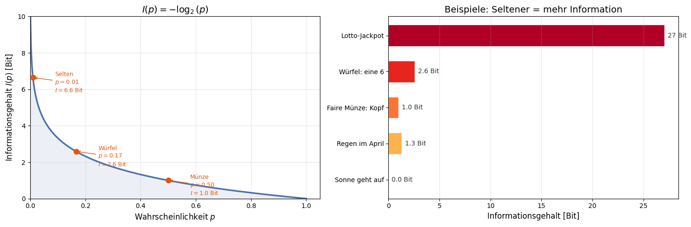
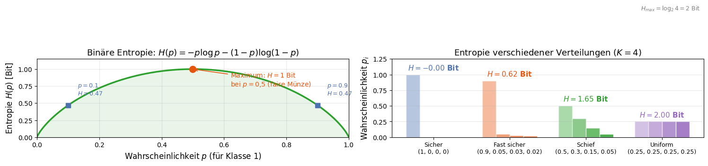
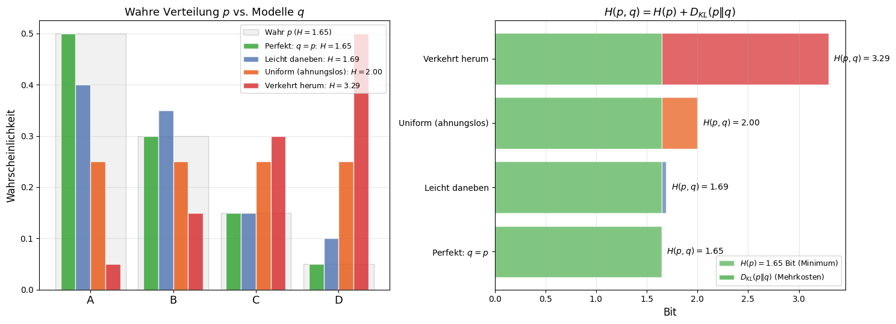
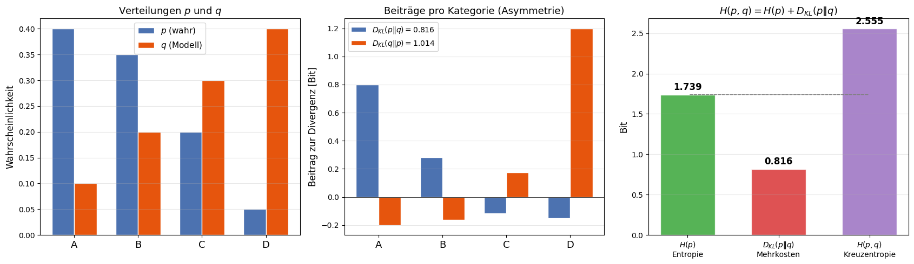
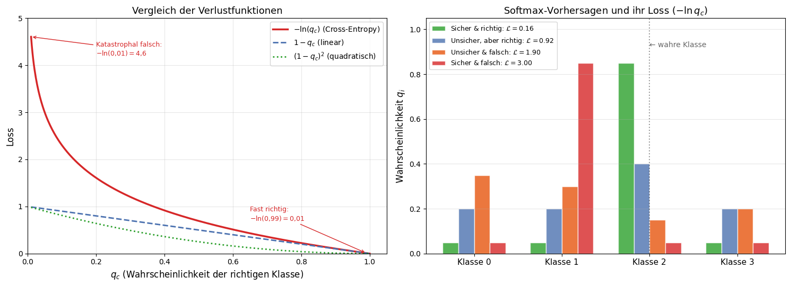
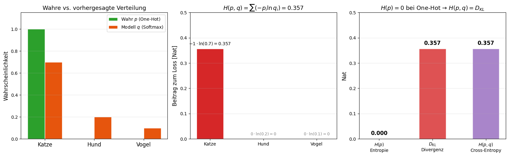
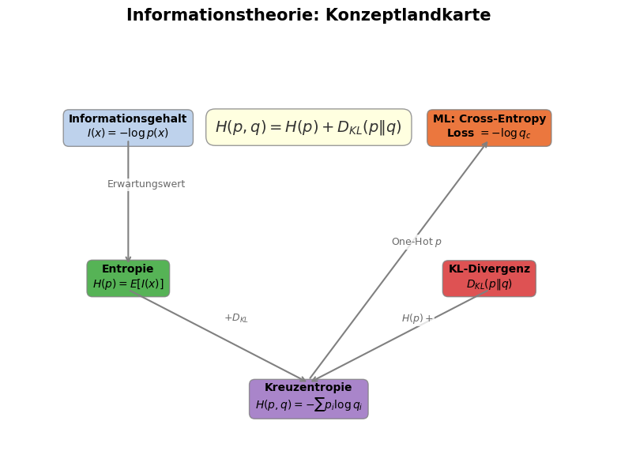

# Machine Learning - Grundlagen
## 01 - Informationstheorie

Als Einstieg in die Welt des Machine Learnings, stellen wir uns nun eine fundamentale Frage: **Wie viel *Information* steckt eigentlich in einem Ereignis?** Und: Wenn wir eine Verteilung durch ein Modell *schätzen* - wie teuer ist es, danebenzuliegen?

Die **Informationstheorie** wurde 1948 von Claude Shannon begründet - ursprünglich für die Nachrichtentechnik. Heute ist sie eines der wichtigsten Werkzeuge im Machine Learning: Der **Cross-Entropy Loss**, mit dem fast jedes Klassifikationsmodell trainiert wird, ist nichts anderes als ein informationstheoretisches Maß. Wer Information, Entropie und Kreuzentropie versteht, versteht *warum* diese Verlustfunktion genau so aussieht - und nicht anders.

### Lernziele

- **Informationsgehalt** - wie viel "Überraschung" ein Ereignis trägt
- **Entropie** - die mittlere Unsicherheit einer Verteilung
- **Kreuzentropie** - die Kosten, wenn man die falsche Verteilung annimmt
- **KL-Divergenz** - wie weit zwei Verteilungen auseinanderliegen
- **Die zentrale Beziehung** $H(p,q) = H(p) + D_{\text{KL}}(p \| q)$ und ihre Bedeutung
- **Verbindung zum ML** - warum Cross-Entropy *der* Standard-Loss für Klassifikation ist

**Voraussetzungen:** [03 - Wahrscheinlichkeitsrechnung](../../Foundations/08_Statistik_und_Wahrscheinlichkeit/03_Wahrscheinlichkeitsrechnung.ipynb), [04 - Verteilungen](../../Foundations/08_Statistik_und_Wahrscheinlichkeit/04_Verteilungen.ipynb), [00 - Verteilungen im ML-Kontext](../../ml/Grundlagen/00_Verteilungen_ML.ipynb) (insb. Multinomialverteilung)

---

### 1. Informationsgehalt - Wie viel verrät ein Ereignis?

Stell Dir vor, jemand erzählt Dir: *"Morgen geht die Sonne auf."* Das ist keine wirkliche Neuigkeit - es passiert jeden Tag. Aber: *"Morgen schneit es im Juli in Wien"* - das wäre überraschend. Seltene Ereignisse tragen **mehr Information** als häufige.

Shannon formalisierte diese Intuition mit einer einzigen Formel:

#### Definition

Der **Informationsgehalt** (auch: *Überraschung*, engl. *surprisal*) eines Ereignisses mit Wahrscheinlichkeit $p$ ist:

$$I(p) = -\log_2(p) = \log_2\!\left(\frac{1}{p}\right) \qquad \text{(in Bit)}$$

#### Warum genau diese Formel?

Shannon stellte drei vernünftige Forderungen:

| Forderung | Bedeutung | Formel-Konsequenz |
|-----------|-----------|-------------------|
| **Monotonie** | Seltenere Ereignisse → mehr Information | $p$ klein → $I(p)$ groß |
| **Sicheres Ereignis = keine Information** | $p = 1$ enthält nichts Neues | $I(1) = -\log(1) = 0$ |
| **Additivität** | Information unabhängiger Ereignisse addiert sich | $I(p_1 \cdot p_2) = I(p_1) + I(p_2)$ |

Die *einzige* Funktion, die alle drei erfüllt, ist der **negative Logarithmus**. Die dritte Eigenschaft folgt direkt aus der Logarithmusregel $\log(a \cdot b) = \log(a) + \log(b)$, die wir aus [04 - Exponenten und Logarithmen](../../Foundations/00_Grundlagen/04_Exponenten_und_Logarithmen.ipynb) kennen.

#### Was genau bedeutet "Bit" hier?

Ein **Bit** ist die Antwort auf eine Ja/Nein-Frage. Daraus ergibt sich die Intuition:

- **1 Bit** = eine faire Münze. Ergebnis "Kopf" mit $p = 0{,}5$: Du brauchst genau **eine** Ja/Nein-Frage ("War es Kopf?"), um das Ergebnis zu übermitteln. $I = -\log_2(0{,}5) = 1$ Bit.
- **$n$ Bit** = ein fairer Würfel mit $2^n$ Seiten. Bei einem 8-seitigen Würfel ($p = 1/8$) braucht man $\log_2(8) = 3$ Ja/Nein-Fragen, um die gefallene Seite zu identifizieren (z.B.: "Obere Hälfte?" → "Zweites Viertel?" → "Links oder rechts?").
- **Bruchteile von Bits** wie $0{,}66$ Bit bedeuten: *Im Durchschnitt* braucht man weniger als eine volle Ja/Nein-Frage. Ein Ereignis mit $p = 0{,}63$ trägt $I = 0{,}66$ Bit - das Ergebnis ist *teilweise vorhersagbar*. Stell Dir 100 solcher Ereignisse vor: Um sie alle zu codieren, bräuchte man ca. 66 Bits statt 100. Das Muster ist so regelmäßig, dass ein Komprimierer sich Fragen sparen kann.

| Informationsgehalt | Interpretation | Beispiel |
|---|---|---|
| $I = 0$ Bit | Vollständig vorhersagbar, keine Überraschung | Sonne geht auf ($p = 1$) |
| $I = 0{,}66$ Bit | Teilweise vorhersagbar, wenig Überraschung | Regen im April ($p \approx 0{,}63$) |
| $I = 1$ Bit | Eine faire Münze, maximale Binär-Unsicherheit | Faire Münze ($p = 0{,}5$) |
| $I = 2{,}6$ Bit | Braucht ca. 3 Ja/Nein-Fragen | Würfel: eine 6 ($p = 1/6$) |
| $I = 27$ Bit | Extrem überraschend | Lotto-Jackpot ($p \approx 10^{-8}$) |

#### Die Wahl der Basis

| Basis | Einheit | Verwendung |
|-------|---------|------------|
| $\log_2$ | **Bit** | Informatik, Codierung |
| $\ln = \log_e$ | **Nat** | Mathematik, ML (Standard in PyTorch/TensorFlow) |
| $\log_{10}$ | **Hartley** | Selten verwendet |

Die Basis ändert nur den Skalierungsfaktor: $\log_2(x) = \frac{\ln(x)}{\ln(2)}$. Die Strukturen bleiben identisch. Wir verwenden $\log_2$ für die Intuition ("wie viele Ja/Nein-Fragen brauche ich?") und $\ln$ wenn wir Richtung ML gehen.

> **Merke:** 1 Bit = 1 Ja/Nein-Frage. Bruchteile von Bits messen, wie *vorhersagbar* etwas ist. Je vorhersagbarer, desto weniger Bits nötig, desto weniger Information steckt drin.

    

    

### 2. Entropie - Die mittlere Unsicherheit

Der Informationsgehalt beschreibt ein *einzelnes* Ereignis. Aber wie unsicher ist eine Verteilung *insgesamt*? Dafür bilden wir den **Erwartungswert des Informationsgehalts** über alle möglichen Ausgänge:

#### Definition: Shannon-Entropie

Für eine diskrete Verteilung $p = (p_1, p_2, \ldots, p_K)$ mit $\sum p_i = 1$:

$$\boxed{H(p) = -\sum_{i=1}^{K} p_i \log p_i = \sum_{i=1}^{K} p_i \cdot I(p_i) = E[I(p)]}$$

Die Entropie ist also nichts anderes als der gewichtete Durchschnitt des Informationsgehalts - gewichtet mit der Wahrscheinlichkeit, dass dieses Ereignis tatsächlich eintritt. Beachte: Wir setzen $0 \cdot \log(0) := 0$, denn $\lim_{p \to 0^+} p \log p = 0$.

#### Die Intuition

| Verteilung | Entropie | Warum? |
|-----------|----------|--------|
| Ein Ausgang sicher ($p_1 = 1$) | $H = 0$ | Keine Überraschung möglich |
| Gleichverteilung ($p_i = 1/K$) | $H = \log K$ (maximal!) | Maximale Unsicherheit |
| Dazwischen | $0 < H < \log K$ | Teilweise vorhersagbar |

Die Entropie misst, **wie viel man im Durchschnitt raten muss** - oder äquivalent: wie viele Bits man braucht, um einen Ausgang optimal zu codieren.

#### Binäre Entropie $H(p)$

Der Spezialfall $K = 2$ (z.B. Münzwurf, Ja/Nein-Klassifikation) verdient besondere Aufmerksamkeit:

$$H(p) = -p \log_2 p - (1-p) \log_2(1-p)$$

Diese Funktion hat eine schöne, symmetrische Form mit Maximum bei $p = 0{,}5$ (faire Münze: maximale Unsicherheit).

> **Merke:** Hohe Entropie = hohe Unsicherheit = schwer vorherzusagen. Niedrige Entropie = die Verteilung ist „spitz
.

    

    

### 3. Kreuzentropie - Die Kosten falscher Annahmen

Jetzt kommt der entscheidende Schritt Richtung Machine Learning. Stellen wir uns folgendes Szenario vor:

Die **wahre** Verteilung der Wörter in einer Sprache sei $p$. Ein Kompressionsalgorithmus (oder ein ML-Modell) *glaubt* aber, die Verteilung sei $q$. Häufigen Wörtern gibt er kurze Codes, seltenen lange - aber er orientiert sich an $q$ statt an $p$. Wie viele Bits braucht er **im Durchschnitt**?

#### Definition

Die **Kreuzentropie** (Cross-Entropy) zwischen der wahren Verteilung $p$ und der geschätzten Verteilung $q$ ist:

$$\boxed{H(p, q) = -\sum_{i=1}^{K} p_i \log q_i}$$

Lies das so: *"Die tatsächlichen Ereignisse folgen $p$, aber wir bewerten ihre Überraschung mit $q$."*

- Jedes Ereignis $i$ tritt mit Wahrscheinlichkeit $p_i$ auf (die Realität)
- Dafür "zahlen" wir $-\log q_i$ Bits (die Kosten laut unserem Modell $q$)
- Zusammen: **erwartete Kosten** $= \sum p_i \cdot (-\log q_i)$

#### Was bedeuten die verschiedenen Fälle?

| Situation | $H(p, q)$ im Vergleich zu $H(p)$ | Bedeutung |
|-----------|----------------------------------|-----------|
| $q = p$ (perfektes Modell) | $H(p, q) = H(p)$ | Die Mindestkosten - besser geht's nicht |
| $q \neq p$ (fehlerhaftes Modell) | $H(p, q) > H(p)$ | Wir zahlen *mehr* als nötig |
| $q_i \approx 0$ aber $p_i > 0$ | $H(p, q) \to \infty$ | Katastrophe: Modell hält etwas für unmöglich, das passiert |

Der letzte Fall ist besonders wichtig: Wenn das Modell einem tatsächlich vorkommenden Ereignis eine Wahrscheinlichkeit nahe 0 zuweist, explodiert der Loss. Das ist kein Bug - es ist die mathematisch korrekte Bestrafung für fatale Fehleinschätzungen.

> **Merke:** Die Kreuzentropie $H(p, q)$ ist immer mindestens so groß wie die Entropie $H(p)$. Die Differenz ist genau die **KL-Divergenz** - unser nächstes Thema.

    

    

### 4. KL-Divergenz - Der "Abstand" zwischen Verteilungen

Wir haben gesehen: Kreuzentropie = Entropie + "irgendetwas Extra". Dieses Extra hat einen Namen.

#### Definition: Kullback-Leibler-Divergenz

Die **KL-Divergenz** (auch: relative Entropie) von $p$ nach $q$ ist:

$$\boxed{D_{\text{KL}}(p \| q) = \sum_{i=1}^{K} p_i \log \frac{p_i}{q_i} = H(p, q) - H(p)}$$

Sie misst die **zusätzlichen Bits**, die man braucht, wenn man die falsche Verteilung $q$ statt der wahren $p$ verwendet.

#### Eigenschaften

| Eigenschaft | Formel | Bedeutung |
|------------|--------|----------|
| **Nicht-negativ** | $D_{\text{KL}}(p \| q) \geq 0$ | Man zahlt immer drauf, wenn $q \neq p$ |
| **Null gdw. gleich** | $D_{\text{KL}}(p \| q) = 0 \Leftrightarrow p = q$ | Perfekte Übereinstimmung |
| **Nicht symmetrisch!** | $D_{\text{KL}}(p \| q) \neq D_{\text{KL}}(q \| p)$ | Kein echter Abstand |

Die **Asymmetrie** ist kein Mangel, sondern inhaltlich sinnvoll: $D_{\text{KL}}(p \| q)$ fragt *"Wie teuer ist es, $q$ zu benutzen, wenn die Wahrheit $p$ ist?"* - und das ist eine andere Frage als umgekehrt.

#### Die zentrale Beziehung

Die drei Größen hängen elegant zusammen:

$$\boxed{H(p, q) = H(p) + D_{\text{KL}}(p \| q)}$$

In Worten:

$$\underbrace{H(p, q)}_{\text{Gesamtkosten}} = \underbrace{H(p)}_{\text{unvermeidbare Kosten}} + \underbrace{D_{\text{KL}}(p \| q)}_{\text{Mehrkosten durch falsches } q}$$

Da $H(p)$ eine Konstante ist (die wahre Verteilung ändert sich nicht), ist das **Minimieren der Kreuzentropie dasselbe wie das Minimieren der KL-Divergenz**. Genau deshalb funktioniert Cross-Entropy als Loss-Funktion: Das Modell wird dazu gedrängt, $q$ so nah wie möglich an $p$ zu bringen.

> **Merke:** $D_{\text{KL}}(p \| q)$ ist *kein* Abstand im mathematischen Sinn (nicht symmetrisch, keine Dreiecksungleichung). Man spricht bewusst von *Divergenz*.

    

    

### 5. Anwendung: Cross-Entropy Loss in der Klassifikation

Jetzt fügt sich alles zusammen. In einem Klassifikationsproblem mit $K$ Klassen haben wir:

- **Wahre Verteilung** $p$: ein One-Hot-Vektor (z.B. $p = (0, 0, 1, 0)$ für Klasse 3)
- **Modellvorhersage** $q$: die Softmax-Ausgabe des Netzwerks (z.B. $q = (0.1, 0.2, 0.6, 0.1)$)

Der **Cross-Entropy Loss** für einen einzelnen Datenpunkt ist:

$$\mathcal{L} = H(p, q) = -\sum_{i=1}^{K} p_i \log q_i$$

Da $p$ ein One-Hot-Vektor ist (nur $p_c = 1$ für die korrekte Klasse $c$, alle anderen 0), vereinfacht sich das zu:

$$\mathcal{L} = -\log q_c$$

Lies das: *"Bestrafe das Modell mit dem negativen Logarithmus der Wahrscheinlichkeit, die es der richtigen Klasse zuweist."*

#### Warum nicht einfach den Fehler zählen?

Man könnte fragen: Warum nicht einfach $\mathcal{L} = 1 - q_c$ ("wie weit von 1 entfernt")? Die Cross-Entropy hat entscheidende Vorteile:

| Eigenschaft | $-\log q_c$ (Cross-Entropy) | $1 - q_c$ (linearer Fehler) |
|------------|---------------------------|----------------------------|
| $q_c = 0{,}99$ (fast richtig) | $0{,}014$ - kaum Strafe | $0{,}01$ - kaum Strafe |
| $q_c = 0{,}5$ (unsicher) | $0{,}69$ - moderate Strafe | $0{,}5$ - moderate Strafe |
| $q_c = 0{,}01$ (katastrophal falsch) | $4{,}6$ - extreme Strafe | $0{,}99$ - milde Strafe |
| Gradient bei $q_c \approx 0$ | Groß → lernt schnell | Klein → lernt langsam |

Die logarithmische Strafe wächst **nach oben unbeschränkt**, wenn das Modell sich bei einer falschen Vorhersage sicher ist. Das erzeugt starke Gradienten genau dort, wo das Modell sie am meisten braucht.

#### Binäre Klassifikation ($K = 2$)

Für den Spezialfall von zwei Klassen mit $p \in \{0, 1\}$ und Modellvorhersage $\hat{y} = q_1$:

$$\mathcal{L} = -\left[y \log \hat{y} + (1-y) \log(1-\hat{y})\right]$$

Das ist die **Binary Cross-Entropy** (BCE) - exakt die binäre Entropie aus Abschnitt 2, nur dass hier $p$ fest (die Labels) und $\hat{y}$ variabel (die Vorhersage) ist.

> **Merke:** Der Cross-Entropy Loss ist informationstheoretisch motiviert: Das Modell $q$ soll die wahre Verteilung $p$ so gut wie möglich approximieren. Weil $H(p)$ konstant ist, minimiert man damit automatisch auch $D_{\text{KL}}(p \| q)$.

    

    

### 6. Ein numerisches Beispiel: Von der Verteilung zum Loss

Lassen wir alles an einem konkreten Beispiel Revue passieren. Ein Klassifikator mit $K = 3$ Klassen (Katze, Hund, Vogel) macht eine Vorhersage für ein Bild, das eine **Katze** zeigt:

| | Katze ($i=1$) | Hund ($i=2$) | Vogel ($i=3$) |
|---|---|---|---|
| **Wahr** $p_i$ | $1$ | $0$ | $0$ |
| **Modell** $q_i$ | $0{,}7$ | $0{,}2$ | $0{,}1$ |

**Schritt 1 - Entropie der wahren Verteilung:**

$$H(p) = -(1 \cdot \ln 1 + 0 \cdot \ln 0 + 0 \cdot \ln 0) = 0 \text{ Nat}$$

Das ergibt Sinn: Die wahre Verteilung ist deterministisch (One-Hot) - es gibt keine Unsicherheit.

**Schritt 2 - Kreuzentropie:**

$$H(p, q) = -(1 \cdot \ln 0{,}7 + 0 \cdot \ln 0{,}2 + 0 \cdot \ln 0{,}1) = -\ln 0{,}7 \approx 0{,}357 \text{ Nat}$$

**Schritt 3 - KL-Divergenz:**

$$D_{\text{KL}}(p \| q) = H(p, q) - H(p) = 0{,}357 - 0 = 0{,}357 \text{ Nat}$$

Bei One-Hot-Labels sind Kreuzentropie und KL-Divergenz identisch, weil $H(p) = 0$.

**Schritt 4 - Was wäre, wenn das Modell perfekt wäre?**

$$q_{\text{perfekt}} = (1, 0, 0) \implies H(p, q_{\text{perfekt}}) = -\ln 1 = 0$$

Der optimale Loss ist 0 - genau die Entropie der wahren Verteilung.

> **Merke:** Bei One-Hot-Labels vereinfacht sich die Kreuzentropie immer zu $-\ln q_c$, und die KL-Divergenz ist identisch mit der Kreuzentropie. Deshalb redet man im ML oft nur von Cross-Entropy Loss, auch wenn man eigentlich die KL-Divergenz minimiert.

    

    

**Ergebnis:** Das Bild zeigt eine Katze, und das Modell gibt $q(\text{Katze}) = 0{,}7$. Da $p$ ein One-Hot-Vektor ist, sind Entropie $H(p) = 0$, Kreuzentropie und KL-Divergenz identisch:

$$\mathcal{L} = H(p, q) = D_{\text{KL}}(p \| q) = -\ln(0{,}7) \approx 0{,}357 \text{ Nat}$$

Das Modell muss $q(\text{Katze})$ näher an $1{,}0$ bringen, um den Loss zu senken.

### 7. Zusammenfassende Beziehungen

Alle Konzepte dieses Notebooks hängen über eine elegante Struktur zusammen:

| Größe | Formel | Misst | Einheit |
|-------|--------|-------|---------|
| **Informationsgehalt** | $I(x) = -\log p(x)$ | Überraschung eines einzelnen Ereignisses | Bit / Nat |
| **Entropie** | $H(p) = -\sum p_i \log p_i$ | Mittlere Unsicherheit einer Verteilung | Bit / Nat |
| **Kreuzentropie** | $H(p, q) = -\sum p_i \log q_i$ | Erwartete Kosten bei Modell $q$ statt $p$ | Bit / Nat |
| **KL-Divergenz** | $D_{\text{KL}}(p \| q) = \sum p_i \log \frac{p_i}{q_i}$ | Mehrkosten durch falsches Modell | Bit / Nat |

#### Die goldene Beziehung

$$H(p, q) = H(p) + D_{\text{KL}}(p \| q)$$

$$\Downarrow$$

$$\min_q H(p, q) = \min_q D_{\text{KL}}(p \| q) \quad \text{(da } H(p) \text{ konstant)}$$

$$\Downarrow$$

$$q^* = p \quad \text{(das optimale Modell reproduziert die wahre Verteilung)}$$

#### Ungleichungskette

$$0 \leq H(p) \leq H(p, q)$$

$$0 \leq D_{\text{KL}}(p \| q) = H(p, q) - H(p)$$

Die erste Ungleichung ($H(p) \leq H(p, q)$) heißt **Gibbs-Ungleichung** und ist der formale Beweis dafür, dass kein Modell besser codieren kann als die wahre Verteilung.

    

    

---

## Verständnis-Check

*Löse die folgenden Aufgaben auf Papier, bevor du die Lösungen aufdeckst.*

**Aufgabe 1:** Berechne den Informationsgehalt (in Bit) für: (a) $p = 0{,}5$, (b) $p = 0{,}125$, (c) $p = 1$.

**Aufgabe 2:** Eine Verteilung hat $p = (0{,}5,\; 0{,}25,\; 0{,}25)$. Berechne die Entropie $H(p)$ in Bit.

**Aufgabe 3:** Für $p = (0{,}5,\; 0{,}25,\; 0{,}25)$ und $q = (0{,}3,\; 0{,}3,\; 0{,}4)$: Berechne $H(p, q)$. Bestätige, dass $H(p, q) > H(p)$.

**Aufgabe 4:** Ein Klassifikator sagt für ein Hundebild $q = (0{,}1,\; 0{,}8,\; 0{,}1)$ vorher (Klassen: Katze, Hund, Vogel). Berechne den Cross-Entropy Loss.

**Aufgabe 5:** Erkläre in eigenen Worten: Warum ist das Minimieren der Kreuzentropie $H(p, q)$ äquivalent zum Minimieren der KL-Divergenz $D_{\text{KL}}(p \| q)$?

### Lösungen

Lösung Aufgabe 1

(a) $I(0{,}5) = -\log_2(0{,}5) = -(-1) = 1$ Bit

(b) $I(0{,}125) = -\log_2(0{,}125) = -\log_2(2^{-3}) = 3$ Bit

(c) $I(1) = -\log_2(1) = 0$ Bit (ein sicheres Ereignis enthält keine Information)

Lösung Aufgabe 2

$$H(p) = -\left(0{,}5 \cdot \log_2 0{,}5 + 0{,}25 \cdot \log_2 0{,}25 + 0{,}25 \cdot \log_2 0{,}25\right)$$

$$= -\left(0{,}5 \cdot (-1) + 0{,}25 \cdot (-2) + 0{,}25 \cdot (-2)\right)$$

$$= -(-0{,}5 - 0{,}5 - 0{,}5) = 1{,}5 \text{ Bit}$$

Zum Vergleich: $H_{\max} = \log_2 3 \approx 1{,}585$ Bit. Die Verteilung ist nicht ganz uniform, daher etwas weniger als das Maximum.

Lösung Aufgabe 3

$$H(p, q) = -(0{,}5 \cdot \log_2 0{,}3 + 0{,}25 \cdot \log_2 0{,}3 + 0{,}25 \cdot \log_2 0{,}4)$$

$$= -(0{,}5 \cdot (-1{,}737) + 0{,}25 \cdot (-1{,}737) + 0{,}25 \cdot (-1{,}322))$$

$$= -(- 0{,}868 - 0{,}434 - 0{,}330) = 1{,}633 \text{ Bit}$$

Tatsächlich: $H(p, q) = 1{,}633 > H(p) = 1{,}5$ ✓

Die Mehrkosten: $D_{\text{KL}}(p \| q) = 1{,}633 - 1{,}5 = 0{,}133$ Bit.

Lösung Aufgabe 4

Das Bild zeigt einen Hund, also $p = (0, 1, 0)$ (One-Hot). Der Loss ist:

$$\mathcal{L} = -\log q_{\text{Hund}} = -\ln(0{,}8) \approx 0{,}223 \text{ Nat}$$

oder in Bit: $-\log_2(0{,}8) \approx 0{,}322$ Bit.

Das Modell ist relativ sicher und liegt richtig → der Loss ist niedrig.

Lösung Aufgabe 5

Es gilt: $H(p, q) = H(p) + D_{\text{KL}}(p \| q)$.

Beim Trainieren eines Modells ist $p$ die wahre Verteilung (die Labels), die sich **nicht ändert**. Daher ist $H(p)$ eine **Konstante**.

Wenn wir $H(p, q)$ nach $q$ minimieren, minimieren wir effektiv $\text{const} + D_{\text{KL}}(p \| q)$, also direkt $D_{\text{KL}}(p \| q)$.

Beide Optimierungsprobleme haben dasselbe Minimum: $q^* = p$ (das Modell reproduziert die wahre Verteilung exakt).

## Zusammenfassung

Die Informationstheorie liefert das mathematische Fundament für Verlustfunktionen in der Klassifikation. Der **Informationsgehalt** $I(p) = -\log p$ formalisiert, dass seltene Ereignisse überraschender sind. Die **Entropie** $H(p) = E[I]$ fasst die gesamte Unsicherheit einer Verteilung in einer Zahl zusammen - sie ist maximal bei der Gleichverteilung und null bei Sicherheit.

Die **Kreuzentropie** $H(p, q)$ beantwortet die zentrale Frage: Was kostet es, wenn unser Modell $q$ statt der wahren Verteilung $p$ benutzt wird? Diese Kosten sind immer mindestens $H(p)$ (Gibbs-Ungleichung). Die Differenz $D_{\text{KL}}(p \| q) = H(p,q) - H(p)$ ist die **KL-Divergenz**: die "verschwendeten" Bits durch ein imperfektes Modell.

In der Klassifikation mit One-Hot-Labels vereinfacht sich alles zu $\mathcal{L} = -\log q_c$ - das Modell wird logarithmisch bestraft, wenn es der richtigen Klasse wenig Wahrscheinlichkeit zuweist. Die unbeschränkte Bestrafung bei $q_c \to 0$ erzeugt starke Gradienten genau dort, wo das Modell am meisten lernen muss.

| Konzept | Formel | Im ML |
|---------|--------|-------|
| **Informationsgehalt** | $I(x) = -\log p(x)$ | Grundbaustein |
| **Entropie** | $H(p) = -\sum p_i \log p_i$ | Untere Schranke des Loss |
| **Kreuzentropie** | $H(p, q) = -\sum p_i \log q_i$ | **Cross-Entropy Loss** |
| **KL-Divergenz** | $D_{\text{KL}}(p \| q) = H(p,q) - H(p)$ | Was tatsächlich minimiert wird |
| **Vereinfachung (One-Hot)** | $\mathcal{L} = -\log q_c$ | Standard-Loss in Klassifikatoren |

> **Nächster Schritt:** Mit diesem Werkzeug im Gepäck sind wir bereit für die ML-Notebooks in `ml/`, wo wir unter anderem den Cross-Entropy Loss im Kontext von Softmax und Backpropagation einsetzen. →

---

## Glossar

| Deutsch | Englisch |
|---------|----------|
| Informationsgehalt | Information content / Surprisal |
| Entropie | Entropy |
| Kreuzentropie | Cross-entropy |
| KL-Divergenz | KL divergence / Relative entropy |
| Verlustfunktion | Loss function |
| Wahre Verteilung | True distribution |
| Geschätzte Verteilung | Estimated / Predicted distribution |
| Bit | Bit (binary digit) |
| Nat | Nat (natural unit) |
| Gibbs-Ungleichung | Gibbs' inequality |
| Mehrkosten | Excess cost / Overhead |
| Einheitsvektor (One-Hot) | One-hot vector |
