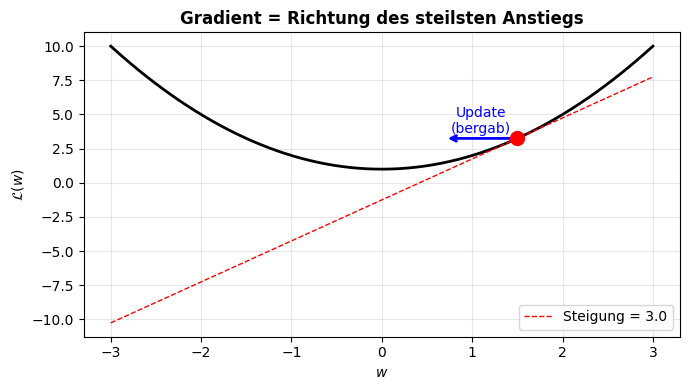
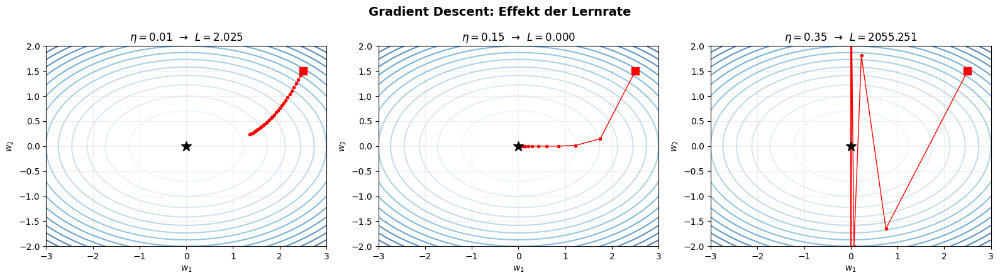
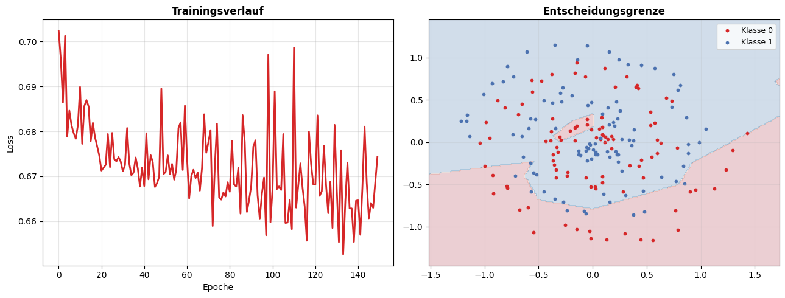

# Machine Learning - Grundlagen
## 03 - Optimierung und Backpropagation

Ein neuronales Netz ist zunächst nur eine parametrisierte Funktion: Eingabe rein, Vorhersage raus. Ob diese Vorhersage *gut* ist, misst die **Verlustfunktion** (Loss) - das haben wir in den letzten Notebooks aufgebaut. Jetzt kommt die entscheidende Frage: Wie finden wir Gewichte, die den Loss **minimieren**?

Die Antwort: **Gradienten**. Der Gradient sagt uns für jedes Gewicht, in welche Richtung und wie stark der Loss sich ändert. Mit dieser Information machen wir kleine Schritte bergab. Das klingt simpel - und die Grundidee *ist* simpel. Die Kunst liegt darin, den Gradienten **effizient** durch ein tiefes Netz zu berechnen. Dafür gibt es Backpropagation.

### Lernziele

- **Ableitung als Empfindlichkeit** - was sagt $\frac{\partial \mathcal{L}}{\partial w}$ über ein Gewicht?
- **Kettenregel** - wie Gradienten durch Kompositionen fließen
- **Computational Graph** - ein Netz als Rechengraph, vorwärts und rückwärts
- **Backpropagation** - systematische Anwendung der Kettenregel, rückwärts durch den Graph
- **Gradient Descent** - die Update-Regel und was die Lernrate bewirkt
- **Stochastic Gradient Descent (SGD)** - warum wir mit Mini-Batches arbeiten

**Voraussetzungen:** [02 - Ableitungen](../../Foundations/07_Analysis/02_Ableitungen.ipynb), [03 - Ableitungsregeln](../../Foundations/07_Analysis/03_Ableitungsregeln.ipynb), [08 - Multivariate Kettenregel](../../Foundations/07_Analysis/08_Multivariate_Kettenregel_und_Gradient.ipynb), [02 - Tensoren](02_Tensoren_und_Operationen.ipynb)

---

### 1. Ableitung als Empfindlichkeit

Aus der Analysis kennen wir: Die Ableitung $f'(x)$ gibt die **Steigung** der Tangente an. Im ML-Kontext lesen wir sie anders:

$$\frac{\partial \mathcal{L}}{\partial w} \approx \frac{\Delta \mathcal{L}}{\Delta w}$$

"Wenn ich das Gewicht $w$ um einen winzigen Betrag $\Delta w$ verschiebe, wie stark ändert sich der Loss $\mathcal{L}$?"

| Wert von $\frac{\partial \mathcal{L}}{\partial w}$ | Bedeutung |
|---|---|
| Groß positiv | $w$ erhöhen → Loss steigt stark. Also: $w$ **verkleinern**. |
| Groß negativ | $w$ erhöhen → Loss sinkt stark. Also: $w$ **vergrößern**. |
| Nahe 0 | $w$ hat wenig Einfluss auf den Loss (hier, lokal). |

Das gilt für *jedes* Gewicht unabhängig. Sammelt man alle partiellen Ableitungen in einem Vektor, erhält man den **Gradienten**:

$$\nabla_\theta \mathcal{L} = \left( \frac{\partial \mathcal{L}}{\partial \theta_1},\; \frac{\partial \mathcal{L}}{\partial \theta_2},\; \ldots,\; \frac{\partial \mathcal{L}}{\partial \theta_n} \right)$$

Er zeigt in die Richtung des **steilsten Anstiegs**. Wir wollen bergab → wir gehen in die **entgegengesetzte** Richtung.


    

    


#### Numerische Verifikation: Finite Differences

Man kann den Gradienten immer numerisch überprüfen, indem man den Loss mit leicht verschobenem Gewicht auswertet:

$$\frac{\partial \mathcal{L}}{\partial w} \approx \frac{\mathcal{L}(w + \varepsilon) - \mathcal{L}(w - \varepsilon)}{2\varepsilon}$$

Das ist langsam ($O(n)$ Auswertungen für $n$ Parameter), aber ein unverzichtbares **Debugging-Werkzeug**. Wenn die analytische und die numerische Ableitung nicht übereinstimmen, ist ein Fehler im Gradienten-Code.

```python
def numerical_gradient(f, x, eps=1e-5):
    """Zentrale Differenzenquotienten für jede Komponente von x."""
    grad = np.zeros_like(x)
    for i in range(len(x)):
        x_plus = x.copy();  x_plus[i]  += eps
        x_minus = x.copy(); x_minus[i] -= eps
        grad[i] = (f(x_plus) - f(x_minus)) / (2 * eps)
    return grad

# Testfunktion: L(w1, w2) = w1^2 + 3*w2^2
L = lambda w: w[0]**2 + 3*w[1]**2
w = np.array([2.0, -1.0])

grad_analytisch = np.array([2*w[0], 6*w[1]])  # dL/dw1=2w1, dL/dw2=6w2
grad_numerisch  = numerical_gradient(L, w)

print(f"Analytisch: {grad_analytisch}")
print(f"Numerisch:  {grad_numerisch}")
print(f"Max. Abweichung: {np.max(np.abs(grad_analytisch - grad_numerisch)):.2e}")
```

    Analytisch: [ 4. -6.]
    Numerisch:  [ 4. -6.]
    Max. Abweichung: 2.62e-11
    

### 2. Die Kettenregel

Neuronale Netze sind **Kompositionen** von Funktionen: Die Ausgabe einer Schicht ist die Eingabe der nächsten. Um den Gradienten des Gesamtverlusts zu berechnen, brauchen wir die **Kettenregel**.

#### Univariat

Für $y = f(g(x))$:

$$\frac{dy}{dx} = \frac{dy}{dg} \cdot \frac{dg}{dx} = f'(g(x)) \cdot g'(x)$$

#### Multivariat

Für $\mathcal{L}(\mathbf{y})$ mit $\mathbf{y} = f(\mathbf{x})$ und $\mathbf{x} = g(\mathbf{w})$:

$$\frac{\partial \mathcal{L}}{\partial w_i} = \sum_j \frac{\partial \mathcal{L}}{\partial y_j} \cdot \frac{\partial y_j}{\partial w_i}$$

In Matrixform: Gradienten werden per **Matrixmultiplikation** weitergereicht. Das erklärt, warum Matmul in der Rückwärtsrichtung genauso zentral ist wie vorwärts.

#### Beispiel: Dreier-Kette

Sei $\mathcal{L} = (y - t)^2$ mit $y = \sigma(z)$, $z = wx + b$. Dann:

$$\frac{\partial \mathcal{L}}{\partial w} = \underbrace{\frac{\partial \mathcal{L}}{\partial y}}_{2(y-t)} \cdot \underbrace{\frac{\partial y}{\partial z}}_{\sigma'(z)} \cdot \underbrace{\frac{\partial z}{\partial w}}_{x}$$

Jeder Faktor kommt von genau einer "Schicht" der Berechnung. Backpropagation berechnet diese Faktoren systematisch von rechts nach links.

```python
# Dreier-Kette: L = (sigma(wx+b) - t)^2

def sigmoid(z):
    return 1 / (1 + np.exp(-z))

w, x, b, t = 0.5, 2.0, -0.3, 1.0

# --- Forward ---
z = w * x + b
y = sigmoid(z)
L = (y - t)**2

# --- Backward (Kettenregel, Schicht für Schicht) ---
dL_dy = 2 * (y - t)           # äußerste Ableitung
dy_dz = y * (1 - y)           # Sigmoid-Ableitung
dz_dw = x                     # z = wx + b → dz/dw = x

dL_dw = dL_dy * dy_dz * dz_dw  # Kettenregel

# --- Numerische Verifikation ---
eps = 1e-5
L_plus  = (sigmoid((w+eps)*x + b) - t)**2
L_minus = (sigmoid((w-eps)*x + b) - t)**2
dL_dw_num = (L_plus - L_minus) / (2*eps)

print(f"Forward:  z={z:.4f}, y=σ(z)={y:.4f}, L=(y-t)²={L:.4f}")
print(f"Backward: dL/dy={dL_dy:.4f} · dy/dz={dy_dz:.4f} · dz/dw={dz_dw:.1f} = dL/dw={dL_dw:.6f}")
print(f"Numerisch: dL/dw={dL_dw_num:.6f}")
```

    Forward:  z=0.7000, y=σ(z)=0.6682, L=(y-t)²=0.1101
    Backward: dL/dy=-0.6636 · dy/dz=0.2217 · dz/dw=2.0 = dL/dw=-0.294268
    Numerisch: dL/dw=-0.294268
    

### 3. Der Computational Graph

Ein neuronales Netz lässt sich als **gerichteter azyklischer Graph (DAG)** darstellen. Jeder Knoten ist eine Operation, jede Kante trägt einen Tensor.

Für eine einfache Schicht mit Softmax-Cross-Entropy:

```
   x ──→ [matmul] ──→ z ──→ [+ bias] ──→ a ──→ [softmax + CE] ──→ L
            ↑                    ↑                     ↑
            W                    b                     t (Label)
```

**Vorwärts (Forward Pass):** Von links nach rechts - berechne die Ausgabe und den Loss.

**Rückwärts (Backward Pass):** Von rechts nach links - starte mit $\frac{\partial \mathcal{L}}{\partial \mathcal{L}} = 1$ und multipliziere bei jedem Knoten den lokalen Gradienten dazu (Kettenregel).

Der Schlüssel: Jeder Knoten braucht nur seine **lokale Ableitung** und den Gradienten, der von "oben" (rechts) kommt. Er muss nichts über den Rest des Graphen wissen. Das macht Backpropagation **modular** - man kann neue Operationen einfügen, solange sie ihren lokalen Gradienten kennen.

#### Lokale Gradienten wichtiger Operationen

| Operation | Forward | Lokaler Gradient (rückwärts) |
|-----------|---------|---|
| Addition: $c = a + b$ | $c = a + b$ | $\frac{\partial c}{\partial a} = 1, \quad \frac{\partial c}{\partial b} = 1$ |
| Multiplikation: $c = a \cdot b$ | $c = a \cdot b$ | $\frac{\partial c}{\partial a} = b, \quad \frac{\partial c}{\partial b} = a$ |
| Matmul: $Z = XW$ | $Z = XW$ | $\frac{\partial \mathcal{L}}{\partial X} = \frac{\partial \mathcal{L}}{\partial Z} W^T, \quad \frac{\partial \mathcal{L}}{\partial W} = X^T \frac{\partial \mathcal{L}}{\partial Z}$ |
| ReLU: $y = \max(0, x)$ | $y = \max(0, x)$ | $\frac{\partial y}{\partial x} = \mathbf{1}_{x > 0}$ |
| Sigmoid: $y = \sigma(x)$ | $y = \frac{1}{1+e^{-x}}$ | $\frac{\partial y}{\partial x} = y(1-y)$ |

### 4. Backpropagation: Durchgerechnetes Beispiel

Wir bauen ein **minimales 2-Schichten-Netz** und rechnen Forward + Backward komplett durch.

**Architektur:** Eingabe $\mathbf{x} \in \mathbb{R}^2$ → Schicht 1 (2→3, ReLU) → Schicht 2 (3→2, Softmax + CE-Loss)

$$\mathbf{h} = \text{ReLU}(\mathbf{x} W_1 + \mathbf{b}_1) \qquad \mathbf{z} = \mathbf{h} W_2 + \mathbf{b}_2 \qquad \mathcal{L} = -\log \text{softmax}(\mathbf{z})_c$$

**Forward:** Vorwärts durch den Graph, alle Zwischenwerte speichern.

**Backward:** Rückwärts von $\mathcal{L}$, bei jedem Knoten den eingehenden Gradienten mit der lokalen Ableitung multiplizieren.

```python
def softmax(z):
    z = z - z.max(axis=-1, keepdims=True)
    e = np.exp(z)
    return e / e.sum(axis=-1, keepdims=True)

def relu(x):
    return np.maximum(0, x)

np.random.seed(42)

# Architektur: 2 → 3 → 2
W1 = np.random.randn(2, 3) * 0.5
b1 = np.zeros(3)
W2 = np.random.randn(3, 2) * 0.5
b2 = np.zeros(2)

x = np.array([1.0, -0.5])  # Eingabe
target = 0                  # wahre Klasse

# ========= FORWARD PASS =========
z1 = x @ W1 + b1            # (2,) @ (2,3) + (3,) → (3,)
h  = relu(z1)               # (3,)
z2 = h @ W2 + b2            # (3,) @ (3,2) + (2,) → (2,)
p  = softmax(z2)            # (2,)  Wahrscheinlichkeiten
L  = -np.log(p[target])     # Skalar  Cross-Entropy Loss

print(f"z1 = {z1.round(4)}")
print(f"h  = ReLU(z1) = {h.round(4)}")
print(f"z2 = {z2.round(4)}")
print(f"p  = softmax(z2) = {p.round(4)}")
print(f"L  = -log(p[{target}]) = {L:.4f}")
```

    z1 = [-0.1324 -0.0106  0.3824]
    h  = ReLU(z1) = [0.     0.     0.3824]
    z2 = [-0.0886 -0.089 ]
    p  = softmax(z2) = [0.5001 0.4999]
    L  = -log(p[0]) = 0.6929
    

```python
# ========= BACKWARD PASS =========

# Gradient des Softmax-CE-Loss bzgl. z2: p - one_hot(target)
dL_dz2 = p.copy()
dL_dz2[target] -= 1         # (2,)

# Schicht 2: z2 = h @ W2 + b2
dL_dW2 = h[:, None] @ dL_dz2[None, :]   # (3,1) @ (1,2) → (3,2)
dL_db2 = dL_dz2                           # (2,)
dL_dh  = dL_dz2 @ W2.T                   # (2,) @ (2,3) → (3,)

# ReLU: h = max(0, z1)
dL_dz1 = dL_dh * (z1 > 0)   # Gradient fließt nur wo z1 > 0

# Schicht 1: z1 = x @ W1 + b1
dL_dW1 = x[:, None] @ dL_dz1[None, :]   # (2,1) @ (1,3) → (2,3)
dL_db1 = dL_dz1                           # (3,)

print(f"dL/dz2 = p - one_hot = {dL_dz2.round(4)}")
print(f"dL/dW2 =\n{dL_dW2.round(4)}")
print(f"dL/db2 = {dL_db2.round(4)}")
print(f"dL/dh  = {dL_dh.round(4)}")
print(f"dL/dz1 = {dL_dz1.round(4)}  (ReLU-Gate: z1>0 = {(z1>0).astype(int)})")
print(f"dL/dW1 =\n{dL_dW1.round(4)}")
print(f"dL/db1 = {dL_db1.round(4)}")
```

    dL/dz2 = p - one_hot = [-0.4999  0.4999]
    dL/dW2 =
    [[ 0.      0.    ]
     [ 0.      0.    ]
     [-0.1911  0.1911]]
    dL/db2 = [-0.4999  0.4999]
    dL/dh  = [-0.2029  0.253  -0.0006]
    dL/dz1 = [-0.      0.     -0.0006]  (ReLU-Gate: z1>0 = [0 0 1])
    dL/dW1 =
    [[ 0.      0.     -0.0006]
     [ 0.      0.      0.0003]]
    dL/db1 = [-0.      0.     -0.0006]
    

```python
# Numerische Verifikation aller Gradienten

def forward(W1, b1, W2, b2, x, target):
    z1 = x @ W1 + b1
    h  = np.maximum(0, z1)
    z2 = h @ W2 + b2
    p  = softmax(z2)
    return -np.log(p[target])

def check_grad(name, param, grad_analytical):
    grad_num = np.zeros_like(param)
    eps = 1e-5
    for idx in np.ndindex(param.shape):
        old = param[idx]
        param[idx] = old + eps
        L_plus = forward(W1, b1, W2, b2, x, target)
        param[idx] = old - eps
        L_minus = forward(W1, b1, W2, b2, x, target)
        param[idx] = old
        grad_num[idx] = (L_plus - L_minus) / (2 * eps)
    err = np.max(np.abs(grad_analytical - grad_num))
    print(f"{name:5s}  max|err| = {err:.2e}  {'✓' if err < 1e-5 else '✗'}")

check_grad("W2", W2, dL_dW2)
check_grad("b2", b2, dL_db2)
check_grad("W1", W1, dL_dW1)
check_grad("b1", b1, dL_db1)
```

    W2     max|err| = 1.43e-11  ✓
    b2     max|err| = 1.02e-11  ✓
    W1     max|err| = 7.26e-12  ✓
    b1     max|err| = 7.26e-12  ✓
    

### 5. Gradient Descent

Wir haben jetzt den Gradienten $\nabla_\theta \mathcal{L}$ - den Kompass, der bergauf zeigt. Die einfachste Optimierungsstrategie: Gehe einen kleinen Schritt in die **entgegengesetzte** Richtung.

$$\theta \leftarrow \theta - \eta \, \nabla_\theta \mathcal{L}$$

Der Hyperparameter $\eta > 0$ ist die **Lernrate** (learning rate). Sie kontrolliert die Schrittgröße:

| Lernrate | Effekt |
|----------|--------|
| Zu klein | Konvergiert extrem langsam, bleibt evtl. in flachen Regionen stecken |
| Passend | Stabiler, stetiger Abstieg zum Minimum |
| Zu groß | Springt über das Minimum hinweg, kann divergieren |

In der Praxis wählt man die Lernrate nicht fix, sondern verwendet **Schedules** (z.B. linearer Warmup, dann Cosine Decay) oder **adaptive Methoden** (Adam), die die effektive Lernrate pro Parameter anpassen. Die Grundidee bleibt aber: Gewicht minus Lernrate mal Gradient.


    

    


### 6. Stochastic Gradient Descent (SGD)

In der Theorie berechnen wir den Gradienten über den **gesamten Datensatz**:

$$\nabla_\theta \mathcal{L} = \frac{1}{N} \sum_{i=1}^{N} \nabla_\theta \mathcal{L}_i$$

In der Praxis ist das oft zu teuer (Millionen von Datenpunkten). Stattdessen schätzen wir den Gradienten mit einem zufällig gezogenen **Mini-Batch** von $B$ Datenpunkten:

$$\nabla_\theta \mathcal{L} \approx \frac{1}{B} \sum_{i \in \text{Batch}} \nabla_\theta \mathcal{L}_i$$

Das ist ein **unverzerrter Schätzer** des wahren Gradienten - im Erwartungswert stimmt die Richtung. Die Varianz sinkt mit $1/B$.

| Variante | Batch-Größe | Eigenschaft |
|----------|-------------|-------------|
| **Full-Batch GD** | $B = N$ | Exakter Gradient, teuer pro Schritt |
| **Stochastic GD** | $B = 1$ | Sehr rauschig, aber billig |
| **Mini-Batch SGD** | $B \in [32, 512]$ | Kompromiss - Standard in der Praxis |

Eine **Epoche** bezeichnet einen vollständigen Durchlauf durch den Datensatz. Bei $N$ Datenpunkten und Batch-Größe $B$ sind das $\lceil N/B \rceil$ Updates pro Epoche.

#### Der Trainingsloop

Jeder Trainingsschritt folgt demselben Muster:

1. **Batch ziehen** - zufällige Teilmenge der Daten
2. **Forward Pass** - Vorhersage berechnen, Loss auswerten
3. **Backward Pass** - Gradienten aller Parameter berechnen
4. **Update** - $\theta \leftarrow \theta - \eta \nabla_\theta \mathcal{L}$

```python
# Kompletter Trainingsloop: 2-Schichten-Netz auf einem Toy-Dataset

np.random.seed(0)
N = 200

# Spiralen-Datensatz: 2 Klassen, 2D
t0 = np.linspace(0, 4*np.pi, N//2)
X = np.vstack([
    np.column_stack([t0 * np.cos(t0), t0 * np.sin(t0)]),
    np.column_stack([t0 * np.cos(t0 + np.pi), t0 * np.sin(t0 + np.pi)])
]) * 0.1 + np.random.randn(N, 2) * 0.08
y = np.array([0]*(N//2) + [1]*(N//2))

# Architektur: 2 → 16 → 2
W1 = np.random.randn(2, 16) * 0.3
b1 = np.zeros(16)
W2 = np.random.randn(16, 2) * 0.3
b2 = np.zeros(2)

lr = 0.5
batch_size = 32
losses = []

for epoch in range(150):
    perm = np.random.permutation(N)
    epoch_loss = 0.0

    for start in range(0, N, batch_size):
        idx = perm[start:start+batch_size]
        xb, yb = X[idx], y[idx]
        B = len(xb)

        # Forward
        z1 = xb @ W1 + b1          # (B, 16)
        h  = np.maximum(0, z1)     # ReLU
        z2 = h @ W2 + b2           # (B, 2)
        p  = softmax(z2)           # (B, 2)
        loss = -np.log(p[np.arange(B), yb] + 1e-8).mean()

        # Backward
        dz2 = p.copy()
        dz2[np.arange(B), yb] -= 1
        dz2 /= B

        dW2 = h.T @ dz2            # (16, B) @ (B, 2) → (16, 2)
        db2 = dz2.sum(axis=0)      # (2,)
        dh  = dz2 @ W2.T           # (B, 16)
        dz1 = dh * (z1 > 0)        # ReLU
        dW1 = xb.T @ dz1           # (2, B) @ (B, 16) → (2, 16)
        db1 = dz1.sum(axis=0)      # (16,)

        # Update
        W1 -= lr * dW1;  b1 -= lr * db1
        W2 -= lr * dW2;  b2 -= lr * db2

        epoch_loss += loss * B

    losses.append(epoch_loss / N)

print(f"Finaler Loss: {losses[-1]:.4f}")
```

    Finaler Loss: 0.6744
    


    

    


    Trainings-Genauigkeit: 60.0%
    

---

## Verständnis-Check

*Versuche die Fragen zu beantworten, bevor du die Lösungen aufdeckst.*

**Aufgabe 1:** Der Loss ist $\mathcal{L} = (3w - 1)^2$. Berechne $\frac{\partial \mathcal{L}}{\partial w}$. Für $w = 2$: In welche Richtung sollte das Update gehen?

**Aufgabe 2:** Eine lineare Schicht berechnet $\mathbf{z} = \mathbf{x} W + \mathbf{b}$. Man kennt $\frac{\partial \mathcal{L}}{\partial \mathbf{z}}$. Was ist $\frac{\partial \mathcal{L}}{\partial W}$ und $\frac{\partial \mathcal{L}}{\partial \mathbf{x}}$?

**Aufgabe 3:** Warum *muss* man beim Backward Pass die Werte aus dem Forward Pass (wie $z_1$, $h$, $x$) gespeichert haben? Welcher Wert wird für den ReLU-Gradienten benötigt?

**Aufgabe 4:** Ein Datensatz hat $N = 10000$ Punkte, die Batch-Größe ist $B = 64$. Wie viele Gewichts-Updates gibt es pro Epoche?

### Lösungen

<details open>
<summary>Lösung Aufgabe 1</summary>

Kettenregel: $\frac{\partial \mathcal{L}}{\partial w} = 2(3w - 1) \cdot 3 = 6(3w - 1)$

Für $w = 2$: $\frac{\partial \mathcal{L}}{\partial w} = 6 \cdot 5 = 30$ (positiv). Also: $w$ **verkleinern** (Update in negative Richtung).
</details>

<details open>
<summary>Lösung Aufgabe 2</summary>

Aus der Matmul-Regel für $Z = XW + b$:

$$\frac{\partial \mathcal{L}}{\partial W} = X^T \frac{\partial \mathcal{L}}{\partial Z} \qquad \frac{\partial \mathcal{L}}{\partial \mathbf{x}} = \frac{\partial \mathcal{L}}{\partial Z} W^T$$

Der Bias-Gradient ist einfach $\frac{\partial \mathcal{L}}{\partial b} = \sum_{\text{Batch}} \frac{\partial \mathcal{L}}{\partial Z}$ (aufsummiert über die Batch-Dimension).
</details>

<details open>
<summary>Lösung Aufgabe 3</summary>

Die lokalen Gradienten hängen von den Forward-Werten ab:

- Matmul $Z = XW$: Der Gradient bzgl. $W$ braucht $X^T$, der bzgl. $X$ braucht $W^T$.
- ReLU: Der Gradient braucht $z_1$ (die Eingabe *vor* ReLU), um zu entscheiden, welche Elemente $> 0$ waren und somit Gradient durchlassen.
- Sigmoid: Der Gradient $y(1-y)$ braucht die Ausgabe $y$.

Ohne die gespeicherten Werte kann man die Rückwärtsrichtung nicht berechnen.
</details>

<details open>
<summary>Lösung Aufgabe 4</summary>

$\lceil 10000 / 64 \rceil = \lceil 156{,}25 \rceil = 157$ Updates pro Epoche.

(Der letzte Batch hat nur $10000 - 156 \times 64 = 16$ Datenpunkte.)
</details>

## Zusammenfassung

Die **Ableitung** $\frac{\partial \mathcal{L}}{\partial w}$ misst, wie empfindlich der Loss auf eine kleine Änderung des Gewichts $w$ reagiert. Der **Gradient** $\nabla_\theta \mathcal{L}$ sammelt diese Information für alle Parameter - er zeigt in Richtung des steilsten Anstiegs.

Die **Kettenregel** erlaubt es, den Gradienten durch eine Komposition von Funktionen zu propagieren: Jede Stufe multipliziert den eingehenden Gradienten mit ihrer lokalen Ableitung. **Backpropagation** ist die systematische Anwendung dieses Prinzips auf einem Computational Graph, von der Verlustfunktion rückwärts bis zu den Gewichten.

Für Matmul $Z = XW$ gilt: $\partial \mathcal{L}/\partial W = X^T (\partial \mathcal{L}/\partial Z)$ und $\partial \mathcal{L}/\partial X = (\partial \mathcal{L}/\partial Z) W^T$. Die Rückwärtsrichtung ist selbst ein Matmul - mit transponierten Matrizen.

**Gradient Descent** aktualisiert die Gewichte: $\theta \leftarrow \theta - \eta \nabla_\theta \mathcal{L}$. Die Lernrate $\eta$ kontrolliert die Schrittgröße. In der Praxis verwendet man **Mini-Batch SGD**: Der Gradient wird über einen kleinen, zufällig gezogenen Batch geschätzt. Das ergibt einen unverzerrten Schätzer des wahren Gradienten bei deutlich geringeren Kosten.

| Konzept | Formel | Rolle |
|---------|--------|-------|
| **Gradient** | $\nabla_\theta \mathcal{L}$ | Richtung des steilsten Anstiegs |
| **Kettenregel** | $\frac{\partial \mathcal{L}}{\partial w} = \frac{\partial \mathcal{L}}{\partial y} \cdot \frac{\partial y}{\partial w}$ | Verknüpfung der Schichten |
| **Matmul rückwärts** | $\partial W = X^T \partial Z$ | Gradient der Gewichte |
| **Update-Regel** | $\theta \leftarrow \theta - \eta \nabla \mathcal{L}$ | Schritt bergab |
| **Mini-Batch SGD** | $\frac{1}{B} \sum_{\text{Batch}} \nabla \mathcal{L}_i$ | Praxis-Standard |

> **Nächster Schritt:** Wir haben jetzt alle Grundbausteine: Tensoren, Softmax, Cross-Entropy, Backpropagation, SGD. Zeit, daraus die Standardkomponenten eines neuronalen Netzes zusammenzusetzen. → Weiter zu [04 - Bausteine eines Neuronalen Netzes](../Bausteine/01_Lineare_Schichten_und_Aktivierungen.ipynb)

---

## Glossar

| Deutsch | Englisch |
|---------|----------|
| Ableitung / Gradient | Derivative / Gradient |
| Partielle Ableitung | Partial derivative |
| Kettenregel | Chain rule |
| Berechnungsgraph | Computational graph |
| Vorwärtsdurchlauf | Forward pass |
| Rückwärtsdurchlauf | Backward pass |
| Rückpropagierung | Backpropagation |
| Verlustfunktion | Loss function |
| Lernrate | Learning rate |
| Gradientenabstieg | Gradient descent |
| Stochastischer Gradientenabstieg | Stochastic gradient descent (SGD) |
| Mini-Batch | Mini-batch |
| Epoche | Epoch |
| Gewicht | Weight |
| Fehlersignal | Error signal / upstream gradient |
