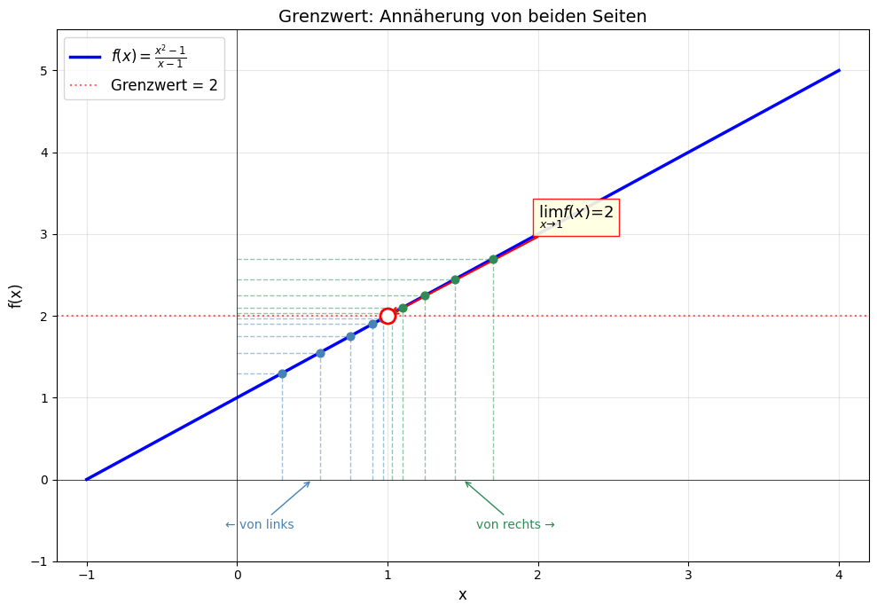
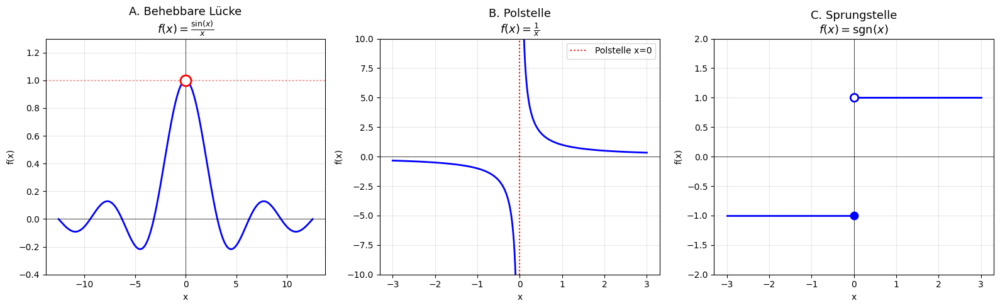
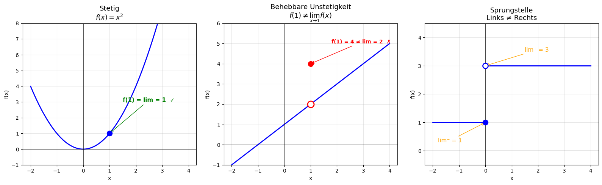
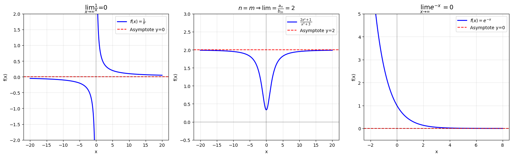

# Funktionen

## 02 – Grenzwerte

Der **Grenzwert** (Limes) ist das mathematische Werkzeug, mit dem wir beschreiben, was passiert, wenn sich eine Größe einem bestimmten Wert immer weiter annähert - ohne ihn zwingend zu erreichen. Er ist das Fundament, auf dem die gesamte Analysis (Ableitungen, Integrale) aufgebaut ist.

### Lernziele

- **Was ein Grenzwert ist** und wie die formale Definition lautet
- **Grenzwerte numerisch und grafisch** bestimmen
- **Grenzwertsätze** — Regeln zum Berechnen auf Papier
- **Polstellen und Lücken** — was passiert, wenn eine Funktion „nicht definiert" ist?
- **Stetigkeit** — wann ist eine Funktion „lückenlos"?
- **Grenzwerte im Unendlichen** — was passiert für $x \to \pm\infty$?

---

### 1. Was ist ein Grenzwert?

#### Intuitive Definition
$g$ heißt **Grenzwert** der Funktion $f$ an der Stelle $x_0$, wenn für alle Folgen von $x$-Werten, die gegen $x_0$ streben, die zugehörigen Funktionswerte $f(x)$ gegen denselben Wert $g$ streben.

Schreibweise:
$$\lim_{x \to x_0} f(x) = g$$

Gesprochen: „Der Limes von $f(x)$ für $x$ gegen $x_0$ ist gleich $g$."

**Wichtig:** Der Grenzwert fragt nicht, welchen Wert $f(x_0)$ *hat*, sondern welchem Wert sich $f(x)$ *annähert*, wenn $x$ immer näher an $x_0$ rückt. Die Funktion muss an $x_0$ nicht einmal definiert sein!

#### Beispiel: $f(x) = \frac{x^2 - 1}{x - 1}$

Bei $x = 1$ ist $f$ **nicht definiert** (Division durch 0). Aber was passiert *in der Nähe* von $x = 1$?

$$f(x) = \frac{x^2 - 1}{x-1} = \frac{(x-1)(x+1)}{x-1} = x + 1 \quad \text{(für } x \neq 1\text{)}$$

Also nähert sich $f(x)$ dem Wert $2$, wenn $x \to 1$:
$$\lim_{x \to 1} \frac{x^2 - 1}{x-1} = 2$$

    

    

### 2. Einseitige Grenzwerte

Manchmal nähert sich $f(x)$ von links und rechts **verschiedenen** Werten an. Dann unterscheiden wir:

- **Linksseitiger Grenzwert:** $\lim_{x \to x_0^-} f(x)$ (Annäherung von links, $x < x_0$)
- **Rechtsseitiger Grenzwert:** $\lim_{x \to x_0^+} f(x)$ (Annäherung von rechts, $x > x_0$)

Der „normale" (beidseitige) Grenzwert existiert **nur**, wenn beide Seiten den gleichen Wert ergeben:
$$\lim_{x \to x_0} f(x) = g \quad \Leftrightarrow \quad \lim_{x \to x_0^-} f(x) = \lim_{x \to x_0^+} f(x) = g$$

---

### 3. Polstellen und Lücken

Was passiert an Stellen, wo die Funktion nicht definiert ist?

#### A. Behebbare Lücke (hebbare Definitionslücke)
Der Grenzwert existiert, aber die Funktion ist dort nicht definiert.

**Beispiel:** $f(x) = \frac{\sin(x)}{x}$ bei $x = 0$.
- $\lim_{x \to 0} f(x) = 1$ existiert
- Aber $f(0)$ ist nicht definiert (Division durch 0)
- Die Lücke kann „behoben" werden, indem man $f(0) = 1$ setzt

*(Ein weiteres Beispiel ist $\frac{x^2 - 1}{x - 1}$ bei $x = 1$ - wie in Abschnitt 1 gezeigt.)*

#### B. Polstelle (nichtbehebbare Definitionslücke)
Die Funktionswerte werden unendlich groß (oder klein).

**Beispiel:** $f(x) = \frac{1}{x}$ bei $x = 0$
- Von links: $\lim_{x \to 0^-} \frac{1}{x} = -\infty$
- Von rechts: $\lim_{x \to 0^+} \frac{1}{x} = +\infty$
- Der Grenzwert existiert **nicht** (die Seiten stimmen nicht überein)

#### C. Sprungstelle
Die Funktion „springt" - die einseitigen Grenzwerte existieren, sind aber verschieden.

**Beispiel:** Die Vorzeichenfunktion $\text{sgn}(x)$ bei $x = 0$:
- $\lim_{x \to 0^-} \text{sgn}(x) = -1$
- $\lim_{x \to 0^+} \text{sgn}(x) = +1$

    

    

### 4. Grenzwertsätze

Wenn $\displaystyle\lim_{x \to a} f(x) = L$ und $\displaystyle\lim_{x \to a} g(x) = M$, dann gelten:

| Satz | Regel |
|------|-------|
| **Summe** | $\lim [f(x) \pm g(x)] = L \pm M$ |
| **Produkt** | $\lim [f(x) \cdot g(x)] = L \cdot M$ |
| **Quotient** | $\lim \dfrac{f(x)}{g(x)} = \dfrac{L}{M}$, falls $M \ne 0$ |
| **Konstante** | $\lim [c \cdot f(x)] = c \cdot L$ |
| **Potenz** | $\lim [f(x)]^n = L^n$ |

> *Hinweis:* Diese Regeln gelten, solange die rechte Seite **definiert** ist. Ausdrücke wie $\dfrac{0}{0}$ oder $\infty - \infty$ sind **unbestimmte Formen** - hier muss man umformen (kürzen, l'Hôpital etc.).

**Beispiel:** Berechne $\displaystyle\lim_{x \to 2} \frac{x^2 - 4}{x - 2}$

$$\frac{x^2 - 4}{x - 2} = \frac{(x-2)(x+2)}{x-2} = x + 2 \quad (\text{für } x \ne 2)$$

$$\Rightarrow \lim_{x \to 2} (x+2) = 4$$

---

### 5. Stetigkeit

Eine Funktion $f$ ist **stetig** an der Stelle $x_0$, wenn **drei Bedingungen** gleichzeitig erfüllt sind:

1. $f(x_0)$ ist **definiert**
2. $\displaystyle\lim_{x \to x_0} f(x)$ **existiert**
3. $\displaystyle\lim_{x \to x_0} f(x) = f(x_0)$

**Anschaulich:** Du kannst den Graphen an dieser Stelle zeichnen, **ohne den Stift abzusetzen**.

| Typ | Beschreibung | Beispiel |
|-----|-------------|----------|
| Stetig | Alle 3 Bedingungen erfüllt | $f(x) = x^2$ überall |
| Behebbare Lücke | Grenzwert existiert, aber $f(x_0)$ fehlt oder passt nicht | $\frac{x^2-1}{x-1}$ bei $x=1$ |
| Sprungstelle | Links-/Rechts-Grenzwerte existieren, sind aber verschieden | Heaviside-Funktion bei $x=0$ |
| Polstelle | Grenzwert existiert nicht ($\pm\infty$) | $\frac{1}{x}$ bei $x=0$ |

    

    

### 6. Grenzwerte im Unendlichen

Wie verhält sich $f(x)$ für $x \to \pm\infty$?

**Horizontale Asymptoten:** Wenn $\displaystyle\lim_{x \to \infty} f(x) = L$, dann ist $y = L$ eine horizontale Asymptote.

**Faustregeln für rationale Funktionen** $\dfrac{a_n x^n + \ldots}{b_m x^m + \ldots}$:

| Grad Zähler vs. Nenner | Grenzwert $x \to \infty$ | Asymptote |
|------------------------|--------------------------|-----------|
| $n < m$ | $0$ | $y = 0$ |
| $n = m$ | $\dfrac{a_n}{b_m}$ | $y = \dfrac{a_n}{b_m}$ |
| $n > m$ | $\pm\infty$ | keine horizontale |

**Wichtige Grenzwerte:**

$$\lim_{x\to\infty} \frac{1}{x} = 0 \qquad \lim_{x\to\infty} e^{-x} = 0 \qquad \lim_{x\to\infty} \frac{\sin x}{x} = 0$$

$$\lim_{x\to 0} \frac{\sin x}{x} = 1 \qquad \lim_{x\to\infty} \left(1 + \frac{1}{x}\right)^x = e$$

    

    

---

## Zusammenfassung

| Konzept | Kernaussage |
|---------|-------------|
| **Grenzwert** | Wert, dem sich $f(x)$ nähert, wenn $x \to a$ |
| **Einseitige Grenzwerte** | $\lim^-$ und $\lim^+$ können verschieden sein |
| **Behebbare Lücke** | Grenzwert existiert, aber $f(a)$ fehlt/passt nicht |
| **Polstelle** | $f(x) \to \pm\infty$ - vertikale Asymptote |
| **Sprungstelle** | Links- und Rechts-Grenzwert sind verschieden |
| **Grenzwertsätze** | Summe, Produkt, Quotient von Grenzwerten |
| **Stetigkeit** | $\lim f(x) = f(a)$ - Graph ohne Unterbrechung |
| **Horizontale Asymptote** | Verhalten für $x \to \pm\infty$ |

> **Nächster Schritt:** Grenzwerte sind die Grundlage für **Ableitungen** - den Differentialquotienten als Grenzwert des Differenzenquotienten. → Weiter zu **07_Analysis/02_Ableitungen_Einfuehrung**

---

## Glossar

| Deutsch | Englisch |
|---------|----------|
| Grenzwert | Limit |
| Einseitiger Grenzwert | One-sided limit |
| Behebbare Lücke | Removable discontinuity |
| Polstelle | Pole / Vertical asymptote |
| Sprungstelle | Jump discontinuity |
| Stetigkeit | Continuity |
| Asymptote | Asymptote |
| Unbestimmte Form | Indeterminate form |
| Grenzwertsatz | Limit theorem / Limit law |
