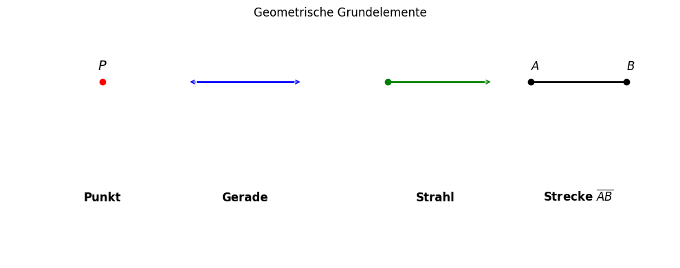
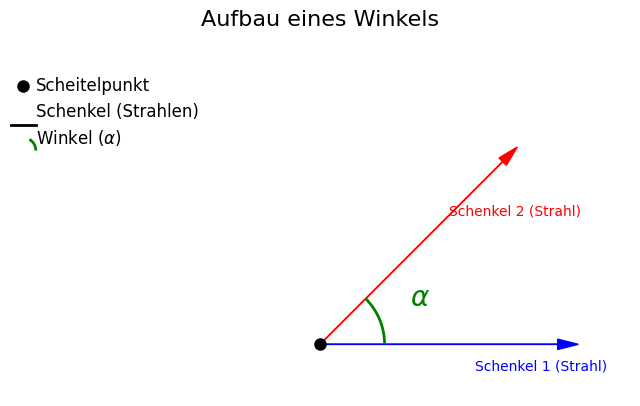
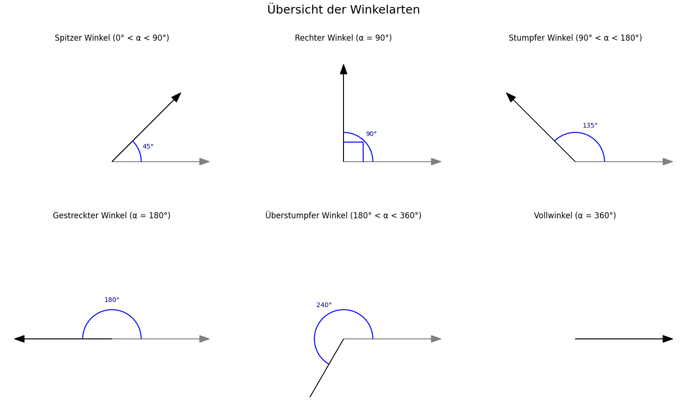

# Geometrie und Trigonometrie

## 01 – Grundlagen, Winkel, Winkelarten

Willkommen zum ersten Teil des Kapitels: Geometrie und Trigonometrie! In diesem Abschnitt legen wir das Fundament für alles Weitere. Wir beginnen mit den grundlegendsten Konzepten: Punkten, Strahlen und vor allem **Winkeln**.

### Lernziele

- Du wirst verstehen, was ein Winkel ist und wie er definiert wird.
- Du wirst die verschiedenen Arten von Winkeln anhand ihrer Größe zu unterscheiden.
- Du wirst in der Lage sein, Winkel mithilfe von Python und `matplotlib` zu visualisieren.

## Geometrische Grundbegriffe

Die Geometrie baut auf wenigen, intuitiven Elementen auf:

- **Punkt:** Eine exakte Position in einem Raum ohne Ausdehnung. Er ist die Grundlage für alle geometrischen Figuren, bezeichnet meist mit Großbuchstaben (z.B. $P, A, B$).
- **Gerade:** Eine unendlich lange, gerade ohne Anfang und Ende.
- **Strahl (oder Halbgerade):** Beginnt an einem Anfangspunkt, und verläuft unendlich in eine Richtung.
- **Strecke:** Die kürzeste Verbindung zwischen zwei Punkten $A und B$. Sie hat eine messbare Länge.

Ein Winkel wird generell in **Grad** gemessen, wobei eine volle Umdrehung $360°$ entspricht. Die Größe des Winkels beschreibt die "Öffnung" zwischen den beiden Strahlen.

    

    

## Der Winkel

**Definition**
Ein **Winkel** entsteht, wenn zwei Strahlen (die sogennanten **Schenkel**) von einem gemeinsamen Anfangspunkt (dem Scheitel) ausgehen.

**Notation**
Winkel werden meist mit griechischen Kleinbuchstaben ($\alpha, \beta, \gamma,...$) bezeichnet. Alternativ können auch die Punkten auf den Schenkeln verwendet werden:
$\angle ABC$ bedeutet, der Scheitel ist bei B, und der Winkel wird von $A$ über $B$ nach $C$ aufgespannt (meist gegen den Uhrzeigersinn).

**Maßeinheiten: Grad vs Bogenmaß**
1. **Gradmaß**: Ein Vollkreis wird in $360°$ unterteilt.
2. **Bogenmaß**: Ein Winkel wird durch die Länge eines Kreisbogens am Einheitskreis ($r = 1$) definiert. Ein Vollkreis entspricht dem Umfang $2\pi$

**Umrechnung:**
$$
\alpha_{\text{rad}} = \alpha_{\text{deg}} \cdot \frac{\pi}{180°}
$$
$$
\alpha_{\text{deg}} = \alpha_{\text{rad}} \cdot \frac{180°}{\pi}
$$

Wichtige Werte:
- $90° = \frac{\pi}{2}$
- $180° = \pi$
- $360° = 2\pi$

    

    

## Winkelarten

Je nach ihrer Größe in Grad lassen sich Winkel in verschiedene Kategorien einteilen:

- **Nullwinkel:** $\alpha = 0°$
  Beide Schenken liegen aufeinander (auf der selben Linie), es gibt keine Öffnung.
  
- **Spitzer Winkel:** $0° < \alpha < 90°$
  Der Winkel ist kleiner als ein rechter Winkel ($<90°$).

  
- **Rechter Winkel:** $\alpha = 90°$
  Die Schenkel stehen **senkrecht** (orthogonal) aufeinander.
  
- **Stumpfer Winkel:** $90° < \alpha < 180°$
  Der Winkel ist größer als ein rechter Winkel ($<90°$ und kleiner als ein gestreckter Winkel ($<180°$).
  
- **Gestreckter Winkel:** $\alpha = 180°$
  Die beiden Schenkel bilden eine gerade Linie.
  
- **Überstumpfer Winkel (erhabener Winkel):** $180° < \alpha < 360°$
  Ein Winkel, der größer als ein gestrecker Winkel ist.

- **Vollwinkel:** $\alpha = 360°$
  Der Winkel beschreibt eine vollständige Umdrehung. Wie beim Nullwinkel liegt der zweite Schenkel wieder auf dem ersten.

    

    

## Zusammenfassung

| Thema | Kernaussage |
|-------|-------------|
| Punkt, Strahl, Winkel | Grundbausteine der Geometrie; ein Winkel entsteht aus zwei Strahlen mit gemeinsamem Scheitel |
| Winkelarten | Null-, spitzer, rechter, stumpfer, gestreckter, überstumpfer, Vollwinkel |
| Grad vs. Bogenmaß | Vollkreis = $360°$ = $2\pi$ rad |

> **Nächster Schritt:** Weiter zu **Winkelbeziehungen** – was passiert, wenn sich Geraden schneiden und welche Gesetze für parallele Geraden gelten.

---

## Glossar

| Deutsch | Englisch |
|---------|----------|
| Winkel | Angle |
| Scheitelpunkt | Vertex |
| Schenkel | Leg / Side (of an angle) |
| Strahl / Halbgerade | Ray |
| Grad (Maßeinheit) | Degree |
| Senkrecht / Orthogonal | Perpendicular / Orthogonal |
| Spitzer Winkel | Acute Angle |
| Rechter Winkel | Right Angle |
| Stumpfer Winkel | Obtuse Angle |
| Gestreckter Winkel | Straight Angle |
| Überstumpfer Winkel / Erhabener Winkel | Reflex Angle |
| Vollwinkel | Full Angle / Complete Angle / Perigon |
