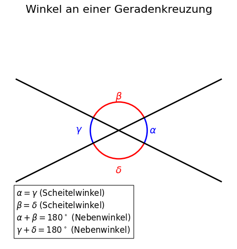
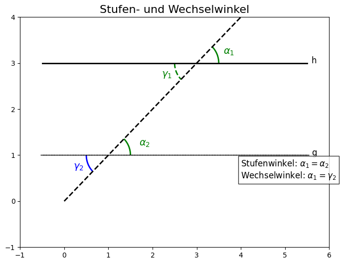

# Geometrie und Trigonometrie

## 02 – Winkelbeziehungen, Kongruenz und Ähnlichkeit

Nachdem wir definiert haben, was ein einzelner Winkel ist, betrachten wir nun wie mehrere Winkel zusammenspielen.
In der Geometrie existieren Winkel nur selten isoliert, sie entstehen wenn Geraden sich schneiden oder wo Geometrische Figuren Ecken bilden. Daher sehen wir uns In diesem Abschnitt an:

### Lernziele

- Du wirst die Gesetzmäßigkeiten an Geradenkreuzungen verstehen (Scheitel- und Nebenwinkel)
- Du wirst Winkel an parallelen Geraden identifizieren können (Stufen- und Wechselwinkel).
- Du wirst die Bedeutung von **Kongruenz** (Deckungsgleichheit) und **Ähnlichkeiten** (Formgleichheit) kennenlernen.
- Das alles, und die Transformation von geometrischen Figuren (Verschiebung vs. Skalierung) in Python + matplotlib animieren.

## 1. Winkel an Geradenkreuzungen

Wenn sich zwei Geraden in einer Ebene schneiden, entstehen um den Schnittpunkt vier Winkel. Diese stehen in einer festen Beziehung zueinander, welche wir verwenden können um fehlende Winkelgrößen ohne messen zu müssen.

### A. Nebenwinkel (Supplementäre Winkel)

Nehmen wir eine gerade Linie, die von einer anderen Linie geschnitten wird. 
Zwei Winkel, die **nebeneinander** liegen, einen gemeinsamen Schenkel und einen gemeinsamen Scheitelpunkt haben, nennt man **Nebenwinkel**

Die beiden äußeren Schenkel bilden zusammen eine gerade (einen gestreckten Winkel von $180°$), daher gilt für Nebenwinkel immer:

$$ \alpha + \beta = 180° $$

Man sagt auch: "Die Winkel ergänzen sich zu $180°$ (sie sind supplementär)"
Wenn man einen Winkel kennt, kann man sofort den anderen berechnen: $\beta = 180° - \alpha$.

### B. Scheitelwinkel

Zwei Winkel, die sich an einer Geradenkreuzung **gegenüberliegen**, nennt man **Scheitelwinkel**.
Sie teilen sich den Scheitelpunkt, haben aber keinen gemeinsamen Schenkel.

Scheitelwinkel sind **immer gleich groß**.

**Warum ist das so?**

Nehmen wir die Nebenwinkel $\alpha$ und $\beta$. Somit $\alpha + \beta = 180°$ 
Gleichzeitig sind aber auch $\beta$ und $\gamma$ Nebenwinkel. Also ist $\beta + \gamma = 180°$.
Daraus folgt logisch: $\alpha$ muss genau so groß sein wie $\gamma$, um $\beta$ zu $180°$ zu ergänzen.

Sehen wir uns das ganze visualisiert an:

    

    

## 2. Winkel an Parallelen

Wenn eine Gerade zwei andere Geraden schneiden, die **parallel** zueinander sind, treten zwei weitere Winkelarten auf: **F-Winkel** und **Z-Winkel** (Da die Linienführung an diese Buchstaben erinnert)
Diese Situation sieht man bspw. bei Eisenbahnschienen, Fensterrahmen oder Straßenkreuzungen.

### A. Stufenwinkel (F-Winkel)

Schneidet man die Kreuzung der oberen Parallele aus und schiebt die schneidende Gerade (**Transversale**) hinunter, bis sie genau auf der unteren Parallele liegt, würden sich die Winkel exakt decken.
Winkel, die auf derselben Seite der Transversale und auf derselben Seite der Parallelen liegen (also: beide "oben rechts" oder beide "unten links"), nennt man **Stufenwinkel**.

**Gesetz:** An parallelen Geraden sind Stufenwinkel gleich groß.
$$ \alpha_1 = \alpha_2 $$

### B. Wechselwinkel (Z-Winkel)
Wechselwinkel liegen auf entgegengesetzten Seiten der schneidenden Geraden. Man sie sich als Kombination der Scheitelwinkel und Stufenwinkel vorstellen.
Wenn man dem Buchstaben "Z" folgt, liegen die Winkel in den inneren Ecken des Z.

**Gesetz:** An parallelen Geraden sind Wechselwinkel gleich groß.
$$ \alpha_1 = \gamma_2 $$

Diese Gesetze gelten **nur**, wenn die geschnittenen Geraden auch wirklich parellel sind.
Umgekehrt, wenn wir gleich große Stufenwinkel finden, *müssen* die Geraden parallel sein.

    

    

## 3. Kongruenz und Ähnlichkeit

In der Geometrie vergleichen wir oft Figuren miteinander, dabei gibt es zwei Abstufungen der "Gleichheit":

### Kongruenz (Deckungsgleichheit)
Zwei Figuren sind **kongruent** ($\cong$), wenn sind in Form und Größe exakt übereinstimmen.
Man könnte eine Figur über die andere legen und nichts würde überstehen.

Matheamtisch bedeutet das: Eine Figur lässt sich durch eine **Kongruenzabbildung** (Verschiebung, Drehung oder Spiegelung) in die andere überführen. Dabei ändern sich weder Seitenlängen noch Winkel.

**Die Kongruenzsätze für Dreicke:**
Um zu bestimmen, ob zwei Dreiecke kongruent sind, müssen nicht alle Eigenschaften des Dreiecks betrachtet werden. Es reicht, wenn folgende Kombinationen übereinstimmen:

1. **SSS:** Alle drei Seiten sind gleich lang.
2. **SWS:** Zwei Seiten und der *eingeschlossene* Winkel sind gleich.
3. **WSW:** Eine Seite und die beiden anliegenden Winkel sind gleich.

### Ähnlichkeit (Formgleichheit)
Zwei Figuren sind **ähnlich** ($\sim$), wenn sie die gleiche Form haben, aber nicht unbedingt die selbe Größe.
Beispiel: Ein Foto, in das man hinein und hinaus zoomt: Das Bild wird größer, aber die Proportionen bleiben gleich (**zentrische Streckung**).

Mathematisch bedeutet das:

1. Alle entsprechenden **Winkel sind gleich groß**.
2. Alle entstprechenden **Seitenverhältnisse sind konstant** (wird Seite $a$ verdoppelt, müssen auch $b$ und $c$ verdoppelt werden).
3. Die Figur lässt sich *zusätzlich* zu **Kongruenzabbildungen** durch **zentrische Streckung** in eine andere überführen.

## Zusammenfassung

| Thema | Kernaussage |
|-------|-------------|
| Nebenwinkel | Liegen nebeneinander an einer Geradenkreuzung; ergänzen sich zu $180°$ |
| Scheitelwinkel | Liegen gegenüber an einer Kreuzung; sind immer gleich groß |
| Stufenwinkel (F) | An parallelen Geraden auf gleicher Seite; gleich groß |
| Wechselwinkel (Z) | An parallelen Geraden auf entgegengesetzter Seite; gleich groß |
| Kongruenz ($\cong$) | Gleiche Form und Größe (SSS, SWS, WSW) |
| Ähnlichkeit ($\sim$) | Gleiche Form, aber ggf. andere Größe; konstante Seitenverhältnisse |

> **Nächster Schritt:** Weiter zum **Strahlensatz** – wie man mit Ähnlichkeit und parallelen Geraden unzugängliche Distanzen berechnen kann.

---

## Glossar

| Deutsch | Englisch |
|---------|----------|
| Schnittpunkt | Intersection (point) |
| Nebenwinkel | Supplementary angles |
| Scheitelwinkel | Vertical angles |
| Stufenwinkel | Corresponding angles |
| Wechselwinkel | Alternate angles |
| Parallel | Parallel |
| Transversale | Transversal |
| Kongruenz | Congruence |
| Ähnlichkeit | Similarity |
| Deckungsgleich | Superimposable / Congruent |
| Verschiebung | Translation |
| Drehung | Rotation |
| Spiegelung | Reflection |
| Skalierung / Zentrische Streckung | Scaling / Homothety / Dilation |
