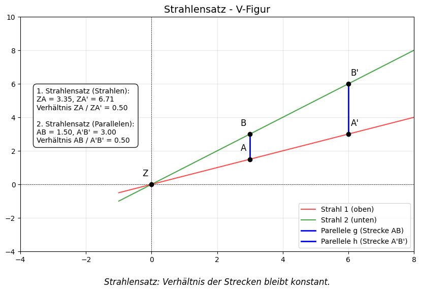
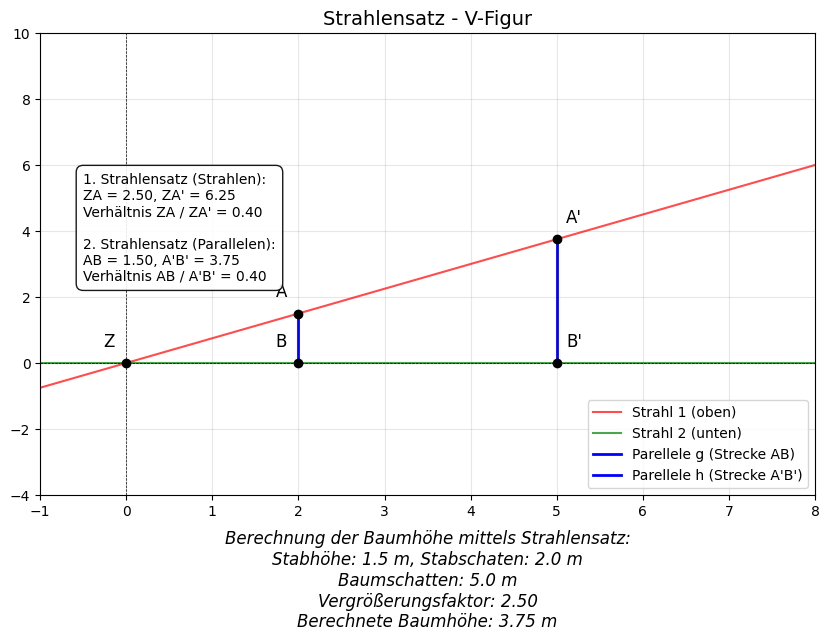

# Geometrie und Trigonometrie

## 03 – Der Strahlensatz (Intercept Theorems)

Im letzten Abschnitt haben wir gelernt, dass zwei Figuren **ähnlich sind, wenn ihre Winkel gleich sind und ihre Seitenverhältnisse übereinstimmen. 
Der Strahlensatz beschreibt im Grunde, die **Anwendung von Ähnlichkeiten auf Dreiecke**, die ineinander verschachtelt sind.

Anekdote: Historisch wird dieser Satz of **Thales von Milet** zugeschrieben, der damit angeblich die Höhe der Cheops-Pyramide anhand ihres Schattens berechnete, ohne auf die Pyramide klettern zu müssen.

### Lernziele

- Du lernst die **V-Figur** (klassischer Strahlensatz) und die **X-Figur** (Sanduhr) kennen.
- Du lernst zwischen dem **1. Strahlensatz** (Abschnitte auf den Strahlen) und dem **2. Strahlensatz** (Abschnitte auf den Parallelen) zu unterscheiden.
- Diese Verhältnisse interaktiv mit Python zu visualisieren
- Dieses Wissen anwenden, um unzugängliche Höhen zu messen.

## 1. Die V-Figur

Nehmen wir einen Punkt $Z$ (das Zentrum), von dem zwei Strahlen ausgehen.
Diese Strahlen werden von zwei paralleln Geraden ($g$ und $h$) geschnitten.
Es entstehen zwei Dreiecke: Ein kleines ($\Delta ZAB$) und ein großes ($\Delta ZA'B'$).

Da die Geraden parallel sind, wissen wir:
- Stufenwinkel sind gleich ($\alpha = \alpha'$).
- Der Winkel bei $Z$ ist beiden Dreiecken gemeinsam.
-> Die Dreiecke sind **ähnlich**.

Daraus ergeben sich zwei Gesetze:

### A. Der 1. Strahlensatz
Der 1. Strahlensatz beschreibt die Beziehungen auf den Strahlen.
Die Verhältnisse der Abschnitte auf dem einen Strahl entsprechen den Verhältnissen auf dem anderen Strahl.
$$ \frac{|ZA|}{|ZA'|} = \frac{|ZB|}{|ZB'|} \quad \text{oder auch} \quad \frac{|ZA|}{|AA'|} = \frac{|ZB|}{|BB'|} $$

*Merkregel:* "Kurz zu Lang verhält sich wie Kurz zu Lang."

### B. Der 2. Strahlensatz
Der 2. Strahlensatz bezeichnet die Beziehungen der Parallelen.
Hier werden die paralleln Abschnitte ins Verhältnis zu den Strahlenabschnitten gesetzt. 
$$ \frac{|AB|}{|A'B'|} = \frac{|ZA|}{|ZA'|} $$

*Wichtig:* Diser Satz verknüpft die "Querstrecken" mit den Strahlen. Hier gilt **nicht** "Kurz zu Teilstück", sonder immer "Kurz zu Lang" (vom Zentrum aus gemessen).

## 2. Die X-Figur

Wenn das Zentrum $Z$ **zwischen** den beiden Parallelen liegt, entsteht eine Figur, die wie eine Sanduhr oder ein X aussieht.
Hier gelten die Strahlensätze gelten **exakt genauso.**

Auch hier sind die Dreiecke ähnlich, denn:
1.  Die Winkel bei $Z$ sind **Scheitelwinkel** (und damit gleich).
2.  Die Winkel bei $A$ und $A'$ (bzw. $B$ und $B'$) sind **Wechselwinkel** an Parallelen (und damit gleich).

Der Unterschied kann in den unteren Settings visualisiert werden, indem man `modus: "V"` auf `modus: "X"` ändert. Das Verhältnis (Ratio) in der Infobox identisch bleibt, obwohl die Figur anders aussieht.
`modus: "beide"` zeigt Beide Modi nebeneinander.

    

    

## 3. Anwendung: Höhenmessung (Försterdreieck)

Eine der klassischsten Anwendungen des Strahlensatzes ist die Bestimmung von Höhen, die wir nicht direkt messen können (z.B. ein Baum, ein Kirchturm oder - wie bei Thales - eine Pyramide).

**Methode "Schattenwurf":**
Wenn die Sonne scheint, werfen Objekte Schatten. Da die Sonnenstrahlen (aufgrund der großen Entfernung der Sonne) praktisch parallel auf die Erde treffen, entstehen ähnliche Dreiecke.

Wir benötigen:
1.  Einen Stab bekannter Länge (z.B. Wanderstock, $h_{Stab}$).
2.  Die Länge des Schattens dieses Stabes ($s_{Stab}$).
3.  Die Länge des Schattens des Objekts ($s_{Objekt}$).

Nach dem 2. Strahlensatz gilt:
$$ \frac{\text{Höhe Objekt}}{\text{Höhe Stab}} = \frac{\text{Schatten Objekt}}{\text{Schatten Stab}} $$

Umgestellt nach der gesuchten Höhe:
$$ \text{Höhe Objekt} = \text{Höhe Stab} \cdot \frac{\text{Schatten Objekt}}{\text{Schatten Stab}} $$

    

    

## Zusammenfassung

| Thema | Kernaussage |
|-------|-------------|
| V-Figur | Zwei Strahlen vom Zentrum, geschnitten von parallelen Geraden; Dreiecke sind ähnlich |
| X-Figur | Zentrum zwischen den Parallelen (Sanduhr); gleiche Verhältnisse wie V-Figur |
| 1. Strahlensatz | Verhältnisse der Abschnitte auf den Strahlen sind gleich |
| 2. Strahlensatz | Verhältnis der Parallelen-Abschnitte = Verhältnis der Strahlen-Abschnitte |
| Höhenmessung | Mit Schattenwurf und bekannter Stablänge unzugängliche Höhen berechnen |

> **Nächster Schritt:** Weiter zu **Flächeninhalte und Skalierung** – warum Flächen quadratisch wachsen, wenn Längen linear wachsen.

---

## Glossar

| Deutsch | Englisch |
|---------|----------|
| Strahlensatz | Intercept Theorem / Basic Proportionality Theorem |
| Strahl | Ray |
| Parallele | Parallel line |
| Zentrum | Center / Origin |
| Verhältnis | Ratio |
| Abschnitt / Strecke | Segment |
| V-Figur | V-Figure (Triangles on the same side) |
| X-Figur | X-Figure (Bowtie / Hourglass shape) |
| Schatten | Shadow |
| Messen | To measure |
