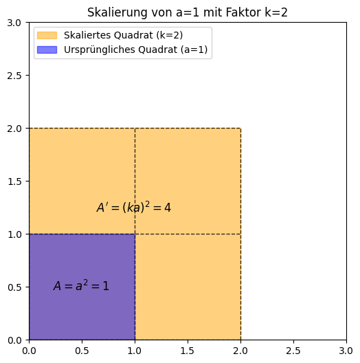

# Geometrie und Trigonometrie

## 04 – Flächeninhalte und Skalierung (Das Pizza-Prinzip)

Bisher haben wir gelernt, dass **ähnliche Figuren** gleiche Winkel haben und ihre Seitenverhältnisse konstant sind. Wenn wir eine Figur vergrößern ("zoomen"), multiplizieren wir alle Längen mit einem Faktor $k$.

Aber was passiert dabei mit der **Fläche**?
Viele Menschen denken intuitiv: "Doppelte Breite = Doppelte Fläche".
**Das ist falsch.** In diesem Abschnitt werden wir sehen, warum Flächen viel schneller wachsen als Längen.

### Lernziele

- Du verstehst den Unterschied zwischen linearer Skalierung (Länge) und quadratischer Skalierung (Fläche).
- Du kannst den neuen Flächeninhalt berechnen, wenn der Vergrößerungsfaktor $k$ bekannt ist.
- Du kannst dieses Wissen auf Alltagsprobleme (Preise, Kartenmaßstäbe) anwenden.

## 1. Das Pizza-Problem

Stellen wir uns vor, wir sind in einer Pizzeria und wollen Pizza bestellen.
- Eine **kleine Pizza** (20cm Durchmesser) kostet **$5\text{€}$**.
- Eine **große Pizza** (40 cm Durchmesser) kostet **$15\text{€}$**.

Welches Angebot ist besser?
Intuitiv denken viele: "Die große ist doppelt so groß ($40 * 2 = 20$), kostet aber dreimal so viel, daher ist eine kleine Pizza ein besseres Angebot ($5 * 2 = 10 < 15$)

Mathematisch ist das jedoch falsch. Wenn wir den Durchmesser verdoppeln ($k = 2$), vierfacht sich die Fläche. Aber warum ist das so?

## 2. Mathematische Herleitung

Betrachten wir ein Rechteck mit den Seitenlängen $a$ und $b$.
Der Flächeninhalt ist $A = a \cdot b$.

Nun vergrößern wir das Rechteck um den **Skalierungsfaktor** $k$.
Die neuen Seitenlängen sind $a' = k \cdot a$ und $b' = k \cdot b$.

Wie groß ist die neue Fläche $A'$?

$$
\begin{aligned}
A' &= a' \cdot b' \\
A' &= (k \cdot a) \cdot (k \cdot b) \\
A' &= k \cdot k \cdot a \cdot b \\
A' &= k^2 \cdot (a \cdot b) \\
A' &= k^2 \cdot A \\
\end{aligned}
$$

**Gesetz der Flächenskalierung:**
Wird eine Figur um den Faktor $k$ vergrößert, wächst ihr Flächeninhalt um den Faktor $k^2$.
- Doppelte Länge ($k=2$) $\rightarrow$ $2^2 = 4$-fache Fläche
- Dreifach Länge ($k=3$) $\rightarrow$ $3^2 = 9$-fache Fläche
- Halbe Länge ($k=0.5$) $\rightarrow$ $2^2 = 0.25$-fache Fläche (Ein Viertel)

    

    

## 3. Verallgemeinerung

Das Gesetz $A' = k^2 \cdot A$ gilt nicht nur für Quadrate, sondern für alle 2-dimensionalen geometrischen Figuren, solange sie **ähnlich** sind.

**Beispiel Kreis:**
$$A = r^2 \cdot \pi$$
Verdoppeln wir den Radius ($r' = 2r$), dann gilt:
$$A' = (2r)^2 \cdot \pi = 4r^2 \cdot \pi = 4 \cdot A$$

**Beispiel Landkarten:**
Eine Karte hat den Maßstab $1:50.000$.
Das bedeutet $1$ cm auf der Karte sind $50.000$ cm ($500$ m) in der Realität.
Der Längen-Faktor ist also $k = 50.000$.

Wie verhält es sich mit der Fläche?
$1 \text{ cm}^2$ auf der Karte entspricht in der Realität:
$$1 \text{ cm}^2 \cdot (50.000)^2 = 1 \cdot 2.500.000.000 \text{ cm}^2 = 250.000 \text{ m}^2 = 25 \text{ Hektar}$$
Der Flächenmaßstab ist also $1 : k^2$.

## 4. Interaktive Visualisierung: Längen- vs. Flächenwachstum

In der folgenden Animation sehen wir uns an, wie sich die Fläche verändert, wenn wir den Skalierungsfaktor $k$ kontinuierlich von 1 bis 3 erhöhen.
Wir stellen dies in einem Graphen dar. Während die Seitenlänge linear wächst (eine Gerade), wächst die Fläche quadratisch (eine Parabel).

## Zusammenfassung

| Thema | Kernaussage |
|-------|-------------|
| Flächenskalierung | $A' = k^2 \cdot A$ – Flächen wachsen quadratisch mit dem Skalierungsfaktor |
| Pizza-Prinzip | Doppelter Durchmesser = vierfache Fläche |
| Kartenmaßstab | Längenmaßstab $1:k$, Flächenmaßstab $1:k^2$ |

> **Nächster Schritt:** Weiter zum **Satz des Pythagoras** – der berühmteste Lehrsatz der Mathematik und wie man damit Distanzen berechnet.

---

## Glossar

| Deutsch | Englisch |
|---------|----------|
| Flächeninhalt | Area |
| Skalierung | Scaling |
| Skalierungsfaktor | Scale factor ($k$) |
| Maßstab | Scale (on a map) |
| Quadratisch | Quadratic / Square |
| Verhältnis | Ratio |
| Ähnlich | Similar |
| Umfang | Perimeter |
