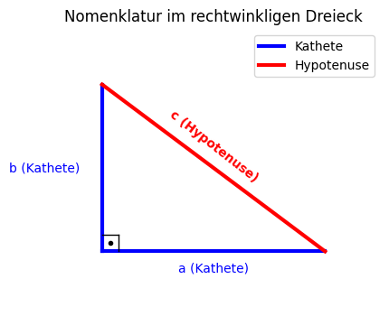
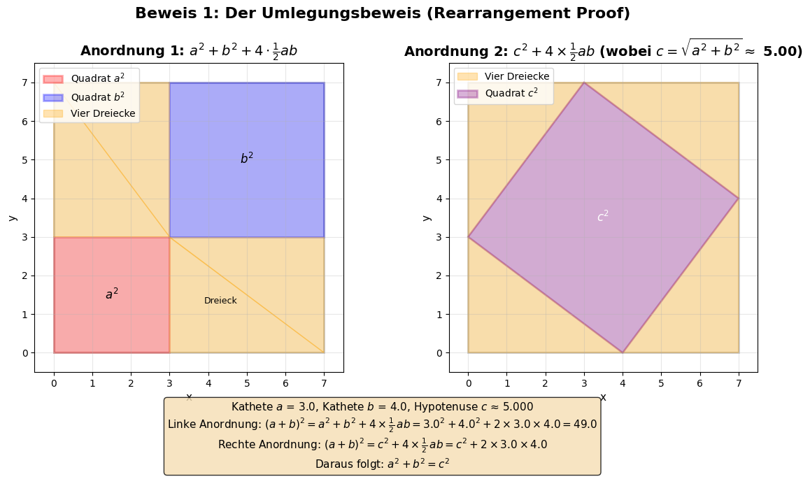

# Geometrie und Trigonometrie

## 05 – Das rechtwinklige Dreieck und der Satz des Pythagoras

Wir kommen nun zum wohl berühmtesten Lehrsatz der Mathematik. 

Jeder kennt die Formel $a^2 + b^2 = c^2$, aber In diesem Abschnitt wollen wir wirklich verstehen, *warum* sie gilt und wie wir sie nutzen können, um Distanzen zu berechnen, die wir nicht direkt messen können.

### Lernziele

- Du lernst die Begriffe **Kathete** und **Hypotenuse** sicher zu verwenden.
- Du verstehst den **geometrischen Beweis** des Satzes (Flächenvergleich).
- Du kannst fehlende Seitenlängen in rechtwinkligen Dreiecken berechnen.
- Du lernst die **Umkehrung** des Satzes kennen (Wie prüfe ich, ob ein Winkel $90°$ ist?).

## 1. Das rechtwinklige Dreieck

Bevor wir rechnen, müssen wir die Bauteile benennen. Der Satz des Pythagoras gilt **nur** in rechtwinkligen Dreiecken.

- **Der rechte Winkel ($90°$):** Er ist das markanteste Merkmal. Meist wird er mit einem Punkt in einem Viertelkreis markiert.
- **Die Hypotenuse:** Die längste Seite des Dreiecks. Sie liegt dem rechten Winkel immer **gegenüber**.
- **Die Katheten:** Die beiden kürzeren Seiten, die den rechten Winkel **einschließen** (sie "berühren" den rechten Winkel).

*Eselsbrücke:* Die **H**ypotenuse ist die **H**auptseite (die größte).

    

    

## 2. Der Satz des Pythagoras

Der Satz des Pythagoras ist eines der fundamentellen Theoreme der euklidischen Geometrie. Er besagt:

**In einem rechtwinkligen Dreieck ist die Fläche des Quadrats über der Hypotenuse (der längsten Seite, die dem rechten Winkel gegenüberliegt) gleich der Summe der Flächen der Quadrate über den beiden Katheten (den Seiten, die den rechten Winkel bilden).**

Mathematisch ausgedrückt:
$$
a^2 + b^2 = c^2
$$

Wobei:
- $a$ und $b$ die **Katheten** (Ankathete und Gegenkathete) sind
- $c$ die **Hypotenuse** ist
- Der Winkel zwischen $a$ und $b$ genau $90°$ ($\pi / 2 \text{Radiant}$) beträgt.

### Interpretation

Das Theorem kann geometrisch interpretiert werden als:
- Die Summer der Flächeninhalte zweiere Quadrate (über den Katheten) entspricht dem Flächeninhalt eines dritten Quadrates (über der Hypotenuse)

## 3. (ein) Beweis

Der Umlegungsbeweis (auch "Beweis durch Neuanordnung" genannt) basiert auf der folgender Idee:

1. Man konstruiert ein großes Quadrat mit der Seitenlänge $(a + b)$
2. Dieses große Quadrat wird auf zwei verschiedene Arten in kleinere geometrische Formen zerlegt
3. **Erste Zerlegung**: Das große Quadrat wird in zwei Quadrate (mit Seitenlängen $a$ und $b$) plus vier kongruente rechtwinklige Dreiecke unterteilt.
4. **Zweite Zerlegung**: Das gleiche große Quadrat wird in ein Quadrat (mit Seitenlänge $c$, der Hypotenuse) plus vier kongruente rechtwinklige Dreiecke unterteilt.
5. Da beide Zerlegungen denselben großen Quadratflächeninhalt ergeben und die vier Dreiecke in beiden Fällen identisch sind, müssen die verbleibenden Quadratflächen gleich sein: $a^2 + b^2 = c^2$

### Mathematische Formalisierung

- Großes Quadrat: Seitenlänge = $a + b$, Fläche = $(a + b)^2 = a^2 + 2ab + b^2$
- Jedes rechtwinklige Dreieck: Fläche = $\frac{1}{2}ab$
- Vier Dreiecke: Gesamtfläche = $4 \cdot \frac{1}{2}ab = 2ab$

**Erste Anordnung**:
$$A_{\text{groß}} = a^2 + b^2 + 2ab$$

**Zweite Anordnung**:
$$A_{\text{groß}} = c^2 + 2ab$$

**Daher**:
$$a^2 + b^2 + 2ab = c^2 + 2ab$$
$$a^2 + b^2 = c^2$$

### Visualisierung
Schauen wir uns an wie das ganze aussieht. Der untenstehende Python Code visualisiert diesen Bweis:

    

    

## Zusammenfassung

| Thema | Kernaussage |
|-------|-------------|
| Rechtwinkliges Dreieck | Katheten schließen den rechten Winkel ein; Hypotenuse liegt gegenüber |
| Satz des Pythagoras | $a^2 + b^2 = c^2$ (nur im rechtwinkligen Dreieck) |
| Beweis | Umlegungsbeweis: Zwei Zerlegungen eines $(a+b)$-Quadrats |
| Pythagoreische Tripel | Ganzzahlige Lösungen, z.B. $(3,4,5)$, $(5,12,13)$ |
| Umkehrung | Gilt $a^2+b^2=c^2$, ist das Dreieck rechtwinklig |

> **Nächster Schritt:** Weiter zu **Geometrische Flächenformeln** – Herleitung der Formeln für Parallelogramm, Dreieck, Trapez und Kreis.

---

## Glossar

| Deutsch | Englisch |
|---------|----------|
| Rechtwinkliges Dreieck | Right-angled triangle |
| Kathete | Cathetus / Leg |
| Hypotenuse | Hypotenuse |
| Satz des Pythagoras | Pythagorean theorem |
| Wurzel | Square root |
| Quadrat | Square |
| Fläche | Area |
| Umkehrung | Converse |
