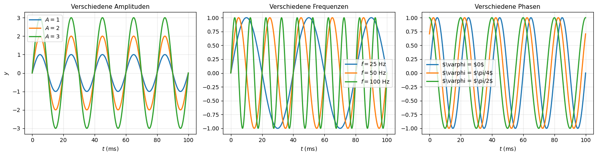
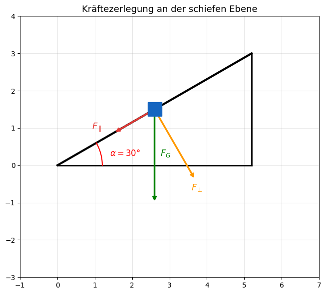

# Geometrie und Trigonometrie

## 04 – Anwendungen der Trigonometrie

Trigonometrie ist keine reine Theorie — sie steckt in Vermessung, Physik, Technik und Signalverarbeitung.

### Lernziele

- Du kannst **Höhen und Entfernungen** mit Trigonometrie berechnen (Vermessung).
- Du verstehst **Schwingungen** als Sinusfunktionen ($y = A\sin(\omega t + \varphi)$).
- Du kannst eine Kraft in **Komponenten** zerlegen (Vektorzerlegung).

## 1. Vermessung: Höhen und Entfernungen

### Höhe eines Objekts

Stehst du in Entfernung $d$ von einem Objekt und misst den **Elevationswinkel** $\alpha$ (von der Horizontalen nach oben), dann gilt:

$$h = d \cdot \tan(\alpha)$$

(wobei $h$ ab deiner Augenhöhe gemessen wird.)

### Entfernung über zwei Winkel

Misst du von zwei Standpunkten $A$ und $B$ (Abstand $d$ bekannt) die Winkel $\alpha$ und $\beta$ zum Zielpunkt $C$, kannst du mit dem **Sinussatz** alle fehlenden Größen berechnen.

### Beispiel

Du stehst $50\text{ m}$ von einem Turm entfernt und misst einen Elevationswinkel von $35°$.  
Deine Augenhöhe ist $1{,}7\text{ m}$.

$$h_{\text{Turm}} = 50 \cdot \tan(35°) + 1{,}7 \approx 50 \cdot 0{,}7002 + 1{,}7 \approx 36{,}7\text{ m}$$

## 2. Schwingungen und Wellen

Viele periodische Vorgänge lassen sich als Sinusfunktion beschreiben:

$$y(t) = A \cdot \sin(\omega t + \varphi)$$

| Parameter | Bedeutung | Einheit |
|---|---|---|
| $A$ | **Amplitude** — maximale Auslenkung | je nach Kontext (m, V, …) |
| $\omega = \frac{2\pi}{T} = 2\pi f$ | **Kreisfrequenz** | rad/s |
| $T$ | **Periode** — Dauer einer Schwingung | s |
| $f = \frac{1}{T}$ | **Frequenz** — Schwingungen pro Sekunde | Hz |
| $\varphi$ | **Phase** — horizontale Verschiebung | rad |

### Beispiel: Wechselstrom

Europäische Netzspannung: $U(t) = 325 \cdot \sin(2\pi \cdot 50 \cdot t)$

- Amplitude: $A = 325\text{ V}$ (Spitzenwert)
- Frequenz: $f = 50\text{ Hz}$
- Periode: $T = \frac{1}{50} = 0{,}02\text{ s}$

    

    

## 3. Kräftezerlegung (Vektorzerlegung)

Eine Kraft $\vec F$, die unter einem Winkel $\alpha$ zur Horizontalen wirkt, kann in zwei **Komponenten** zerlegt werden:

- **Horizontale Komponente:** $F_x = F \cdot \cos(\alpha)$
- **Vertikale Komponente:** $F_y = F \cdot \sin(\alpha)$

### Beispiel: Schiefe Ebene

Ein Block ($m = 10\text{ kg}$) liegt auf einer schiefen Ebene mit Neigungswinkel $30°$.  
Die Gewichtskraft ist $F_G = m \cdot g = 98{,}1\text{ N}$ (senkrecht nach unten).

Zerlegung relativ zur Ebene:
- **Hangabtriebskraft** (parallel zur Ebene): $F_{\parallel} = F_G \cdot \sin(30°) = 49{,}05\text{ N}$
- **Normalkraft** (senkrecht zur Ebene): $F_{\perp} = F_G \cdot \cos(30°) \approx 84{,}96\text{ N}$

    

    

## Zusammenfassung

| Thema | Kernaussage |
|:------|:------------|
| **Vermessung** | Höhen und Entfernungen über $\tan(\alpha)$ und bekannte Abstände berechnen |
| **Schwingungen** | $y(t) = A\sin(\omega t + \varphi)$ — Amplitude, Frequenz $f = \frac{\omega}{2\pi}$, Periode $T = \frac{1}{f}$ |
| **Kräftezerlegung** | $F_x = F\cos(\alpha)$, $F_y = F\sin(\alpha)$ — Projektion auf Achsen |

> **Nächster Schritt:** [01 – Grundlagen der Vektoren](../05_Vektoren_Matrizen/01_Grundlagen_der_Vektoren.ipynb) — Vektoren als Erweiterung der Trigonometrie in höhere Dimensionen.

---

## Glossar

| Deutsch | English |
|---------|---------|
| Vermessung | Surveying |
| Elevationswinkel | Angle of elevation |
| Schwingung | Oscillation |
| Amplitude | Amplitude |
| Frequenz | Frequency |
| Periode | Period |
| Kreisfrequenz | Angular frequency |
| Phase / Phasenverschiebung | Phase / phase shift |
| Kräftezerlegung | Force decomposition |
| Schiefe Ebene | Inclined plane |
| Hangabtriebskraft | Downhill force component |
