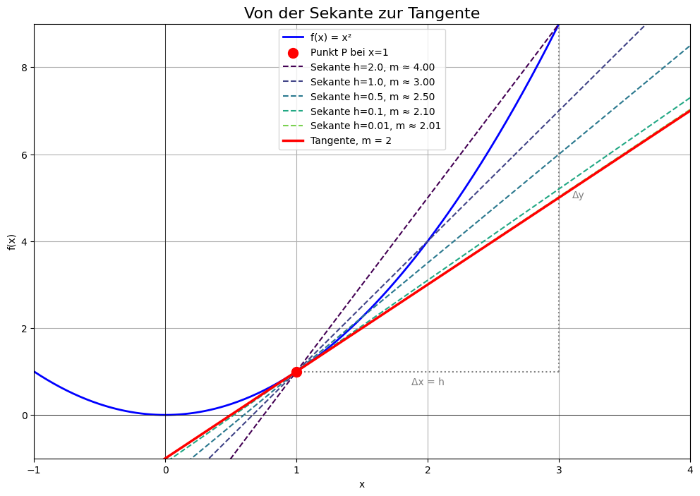
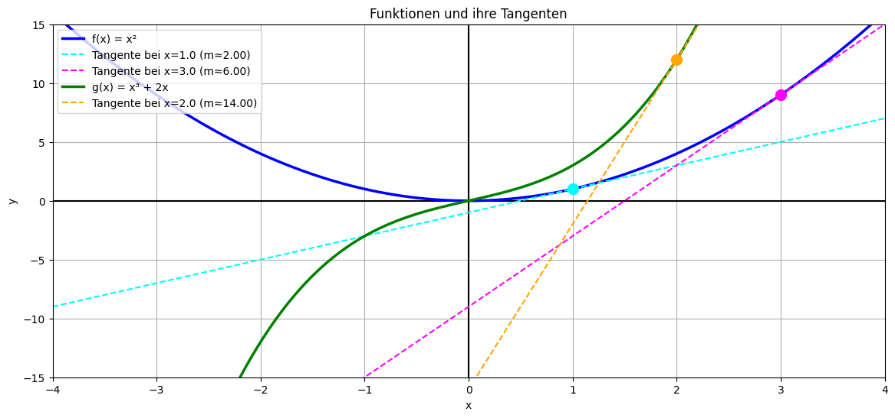

# Analysis
## 02 - Ableitungen: Einführung
Die Steigung einer Kurve

Die Ableitung ist eines der wichtigsten Konzepte der Mathematik. Sie beschreibt, wie schnell sich eine Funktion an einer bestimmten Stelle ändert - die **momentane Änderungsrate**.

### Lernziele

In diesem Abschnitt lernst Du:
- **Was eine Ableitung ist** und warum sie die Steigung einer Kurve beschreibt
- **Den Übergang von der Sekante zur Tangente** visuell zu verstehen
- **Die Ableitung numerisch zu berechnen** mithilfe der Grenzwertdefinition
- **Die Ableitung symbolisch zu berechnen** mit SymPy
- **Die verschiedenen Notationen** der Ableitung ($f'(x)$, $\frac{df}{dx}$, $\dot{f}$)

---

### 1. Die Kernidee: Von der durchschnittlichen zur momentanen Steigung

Bei einer Geraden, z.B. $y = 2x + 1$, ist die Steigung überall gleich. Für jeden Schritt in $x$ steigt $y$ um 2. Die Steigung ist konstant **2**.

Aber was ist mit einer Kurve wie $f(x) = x^2$? Die Steilheit dieser Funktion ändert sich ständig. Bei $x=10$ ist sie sehr steil, bei $x=0$ fast flach.

Die **Ableitung** einer Funktion an einer bestimmten Stelle ist die **Steigung der Kurve genau an diesem Punkt**.

#### Das Steigungsdreieck
Um die Steigung zu verstehen, beginnen wir mit dem **Steigungsdreieck** (auch: Differenzenquotient). Wir wählen zwei Punkte auf der Kurve und zeichnen eine Gerade durch sie - die **Sekante**. Ihre Steigung ist die *durchschnittliche* Änderungsrate zwischen diesen beiden Punkten.

Die Steigung einer Geraden zwischen zwei Punkten $(x_1, y_1)$ und $(x_2, y_2)$ ist:
$$
m = \frac{\Delta y}{\Delta x} = \frac{y_2 - y_1}{x_2 - x_1}
$$

In Funktionsnotation: Wenn wir einen Punkt $x$ und einen zweiten Punkt $x + h$ haben (wobei $h$ eine kleine Änderung in $x$ ist), ist die Sekantensteigung:
$$
m_{\text{Sekante}} = \frac{f(x+h) - f(x)}{(x+h) - x} = \frac{f(x+h) - f(x)}{h}
$$

Diesen Ausdruck nennt man den **Differenzenquotienten**.

Die Kernidee der Analysis: **Was passiert, wenn wir $h$ unendlich klein machen?** Wenn der zweite Punkt immer näher an den ersten rückt, wird die Sekante zur **Tangente** - einer Geraden, die die Kurve in genau einem Punkt berührt.

Die Steigung dieser Tangente ist die Ableitung.

*Hinweis: Du kannst sowohl $h$ als auch $\Delta x$ als Notation für die Änderung in $x$ verwenden - beide sind gleichwertig. In diesem Abschnitt verwenden wir $h$.*

    

    

### 2. Die Ableitung berechnen: Die Grenzwertdefinition

Der obige Prozess wird durch die **Grenzwertdefinition der Ableitung** formalisiert:

$$
f'(x) = \lim_{h \to 0} \frac{f(x+h) - f(x)}{h}
$$

Die Notation $f'(x)$ (gesprochen: „f Strich von x") ist eine der üblichen Schreibweisen. Die wichtigsten Notationen sind:

| Notation | Name | Wann verwendet |
|----------|------|---------------|
| $f'(x)$ | Lagrange-Notation | Am häufigsten in der Schulmathematik |
| $\frac{df}{dx}$ oder $\frac{dy}{dx}$ | Leibniz-Notation | Betont die Variablen, nützlich bei Kettenregel |
| $\dot{f}$ | Newton-Notation | Vor allem in der Physik (Ableitung nach der Zeit) |

Machen wir daraus eine Python-Funktion! Wir können $h$ nicht wirklich Null setzen (Division durch Null!), aber wir können es sehr klein machen, z.B. $h = 1 \cdot 10^{-7}$.

    

    

### 3. Die exakte Ableitung mit SymPy

Unsere `numerische_ableitung`-Funktion ist nützlich für die Intuition, aber sie liefert nur eine **Näherung**. Für exakte Ergebnisse brauchen wir symbolische Mathematik. Das geht mit der Bibliothek `sympy`. Sie behandelt Variablen als Symbole, nicht als Zahlen.

Lass uns SymPy nutzen, um die Ableitung von $f(x) = x^2$ exakt zu berechnen:

---

## Zusammenfassung

| Konzept | Kernaussage |
|---------|-------------|
| **Ableitung** | Momentane Steigung einer Kurve an einem Punkt |
| **Sekante → Tangente** | Übergang durch Grenzwert $h \to 0$ |
| **Differenzenquotient** | $\frac{f(x+h)-f(x)}{h}$ — Näherung der Ableitung |
| **Grenzwertdefinition** | $f'(x) = \lim_{h \to 0} \frac{f(x+h)-f(x)}{h}$ — exakte Definition |
| **SymPy** | Berechnet Ableitungen symbolisch (exakt) |

> **Nächster Schritt:** Wie leitet man effizient ab, ohne jedes Mal den Grenzwert zu berechnen? → 03_Ableitungsregeln

---

## Glossar

| Deutsch | Englisch |
|---------|----------|
| Ableitung | Derivative |
| Steigung | Slope |
| Tangente | Tangent (line) |
| Sekante | Secant (line) |
| Steigungsdreieck | Slope triangle |
| Differenzenquotient | Difference quotient |
| Grenzwert | Limit |
| Momentane Änderungsrate | Instantaneous rate of change |
| Durchschnittliche Änderungsrate | Average rate of change |
