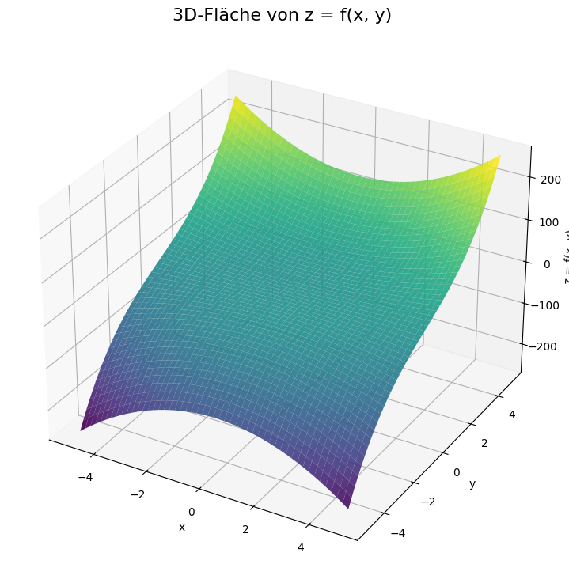
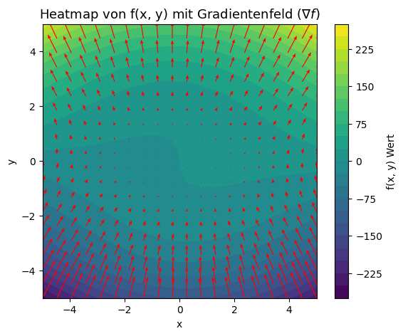

# Analysis
## 07 - Partielle Ableitungen: Steigungen in höheren Dimensionen
Funktionen mit mehreren Variablen ableiten

Bisher haben wir Funktionen mit einer einzigen Eingabevariable betrachtet, wie $f(x)$. Doch in vielen Anwendungen hängt eine Funktion von **mehreren Variablen** ab, wie beispielsweise $f(x, y)$. Ein praktisches Beispiel: Die Temperatur in einem Raum kann von der Position $(x, y)$ abhängen.

Die **partielle Ableitung** ist das Werkzeug für solche Fälle: Sie ist die Ableitung einer Funktion mehrerer Variablen **nach einer** dieser Variablen, während alle anderen Variablen als **Konstanten** behandelt werden.

Stelle Dir eine 3D-Landschaft vor, definiert durch $z = f(x, y)$. An einem Punkt $(x, y)$:
- Die partielle Ableitung nach $x$ (geschrieben $\frac{\partial f}{\partial x}$) ist die **Steigung in x-Richtung** (z.B. Ost-West)
- Die partielle Ableitung nach $y$ (geschrieben $\frac{\partial f}{\partial y}$) ist die **Steigung in y-Richtung** (z.B. Nord-Süd)

### Lernziele

In diesem Abschnitt werden folgende Konzepte behandelt:
- **Partielle Ableitungen** numerisch und symbolisch berechnen
- **Den Gradienten** $\nabla f$ als Vektor der steilsten Steigung
- **3D-Flächen** und **Gradientenfelder** visuell interpretieren
- Zusammenhänge zum Gradientenabstieg (Gradient Descent) erkennen

---

### 1. Definition und numerische Berechnung

Die Definition ist sehr ähnlich zur gewöhnlichen Ableitung. Für die partielle Ableitung nach $x$ ändert sich nur $x$, während $y$ festgehalten wird:
$$
\frac{\partial f}{\partial x}(x, y) = \lim_{h \to 0} \frac{f(x+h, y) - f(x, y)}{h}
$$

Und für $y$:
$$
\frac{\partial f}{\partial y}(x, y) = \lim_{h \to 0} \frac{f(x, y+h) - f(x, y)}{h}
$$

**Praktische Berechnung:** Alle *anderen* Variablen werden wie Konstanten behandelt, und es wird nach den üblichen Ableitungsregeln vorgegangen.

**Beispiel:** $f(x, y) = x^2 y + 2x + y^3$
- $\frac{\partial f}{\partial x} = 2xy + 2$ ($y$ und $y^3$ werden wie Konstanten behandelt)
- $\frac{\partial f}{\partial y} = x^2 + 3y^2$ ($x^2$ und $2x$ werden wie Konstanten behandelt)

Wir können unsere `numerische_ableitung`-Funktion wiederverwenden, indem wir mit Pythons `lambda` temporäre Ein-Variablen-Funktionen erstellen:

### 2. Der Gradient: Die Richtung des steilsten Anstiegs

Wir haben die Steigung in x-Richtung ($\frac{\partial f}{\partial x}$) und die Steigung in y-Richtung ($\frac{\partial f}{\partial y}$) berechnet. Was passiert, wenn wir diese beiden Werte zu einem **Vektor** zusammenfassen?

Diesen Vektor nennt man den **Gradienten**, geschrieben als $\nabla f$ (gesprochen: „Nabla f"):

$$
\nabla f(x, y) = \begin{pmatrix} \frac{\partial f}{\partial x} \\ \frac{\partial f}{\partial y} \end{pmatrix}
$$

Der Gradient hat zwei wichtige Eigenschaften:
1. **Richtung:** Der Gradientvektor zeigt immer in die Richtung des **steilsten Anstiegs**. Wenn Du auf einem Berg stehst und so schnell wie möglich nach oben willst, gehst Du in Richtung des Gradienten.
2. **Betrag:** Die Länge (der Betrag) des Gradientvektors gibt an, **wie steil** dieser Anstieg ist. Längerer Vektor = steilerer Anstieg.

Der **negative Gradient** ($-\nabla f$) zeigt in die Richtung des **steilsten Abstiegs** - das ist die Kernidee hinter dem **Gradientenabstieg** (Gradient Descent), einem der wichtigsten Algorithmen im maschinellen Lernen.

---

### 3. 3D-Visualisierung: Die Funktionslandschaft

Zuerst visualisieren wir die Funktion $f(x, y)$ als 3D-Fläche. Das zeigt die tatsächliche „Landschaft" der Funktion:

    

    

### 4. 2D-Darstellung: Gradientenfeld als Heatmap

Jetzt visualisieren wir das Ganze von oben: Eine 2D-Heatmap zeigt den Wert von $f(x,y)$ durch Farbe, und darüber legen wir **Pfeile** (ein „Quiver-Plot"), die die Gradientvektoren an verschiedenen Stellen darstellen.

- Pfeile zeigen **bergauf** - von dunklen (niedrigen) zu hellen (hohen) Regionen
- Gelbe Bereiche = hohe Gipfel, violette Bereiche = tiefe Täler
- Längere Pfeile = steilere Steigung

    

    

---

## Zusammenfassung

| Konzept | Kernaussage |
|---------|-------------|
| **Partielle Ableitung** | Steigung in *einer* Richtung, andere Variablen festhalten |
| **Berechnung** | Andere Variablen wie Konstanten behandeln und normal ableiten |
| **Gradient** | $\nabla f$ fasst alle partiellen Ableitungen zu einem Vektor zusammen |
| **Richtung** | $\nabla f$ zeigt zum **steilsten Anstieg**, $-\nabla f$ bergab |
| **3D-Visualisierung** | Funktion als Fläche, Gradient als Pfeilfeld |

> **Nächster Schritt:** Die Analysis-Reihe ist abgeschlossen! Weiter zur Statistik und Wahrscheinlichkeit in `08_Statistik_und_Wahrscheinlichkeit/`

---

## Glossar

| Deutsch | Englisch |
|---------|----------|
| Partielle Ableitung | Partial derivative |
| Gradient | Gradient |
| Gradientenfeld | Gradient field |
| Steilster Anstieg | Steepest ascent |
| Steilster Abstieg | Steepest descent |
| Gradientenabstieg | Gradient descent |
| Heatmap | Heatmap |
| Höhenlinie / Konturlinie | Contour line |
| Betrag (eines Vektors) | Magnitude (of a vector) |
| Mehrere Variablen | Multiple variables |
