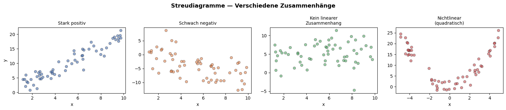
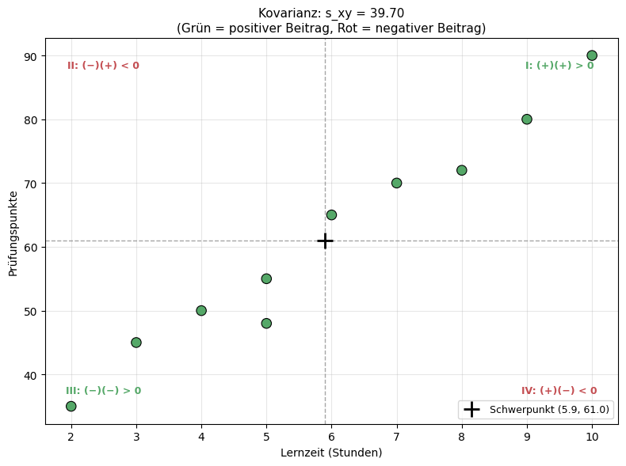
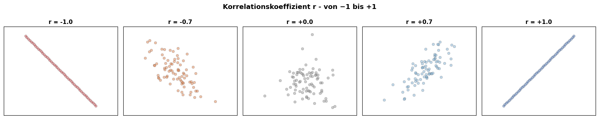
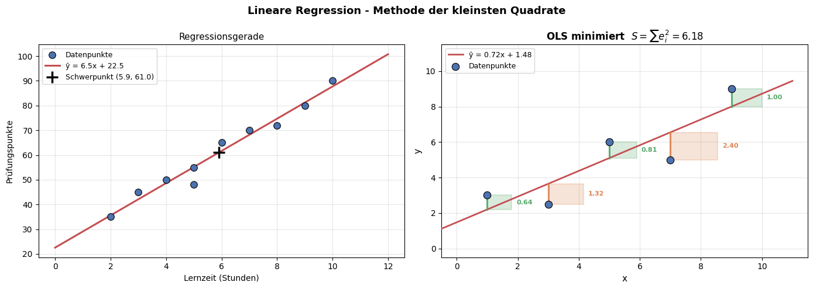
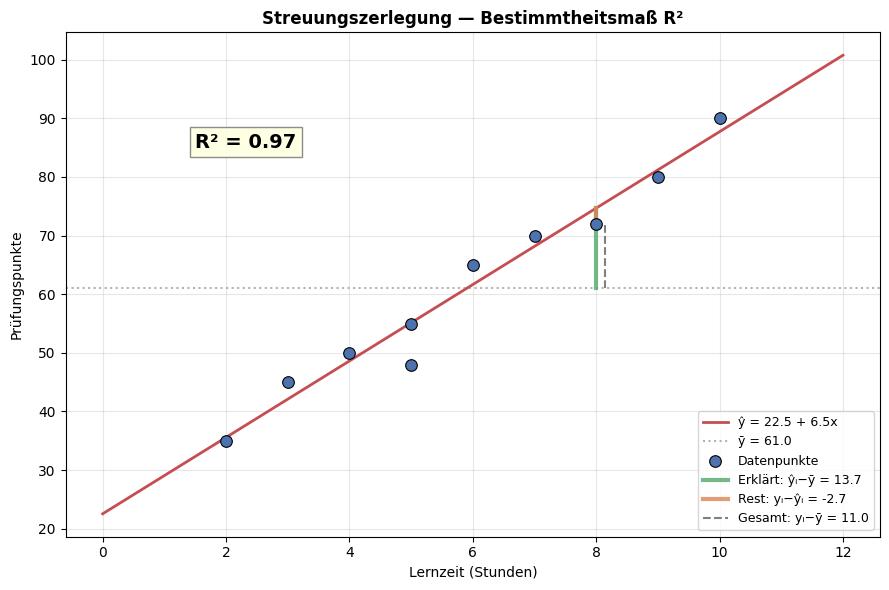
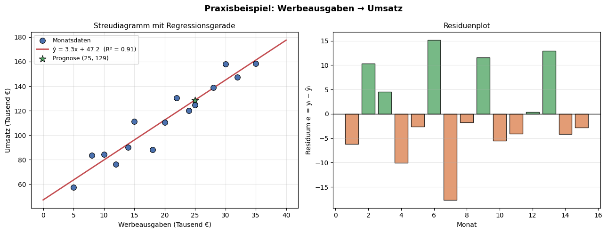

# Statistik
## 02 - Korrelation und Regression

**Voraussetzungen:** Beschreibende Statistik (Mittelwert, Varianz, Standardabweichung)

Bisher haben wir einzelne Merkmale betrachtet - Mittelwerte, Streuungen, Häufigkeiten. Doch in der Praxis interessiert uns oft eine tiefere Frage:

> **Gibt es einen Zusammenhang zwischen zwei Merkmalen?** Und wenn ja - wie können wir ihn beschreiben und nutzen?

Dieses Notebook behandelt die zwei zentralen Werkzeuge dafür:

| Werkzeug | Frage | Ergebnis |
|----------|-------|----------|
| **Korrelation** | *Wie stark* und *in welche Richtung* hängen zwei Merkmale zusammen? | Eine Kennzahl $r \in [-1, 1]$ |
| **Regression** | Wie können wir den Zusammenhang durch eine *Funktion* beschreiben und damit **vorhersagen**? | Eine Gleichung, z.B. $\hat{y} = a + bx$ |

Wir beginnen mit der Korrelation - denn bevor wir einen Zusammenhang mathematisch modellieren, müssen wir ihn erst **erkennen und quantifizieren**.

### Lernziele

- Du kannst **Streudiagramme** lesen und interpretieren.
- Du verstehst die **Kovarianz** als Grundlage der Korrelation.
- Du kannst den **Korrelationskoeffizienten nach Pearson** berechnen und interpretieren.
- Du kennst den Unterschied zwischen **Korrelation und Kausalität**.
- Du kannst eine **lineare Regressionsgerade** nach der Methode der kleinsten Quadrate bestimmen.
- Du kannst das **Bestimmtheitsmaß** $R^2$ interpretieren.
- Du kannst mit Python Zusammenhänge visualisieren und berechnen.

---

### 1. Das Streudiagramm

Wenn wir den Zusammenhang zwischen zwei metrischen Merkmalen $x$ und $y$ untersuchen wollen, ist der erste Schritt immer eine **grafische Darstellung**: das **Streudiagramm** (auch: Scatterplot).

Jedes Objekt der Stichprobe liefert ein **Wertepaar** $(x_i, y_i)$, das als Punkt in einem Koordinatensystem eingetragen wird.

> **Beispiel:** Wir messen bei $n = 10$ Schülerinnen und Schülern die **Lernzeit** (Stunden pro Woche) und die **Prüfungsnote** (Punkte von 0–100). Jeder Punkt im Streudiagramm entspricht einer Person.

Aus dem Streudiagramm lässt sich bereits **visuell** ablesen:

| Muster | Interpretation |
|--------|----------------|
| Punkte steigen von links nach rechts | **Positiver** Zusammenhang - wenn $x$ wächst, wächst tendenziell auch $y$ |
| Punkte fallen von links nach rechts | **Negativer** Zusammenhang - wenn $x$ wächst, sinkt tendenziell $y$ |
| Punkte bilden eine **enge** Wolke | **Starker** Zusammenhang |
| Punkte bilden eine **breite** Wolke | **Schwacher** Zusammenhang |
| Kein erkennbares Muster | **Kein linearer** Zusammenhang |

> **Merke:** Das Streudiagramm zeigt nur **lineare** Zusammenhänge deutlich. Ein perfekter quadratischer Zusammenhang kann im Streudiagramm wie „kein Zusammenhang" aussehen - daher immer auch an **nichtlineare** Muster denken!

---

    

    

### 2. Kovarianz

Um den Zusammenhang zweier Merkmale **numerisch** zu erfassen, brauchen wir ein Maß dafür, wie $x$ und $y$ **gemeinsam** vom Mittelwert abweichen.

#### Intuition

Betrachte einen einzelnen Datenpunkt $(x_i, y_i)$:
- Wenn $x_i > \bar{x}$ **und** $y_i > \bar{y}$ (beide überdurchschnittlich), dann ist das Produkt $(x_i - \bar{x})(y_i - \bar{y}) > 0$.
- Wenn $x_i > \bar{x}$ **aber** $y_i < \bar{y}$ (gegenläufig), dann ist das Produkt $(x_i - \bar{x})(y_i - \bar{y}) < 0$.

Mittelt man diese Produkte über alle Datenpunkte, erhält man ein Maß für die **Tendenz des gemeinsamen Schwankens**.

#### Definition

> Die **empirische Kovarianz** zweier Merkmale $x$ und $y$ ist:
>
> $$s_{xy} = \frac{1}{n} \sum_{i=1}^{n} (x_i - \bar{x})(y_i - \bar{y})$$

| Wert von $s_{xy}$ | Interpretation |
|--------------------|----------------|
| $s_{xy} > 0$ | Tendenz: wenn $x$ steigt, steigt auch $y$ → **gleichsinniger** Zusammenhang |
| $s_{xy} < 0$ | Tendenz: wenn $x$ steigt, sinkt $y$ → **gegensinniger** Zusammenhang |
| $s_{xy} \approx 0$ | Kein (linearer) Zusammenhang erkennbar |

#### Rechenregel (Verschiebungssatz)

Analog zur Varianz gibt es eine äquivalente Berechnungsformel, die manchmal bequemer ist:

$$s_{xy} = \frac{1}{n} \sum_{i=1}^{n} x_i y_i - \bar{x} \cdot \bar{y} = \overline{xy} - \bar{x} \cdot \bar{y}$$

> **Problem der Kovarianz:** Ihr Wert hängt von den **Einheiten** der Merkmale ab. Messen wir Einkommen in Euro, erhalten wir einen anderen Wert als in Cent - obwohl der Zusammenhang derselbe ist. Wir brauchen ein **einheitenfreies** Maß.

---

    

    

### 3. Der Korrelationskoeffizient nach Pearson

Um das Einheitenproblem der Kovarianz zu lösen, **normieren** wir: Wir teilen die Kovarianz durch das Produkt der Standardabweichungen beider Merkmale.

#### Definition

> Der **empirische Korrelationskoeffizient nach Pearson** ist:
>
> $$r = r_{xy} = \frac{s_{xy}}{s_x \cdot s_y} = \frac{\displaystyle\frac{1}{n}\sum_{i=1}^{n}(x_i - \bar{x})(y_i - \bar{y})}{\sqrt{\displaystyle\frac{1}{n}\sum_{i=1}^{n}(x_i - \bar{x})^2} \cdot \sqrt{\displaystyle\frac{1}{n}\sum_{i=1}^{n}(y_i - \bar{y})^2}}$$

#### Eigenschaften

| Eigenschaft | Erklärung |
|-------------|----------|
| $-1 \leq r \leq 1$ | Der Wert ist immer zwischen $-1$ und $1$ |
| $r = 1$ | **Perfekter positiver** linearer Zusammenhang - alle Punkte liegen exakt auf einer steigenden Geraden |
| $r = -1$ | **Perfekter negativer** linearer Zusammenhang - alle Punkte liegen exakt auf einer fallenden Geraden |
| $r = 0$ | **Kein linearer** Zusammenhang (aber möglicherweise ein nichtlinearer!) |
| **Einheitenfrei** | Egal in welcher Einheit gemessen wird - $r$ bleibt gleich |
| **Symmetrisch** | $r_{xy} = r_{yx}$ - es ist egal, welches Merkmal $x$ und welches $y$ ist |
| **Ausreißerempfindlich** | Ein einzelner extremer Punkt kann $r$ stark verändern |

#### Interpretation - Daumenregel

| Betrag von $r$ | Stärke des linearen Zusammenhangs |
|----------------|-----------------------------------|
| $0{,}0$ bis $0{,}3$ | schwach |
| $0{,}3$ bis $0{,}7$ | mittel |
| $0{,}7$ bis $1{,}0$ | stark |

> **Achtung:** Diese Einteilung ist eine grobe Orientierung. In der Physik erwartet man oft große Werte von $|r|$, in den Sozialwissenschaften kann bereits ein deutlich kleinerer Wert relevant sein. Der Kontext entscheidet.

---

    

    

### 4. Korrelation ≠ Kausalität

Dies ist vielleicht die **wichtigste Erkenntnis** der gesamten Statistik:

> **Aus einer Korrelation zweier Merkmale darf man nicht schließen, dass eines das andere *verursacht*.**

Ein hoher Korrelationskoeffizient sagt lediglich: *Die beiden Größen verändern sich tendenziell gemeinsam.* Warum sie das tun, bleibt offen. Es gibt mehrere Möglichkeiten:

| Szenario | Beispiel |
|----------|----------|
| **Echte Kausalität** (x → y) | Mehr Lernen → bessere Note |
| **Umgekehrte Kausalität** (y → x) | Vielleicht lernen motivierte Schüler mehr, *weil* sie gute Noten erwarten |
| **Gemeinsame Ursache** (z → x und z → y) | Bildungsnähe des Elternhauses beeinflusst sowohl Lernverhalten als auch Noten |
| **Scheinkorrelation** (Zufall / Drittvariable) | Eisverkauf korreliert mit Badetoten - die gemeinsame Ursache ist das *Wetter* |

#### Klassische Scheinkorrelationen

- **Storchenpopulation** und **Geburtenrate** korrelieren in europäischen Ländern ($r \approx 0{,}6$). Gemeinsame Ursache: ländliche vs. städtische Regionen.
- **Schokoladenkonsum pro Kopf** und **Anzahl Nobelpreisträger** eines Landes. Gemeinsame Ursache: Wohlstand.
- **Schuhgröße** und **Lesefähigkeit** bei Kindern - beide wachsen mit dem Alter.

> **Merke:** *Correlation does not imply causation* - Korrelation impliziert keine Kausalität. Um Kausalität nachzuweisen, braucht man **kontrollierte Experimente** oder spezielle statistische Verfahren.

---

### 5. Lineare Regression - Gerade der besten Anpassung

Nachdem wir **erkannt** haben, dass ein linearer Zusammenhang besteht (Streudiagramm, $r$-Wert), wollen wir diesen Zusammenhang durch eine Gerade **modellieren**:

$$\hat{y} = mx + b$$

Dabei ist:
- $m$ die **Steigung** (um wie viel ändert sich $\hat{y}$, wenn $x$ um 1 steigt?)
- $b$ der **$y$-Achsenabschnitt** ($\hat{y}$-Wert bei $x = 0$)
- $\hat{y}$ der **geschätzte** Wert (im Unterschied zum tatsächlichen $y_i$)

> **Hinweis zur Notation:** In vielen Schulbüchern und Vorlesungen wird die lineare Funktion als $y = mx + b$ geschrieben. In anderen Statistikbüchern findet man oft auch $\hat{y} = a + bx$. Beide Schreibweisen meinen dasselbe - nur die Buchstaben für **Steigung** und **Achsenabschnitt** sind vertauscht.

Die zentrale Frage: **Welche** Gerade passt am besten?

---

#### 5.1 Methode der kleinsten Quadrate (OLS)

Für jeden Datenpunkt gibt es einen **Fehler** (Residuum) zwischen dem tatsächlichen Wert $y_i$ und dem von der Gerade geschätzten Wert $\hat{y}_i$:

$$e_i = y_i - \hat{y}_i = y_i - (mx_i + b)$$

Die **Methode der kleinsten Quadrate** (*Ordinary Least Squares*, OLS) findet die Gerade, die die **Summe der quadrierten Fehler** minimiert:

$$S(m, b) = \sum_{i=1}^{n} e_i^2 = \sum_{i=1}^{n} (y_i - b - mx_i)^2 \xrightarrow{\text{min!}}$$

> **Warum quadrieren?** Positive und negative Fehler sollen sich nicht aufheben (genau wie bei der Varianz). Außerdem werden große Fehler stärker bestraft.

#### 5.2 Formeln für $m$ und $b$

Durch Ableiten und Nullsetzen (Analysis!) erhält man:

> $$m = \frac{s_{xy}}{s_x^2} = \frac{\displaystyle\frac{1}{n}\sum_{i=1}^{n}(x_i - \bar{x})(y_i - \bar{y})}{\displaystyle\frac{1}{n}\sum_{i=1}^{n}(x_i - \bar{x})^2}$$
>
> $$b = \bar{y} - m\bar{x}$$

Die Regressionsgerade geht **immer** durch den Schwerpunkt $(\bar{x}, \bar{y})$ der Daten.

#### Zusammenhang mit der Korrelation

Die Steigung $m$ lässt sich auch über den Korrelationskoeffizienten ausdrücken:

$$m = r \cdot \frac{s_y}{s_x}$$

Das zeigt: Die **Richtung** von $m$ (positiv/negativ) stimmt immer mit dem **Vorzeichen** von $r$ überein.

> **Wichtig:** Sowohl Korrelation als auch lineare Regression sind **empfindlich gegenüber Ausreißern**. Schon ein einzelner extremer Punkt kann $r$, $m$ und $b$ deutlich verändern.

---

    

    

### 6. Das Bestimmtheitsmaß $R^2$

Wir haben nun eine Regressionsgerade - aber **wie gut** beschreibt sie die Daten? Dafür brauchen wir ein Gütemaß.

#### Idee: Zerlegung der Gesamtstreuung

Die Abweichung jedes Datenpunkts $y_i$ vom Gesamtmittelwert $\bar{y}$ lässt sich in zwei Teile zerlegen:

$$\underbrace{y_i - \bar{y}}_{\text{Gesamtabweichung}} = \underbrace{(\hat{y}_i - \bar{y})}_{\text{durch Regression erklärt}} + \underbrace{(y_i - \hat{y}_i)}_{\text{Residuum (nicht erklärt)}}$$

Quadriert und summiert ergibt sich:

$$\underbrace{\sum(y_i - \bar{y})^2}_{SS_{\text{tot}}} = \underbrace{\sum(\hat{y}_i - \bar{y})^2}_{SS_{\text{reg}}} + \underbrace{\sum(y_i - \hat{y}_i)^2}_{SS_{\text{res}}}$$

#### Definition

> Das **Bestimmtheitsmaß** ist der Anteil der Gesamtstreuung, der durch die Regression **erklärt** wird:
>
> $$R^2 = \frac{SS_{\text{reg}}}{SS_{\text{tot}}} = 1 - \frac{SS_{\text{res}}}{SS_{\text{tot}}}$$

| Wert | Bedeutung |
|------|----------|
| $R^2 = 1$ | Alle Punkte liegen **exakt** auf der Geraden - perfekte Anpassung |
| $R^2 = 0$ | Die Gerade erklärt **nichts** - der Mittelwert $\bar{y}$ wäre genauso gut |
| $R^2 = 0{,}85$ | 85 % der Streuung von $y$ werden durch den linearen Zusammenhang mit $x$ erklärt |

#### Zusammenhang mit $r$

Bei der **einfachen linearen Regression** (ein $x$-Merkmal) gilt ein eleganter Zusammenhang:

$$R^2 = r^2$$

Das Bestimmtheitsmaß ist das **Quadrat** des Korrelationskoeffizienten. Daher der Name $R^2$.

> **Beispiel:** Bei $r = 0{,}96$ ist $R^2 = 0{,}92$ - die Regressionsgerade erklärt 92 % der Streuung.

---

    

    

### 7. Praxisbeispiel - Vollständige Analyse

Zum Abschluss führen wir eine **vollständige Korrelations- und Regressionsanalyse** an einem realistischeren Datensatz durch.

> **Aufgabe:** Ein Unternehmen möchte den Zusammenhang zwischen **Werbeausgaben** (in Tausend €) und **Umsatz** (in Tausend €) untersuchen. Es liegen Daten aus 15 Monaten vor.

Wir folgen dem systematischen Vorgehen:

1. **Streudiagramm** zeichnen
2. **Korrelationskoeffizient** berechnen und interpretieren
3. **Regressionsgerade** bestimmen
4. **$R^2$** berechnen und die Güte beurteilen
5. **Prognose** für einen neuen $x$-Wert erstellen

---

#### 7.1 Lösungsschema „von Hand"

Das folgende Schema kann fast immer direkt verwendet werden:

| Schritt | Was wird berechnet? | Formel |
|--------|----------------------|--------|
| 1 | Mittelwerte | $\bar{x} = \frac{1}{n}\sum x_i$, $\bar{y} = \frac{1}{n}\sum y_i$ |
| 2 | Kovarianz | $s_{xy} = \frac{1}{n}\sum (x_i-\bar{x})(y_i-\bar{y})$ |
| 3 | Varianz von $x$ | $s_x^2 = \frac{1}{n}\sum (x_i-\bar{x})^2$ |
| 4 | Korrelation | $r = \frac{s_{xy}}{s_x s_y}$ |
| 5 | Regression | $m = \frac{s_{xy}}{s_x^2}$, $b = \bar{y} - m\bar{x}$ |
| 6 | Gerade angeben | $\hat{y} = mx + b$ |
| 7 | Güte beurteilen | $R^2 = r^2$ (bei einfacher linearer Regression) |
| 8 | Prognose | gewünschten $x$-Wert in $\hat{y} = mx + b$ einsetzen |

#### Typische Tabelle für das Rechnen

Bei einer schriftlichen Lösung ist oft eine Tabelle mit folgenden Spalten hilfreich:

| $x_i$ | $y_i$ | $x_i-\bar{x}$ | $y_i-\bar{y}$ | $(x_i-\bar{x})(y_i-\bar{y})$ | $(x_i-\bar{x})^2$ |
|------|------|----------------|----------------|---------------------------------|-------------------|

Am Ende summiert man die letzten beiden bzw. drei Spalten und setzt die Werte in die Formeln ein.

> **Prüfungstipp:** In vielen Aufgaben genügt es nicht, nur die Gerade anzugeben. Man sollte auch kurz **interpretieren**, was die Steigung $m$, der Achsenabschnitt $b$, der Korrelationswert $r$ und das Bestimmtheitsmaß $R^2$ inhaltlich bedeuten.

> **Achtung vor Extrapolation:** Vorhersagen sind innerhalb des beobachteten Bereichs der $x$-Werte meist sinnvoller (**Interpolation**) als weit außerhalb (**Extrapolation**). Außerhalb des Datenbereichs kann die Gerade leicht in die Irre führen.

---

#### 7.2 Dasselbe Vorgehen mit Python

Die folgende Code-Zelle setzt genau dieses Schema rechnerisch um und visualisiert das Ergebnis.

---

    

    

#### 7.3 Taschenrechner: TI-Nspire CX II

Alle Berechnungen dieses Notebooks lassen sich direkt am **TI-Nspire CX II-T** durchführen. Hier das Vorgehen, das für Korrelation und Regression relevant ist.

##### Dateneingabe

1. Neues Dokument → **Lists & Spreadsheets** einfügen
2. Spalte **A**: $x$-Werte eingeben, Spalte **B**: $y$-Werte
3. Spaltenüberschriften vergeben (z.B. `werb`, `ums`) - diese Namen kann man danach in Formeln verwenden

##### Statistik-Befehle

Über **Menü → Statistik → Stat-Berechnungen**:

| Menüpunkt | Eingabe | Liefert |
|-----------|---------|---------|
| **Einvariable Statistik** | Liste wählen | $\bar{x}$, $\sum x$, $\sum x^2$, $\sigma_x$, $s_x$, $n$, Min, $Q_1$, Med, $Q_3$, Max |
| **Zweivariable Statistik** | Beide Listen wählen | Wie oben für $x$ und $y$, zusätzlich $\sum xy$ |
| **Lin. Regression (mx+b)** | $x$-Liste, $y$-Liste | $m$, $b$, $r$, $r^2$ |

> **Tipp:** Es gibt auch **Lin. Regression (a+bx)** - die Werte sind identisch, nur die Buchstaben vertauscht. Bei **(mx+b)** stehen $m$ = Steigung und $b$ = Achsenabschnitt direkt so, wie in diesem Notebook.

##### Streudiagramm am TR

1. Neue Seite → **Data & Statistics** hinzufügen
2. Unten auf *„Klicke, um Variable hinzuzufügen"* → $x$-Liste wählen
3. Links dasselbe → $y$-Liste wählen
4. **Menü → Analyse → Regression → Linear anzeigen** → Gerade wird eingeblendet

##### Notation am TR vs. Formelsammlung

| TR-Ausgabe | Divisor | Notebook / Formelsammlung |
|------------|---------|---------------------------|
| $\sigma_x$ | $\frac{1}{n}$ | $s_x$ - **diese verwenden wir** (deskriptive Statistik) |
| $s_x$ | $\frac{1}{n-1}$ | Stichproben-Std.abw. (schließende Statistik, hier nicht benötigt) |
| $r$ | - | Korrelationskoeffizient $r$ |
| $r^2$ | - | Bestimmtheitsmaß $R^2$ |
| $\Sigma xy$ | - | $\sum x_i y_i$ (nützlich für Verschiebungssatz) |

> **Achtung bei der Matura:** Der TR gibt **beide** Standardabweichungen aus ($\sigma_x$ und $s_x$). In der deskriptiven Statistik (und in diesem Notebook) verwenden wir immer **Divisor $n$** → das ist $\sigma_x$ am TR. Diesen Wert ablesen, nicht $s_x$!

---

## Zusammenfassung

| Konzept | Formel / Symbol | Wofür? |
|---------|----------------|--------|
| **Streudiagramm** | — | Visueller Eindruck des Zusammenhangs |
| **Kovarianz** $s_{xy}$ | $\frac{1}{n}\sum(x_i - \bar{x})(y_i - \bar{y})$ | Richtung des Zusammenhangs (einheitenabhängig) |
| **Korrelation** $r$ | $\frac{s_{xy}}{s_x \cdot s_y}$ | Stärke und Richtung ($-1 \leq r \leq 1$, einheitenfrei) |
| **Regression** $\hat{y} = mx + b$ | $m = \frac{s_{xy}}{s_x^2}$, $b = \bar{y} - m\bar{x}$ | Vorhersage von $y$ aus $x$ |
| **Bestimmtheitsmaß** $R^2$ | $1 - \frac{SS_{\text{res}}}{SS_{\text{tot}}} = r^2$ | Güte der Anpassung (Anteil erklärter Streuung) |

#### Systematisches Vorgehen bei der Analyse

1. **Streudiagramm** zeichnen — gibt es überhaupt einen (linearen) Zusammenhang?
2. **Ausreißer** und auffällige Muster prüfen — sie können $r$ und die Regression stark beeinflussen.
3. **Korrelationskoeffizient** $r$ berechnen — wie stark und in welche Richtung?
4. Prüfen: **Korrelation ≠ Kausalität** — gibt es eine plausible Erklärung?
5. **Regressionsgerade** bestimmen — Zusammenhang modellieren
6. **$R^2$** berechnen — wie gut passt das Modell?
7. **Residuen** prüfen — sind die Fehler zufällig verteilt? (Muster → Modell ungeeignet)
8. **Prognosen** nur mit Vorsicht verwenden — besonders außerhalb des beobachteten Bereichs.

> **Nächster Schritt:** Was passiert, wenn es um Zufall und Wahrscheinlichkeit geht? → 03_Wahrscheinlichkeitsrechnung

---

## Glossar

| Deutsch | Englisch |
|---------|----------|
| Streudiagramm | Scatter plot |
| Kovarianz | Covariance |
| Korrelationskoeffizient | Correlation coefficient |
| Regressionsgerade | Regression line |
| Steigung | Slope |
| Achsenabschnitt | Intercept |
| Bestimmtheitsmaß | Coefficient of determination |
| Residuum (Pl. Residuen) | Residual |
| Quadratsumme | Sum of squares |
| Kausalität | Causality |
| Drittvariable | Confounding variable |
| Vorhersage / Prognose | Prediction |
| Extrapolation | Extrapolation |
