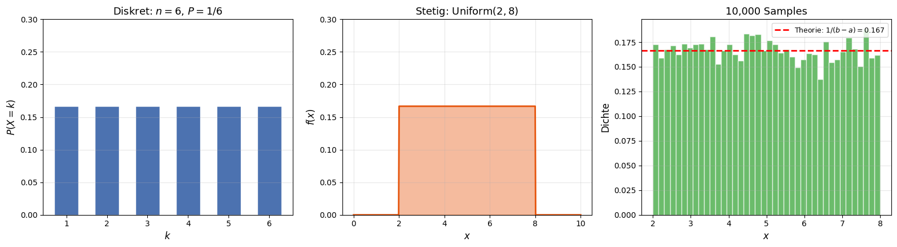
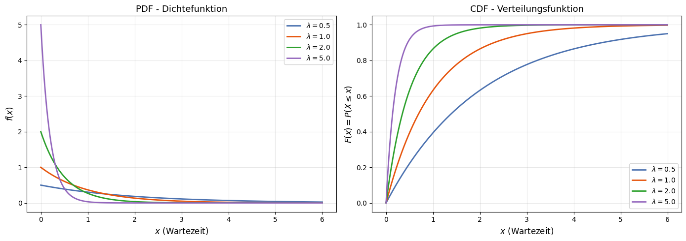
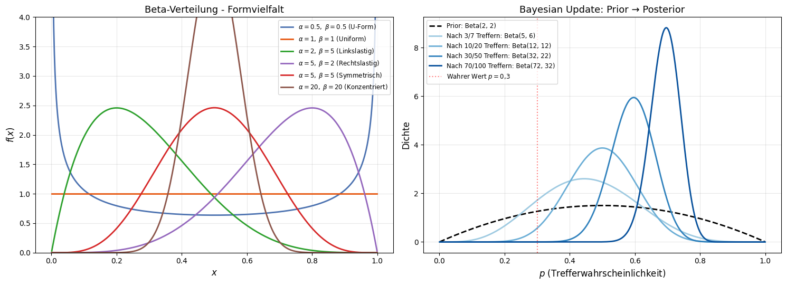
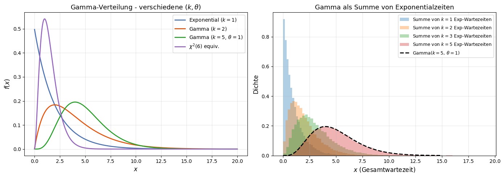
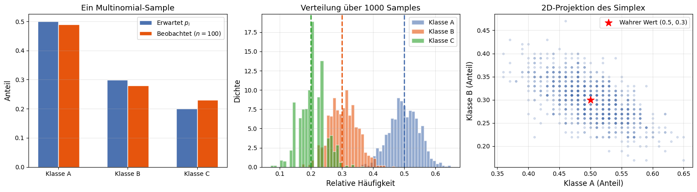
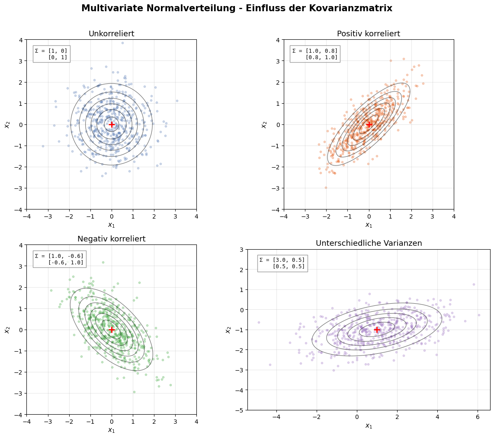
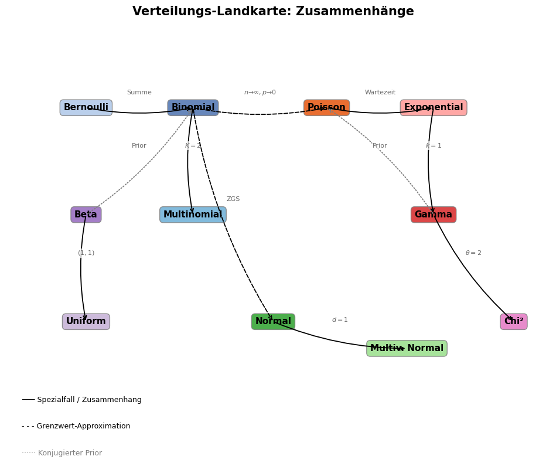

# Statistik und Wahrscheinlichkeit
## 05 - Verteilungen im ML-Kontext

Im vorigen Notebook haben wir die drei Grundverteilungen kennengelernt: Binomial, Normal und Poisson. Die decken vieles ab - aber in der Praxis (besonders im Machine Learning) stößt man schnell auf Situationen, die nach spezialisierteren Werkzeugen verlangen: Wie initialisiert man Gewichte? Wie modelliert man Wartezeiten? Was, wenn man nicht *eine* Wahrscheinlichkeit schätzt, sondern unsicher ist, *wie groß* diese Wahrscheinlichkeit überhaupt ist?

Dieses Notebook stellt sechs weitere Verteilungen vor, die genau solche Fragen beantworten. Jede davon löst ein konkretes Problem - und zusammen bilden sie ein Netzwerk, in dem die Verteilungen über Spezialfälle und Grenzwerte miteinander verbunden sind.

### Lernziele

- **Gleichverteilung** (Uniform) - die „wir wissen nichts"-Verteilung
- **Exponentialverteilung** - Wartezeiten mit Gedächtnislosigkeit
- **Beta-Verteilung** - Unsicherheit über Wahrscheinlichkeiten modellieren
- **Gamma-Verteilung** - die Exponentialverteilung verallgemeinert
- **Multinomialverteilung** - von zwei auf $K$ Kategorien
- **Multivariate Normalverteilung** - Gauß in mehreren Dimensionen
- **Verteilungs-Landkarte** - wie alles zusammenhängt

---

### 1. Gleichverteilung (Uniform)

Die einfachste Verteilung überhaupt: Jeder Wert ist gleich wahrscheinlich. Klingt trivial - ist aber das Fundament, auf dem fast alles andere aufbaut.

#### Diskrete Gleichverteilung

$$P(X = k) = \frac{1}{n} \qquad \text{für } k = 1, 2, \ldots, n$$

**Beispiel:** Ein fairer Würfel - jede Augenzahl hat Wahrscheinlichkeit $\frac{1}{6}$.

#### Stetige Gleichverteilung $\text{Uniform}(a, b)$

$$f(x) = \begin{cases} \frac{1}{b-a} & \text{für } a \leq x \leq b \\ 0 & \text{sonst} \end{cases}$$

$$E(X) = \frac{a+b}{2} \qquad \text{Var}(X) = \frac{(b-a)^2}{12}$$

Die Dichte ist schlicht ein Rechteck: alle Werte zwischen $a$ und $b$ sind gleich „dicht". Was macht das interessant?

Fast alle **Zufallszahlengeneratoren** starten intern mit $\text{Uniform}(0, 1)$. Andere Verteilungen werden daraus *transformiert* - die Gleichverteilung ist sozusagen der Rohstoff. Viele neuronale Netze initialisieren ihre Gewichte mit $\text{Uniform}(-c, c)$ (Xavier/Glorot-Initialisierung), und beim **Random Search** für Hyperparameter sampelt man ebenfalls uniform aus dem Suchraum. In der Bayes-Statistik drückt die Gleichverteilung „keine Vorinformation" aus - ein **uninformativer Prior**.

> Wann immer man sagt „ich weiss nichts, also verteile ich gleichmäßig", steckt die Uniform-Verteilung dahinter.

    

    

### 2. Exponentialverteilung

Stellen wir uns ein konkretes Szenario vor: Ein Server stürzt im Schnitt einmal pro Woche ab - völlig zufällig, ohne Vorwarnung. Die **Exponentialverteilung** modelliert genau solche **Wartezeiten** zwischen zufälligen Ereignissen. Sie ist das stetige Gegenstück zur geometrischen Verteilung.

#### Dichtefunktion

$$f(x) = \lambda \, e^{-\lambda x} \qquad \text{für } x \geq 0$$

$$E(X) = \frac{1}{\lambda} \qquad \text{Var}(X) = \frac{1}{\lambda^2}$$

Der Parameter $\lambda$ ist die **Rate** (Ereignisse pro Zeiteinheit). Je größer $\lambda$, desto kürzer die erwartete Wartezeit.

#### Gedächtnislosigkeit

Die zentrale (und zunächst kontraintuitive) Eigenschaft: Die verbleibende Wartezeit hängt *nicht* davon ab, wie lange man bereits gewartet hat:

$$P(X > s + t \mid X > s) = P(X > t)$$

Bei unserem Server: Ob er seit 3 Tagen oder seit 3 Wochen läuft - die Wahrscheinlichkeit eines Absturzes in der nächsten Stunde bleibt gleich. Das passt zu Prozessen ohne „Verschleiß" (radioaktiver Zerfall, spontane Ausfälle), aber natürlich nicht zu allem (Autoteile verschleißen sehr wohl).

#### Zusammenhang mit Poisson

Wenn Ereignisse poissonverteilt mit Rate $\lambda$ auftreten, dann ist die **Wartezeit** zwischen zwei aufeinanderfolgenden Ereignissen exponentialverteilt mit demselben $\lambda$. Die beiden Verteilungen sind zwei Seiten derselben Medaille: Poisson zählt *wie viele* Ereignisse, Exponential misst *wie lange* dazwischen.

In der Praxis taucht die Exponentialverteilung bei **Survival Analysis** (Überlebenszeiten), in **Queueing Theory** (Ankunftszeiten), und als Baustein der Gamma-Verteilung auf, die wir gleich kennenlernen.

    

    

### 3. Beta-Verteilung

Bisher haben unsere Verteilungen Daten modelliert: Würfelergebnisse, Wartezeiten, Häufigkeiten. Aber was, wenn man den **Parameter selbst** nicht kennt? Beispiel: Eine Website hat eine Conversion-Rate $p$ - aber wie groß $p$ genau ist, wissen wir noch nicht. Wir brauchen eine *Verteilung über Wahrscheinlichkeiten*.

Genau das leistet die **Beta-Verteilung**: Sie lebt auf dem Intervall $[0, 1]$ und kann mit nur zwei Parametern $\alpha > 0$ und $\beta > 0$ eine erstaunliche Formenvielfalt annehmen.

#### Dichtefunktion

$$f(x; \alpha, \beta) = \frac{x^{\alpha-1}(1-x)^{\beta-1}}{B(\alpha, \beta)} \qquad \text{für } 0 \leq x \leq 1$$

Der Nenner $B(\alpha, \beta)$ ist die **Beta-Funktion** - ein reiner Normierungsfaktor, der sicherstellt, dass die Dichte auf 1 integriert. Sie hängt mit der Gamma-Funktion zusammen: $B(\alpha, \beta) = \frac{\Gamma(\alpha)\,\Gamma(\beta)}{\Gamma(\alpha+\beta)}$. Die Parameter $\alpha$ und $\beta$ müssen lediglich positiv reell sein (keine komplexen Zahlen nötig - das wäre reine Funktionentheorie).

$$E(X) = \frac{\alpha}{\alpha + \beta} \qquad \text{Var}(X) = \frac{\alpha\beta}{(\alpha+\beta)^2(\alpha+\beta+1)}$$

#### Spezialfälle

| $\alpha$ | $\beta$ | Form | Entspricht |
|----------|---------|------|------------|
| $1$ | $1$ | Uniform | $\text{Uniform}(0,1)$ |
| $< 1$ | $< 1$ | U-Form | Extrem an den Rändern |
| $> 1$ | $> 1$ | Glocke | Konzentriert in der Mitte |
| $\alpha > \beta$ | | Rechtslastig | Hohe Werte wahrscheinlicher |
| $\alpha < \beta$ | | Linkslastig | Niedrige Werte wahrscheinlicher |

#### Konjugierter Prior: Was das heißt und warum es so elegant ist

Die Beta-Verteilung ist der **konjugierte Prior** der Binomialverteilung. Das bedeutet: Startet man mit einem Beta-Prior und beobachtet binomiale Daten, ist der Posterior *wieder* eine Beta-Verteilung:

$$\text{Prior: } \text{Beta}(\alpha, \beta) \;\;+\;\; k \text{ Treffer in } n \text{ Versuchen} \;\;\Rightarrow\;\; \text{Posterior: } \text{Beta}(\alpha + k,\; \beta + n - k)$$

Man addiert einfach Treffer und Nieten auf die bestehenden Parameter - kein Integral lösen, kein Rechner nötig. In der Praxis bedeutet das: Beim **A/B-Testing** startet man mit einem vagen Prior (z.B. $\text{Beta}(1,1)$ = „ich weiss nichts"), und nach jeder Beobachtung wird die Schätzung automatisch schärfer. Die rechte Grafik unten zeigt genau diesen Prozess.

    

    

### 4. Gamma-Verteilung

Die Exponentialverteilung modelliert die Wartezeit auf *ein* Ereignis. Was, wenn man auf das **$k$-te** warten muss - z.B. den dritten Serverausfall, oder den fünften Kundenanruf? Dann summiert man $k$ exponentialverteilte Wartezeiten, und heraus kommt die **Gamma-Verteilung**.

#### Dichtefunktion

$$f(x; k, \theta) = \frac{x^{k-1} \, e^{-x/\theta}}{\theta^k \, \Gamma(k)} \qquad \text{für } x > 0$$

Die **Gamma-Funktion** $\Gamma(k)$ im Nenner ist - wie bei der Beta-Verteilung - ein Normierungsfaktor. Für natürliche Zahlen gilt einfach $\Gamma(k) = (k-1)!$, aber $\Gamma$ verallgemeinert die Fakultät auf alle positiven reellen Zahlen.

$$E(X) = k\theta \qquad \text{Var}(X) = k\theta^2$$

Es gibt zwei gängige Parametrisierungen:
- **Shape-Scale**: $(k, \theta)$ - wie oben
- **Shape-Rate**: $(k, \beta)$ mit $\beta = 1/\theta$ - häufig in Bayesian-Literatur

#### Spezialfälle

Die Gamma-Verteilung ist eine regelrechte „Dachverteilung", unter der einiges versammelt ist:

| Parameter | Verteilung | Beschreibung |
|-----------|-----------|--------------|
| $k = 1$ | Exponential$(\lambda = 1/\theta)$ | Wartezeit auf *ein* Ereignis |
| $k = n/2,\; \theta = 2$ | $\chi^2(n)$ | Chi-Quadrat mit $n$ Freiheitsgraden |
| $k \in \mathbb{N}$ | Erlang$(k, \lambda)$ | Wartezeit auf $k$ Ereignisse |

Das rechte Diagramm unten demonstriert den Zusammenhang empirisch: Man sieht, wie die Summe von immer mehr Exponential-Wartezeiten exakt der theoretischen Gamma-Kurve entspricht.

Analog zur Beta-Verteilung ist die Gamma-Verteilung ebenfalls ein konjugierter Prior - diesmal für die **Poisson-Rate** $\lambda$ und die **Präzision** $\tau = 1/\sigma^2$ der Normalverteilung. In der Bayesian-Modellierung taucht sie deshalb überall dort auf, wo man Unsicherheit über Raten oder Varianzen ausdrücken will.

    

    

### 5. Multinomialverteilung

Die Binomialverteilung hat zwei Ausgänge: Treffer oder Niete. Aber was, wenn ein Würfel 6 Seiten hat? Oder ein Klassifikator 10 Klassen unterscheidet? Die **Multinomialverteilung** verallgemeinert die Binomialverteilung auf **$K$ Kategorien** mit Wahrscheinlichkeiten $p_1, \ldots, p_K$ (wobei $\sum p_i = 1$).

#### Formel

Bei $n$ unabhängigen Versuchen:

$$P(X_1 = x_1, \ldots, X_K = x_K) = \frac{n!}{x_1! \cdot x_2! \cdots x_K!} \cdot p_1^{x_1} \cdot p_2^{x_2} \cdots p_K^{x_K}$$

$$E(X_i) = n \cdot p_i \qquad \text{Var}(X_i) = n \cdot p_i \cdot (1 - p_i)$$

Schaut man sich nur *eine* der $K$ Komponenten an, ist $X_i \sim \text{Bin}(n, p_i)$ - die Marginalen sind binomialverteilt.

#### Warum das im ML zentral ist

Wenn ein Klassifikator über seine Softmax-Schicht die Wahrscheinlichkeiten $(p_1, \ldots, p_K)$ für $K$ Klassen ausgibt, ist ein einzelner Datenpunkt eine Multinomialverteilung mit $n = 1$ (auch **kategorische Verteilung** genannt). Der **Cross-Entropy Loss** $-\sum_i y_i \log(p_i)$, den man in fast jedem Klassifikationsproblem minimiert, ist nichts anderes als die negative Log-Likelihood der Multinomialverteilung.

Auch in der Textverarbeitung (NLP) begegnet man ihr: Bag-of-Words-Modelle behandeln Wortvorkommen als multinomialverteilt. Und der konjugierte Prior? Die **Dirichlet-Verteilung** - eine Verallgemeinerung der Beta-Verteilung auf den $K$-dimensionalen Simplex.

    

    

### 6. Multivariate Normalverteilung

Bisher waren alle Verteilungen eindimensional (oder diskret mehrdimensional wie die Multinomiale). Aber reale Datensätze haben fast immer **mehrere Features** - und die können korreliert sein. Die **multivariate Normalverteilung** verallgemeinert die Gauß-Glocke auf $d$ Dimensionen.

Statt $\mu$ und $\sigma^2$ hat man jetzt einen **Mittelwertvektor** $\boldsymbol{\mu} \in \mathbb{R}^d$ und eine **Kovarianzmatrix** $\boldsymbol{\Sigma} \in \mathbb{R}^{d \times d}$.

#### Dichtefunktion

$$f(\mathbf{x}) = \frac{1}{\sqrt{(2\pi)^d \det(\boldsymbol{\Sigma})}} \exp\!\left(-\frac{1}{2}(\mathbf{x} - \boldsymbol{\mu})^\top \boldsymbol{\Sigma}^{-1} (\mathbf{x} - \boldsymbol{\mu})\right)$$

Zwei Dinge fallen auf:

1. **$\det(\boldsymbol{\Sigma})$** - die **Determinante** der Kovarianzmatrix. Sie misst, wie viel „Volumen" die Verteilung einnimmt. Große Determinante → weit gestreut, niedriger Peak. Kleine Determinante → eng konzentriert, hoher Peak. Für eine $2 \times 2$-Matrix: $\det\begin{pmatrix} a & b \\ c & d \end{pmatrix} = ad - bc$.

2. **$(\mathbf{x} - \boldsymbol{\mu})^\top \boldsymbol{\Sigma}^{-1} (\mathbf{x} - \boldsymbol{\mu})$** - die **Mahalanobis-Distanz**. Sie misst den Abstand eines Punktes zum Mittelwert, aber *gewichtet nach der Kovarianzstruktur*. In Richtungen mit hoher Varianz „zählt" dieselbe Strecke weniger als in Richtungen mit niedriger Varianz.

#### Die Kovarianzmatrix $\Sigma$

Die Kovarianzmatrix codiert, wie die Dimensionen zusammenhängen:
- **Diagonale** $\Sigma_{ii} = \sigma_i^2$: Varianz der $i$-ten Dimension
- **Nebendiagonale** $\Sigma_{ij}$: Kovarianz zwischen Dimension $i$ und $j$
  - $> 0$: positiv korreliert (steigen gemeinsam)
  - $= 0$: unkorreliert (achsenparallele Ellipse)
  - $< 0$: negativ korreliert (gegenläufig)

Geometrisch formen die Konturlinien gleicher Dichte **Ellipsen**, deren Achsen und Orientierung durch die Eigenwerte und Eigenvektoren von $\Sigma$ bestimmt werden. Das sieht man gut in den vier Beispielen unten.

Die multivariate Normalverteilung steckt in vielen Algorithmen: **Gaussian Mixture Models** (jeder Cluster eine Gauß-Ellipse), **PCA** (Eigenvektoren der Kovarianzmatrix), **Variational Autoencoders** (Latent-Space als multivariate Normalverteilung) und **Gaussian Processes** (Verteilungen über ganze Funktionen).

    

    

### 7. Verteilungs-Landkarte

Alle Verteilungen aus diesem und dem vorigen Notebook bilden ein zusammenhängendes Netzwerk. Das Diagramm unten zeigt die drei Arten von Beziehungen:

#### Durchgezogene Linien - Spezialfälle
Verteilung A *ist* Verteilung B mit eingeschränkten Parametern. Man muss nicht jede neu lernen - versteht man die allgemeinere, hat man den Spezialfall gratis:

| Von → Zu | Was passiert |
|----------|-------------|
| Bernoulli → Binomial | Ein Bernoulli-Versuch ist Binomial mit $n=1$. Summiert man $n$ davon, entsteht Binomial. |
| Exponential → Gamma | Exponential ist Gamma mit $k=1$. Wartezeit auf ein vs. auf $k$ Ereignisse. |
| Gamma → Chi² | $\chi^2(n) = \text{Gamma}(n/2,\, 2)$ - taucht in Hypothesentests auf. |
| Beta $(1,1)$ → Uniform | Beta mit beiden Parametern auf 1 wird flach - „ich weiss nichts". |
| Normal → Multiv. Normal | Die 1D-Normalverteilung ist der Spezialfall $d=1$. |
| Binomial → Multinomial | Binomial hat 2 Ausgänge, Multinomial hat $K$. Bei $K=2$ sind sie identisch. |

#### Gestrichelte Linien - Grenzwerte
Verteilung A *nähert sich* Verteilung B unter bestimmten Bedingungen:

| Von → Zu | Bedingung |
|----------|-----------|
| Binomial → Poisson | $n \to \infty$, $p \to 0$, aber $np = \lambda$ konstant. Deshalb modelliert Poisson *seltene* Ereignisse. |
| Binomial → Normal | $n$ groß - der **Zentrale Grenzwertsatz** in Aktion. |

#### Gepunktete Linien - Konjugierte Priors
Verteilung A ist der „natürliche" Bayesian-Prior für Verteilung B. Der Posterior bleibt in derselben Familie:

| Prior → Likelihood | Bedeutung |
|-------------------|-----------|
| Beta → Binomial | Unsicherheit über $p$ modellieren. Nach Beobachtungen: Beta-Posterior mit schärferen Parametern. |
| Gamma → Poisson | Unsicherheit über die Rate $\lambda$. Gleiches Prinzip, gleiche Eleganz. |

#### Diskret vs. Stetig

| Diskrete Verteilungen | Stetige Verteilungen |
|----------------------|---------------------|
| Bernoulli, Binomial | Normal, Multivariate Normal |
| Poisson | Exponential, Gamma |
| Multinomial | Uniform, Beta |

---

    

    

## Zusammenfassung

| Verteilung | Typ | Parameter | $E(X)$ | $\text{Var}(X)$ | ML-Kontext |
|-----------|-----|-----------|--------|-----------------|------------|
| **Uniform** | stetig | $a, b$ | $\frac{a+b}{2}$ | $\frac{(b-a)^2}{12}$ | Init, Sampling, uninformativer Prior |
| **Exponential** | stetig | $\lambda$ | $\frac{1}{\lambda}$ | $\frac{1}{\lambda^2}$ | Wartezeiten, Survival, LR Decay |
| **Beta** | stetig | $\alpha, \beta$ | $\frac{\alpha}{\alpha+\beta}$ | $\frac{\alpha\beta}{(\alpha+\beta)^2(\alpha+\beta+1)}$ | Bayesian Priors, A/B-Testing |
| **Gamma** | stetig | $k, \theta$ | $k\theta$ | $k\theta^2$ | Priors für Raten/Varianzen |
| **Multinomial** | diskret | $n, \mathbf{p}$ | $np_i$ | $np_i(1-p_i)$ | Softmax, NLP, Cross-Entropy |
| **Multiv. Normal** | stetig | $\boldsymbol{\mu}, \boldsymbol{\Sigma}$ | $\boldsymbol{\mu}$ | $\text{diag}(\boldsymbol{\Sigma})$ | GMM, PCA, VAE, Gaussian Processes |

| Konzept | Kernaussage |
|---------|-------------|
| **Konjugierter Prior** | Prior und Posterior aus derselben Familie → einfaches Update |
| **Gedächtnislosigkeit** | Exponentialverteilung: Restwartezeit unabhängig von bisheriger Wartezeit |
| **Kovarianzmatrix** | Beschreibt Korrelationsstruktur → bestimmt Ellipsenform der Konturen |
| **Mahalanobis-Distanz** | Abstand unter Berücksichtigung der Kovarianzstruktur |
| **Simplex** | Multinomiale Wahrscheinlichkeiten leben auf dem $(K-1)$-Simplex |

---

## Glossar

| Deutsch | Englisch |
|---------|----------|
| Gleichverteilung | Uniform distribution |
| Exponentialverteilung | Exponential distribution |
| Beta-Verteilung | Beta distribution |
| Gamma-Verteilung | Gamma distribution |
| Multinomialverteilung | Multinomial distribution |
| Multivariate Normalverteilung | Multivariate normal distribution |
| Gedächtnislosigkeit | Memorylessness |
| Konjugierter Prior | Conjugate prior |
| Posterior | Posterior (distribution) |
| Kovarianzmatrix | Covariance matrix |
| Mahalanobis-Distanz | Mahalanobis distance |
| Simplex | Simplex |
| Dichtefunktion | Probability density function (PDF) |
| Formparameter | Shape parameter |
| Skalenparameter | Scale parameter |
| Ratenparameter | Rate parameter |
